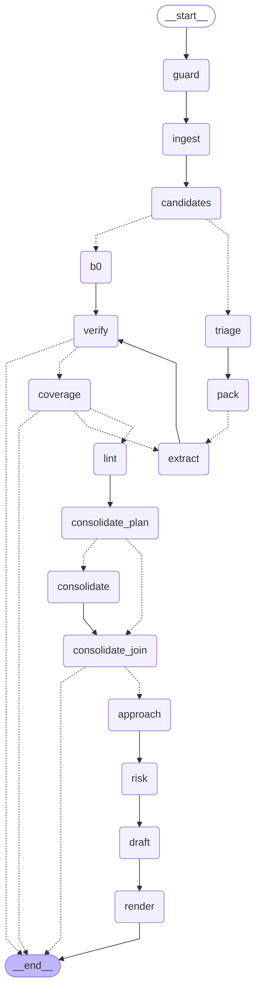

# Agents and LLM functions

<!-- Generated by scripts/gen_docs.py. Do not edit by hand; run the script. -->

What each LLM call in the current tag may do, from `config/agents.yaml`, `config/models.yaml` and the prompts' front matter. `ToolGateway` enforces the tool allowlists and limits.

## Roles

| Name | Kind | Input | Output | Prompt | Model role | Tools | Limits |
|---|---|---|---|---|---|---|---|
| `triage` | function | `TriageInput` | `TriageResult` | `triage@0.1.0` | extract | None | None |
| `extract` | function | `ExtractBatch` | `ExtractResult` | `extract@0.4.0` | extract | None | None |
| `approach` | function | `ApproachInput` | `ApproachResult` | `approach@0.2.0` | reason | None | None |
| `risk` | agent | `RiskInput` | `RiskRegister` | `risk@0.2.0` | reason | `search_rfp`, `date_calc` | max_turns 4, max_tool_calls 6, stop_on_no_progress True |
| `draft` | function | `DraftTask` | `DraftResult` | `draft@0.2.0` | reason | None | None |
| `consolidate` | function | `ClusterTask` | `ConsolidationResult` | `consolidate@0.1.0` | reason | None | None |

A function declares no limits: it makes one call and one repair, fixed in the node code, and with the second pass on, `extract` makes one more call per pack, with one format repair. An agent's limits bound its tool loop.

## Prompts

| Prompt | Version | Role | Pattern | Schema | Decoding | Last tested |
|---|---|---|---|---|---|---|
| `approach` | 0.2.0 | reason | Skeleton-of-Thought | `ApproachResult` | gemini: thinking medium; ollama: think False | 2026-11-04 |
| `consolidate` | 0.1.0 | reason | ordered steps in the task, positive directives | `ConsolidationResult` | gemini: thinking medium; ollama: think False | 2026-11-04 |
| `draft` | 0.2.0 | reason | CO-STAR with strict sourcing | `DraftResult` | gemini: thinking medium; ollama: think False | 2026-11-04 |
| `extract` | 0.4.0 | extract | plain rules and decision table, positive directives | `ExtractResult` | gemini: thinking medium; ollama: think False | 2026-11-04 |
| `extract_oneshot` | 0.4.0 | extract | plain instruction | `ExtractResult` | gemini: thinking medium; ollama: think False | never |
| `risk` | 0.2.0 | reason | Multi-Perspective pre-mortem in one call | `RiskRegister` | gemini: thinking low; ollama: think False | 2026-11-04 |
| `triage` | 0.1.0 | extract | plain rules and a zone table, positive directives | `TriageResult` | gemini: thinking low; ollama: think False | 2026-11-04 |

## Models by profile and role

| Profile | Role | Provider | Model | Fallback | Settings |
|---|---|---|---|---|---|
| `free` | extract | gemini | `gemini-3.5-flash-lite` | `gemini-3.1-flash-lite` | thinking medium |
| `free` | reason | gemini | `gemini-3.5-flash-lite` | `gemini-3.1-flash-lite` | thinking low |
| `paid` | extract | gemini | `gemini-3.5-flash-lite` | `gemini-3.1-flash-lite` | thinking medium |
| `paid` | reason | gemini | `gemini-3.5-flash-lite` | `gemini-3.1-flash-lite` | thinking low |
| `local` | extract | ollama | `qwen3.5:4b` | `qwen3.5:2b` | num_ctx 16384, think False |
| `local` | reason | ollama | `qwen3.5:4b` | `qwen3.5:2b` | num_ctx 16384, think False |

## Tools

| Tool | Description | Arguments |
|---|---|---|
| `search_rfp` | Search the RFP's passages by words, such as 'go-live migration deadline'. A requirement id such as REQ-0003 returns the passages that requirement quotes. Returns up to k passages, best first, each with its SRC id, section path and text. | `query`; `k` (optional) |
| `date_calc` | Date arithmetic. add or subtract an amount of days, business_days, weeks or months; diff counts days or business days from date to other_date; weekday names the day. With tz, times are read and returned in that IANA time zone. | `date`; `op`; `amount` (optional); `unit` (optional); `tz` (optional); `other_date` (optional) |

## Runtime graph

Drawn from the compiled LangGraph graph. The dotted edges are conditional: the `Send` fan-outs, one `extract` worker per pack and one `consolidate` worker per cluster the model step takes, and the stops that `until` and `--baseline b0` choose.

