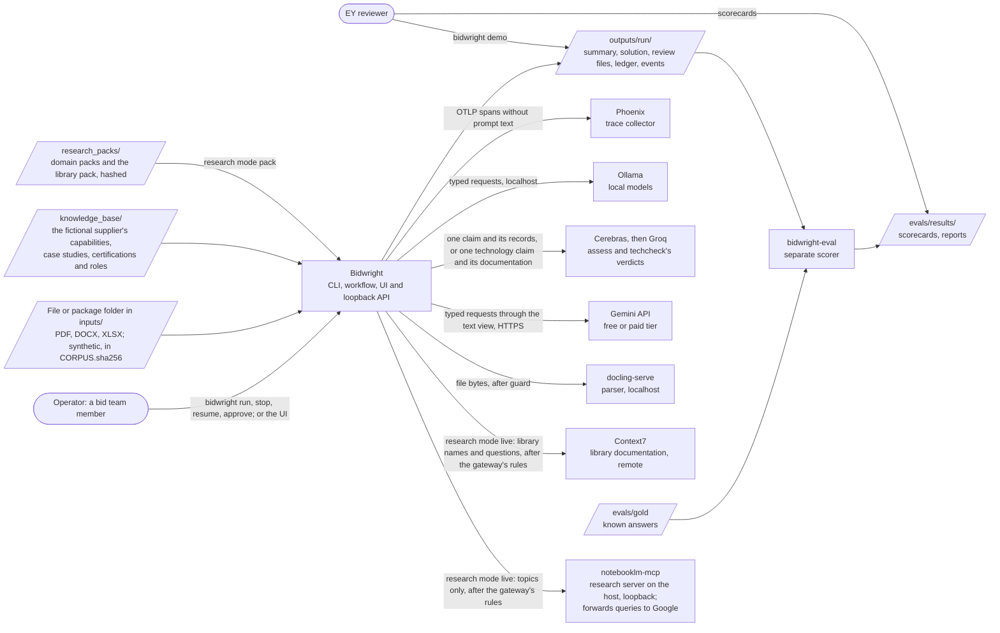
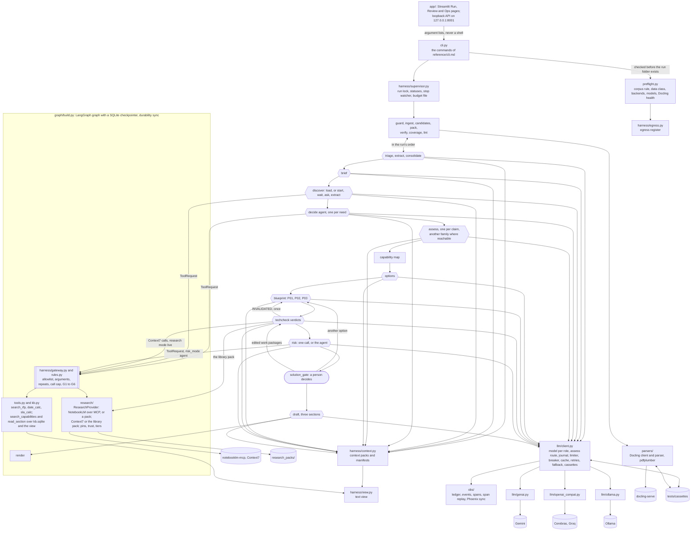
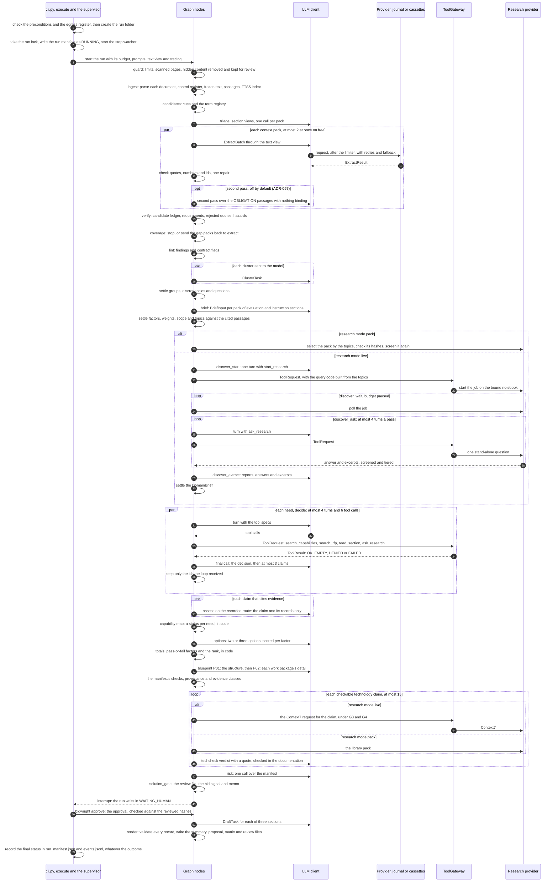

# Architecture

This document describes Bidwright as built in Iteration 3, for the tag `v0.3`, under the twelve arc42 headings. `v0.2` read a whole RFP package, with run control, the gateway's rules and research on the RFP's domain. Iteration 3 adds the solution path:

1. For each need, an agent, `decide`, chooses how to answer it and drafts claims from the supplier's knowledge base.
2. An assessor, `assess`, checks each claim against its evidence, on another model family where one can be reached.
3. Code builds the capability map, each need's status.
4. `options` proposes two or three solutions, which code ranks, and `blueprint` turns the chosen one into a sourced solution manifest.
5. `techcheck` checks the manifest's technology claims against current documentation.
6. `risk` writes a pre-mortem over the manifest.
7. A person approves the manifest at a gate before anything is drafted from it.

A Streamlit UI and a loopback API show a run's files and decide the gate. This document describes what is built; planned work appears where it explains a gap. The work still to come lives in [section 10 of `context/Master-Plan.md`](../context/Master-Plan.md#10-full-vision); the build plans are [`designs/iteration-1.md`](designs/iteration-1.md), [`designs/iteration-2.md`](designs/iteration-2.md) and [`designs/iteration-3.md`](designs/iteration-3.md). Where another file owns a detail, the section links it.

## 0. How this architecture is described

The method has six steps, combining arc42, C4 and ADRs. It was reviewed against the literature (DR-19 in [`context/Research-Register.md`](../context/Research-Register.md)) and not refuted, which is not proof; the register lists the seven changes that review made.

| Step | What it produces | Where |
|---|---|---|
| 1. Concerns | Quality scenarios: invariants, checked on every run, and statistical scenarios, measured over repeats | Section 10 |
| 2. Views | C4 Context and Container, an agent view, one run, and deployment. The container view marks LLM calls, the gateway every tool call passes and the human gate; the agent view gives each role's tools; the deployment view is a table. | Sections 3, 5, 6 and 7 |
| 3. Boundaries | A contract in code wherever LLM output meets code | Section 5.4 |
| 4. Decisions | Short ADRs | Section 9 and [`DECISIONS.md`](../DECISIONS.md) |
| 5. Threats and governance | Trust boundaries and controls mapped to the OWASP lists; roles, the trust layer, NIST AI RMF and sensitive information; the AI bill of materials | [`security.md`](security.md), [`governance.md`](governance.md), [`ai-bom.md`](ai-bom.md) |
| 6. Conformance | Fitness functions in CI; behavior in the evaluation harness | Section 8.7 and [`evaluation.md`](evaluation.md) |

## 1. Introduction and goals

### 1.1 What the system does

The assignment asks for an LLM application that reads an RFP and produces a structured solution summary of requirements, approach and risks. It must be what the assignment calls "a genuine agentic workflow", with an evaluation harness and tracing of tokens, latency and cost. At `v0.3`, Bidwright reads one file or a package folder of PDF, DOCX and XLSX documents, such as an RFP with its addendum and annex, and writes:
- `solution_summary.md` and its JSON form: submission hazards first, then requirements with verified quotes and the evaluation factors as the RFP states them, approach items (the manifest's workstreams, each with the requirements it answers), risks and open questions, and, when research found anything, an appendix of domain research marked external and unverified;
- `proposal.md`: three short sections (`understanding`, `approach` and `risks_and_assumptions`) drafted from those records;
- the compliance matrix (`compliance_matrix.xlsx` and `.csv`), `clarification_questions.md`, `submission_checklist.md`, and `review/quarantine.md`, which shows a person the hidden content removed before parsing, the small print kept, and the passages that read like instructions to a model;
- the records behind them: the control register of the package's documents, a disposition for every passage, requirement groups, discrepancies, contract flags and lint findings;
- `brief.json`, the opportunity brief: evaluation factors with their weights and scoring method, needs, scope and constraints, each citing passages, and the research topics; and `domain_brief.json` and `research.json`, the domain research and its record, from a committed research pack or a live research job;
- the solution: `decisions.jsonl` and `claims.jsonl`, each need's decision and the claims drafted for it; `assessments.jsonl`, each claim's disposition against its evidence; `capability_map.json`, each need's status; `options.json`, one to three options with their scores, reasons and ranking; `manifest.json`, the solution manifest, every fact with its evidence class and sources; `tech_validations.jsonl`, each technology claim's verdict; `bid_signal.json` and `bid_memo.md`; and `review/solution_gate.md` with `review/solution_gate.approval.yaml`, what a person reviewed and decided at the gate;
- `ledger.jsonl`, `run_manifest.json`, `events.jsonl` and `tool_calls.jsonl`: every LLM call's tokens, latency and cost, the run's status history, totals and data class, every status change, recovery and security event, and every tool call with its result; and `dead_letter.jsonl` when an `extract` pack is rejected after its repair or a `consolidate` cluster falls back to code.

An operator can stop a run with `bidwright stop` and continue it with `bidwright resume`, which never pays twice for a call that was answered. A run waits at the solution gate, in `WAITING_HUMAN`, until a person decides it with `bidwright approve` or on the UI's Review page; `--auto-select` approves the top-ranked option for tests, matrices, recordings and the committed sample, and records that it did (section 8.4). Every output carries the status `UNREVIEWED_DRAFT`.

A bid team's problem is that one missed mandatory clause can disqualify a bid, and an overstated compliance claim creates liability. Bidwright answers the first with a disposition for every passage and requirements whose quotes code has checked, and the second with claims that an assessor checks against their evidence, on another model family wherever one can be reached (a client run and a `local` run assess with the generator's family, and each such assessment is flagged `SAME_FAMILY`), a manifest that asserts a capability only by citing an assessed claim, drafts that people approve and a compliance status that starts `UNVERIFIED`.

### 1.2 Quality goals

In priority order. Section 10 states each one as a measurable scenario.

| Priority | Goal | Scenarios |
|---|---|---|
| 1 | Functional correctness: no mandatory requirement missed, and every requirement traced to a quote that code has checked | QS-1, QS-2, QS-8 |
| 2 | Security: tools are authorized outside the model, hidden content never reaches a model, and document text is never treated as an instruction | QS-3, QS-4 |
| 3 | Transparency: an unsupported claim is marked, never asserted, and every number traces to a run | QS-5 |
| 4 | Controllability: people decide, and a run stops or waits when it should | QS-6 |
| 5 | Recoverability: provider faults are retried and failed over, and a resumed run never pays twice for an answered call | QS-7 |

Quote verification protects grounding: a requirement's quote is in the RFP. It does not protect the mandatory count: a clause the model labels `BACKGROUND`, `NOT_BINDING` or `OUT_OF_SCOPE` is a miss, which QS-2 measures and the evaluation funnel charges to the stage that lost it.

The scenarios cover the requirements of the assignment's output, not its approach or its risks. The ladders measured both with no threshold: the manifest maps a median of 65% of the hero's binding requirements to work packages, and no risk setting found more than 2 of the hero's 6 risk seeds (section 11). The Iteration 4 design adds a scenario for each, QS-9 and QS-10 (CH-109).

### 1.3 Stakeholders

| Stakeholder | Needs from the architecture |
|---|---|
| The EY reviewers | The assignment's required items, visible and runnable without keys; trade-offs they can question |
| The owner | Sole approver of scope and decisions; a design the owner can explain and change live |
| The bid team Bidwright serves, fictional here | A summary they can trust line by line, and drafts they can edit |
| Coding agents, Claude among them | Commands and boundaries, in [`AGENTS.md`](../AGENTS.md) |

### 1.4 Not in `v0.3`

The product's non-goals, among them pricing, win probability, submission, real client data, training and production concerns, are in section 1.4 of [`context/Master-Plan.md`](../context/Master-Plan.md#14-non-goals). Not built in `v0.3`:
- the proposal pack and the final review gate (Iteration 4): `draft` still writes three short sections, now from the manifest's workstreams;
- judges and their calibration on the owner's labels (Iteration 5);
- an `ExecutionPolicy` class and versioned artifacts, which wait for their first consumers (ADR-037);
- a program that uses the loopback API: the API is built and served with the UI, and ADR-051 removes it at release if no program uses it by then;
- OCR: a scanned file is reported, and its pages are not parsed;

Built and off:
- the method cards: built, with a slot in the context manager, and off, because no family passed S-12 (ADR-055);
- the gated `reflect` tool: built behind the gateway's sixth rule, and off, because neither SO1-T nor RK1-T showed a gain (ADR-058, ADR-059);
- the `risk` agent's tool loop: built and kept behind `risk_mode: agent`; the default is one call over the manifest, because the RK ladder did not show the loop finding more risk seeds (ADR-059);
- the bid signal's rules: built, and `UNDETERMINED` in every committed run, since none was given a bid policy; `test_bid_signal.py` exercises the policy path;

Client documents follow the rule in section 2.

The code of each setting the ladders turned off, including the solution modes other than `manifest`, stays behind its switch, under the keep-or-drop rule in [section 10.9 of `context/Master-Plan.md`](../context/Master-Plan.md#109-evaluation-design): Iteration 5's full ladders and Iteration 6's local comparison run those settings again.

## 2. Constraints

| Kind | Constraint |
|---|---|
| Assignment | Synthetic RFPs only: no real tender or client document enters the repository, a prompt or a test. The deliverables include `DECISIONS.md`, [`ASSUMPTIONS.md`](../ASSUMPTIONS.md), rough timings and a demo of 3 to 5 minutes. |
| Models | Free tiers first. The owner's AI Studio limits, read 2026-11-02: 20 requests a day on `gemini-3.8-flash`, 500 on `gemini-3.5-flash-lite` (ADR-003). Free-tier prompts may be used by the provider to improve its products, so `free` runs on the synthetic corpus. `assess` and `techcheck`'s verdicts run on Cerebras `gpt-oss-120b`, whose trial credits run until 2026-12-03, with Groq's copy of the same model as the second route and the `reason` role's model as the third, one route chosen a run, flagged `SAME_FAMILY` (ADR-045). The paid budget is $40 for Iterations 2 and 3 (D-01), of which about $4.40 was spent by the Iteration 3 exit. |
| Client documents | A run on a file outside the corpus has the data class `client`, and the egress register lets it reach local destinations only (ADR-026). So it runs on `local`. On `free`, the consent override `--allow-non-corpus=i-accept-free-tier-terms` lets it reach Gemini's free tier, the one remote destination the override opens, and records the consent; the owner's decision D-05 keeps this override and accepts its conflict with the free tier's terms as a risk. On `paid` the register refuses it, since Gemini is remote. A client document must sit under `BIDWRIGHT_CLIENT_ROOT`, a folder outside the repository, or `guard` ends the run `POLICY_BLOCKED`. Research mode `live` is refused on any client run, and `techcheck` then reads the library pack. |
| Machine | The build laptop, a Windows machine whose 4 GB GPU the local models exceed, so Ollama runs mostly on CPU (V-06 in [`verification_log.md`](verification_log.md)). Ollama cuts a prompt longer than `num_ctx` silently (S-14), so the adapter fails a call whose evaluated prompt comes within 64 tokens of `num_ctx`. |
| Parsing | `docling-serve`, a 5 GB image, parses PDF, DOCX and XLSX for live runs; replays and tests read recorded Docling responses and need no service. |
| Research | Research mode `live` needs the owner's NotebookLM login, a cookie-based login on a personal Google account, and the `notebooklm-mcp` server running on the host, bound to loopback; it is allowed on synthetic runs only, and a client run with research mode `live` is refused (section 3.1). Research mode `pack`, the default, needs neither. `techcheck` reads Context7's remote server in research mode `live`, and the committed library pack in `pack`. |
| Toolchain | Python 3.12 and uv; ruff, pyright and pytest; GitHub Actions on a private repository |
| Conventions | Keys only in `.env`; ISO 8601 dates; one writer per output file; a design change needs an ADR |

## 3. Context and scope

### 3.1 Business and technical context

Rounded nodes are people, slanted ones are files and folders, and rectangles are Bidwright and the services it calls; the table gives each interface's form.

| Interface | Direction | Form |
|---|---|---|
| RFP input | In | One file or a folder under `inputs/`: PDF, DOCX or XLSX, with an optional `package.yaml` naming roles and precedence. On `free`, every file's sha256 must be listed in `inputs/CORPUS.sha256`, or the run is started with `--allow-non-corpus=i-accept-free-tier-terms`, which the run manifest records beside the data class `client` (ADR-026). The run entry checks the rule before the run folder exists. |
| Knowledge base | In | `knowledge_base/capabilities/`: the fictional supplier's capabilities, case studies, certifications and roles, in YAML, indexed once a run as `kb.sqlite` for `search_capabilities`. It is the only source of capability evidence. |
| Docling | Out | HTTP to `DOCLING_URL` (`http://localhost:5001` on the host, `http://docling:5001` in Compose), after `guard` has sanitized the file; only for live and record runs |
| Gemini | Out | The native `google-genai` SDK (ADR-001), with `GEMINI_API_KEY`, or `GEMINI_PAID_API_KEY` on the `paid` profile, from `.env` |
| Cerebras and Groq | Out | The OpenAI-compatible endpoints `https://api.cerebras.ai/v1` and `https://api.groq.com/openai/v1`, with `CEREBRAS_API_KEY` and `GROQ_API_KEY` from `.env`, for the `assess` role only. The route is chosen once a run from the backends present and recorded in the run manifest, so a resume or a replay uses the same one (ADR-045). |
| Ollama | Out | HTTP to `OLLAMA_HOST`: `http://localhost:11434` on the host and `http://ollama:11434` in Compose, or `http://host.docker.internal:11434` from Compose for the host's own Ollama |
| Phoenix | Out | OTLP over HTTP to `PHOENIX_ENDPOINT` when it is set, answers and is allowed for the run's data class; spans always go to `outputs/<run>/spans.jsonl` as well, which `bidwright phoenix sync` or the UI replays into the local Phoenix later |
| NotebookLM | Out | MCP over streamable HTTP to `NOTEBOOKLM_MCP_URL` (`http://127.0.0.1:8000/mcp` on the host, `http://host.docker.internal:8000/mcp` from Compose), only in research mode `live`. The server's name, version and six allowed tools must match `config/mcp_pins.yaml`, or no tool of it is used (FI-11). The server forwards every query to Google, so the egress register treats it as remote whatever its host, and a client run with research mode `live` is refused at the run entry. |
| Context7 | Out | MCP over streamable HTTP to `mcp.context7.com`, only in research mode `live`, for `techcheck`: code calls its two tools, pinned like NotebookLM's, with a library name and a question built from one technology claim, never RFP text (G3) |
| Research packs | In | `research_packs/<domain>/`: a manifest of hashes, sources with URLs and authority tiers, excerpts of at most 300 characters, the recorded `DomainBrief` and answers (ADR-033). `research_packs/libraries/` is the library pack `techcheck` reads in research mode `pack`: recorded documentation excerpts for the libraries the knowledge base and the corpus name (ADR-044). A pack whose files do not match its hashes is refused. `bidwright research pack` builds a domain pack from a live run or a NotebookLM job, and `bidwright research libraries` the library pack from Context7, both on the host. |
| Egress register | Check | `config/egress.yaml` lists every destination, its hosts, whether it is local and what it may receive. Before a run, each backend, the trace endpoint, the parser and, in research mode `live`, the research and documentation servers are checked against it and the data class; a client run reaches no remote destination except through the consent override (ADR-026). |
| Run control | In | `bidwright stop <run>` writes `control/stop.request`, which the supervisor reads once a second; `bidwright resume <run>` continues a stopped, paused, killed or budget-stopped run under its lock, `control/run.lock` |
| Gate decision | In | `bidwright approve <run> --role ROLE` with `--edit FILE`, `--option OPT-n`, `--override REASON` or `--reject REASON`, or the same command run by the UI's Review page; it builds an approval in ADR-035's format and resumes the run, whose gate checks it and writes `review/solution_gate.approval.yaml` (ADR-046) |
| UI and API | In and out | `bidwright ui` serves the Streamlit pages on `127.0.0.1:8501`, and `--api` the loopback API on `127.0.0.1:8001` (ADR-050, ADR-051); both read run folders, the pages run the CLI as a subprocess and the API calls the CLI's functions, and neither writes a run file itself |
| Run folder | Out | `outputs/<run>/`, gitignored; `bidwright purge` deletes a run, its journal and its cache entries, refuses a run whose lock is held, and `--expired` deletes every client run past the retention period |
| Evaluation | Read only | `bidwright-eval` reads finished run folders and the gold, and writes `evals/results/` |

### 3.2 The LLM boundary

Everything a model writes crosses one boundary. Code sends a typed request built from a schema and receives text that must parse into a schema, and an acceptance check in code then decides what reaches the graph's state. The model never sees character offsets, never chooses the next step, and never runs a tool itself. Everything a model reads from the RFP passes one seam, the text view (ADR-026): context packs, section views, cluster tasks, brief tasks and search results are built from `TextView.text`, and stored records keep the frozen text. At `v0.3` the view is `IdentityView`, which shows the frozen text with line breaks as spaces; a masking view replaces it in Iteration 5. The `discover` model sees no RFP passage at all: its only input from the RFP is the brief's topics, which code checks, and everything it reads back from research is screened, tiered and tagged `EXTERNAL_RESEARCH` (section 8.1). Section 8.1 lists what each call sees; an `assess` call never sees the generator's reasoning. A capability reaches the manifest only through a claim that `assess` judged against its records. `assess` runs on another model family when Cerebras or Groq can be reached; a client run, which reaches no remote destination, and a `local` run assess with the generator's own family, and every such assessment is flagged `SAME_FAMILY`. Section 5.4 lists the contract for each call.

## 4. Solution strategy

The design rests on one principle: a deterministic shell around a probabilistic core. Code checks what code can check (files, quotes, numbers, ids, schemas, allowlists, budgets, closure and weights), and the LLM does only the judgment and generation that code cannot, inside those checks (ADR-005).

Each row's ADRs give the full reasoning; [the index in `DECISIONS.md`](../DECISIONS.md#adrs) lists them.

| Goal | Strategy at `v0.3` | Instead of, and why not | ADR |
|---|---|---|---|
| Every requirement traceable | Each document becomes passages with ids and offsets into one frozen text. The model cites passage ids and copies a quote, and code checks the quote and every number and date in the statement. | Offsets or citations emitted by the model, which models get wrong | ADR-006 |
| No obligation silently dropped | Every passage reaches `extract` in a context pack and gets a disposition; cues and zones are hints; `coverage` re-reads the gaps | A cue filter in front of the model, which drops obligations phrased without a cue | ADR-017, ADR-018 |
| Hidden text never reaches a model | `guard` scans the raw files, removes hidden content from the copy that is parsed, and lists it for review | Screening the parsed text, which published detectors found the weaker design, or delimiters alone, whose effect varies by model | ADR-010, ADR-020 |
| Linked requirements read together | Code clusters requirements by section, reference and wording; one `consolidate` call per cluster | One call over all requirements, whose recall of cross-references falls with distance, or none, which leaves conflicts unread | ADR-019 |
| Agentic, yet testable | A LangGraph graph routes the run, with no LLM choosing the next step. `decide` is a tool-using agent, one per need, in every run, and `discover` in research mode `live`; `risk`'s agent loop is built and off by default. Single-call functions elsewhere. Code waits for a research job; no model polls it. | An LLM choosing the next step, or CrewAI's role-led autonomy, either of which makes a run hard to test, resume and audit | ADR-005, ADR-036, ADR-039 |
| No capability asserted without evidence | Each claim cites knowledge-base records its own loop retrieved; `assess` judges entailment, on another model family where one can be reached (on a client run and on `local`, the generator's own model, flagged `SAME_FAMILY`, accepted until a local assessor of another family exists; section 11), over those records only, after code's pre-checks, and a claim with no evidence is `UNVERIFIED` in code with no call; the capability map's status is code; the manifest asserts a capability only by citing an assessed claim | The generator judging its own claim, whose errors it shares, or a scored judge, which the owner's 40 labels cannot yet calibrate | ADR-040, ADR-045 |
| A reproducible choice of solution | The model proposes two or three options, the simplest as the baseline, and scores each 0 to 4 per in-scope factor with a reason; code applies the RFP's weights, the pass-or-fail rule and the tie-breaks, so the ranking reproduces from the logged scores | A ranking the model writes, which cannot be reproduced or checked against the RFP's weights | ADR-041 |
| A solution traced to requirements and evidence | `blueprint` in two calls, the structure and then each work package's detail; code checks the tree, the 100% rule, the backward trace, provenance, the effort's basis and the absence of prices and invented dates, and a fact with no source becomes an assumption | One free-text approach, which no check can trace to requirements and evidence | ADR-043 |
| Technology claims checked | `techcheck` judges each library claim against current documentation, from Context7 or the committed library pack, with a quote that must be found in it; an `INVALIDATED` claim sends the manifest back once, then blocks the gate | Trusting the model's knowledge of libraries, which dates with its training | ADR-044 |
| People decide the solution | Every run whose blueprint succeeds stops at `solution_gate`, which waits in `WAITING_HUMAN` and shows the options, the capability map, the manifest, the verdicts and the risks; the approval names a role, the hashes of what was reviewed, and edits within a fixed list of fields | Automatic approval, which leaves the choice of solution to a model | ADR-035, ADR-046, ADR-060 |
| Steps measured before they stay | Three ladders of 5 repeats a rung, each rung against the last one kept. SO3, the manifest rung, was kept because it claimed none of the seeded gaps, and it carries `decide` and `assess`, which were dropped as rungs of their own: `decide`'s loop took 75 requests where the fixed-retrieval control took 27, with the same results, and `assess` stays as an honesty control, the floor ADR-048 sets. The loop stays because the manifest path is built on it, and no rung tried fixed retrieval feeding `assess` and the manifest; it is also the one agent a default run has. Section 11 lists the cost. The EX ladder's rule kept EX1; ADR-057 made EX3 the default, for the dispositions and zones the ladder's metric does not count. The risk agent, `reflect` and the second pass default off, since their rungs showed no gain. Research and `techcheck` run with no rung yet: SO4 and SO5 measure them in Iteration 5, and `techcheck` failed its own seed rule | Adding every planned step, or keeping one on assertion, which spends calls on steps that add nothing | ADR-048, ADR-054, ADR-056 to ADR-059 |
| No unauthorized action | Every tool call passes `ToolGateway` before it runs: four checks (the allowlist, the arguments, repeats and the call cap) and six rules, each a trigger, a check and an outcome. Code binds every notebook and job id, so the model never names one. | Allowlists alone, which cannot check arguments or run state, or safety instructions in the prompt, which injected text can override | ADR-009, ADR-032, ADR-047 |
| Stoppable and resumable | A supervisor drains the graph between steps on a stop request, a journal keeps every answered call, the ledger and the budget's counts are written as they change, and a run lock tells a killed run from a running one | Rerunning a stopped run from the start, which pays every call again, or stop checks in every node, which each new node must remember | ADR-031 |
| Domain research without leaking the RFP | Queries are built from the brief's topics, never from passages; a gateway rule denies any query sharing 8 consecutive words with a passage; recorded research packs by default, a live job only on request; `decide`'s research questions are answered from the research the run already holds. A live run researches the topics of the RFP in hand, and `bidwright research pack` turns a live run or a NotebookLM job into a pack for later runs; SO4, in Iteration 5, measures whether research in the run shows a gain (ADR-036) | Queries written from RFP text, which could carry it to the research provider, or live research on every run, which needs a personal login and minutes of waiting | ADR-032, ADR-033, ADR-036 |
| Research treated as untrusted | Every excerpt, answer and report paragraph is screened as passages are; a source that reads like a published solicitation is left out; each source gets an authority tier by host; an item resting only on tier-4 sources, or sharing no word with its excerpts, is dropped; research is never capability evidence | Trusting what the research tool returns, which can be injected or off the subject | ADR-033, ADR-038 |
| Client documents protected | A data class per run, an egress register that counts the research and documentation servers as remote, the text view and a retention period | Trusting each call site, where one missed check sends a document out | ADR-026 |
| The assignment's output first | The solution summary is the first output every run lists, written by `render` at the end of the run | The summary alone, which leaves out what a bid team needs next, or a pack without it, which drops the assignment's output | ADR-007 |
| Nothing submitted; every output a draft | `DRAFT_ONLY`: nothing is submitted, every output is `UNREVIEWED_DRAFT`, and compliance starts `UNVERIFIED` | A fully automatic pipeline, in which no person is accountable for what is sent | ADR-008, ADR-021 |
| Runs without keys | Recorded LLM and Docling cassettes replay a whole run, the solution path and its gate included; the host path needs no Docker | Live calls in every test, which need keys, spend quota and vary between runs | ADR-016 |
| Measured, not asserted | A separate evaluation package with a funnel, seed scores and a regression gate; a ledger entry per call and spans per step | A judged-metric framework, whose generic metrics do not fit scoring against gold clauses | ADR-014, ADR-015 |
| Fits the free tier | Flash-Lite for both Gemini roles on `free`; Cerebras's trial for `assess`; a limiter on each model's per-minute limits and, on `paid`, its daily limit, while Google's own daily 429 decides on `free`; a circuit breaker per model and per server; a response cache for repeats; no thinking on `local` | Flash for `reason`, whose 20 free requests a day cannot finish a run; thinking on for `local`, which timed every `reason` call out on this machine; a local daily cap on `free`, which trusts a local count over Google's | ADR-003, ADR-004, ADR-029 |
| One interface for people | The Streamlit pages and the loopback API read run folders and act through the same CLI a person types: the pages run it, and the API calls its functions | A second code path for the UI, which could act differently from the CLI | ADR-050, ADR-051, ADR-053 |

The workflow follows three phases: requirements and reality (`guard` to `consolidate`), engineering and evidence (`brief`, research, `decide`, `assess`, the capability map, `options`, `blueprint`, `techcheck`, `risk` and `solution_gate`), and proposal (`draft`, `render`). Of the planned control plane, `v0.3` has the run supervisor with stop and resume, the tool gateway with its rules, recovery (the circuit breaker and the dead-letter file), the events log, the run budget, the limiter, the checkpointer, which writes each step's state to `checkpoints.sqlite` for `resume` to read, and the first human gate. Two planned components still wait for their consumers (ADR-037): an `ExecutionPolicy` class, since `config.py` already validates `config/agents.yaml` and the nodes read it, and versioned artifacts, for Iteration 4's `repair`. The context manager's slot for method cards exists and is empty, since no family is on.

## 5. Building block view

### 5.1 Containers

Hexagons make LLM calls through the client, the rounded node is the human gate, and the double-edged node is `ToolGateway`, which every tool call passes. Everything else is code with no LLM.

### 5.2 Modules

| Module | Responsibility | Tested by |
|---|---|---|
| `cli.py` | The commands [`reference/cli.md`](reference/cli.md) lists, generated from the parser: running, recording and replaying runs, run control and the gate, review and purge, seeds and matrices, research packs and pins, the UI, the API and span replay; prints what the run entry refuses; `approve` builds an approval from its flags and refuses edits the reviewed manifest cannot take | `test_cli.py`, `test_purge.py`, `test_matrix.py`, `test_seed.py`, `test_review.py` |
| `preflight.py` | The run entry's preconditions: the corpus rule per file, the data class and package id, a backend per provider, the local models, Docling's health | `test_preflight.py`, `test_corpus_rule.py` |
| `config.py` | Loads and validates `config/*.yaml` with `yaml.safe_load` and Pydantic | `test_config.py` |
| `schemas.py` | Every record and every model-facing request and response, in [`reference/schemas.md`](reference/schemas.md) | `test_schemas.py` |
| `harness/supervisor.py` | `RunSupervisor`: the run lock, the run manifest as its only writer, every status in `status_history` and `events.jsonl`, the stop watcher that drains the graph, the budget's counts in `control/budget.json`, and a resume's refusals; on a resume, the line files a kill may have cut are repaired before anything appends | `test_supervisor.py`, `test_resume.py` |
| `harness/recovery.py` | The circuit breaker per model and tier and per MCP server, kept in `outputs/.quota/breaker/`; the dead-letter file | `test_recovery.py` |
| `harness/rules.py`, `harness/reflect.py` | The gateway's rules G1 to G6, each a trigger, a check and an outcome; G3 and G4 also cover Context7's tools; G6 offers `reflect` only after a failure signal; the `reflect` tool over the pinned sequential-thinking server on stdio | `test_gateway.py`, `test_reflect.py` |
| `harness/context.py`, `harness/view.py` | Context packs within budget, with neighbors, lead-ins and terms, and their manifests; the text view | `test_context.py`, `test_text_view.py` |
| `harness/gateway.py`, `harness/budget.py` | `ToolGateway` and `tool_calls.jsonl`; per-run limits on requests, tokens and active time, checked before each provider attempt, paused while code waits for a research job, and raised by `resume --raise-budget` | `test_gateway.py`, `test_budget.py` |
| `harness/egress.py`, `purge.py` | The egress register's checks; deleting runs and their cache entries | `test_egress.py`, `test_purge.py` |
| `fileio.py` | Atomic writes, and the reading and repair of line files that a kill may leave with a cut last line | `test_supervisor.py`, `test_cache.py` |
| `text.py` | Word-level helpers shared by the nodes and the gateway's rules: content stems, normalized words and the longest shared run of words | `test_brief.py`, `test_gateway.py` |
| `guard/` | Size, page, path and archive limits; scanned files; hidden content in PDF, DOCX and XLSX, removed from the parsed copy and kept in `quarantine.jsonl`; small print | `test_guard.py` |
| `parsers/`, `ingest.py`, `register.py` | The Docling client with its cassettes, the Docling and pdfplumber parsers, frozen text and passages with lead-ins, table headers, pages and small-print flags; the control register of documents, roles and precedence | `test_docling_parser.py`, `test_ingest.py`, `test_register.py` |
| `candidates.py`, `kb.py` | Cue annotations and the term registry; the B0 rule-only baseline; the knowledge base, its FTS5 index `kb.sqlite` and the method cards | `test_candidates.py`, `test_knowledge_base.py`, `test_cards.py` |
| `verify.py` | Quote checks (verbatim, normalized or rejected) and number and date fidelity | `test_verify.py` |
| `coverage.py` | The gaps after `extract`, and when to stop re-reading them | `test_coverage.py` |
| `lint.py` | Requirement-quality rules, the coded checks and contract flags | `test_lint.py` |
| `clusters.py`, `graph/consolidate.py` | The cluster rule in code; one `consolidate` call per cluster, and the groups, discrepancies and questions it settles | `test_clusters.py`, `test_consolidate.py` |
| `retrieval.py`, `tools.py` | The per-run FTS5 index over the view's text; the `search_rfp`, `read_section`, `search_capabilities`, `date_calc` and `sla_calc` tools | `test_tools.py` |
| `graph/brief.py` | `brief`: the opportunity brief from the evaluation and instruction sections, checked against the passages it cites | `test_brief.py` |
| `graph/discover.py` | `discover`'s five nodes, `research.json` and `domain_brief.json`, the research tools, and the rules that settle an extraction into a `DomainBrief` | `test_discover.py` |
| `graph/decide.py` | `decide_plan`, one `decide` worker per need with its tool loop, the join that numbers claims `CL-001` onward in need order, and `claims.jsonl` and `decisions.jsonl` | `test_decide.py` |
| `graph/assess.py`, `graph/capability.py` | `assess`, one call per claim with evidence on the routed model, `UNVERIFIED` in code with no evidence, and `assessments.jsonl`; the capability map's status per need, in code | `test_assess.py`, `test_capability_map.py` |
| `graph/options.py`, `graph/signal.py` | `options`, its scores and the weighted ranking in code; the bid signal and memo, from an approved bid policy or `UNDETERMINED` | `test_options.py`, `test_bid_signal.py` |
| `graph/blueprint.py` | `blueprint`'s plan and detail calls, the manifest's checks, the revision after an `INVALIDATED` claim, the gate's edits (`apply_edits`) and `manifest.json` | `test_blueprint.py`, `test_blueprint_option.py` |
| `graph/techcheck.py`, `research/context7.py` | Each technology claim's verdict, its quote found in the documentation, from Context7 in research mode `live` or the library pack in `pack` | `test_techcheck.py` |
| `graph/gate.py` | `solution_gate`: the review file, the approval's checks, the edits, the switch, the rejection and the override's cover | `test_gate.py` |
| `graph/solution.py` | The solution path's nodes in the graph, the switches of section 4.11 of the Iteration 3 design, and the option `blueprint` builds for | `test_solution_path.py` |
| `graph/seed.py`, `graph/single.py` | Freezing a finished run as a ladder's seed and loading it; one node's call outside a run, for the technology seeds and S-12 | `test_seed.py`, `test_single.py` |
| `graph/triage.py` | Section views, zones with the keyword fallback, the RFP profile and submission hazards | `test_triage.py` |
| `graph/nodes.py`, `graph/state.py`, `graph/build.py` | The nodes, the graph state, the wiring, and `execute` | `test_nodes.py`, `test_risk_loop.py`, `test_e2e_replay.py` |
| `review.py` | `bidwright review`: verdicts on a run's records in order of consequence, in `review/decisions.jsonl` | `test_review.py` |
| `research/provider.py`, `research/nlm.py`, `research/mcp_client.py` | The `ResearchProvider` interface; NotebookLM behind it, over an MCP client that speaks streamable HTTP and stdio | `test_mcp_client.py`, `test_discover.py` |
| `research/pins.py`, `research/trust.py`, `research/audit.py` | Tool pins checked at connection (FI-11); screening, the solicitation pattern (ADR-038) and authority tiers for research text (FI-10); the overlap of every sent query with the RFP | `test_mcp_client.py`, `test_pack.py`, `test_discover.py` |
| `research/pack.py`, `research/builder.py`, `restricted.py` | Research packs: hashes, selection by keyword, `ask_research` over a pack; the pack builder, with its checks for solicitation-like sources and for the names the repository must not carry | `test_pack.py`, `test_builder.py`, `test_repo_hygiene.py` |
| `llm/client.py`, `llm/types.py`, `llm/limits.py`, `llm/cache.py` | One `complete` call for every role: model choice, decoding, the run's journal, the limiter, the circuit breaker, the response cache, retries, fallback, record and replay, schema validation, ledger entries | `test_client_replay.py`, `test_simulator.py`, `test_cache_key.py`, `test_limiter.py`, `test_cache.py`, `test_resume.py` |
| `llm/genai.py`, `llm/ollama.py`, `llm/openai_compat.py` | The Gemini, Ollama and OpenAI-compatible adapters, the last for Cerebras and Groq | `test_adapters.py`, `test_routes.py` |
| `llm/replay.py`, `llm/simulator.py`, `llm/schema.py` | Cassettes; a replay backend that injects scripted faults; the provider form of a schema | `test_client_replay.py`, `test_simulator.py`, `test_provider_schema.py` |
| `prompts.py` | Loads versioned prompts, renders them with `string.Template.substitute`, seeds delimiters from the run id, and renders the few-shot examples, validated against the schemas | `test_prompts.py` |
| `obs/ledger.py`, `obs/tracing.py` | `ledger.jsonl`, appended as each call finishes, its totals and the models that answered; spans with a file fallback | `test_ledger.py`, `test_tracing.py` |
| `obs/replay.py`, `obs/phoenix.py` | `spans.jsonl` replayed over OTLP into the local Phoenix; review verdicts and scores sent to a run's trace as annotations | `test_span_replay.py`, `test_phoenix.py` |
| `obs/events.py` | The events log | `test_supervisor.py` |
| `render.py`, `render_xlsx.py` | The outputs, after schema validation; the compliance matrix | `test_render_outputs.py`, `test_compliance_matrix.py` |
| `baselines.py`, `matrix.py` | EX0 and B0; the matrix runner for spikes and ablations | `test_e2e_replay.py`, `test_matrix.py` |
| `app/` | The Streamlit Run, Review and Ops pages in `app/views/`, the run selector and the state the pages share, the commands the pages run, and the loopback API | `test_app.py`, `test_api.py` |
| `scripts/gen_docs.py`, `scripts/check_docs.py`, `scripts/outbound_rates.py` | Generate `agents.md`, `ai-bom.md` and the CLI and schema references; check links, wikilinks, dates, front matter, voice and test names; report the outbound rule's pass rates on its test set | `test_docs_generated.py`, `test_check_docs.py`, and the `docs-links` job |
| Repository rules | The import rule, repository hygiene, the Compose lockdown, the privacy invariant | `test_isolation.py`, `test_repo_hygiene.py`, `test_compose_lockdown.py`, `test_privacy_invariant.py` |
| `evals/` | The separate `bidwright-eval` package: corpus rendering, gold, matcher, funnel, seeds, scorer, gate, explain, report with the keep-or-drop rule, the technology seeds, S-12's cards, the spot-check, and the external stage benchmarks in `evals/external/` | `test_render.py`, `test_matcher.py`, `test_funnel.py`, `test_scorer_selftest.py`, `test_gates.py`, `test_hero_replay.py`, `test_external_crackedpdfs.py` |

### 5.3 Agent view

[`agents.md`](agents.md) is regenerated by CI from `config/agents.yaml`, `config/models.yaml`, the prompts' front matter, the tool specs and the compiled graph, and the `docs-generated` job fails on a diff. The generated view, in summary:

| Role | Kind | Input to output | Model role | Tools | Limits |
|---|---|---|---|---|---|
| `triage` | Function, one per pack of sections | `TriageInput` to `TriageResult` | extract | None | 1 call, 1 repair |
| `extract` | Function, one per context pack | `ExtractBatch` to `ExtractResult` | extract | None | 1 call, 1 targeted repair; the second pass is off (ADR-057) |
| `consolidate` | Function, one per cluster sent to the model | `ClusterTask` to `ConsolidationResult` | reason | None | 1 call, 1 repair |
| `brief` | Function, one per context pack of evaluation and instruction sections | `BriefInput` to `BriefResult` | extract | None | 1 call, 1 repair |
| `discover` | Agent, in research mode `live` only | `DiscoveryTask` to `DiscoveryExtract` | reason | `start_research`, `ask_research` | 1 turn and 1 reminder to start a job; 4 turns a pass, 2 passes; 2 jobs, 6 questions and 8 tool calls a run; 1 extraction call, 1 repair |
| `decide` | Agent, one per need, at most 24 needs a run | `DecideTask` to `DecideResult` | reason | `search_capabilities`, `search_rfp`, `read_section`, `ask_research`; `reflect`, off | 4 turns, 6 tool calls, stop on no progress; 1 final call, 1 repair; at most 3 claims |
| `assess` | Function, one per claim that cites evidence | `AssessmentTask` to `AssessmentResult` | assess, on its route: another family where reachable | None | 1 call, 1 repair; no evidence, no call |
| `options` | Function | `OptionsTask` to `OptionsResult` | reason | None | 1 call, 1 repair |
| `blueprint` | Function, two calls and a revision | `BlueprintPlanTask` to `BlueprintPlan` (P01), `BlueprintDetailTask` to `BlueprintDetail` (P02); P03 revises the plan after an `INVALIDATED` claim | reason | None | Each call 1 format repair; P01 also 1 closure repair |
| `techcheck` | Function, one per checkable technology claim | `TechVerdictTask` to `TechVerdict` | assess, on its route: another family where reachable | Code calls Context7's `resolve-library-id` and `query-docs` | At most 15 claims a run |
| `risk` | Function by default; agent behind `risk_mode: agent` | `RiskFixedInput` or `RiskInput` to `RiskRegister` | reason | The agent: `search_rfp`, `date_calc`, `sla_calc`; `reflect`, off | 1 call, 1 retry for rejected risks; the agent 4 turns and 6 tool calls |
| `approach` | Function, the solution ladder's one-call baseline and the fallback when `blueprint` fails twice | `ApproachInput` to `ApproachResult` | reason | None | 1 call, 1 repair |
| `extract_oneshot` | Function, the extraction ladder's one-call baseline, EX0 | `ExtractBatch` of every passage to `ExtractResult` | extract | None | 1 call, 1 targeted repair, as `extract` |
| `draft` | Function, once per section | `DraftTask` to `DraftResult` | reason | None | 1 call, 1 repair |

No role reads another role's raw output: the graph passes each one a typed input built from checked records, and only checked output enters the state; `discover` gets the brief's topics and nothing else from the RFP; `assess` never sees the reasoning of the `decide` call that wrote the claim. Each `Send` worker returns its result through a list reducer, so no two workers write the same key.

### 5.4 Boundary contracts

Each point where a model's or a person's output meets code has a contract: each LLM call a schema (the agents' tool turns return tool calls instead), and the gate's approval its file format. Each has an acceptance check in code, a pinned prompt and model or a fixed format, and a defined result when the check fails.

| Call | Pinned by | Acceptance check in code | When the check fails |
|---|---|---|---|
| `triage` | `triage@0.2.0`; the `extract` role's model | Zones only for sections in the pack, at or above the confidence threshold; hazards cite passages that exist | A section without an accepted zone takes the keyword zone; a pack whose answer breaks its schema twice falls back to keywords, and the run ends `DEGRADED` |
| `extract` | `extract@0.5.0`; `extract` | Each quote is found in the view's text of a passage the item cites, from its own pack, and mapped to the frozen text; every number and date in the statement occurs in the quote, a cited passage, its lead-in or header, or its section path; every passage of the pack appears in an item or in `no_obligation_src_ids`. An item keeps its first 3 ids; a quote over 300 characters fails its item, not its pack (ADR-024). | One repair message naming each failed quote, number and long quote; items that still fail go to `rejected.jsonl`. A pack that breaks its schema twice is rejected whole. `coverage` re-reads passages left without a disposition. |
| `extract_oneshot`, EX0 | `extract_oneshot@0.4.0`; `extract` | The checks of `extract`, over one pack of every passage | As `extract` |
| `consolidate` | `consolidate@0.2.0`; `reason` | Duplicates, discrepancies, questions and references name members of the cluster; a merge never loses an anchor | A call that fails becomes a group built in code, and the run ends `DEGRADED` |
| `brief` | `brief@0.3.0`; `extract` | A factor stays only when its name and, unless `not_stated`, its weight occur as whole words in a passage it cites; a scoring quote that does not verify becomes `not_stated`; code sets each factor's status, `OUT_OF_SCOPE` for price, cost, fee or charge; ids outside the call's sections are dropped; a topic of more than 7 words, or sharing 4 consecutive words with a passage, is dropped. Two stated weights for one factor become a discrepancy and a clarification question. | One format repair; a call that still fails adds nothing, and the run ends `DEGRADED` |
| `discover`, tool turns | `discover@0.4.0`; `reason`; the allowlist in `config/agents.yaml` and the pins in `config/mcp_pins.yaml` | `ToolGateway`, with G1 to G5 (section 8.3, and the generated table in [`agents.md`](agents.md)); code builds the query from the prompt's research envelope, the model's question and the topics, and binds every notebook and job id | A denial of the model's call goes back to the model; a denial of code's own call, a tool error, a refused server or a failed job is a research failure, handled in section 6.3 |
| `discover`, extraction | The same | Every cited excerpt exists and is not quarantined, at most 3 kept; an item or need whose excerpts all come from tier-4 sources, or that shares no content word with them, is dropped | One format repair; an extraction that keeps nothing writes no `domain_brief.json` and is a research failure |
| `decide`, tool turns | `decide@0.2.0`; `reason`; the allowlist in `config/agents.yaml` | `ToolGateway`: the tool is allowed, the arguments validate, no third identical call, the call cap is not spent; G6 denies `reflect` while it is off or before a failure signal | A `DENIED` or `FAILED` result goes back to the model; a turn with nothing new ends the loop |
| `decide`, final call | The same | An evidence id stays only when this need's loop received it from `search_capabilities`, a passage id only when it belongs to the need or this loop received it; a claim left with no passage id is dropped; `RETRIEVE_EVIDENCE` with no claim left becomes `PROCEED_WITH_GAP` | One format repair; a need whose call still fails has no claim, and its status is `GAP` |
| `assess` | `assess@0.1.0`; the `assess` route, recorded in the run manifest | A supporting id must be one the claim cites; `SUPPORTED` with none left becomes `UNVERIFIED`; a claim with no evidence makes no call and is `UNVERIFIED`; every assessment the generator's family makes is flagged `SAME_FAMILY`, on route `same` and on `local`, where `assess` is configured as that family | One format repair, then `UNVERIFIED`; a fallback to the generator's family makes a `free` or `paid` run `DEGRADED` |
| `options` | `options@0.1.0`; `reason` | One to three options, the baseline marked (one alone is kept with a note, and past 3 the first 3); approaches name needs on the map and their own claims; a score for an out-of-scope factor is dropped, a missing one counts 0 and one out of range is clamped; code computes each total, the failed pass-or-fail factors, the unsupported claims cited and the rank | One format repair; with no option left, `blueprint` builds nothing and the run takes the `approach` fallback |
| `blueprint` | `blueprint@0.1.0`, `blueprint_detail@0.1.0`; `reason` | The tree, the 100% rule, the backward trace, the dictionary, the effort's basis and order, the schedule's predecessors, provenance, win themes with a proof, and no price or date the RFP does not hold; a fact's evidence class is its strongest source's, and a fact with no source becomes an `ASSUMPTION` | One format repair, and for P01 one closure repair naming the unmapped requirements; a plan that fails twice is a blueprint failure, and the run takes the `approach` fallback; checks that still fail are listed in the manifest, which is written |
| `techcheck` | `techcheck@0.1.0`; the `assess` route; Context7's pins | The verdict's quote must be found in the documentation returned for the claim; a claim naming no library is `NOT_CHECKABLE`; past 15, `SKIPPED_CAP` | A quote not found gives `INSUFFICIENT_DOCS`; one `INVALIDATED` claim sends the manifest to P03 once, and one still `INVALIDATED` blocks the gate |
| `risk`, one call | `risk_oneshot@0.1.0`; `reason` | Each risk cites passages that exist and shares a content word with them, holds the six fields, and carries no rating or probability | One retry for the rejected risks; a register that breaks its schema twice is empty, and the run ends `DEGRADED` |
| `risk`, agent | `risk@0.3.0`; `reason`; the allowlist | As the one call, and `ToolGateway` on every tool call | As above |
| `approach` | `approach@0.2.0`; `reason` | Requirement ids must name verified `BINDING` or `OPTIONAL` requirements; an item with none is dropped, and requirements left unmapped are listed | One format repair, then an empty result and the run ends `DEGRADED` |
| `draft` | `draft@0.3.0`; `reason` | Cited ids are kept only if they name the section's own records | One format repair, then the section is `FAILED` and the run `DEGRADED` |
| The gate's approval | ADR-035's format; the reviewed hashes | Gate and run match; the hashes of `manifest.json` and `options.json` match what was reviewed; a blocked gate needs an override unless the decision rejects or switches option; edits name fields of the fixed list and must apply to the manifest | A void approval asks again, and the run keeps waiting; `bidwright approve` refuses most of these before it resumes the run |
| Every call | The cassette key | The response parses into its schema | Reported as a parse error for the node's repair |

[`agents.md`](agents.md) lists the prompt versions in force. A research pack's recorded `DomainBrief` goes through the extraction's rules again each time it loads, without the tier rule its build applied; a pack that keeps nothing is a research shortfall. `render` adds the last check: every record is validated against its schema before anything is written, and one failure blocks every output.

## 6. Runtime view

### 6.1 The graph

A run passes these steps, in order; [`agents.md`](agents.md) draws every node and edge of the compiled graph, the plan and join nodes of each fan-out, the research nodes and `approach` included:

1. `guard`.
2. `ingest`.
3. `candidates`.
4. `triage`.
5. `pack`.
6. `extract`, one `Send` per context pack.
7. `verify`.
8. `coverage`, which either ends the extraction or sends the packs holding its gaps back to `extract`, for at most 2 rounds.
9. `lint`.
10. `consolidate`, one `Send` per cluster sent to the model, with code groups for the rest.
11. `brief`.
12. Research, by the run's research mode.
13. `decide`, planned per need, one `Send` per need, then joined.
14. `assess`, one `Send` per claim that cites evidence, then joined.
15. `capability_map`.
16. `options`.
17. `blueprint`.
18. `techcheck`.
19. `risk`.
20. `solution_gate`.
21. `draft`.
22. `render`.

`techcheck` sends a manifest with an `INVALIDATED` technology claim back to `blueprint` once, for P03's revision; the gate sends a switch of option back to `blueprint` and edited work packages to `techcheck`; a `blueprint` that fails twice, or `options` leaving no option, goes to `approach`, the one-call route, and on to `risk` and `draft` with no gate decision, and the run ends `DEGRADED` with the reason; after a person's switch at the gate, a blueprint that fails twice ends the run `POLICY_BLOCKED` with `GATE_SWITCH_FAILED`, and nothing is drafted. `--until verify`, `coverage`, `consolidate`, `brief`, `capability_map` or `solution_gate` ends the run after that node, `COMPLETED`, or `DEGRADED` with its shortfalls, with the reason "stopped after <node> by request" (`--until solution_gate` ends once the gate is decided), and `--baseline b0` routes `candidates` to the rule-only B0 step and stops after `verify`. The diagram in [`agents.md`](agents.md) is drawn from the compiled graph.

#### Research modes

Research follows the mode in `config/research.yaml`, which `--research off|pack|live` overrides for one run (ADR-036):
- `off`: `brief` goes straight to `decide_plan`, `decide` is not offered `ask_research`, and `techcheck` makes no call: every checkable technology claim is `UNVALIDATED`.
- `pack`, the default: `discover_load` loads the research pack whose keywords match the brief's topics, at least 2 of them and more than any other pack, with no model call. No matching pack is not a shortfall; the run manifest's research block says so.
- `live`: `discover_start` creates a notebook and starts one deep research job; `discover_wait`, code, polls it with the budget paused; `discover_ask` asks follow-up questions over the job's report, and may start a second job, which returns to `discover_wait`; `discover_extract` makes one call over every finished report and the answers. A research failure in any live node goes to `discover_load`, which loads the matching pack, if any, and the run ends `DEGRADED` with the reason.

The solution path reads the research: each need of the domain brief becomes a need of origin `DOMAIN`, which `decide` answers from the knowledge base like a requirement group; `decide`'s `ask_research` answers from the loaded pack, or from the run's own `research.json` in research mode `live`; and `options` sees the domain brief's items. `render` adds the research's items to the summary's appendix.

#### Switches and concurrency

Switches, set per run and defaulted in `config/limits.yaml` from the ladders' results, change the path ([section 4.11 of the Iteration 3 design](designs/iteration-3.md#411-the-ablation-adr-048)): `solution` (`manifest`, the default; `assess` and `decide`, which stop before `options` and take the `approach` route; `fixed`, one call per need with retrieved evidence; `oneshot`, the one-call `approach`), `risk_mode` (`oneshot`, the default; `fixed`; `agent`), `reflect` (off), and the extraction's `extract_context`, `triage` and `coverage` (all on). The run manifest records them, and a resume keeps them.

Every passage reaches `extract`, in packs of at most `batch_size` passages within the call's token budget, so the hero package's 278 passages take 7 packs, about 8 calls with `triage` and their repairs (the EX3 rung of build step 19). `decide` takes at most 24 needs a run, `RFP` needs first, and each claim with evidence one `assess` call. At most 2 workers run at once on `free`, 4 on `paid` and 1 on `local`, because Ollama on the build laptop serves one request at a time (`config/limits.yaml`).

#### The run entry

Before the run folder is created, `execute` checks the run entry's preconditions, in `preflight.py`: the corpus rule per file on `free`, the data class, a backend for every provider the profile's roles use, the local models on `local`, Docling's health when it parses live, asked twice, and the egress register for every destination, the research and documentation servers included in research mode `live`. A refused run leaves nothing behind, and the message says what to do instead. `execute` then runs the graph inside a `RunSupervisor`, which takes the run lock, writes the run manifest as `RUNNING` at once, and records every later status.

#### Stop and resume (ADR-031)

`bidwright stop` writes `control/stop.request`; the supervisor's watcher finds it within a second and asks LangGraph to drain, so the graph finishes its current step, saves a checkpoint and the run ends `STOPPED`. In a fan-out step the current step is every worker in it, so a stop during `assess` waits for every claim at the assessor's pace. Only `discover_wait`, which waits inside one step, reads the request itself, between polls. While the client calls live models, every answer that parses goes to the run's journal, `journal/`, under its cassette key and with the provider's native turn; every ledger entry is appended as its call finishes; and the budget's counts are written once a second. `bidwright resume` reruns the run entry's checks, takes the lock, refuses what section 6.3 lists, rebuilds the passages and the search index from the checkpointed state, and invokes the graph from its last checkpoint; a call the journal holds is answered from it at no cost. The operating system releases the lock when a process dies, so a `RUNNING` run manifest whose lock is free belongs to a killed run, which resumes the same way.

### 6.2 One run

Every LLM call goes through the client, which looks the call up in the journal on a resume, checks the circuit breaker, the limiter and the run budget before each provider attempt, and records one ledger entry, appended to `ledger.jsonl` at once, and one `LLM` span. Every call also writes a context manifest, `context/<node>-<call>.json` (section 8.1).

### 6.3 Failure behavior per step

Rows follow the run's order, with the rows that apply to every call or step last. In the Limit column, 0 means no retry or repair, and None means no limit applies.

| Step | Failure | Response | Limit | Test |
|---|---|---|---|---|
| The run entry | A profile with no limits for the input's tier, such as the hero package on `local`; or `record` of a file outside the corpus, on any profile | Refused before the run folder exists | None | `test_preflight.py` |
| The run entry | A file not in the corpus, on `free` | Refused before the run folder exists; the consent override runs it, and the run manifest records the override and the data class `client` | None | `test_corpus_rule.py` |
| The run entry | No backend for a provider the profile uses, a local model that is not pulled, or Docling not answering twice | Refused before the run folder exists, with the key to set, the pull command or the service to start | None | `test_preflight.py`, `test_a_docling_run_is_refused_when_the_health_check_fails`, `test_a_docling_that_misses_its_first_health_check_is_asked_again` |
| The run entry | A destination the egress register refuses for the run's data class, such as research mode `live` on a client run | Refused, or for a trace endpoint, spans go to `spans.jsonl` and the run manifest lists the refused destination; the research refusal names `--research pack` | None | `test_egress.py`, `test_a_client_run_with_live_research_is_refused_before_its_folder_exists` |
| The run entry | Research mode `live` in the client's `record` or `replay` mode | Refused before the run folder exists, naming `--research pack` | None | `test_live_research_is_refused_when_recording_or_replaying` |
| The run entry | A baseline asked for the second pass, which a baseline never runs (ADR-028), or an extract prompt the run does not load, such as a retired one | Refused before the run folder exists; a matrix with such a rung is refused before anything starts | None | `test_a_baseline_asked_for_the_second_pass_is_refused_before_a_run_folder_exists`, `test_an_extract_prompt_a_run_does_not_load_is_refused_before_a_run_folder_exists`, `test_a_rung_that_execute_would_refuse_is_refused_before_anything_starts` |
| `guard` | A file over a limit, a path outside the input root, a client file outside `BIDWRIGHT_CLIENT_ROOT` or a `BIDWRIGHT_CLIENT_ROOT` inside the repository, an archive bomb, an encrypted or corrupt file, or a missing input | The run ends `POLICY_BLOCKED`, with its run manifest | 0 | `test_guard_limits`, `test_a_corrupt_input_is_blocked_by_guard_with_a_manifest`, `test_a_missing_input_is_blocked_with_a_manifest` |
| `guard` | Hidden content | Removed from the copy that is parsed, kept in `quarantine.jsonl` with its location, and shown in `review/quarantine.md` | 0 | `test_guard_quarantine_finds_each_hidden_kind_and_sanitizes` |
| `guard` | A scanned file, with no text layer | Reported and not parsed; the run ends `DEGRADED`, or `POLICY_BLOCKED` with "no text layer" when every file is scanned | 0 | `test_guard_scanned` |
| `ingest` | Docling down or timing out | Retried, then `UNRECOVERABLE_FAULT` | 3 retries | `test_ingest_retry_retries_a_failing_docling_call_then_faults` |
| `ingest` | A partial conversion | The run continues and ends `DEGRADED` | 0 | `test_ingest_unparseable_a_partial_conversion_continues_degraded` |
| `triage` | Low confidence or a malformed answer | The keyword zones; the run ends `DEGRADED` for a failed call | 1 repair | `test_triage_fallback` |
| `extract` | A quote not found, a number not in the source, a quote over 300 characters, or ids missing | One repair message for all the item's failures, then `REJECTED` in `rejected.jsonl` | 1 repair | `test_the_three_repair_kinds_go_in_one_message`, `test_a_long_quote_fails_only_its_item_and_is_rejected_if_still_long` |
| `extract` | Malformed output twice | The whole pack is rejected, with one row in `dead_letter.jsonl` naming its context manifest; `coverage` re-reads its passages | 1 repair | `test_fi02_malformed_twice_rejects_the_whole_batch`, `test_fi02_a_rejected_context_pack_leaves_one_dead_letter` |
| `coverage` | Passages still without a disposition | Their packs are read again; the run ends `DEGRADED` when gaps remain after 2 rounds or stop shrinking | 2 rounds | `test_coverage_rounds`, `test_a_gap_that_never_shrinks_marks_the_run_degraded` |
| `lint` | A rule fails on unusual text | The rule is skipped for that requirement and logged; the run ends `DEGRADED` | 0 | `test_lint_resilience` |
| `consolidate` | A merge would lose an anchor, or the call fails | The records stay separate; a failed cluster becomes a code group, with a dead letter, and the run ends `DEGRADED` | 1 repair | `test_consolidate_anchors`, `test_a_failed_call_falls_back_to_a_code_group`, `test_a_cluster_that_fell_back_leaves_one` |
| `brief` | A call breaks its schema twice | That call adds nothing; the run ends `DEGRADED` with "brief: N of M calls failed", or "brief: no brief" when every call failed | 1 repair | `test_brief_degrades_after_two_schema_failures`, `test_a_partial_failure_degrades_with_its_count` |
| `discover_load` | A research pack whose files do not match its hashes, or whose recorded entries all fail the rules at load | A research shortfall: no domain brief, and the run ends `DEGRADED` with the reason. No matching pack, or a tie, is not a shortfall. | 0 | `test_a_pack_with_a_tampered_file_is_refused`, `test_a_pack_that_keeps_nothing_at_load_is_a_shortfall`, `test_the_fixture_is_selected_for_matching_topics_and_none_for_a_tie_or_one_keyword` |
| `discover`, live | A tool error, a server whose tools do not match their pins, an open breaker on the server, a failed job, code's own query denied by the gateway, or an extraction that keeps nothing | A research failure: the reason goes to `research.json`, the edge goes to `discover_load`, which loads the matching pack if one exists, and the run ends `DEGRADED` | 0 | `test_fi11_changed_description_refuses_the_server`, `test_an_open_breaker_on_the_server_sends_the_run_to_discover_load`, `test_an_extraction_that_keeps_nothing_is_a_research_failure` |
| `discover`, live | The model's own tool call breaks a gateway rule | `DENIED`, or `EMPTY` for the question cap, returned to the model | 0 | `test_a_second_start_in_one_turn_is_denied`, `test_a_copied_passage_is_denied_before_the_server_sees_it`, `test_fi09_each_rule_gives_its_outcome` |
| `discover_wait` | The job still runs when the 20-minute wait cap passes | The run ends `WAITING_RESEARCH`; a resume polls the same job with a fresh cap | 20 minutes | `test_discover_wait_times_out_and_a_resume_finishes_the_job`, `test_a_live_run_waits_for_research_and_a_resume_completes_it` |
| Research text | An excerpt, answer or report paragraph that matches the suspect patterns | The excerpt is quarantined and no item may cite it; the answer's text is withheld; the paragraph is removed before a model sees it; each is a security event attributed `injection-dominant` (FI-10) | 0 | `test_fi10_poisoned_excerpt_is_quarantined`, `test_fi10_poisoned_answer_is_withheld` |
| `decide`, the `risk` agent | A tool outside the allowlist, bad arguments, a third identical call, the cap spent, or `reflect` while it is off or before a failure signal | `DENIED`, returned to the model | 0 | `test_gateway.py`, `test_reflect_gating` |
| `decide`, the `risk` agent | A tool raises | `FAILED`, returned to the model | 0 | `test_a_tool_that_raises_returns_failed_to_the_model` |
| `decide`, the `risk` agent | A turn adds nothing new, or a cap is reached | The loop ends, and a final call with no tools asks for the answer | 4 turns, 6 calls | `test_loop_caps_stop_at_four_turns`, `test_loop_caps_stop_at_six_tool_calls`, `test_the_loop_stops_at_a_turn_with_nothing_new`, `test_the_loop_stops_at_its_tool_cap` |
| `decide` | An evidence or passage id the loop never received, or a claim left with no passage | The id is dropped, and so is the claim; `RETRIEVE_EVIDENCE` with no claim left becomes `PROCEED_WITH_GAP` | 0 | `test_ids_the_loop_never_received_are_dropped_and_a_claim_left_bare_goes`, `test_retrieve_evidence_with_no_claim_left_becomes_a_gap` |
| `decide` | More needs than the cap | The rest are listed `GAP`, "not decided", and the run ends `DEGRADED` | 24 needs | `test_past_the_need_cap_the_rest_are_overflow_and_degrade_the_run` |
| `assess` | A claim with no evidence | `UNVERIFIED` in code, with no call | 0 | `test_assess_no_evidence_makes_no_call` |
| `assess` | Neither Cerebras nor Groq has a backend, or the run is a client run | The `reason` role's model answers, every assessment is flagged `SAME_FAMILY`, and a `free` or `paid` run ends `DEGRADED` | 0 | `test_a_same_family_route_flags_every_assessment_and_degrades_free_not_local`, `test_a_gemini_only_free_run_is_degraded_same_family` |
| `options` | An option cites a claim that is not supported, or fails a pass-or-fail factor | Listed in its `needs_proof`, or ranked below every option that passes | 0 | `test_options_needs_proof`, `test_a_failed_gate_ranks_its_option_below_every_passing_one` |
| `blueprint` | A binding requirement mapped nowhere, or a plan that breaks its schema twice | One closure repair naming the requirements, then the rest listed as gaps; a plan that fails twice sends the run to `approach`, which drafts with no gate decision, or, after a person's switch, ends the run `POLICY_BLOCKED` with `GATE_SWITCH_FAILED` | 1 repair | `test_blueprint_closure`, `test_a_schema_failure_twice_sets_blueprint_failed_and_keeps_what_settled`, `test_a_failed_blueprint_after_a_switch_ends_the_run_with_nothing_drafted` |
| `techcheck` | A technology claim `INVALIDATED` | Back to `blueprint` once for P03; a revision that fails twice keeps revision 0, counted as revised; a claim still `INVALIDATED` blocks the gate, which only an override with a reason passes | 1 revision | `test_techcheck_blocks_gate`, `test_a_revised_manifest_is_not_due_a_second_revision` |
| `techcheck` | Context7 out of reach, or its tools changed | The claim is left unvalidated, or the server refused, and the gate shows it | 0 | `test_techcheck_unknown_when_context7_is_out_of_reach`, `test_a_changed_tool_description_refuses_the_server` |
| `risk` | A generic risk, one missing a field, or one with a rating or probability | Rejected, with one retry for the rejected risks, in `risk_rejected.jsonl` | 1 retry | `test_risk_generic_is_rejected_then_replaced_on_retry`, `test_risk_no_invented_rating` |
| `approach`, `risk` | Malformed output twice | The node's output is empty, the run continues and ends `DEGRADED`, so the summary keeps the verified requirements | 1 repair | `test_approach_degrades_after_two_schema_failures`, `test_risk_degrades_after_two_schema_failures` |
| `solution_gate` | No person has decided | The run waits in `WAITING_HUMAN` with the review file written | None | `test_gate_waiting_human_writes_the_review_and_interrupts` |
| `solution_gate` | An approval for other hashes, a blocked gate approved without an override, or edits the manifest cannot take | The approval is void, and the gate asks again with the reason; `bidwright approve` refuses most of these before it resumes | 0 | `test_a_manifest_changed_after_review_voids_the_approval`, `test_an_edit_the_manifest_cannot_take_asks_again_and_the_run_keeps_waiting` |
| `solution_gate` | A claim invalidated after an edit that the override did not cover | The gate asks again | 0 | `test_an_override_covers_only_the_claims_it_was_given_for` |
| `solution_gate` | A rejection, or a blocked gate under `--auto-select` | The run ends `POLICY_BLOCKED` with `GATE_REJECTED` or `GATE_BLOCKED`, and nothing is drafted | 0 | `test_a_reject_ends_the_run_policy_blocked`, `test_techcheck_blocks_gate` |
| `draft` | Malformed output twice | That section is `FAILED`, the others continue, and the run ends `DEGRADED` | 1 repair | `test_nodes.py` |
| `render` | A record fails its schema | Nothing is written; `UNRECOVERABLE_FAULT` | 0 | `test_render_schema_failure_blocks_all_output` |
| Any LLM call | 429, 5xx or timeout | Full-jitter backoff with a 2-second base and a 30-second cap, where a `Retry-After` header sets the wait and a 429 without one waits the 30-second cap; then the role's fallback model, once, except in a matrix run, which stays on its primary model and faults the run instead. On the Cerebras and Groq routes `assess` and `techcheck` have no fallback model. When every model's retries are spent, the run ends `UNRECOVERABLE_FAULT`, which a resume cannot continue, unless the circuit breaker opened first and paused it in `QUOTA_PAUSED` | 3 retries | `test_fi01_*` in `test_simulator.py` |
| Any LLM call | On `paid`, the limiter's daily count reaches the published limit; on either tier, a 429 names a daily limit (ADR-029) | No retry: the fallback model at once; with none left, the run ends `QUOTA_PAUSED` | 0 | `test_a_spent_primary_moves_to_the_fallback_and_a_spent_fallback_raises`, `test_a_spent_daily_quota_moves_to_the_fallback_without_retrying` |
| Any LLM call | 5 consecutive transient failures on one model and tier, across calls and runs | The circuit breaker opens for 30 minutes and the call moves to the fallback model; with no model left, the run ends `QUOTA_PAUSED`, which a resume after the cooldown, or with `--profile paid`, continues | 5 failures | `test_fi01_breaker_opens_after_five_failures`, `test_an_open_breaker_moves_the_call_to_the_fallback_model`, `test_an_open_breaker_with_no_fallback_pauses_the_run_and_paid_resumes_it` |
| Any LLM call | A 4xx other than 429 | `UNRECOVERABLE_FAULT` at once, with no retry and no fallback, because a retry fixes neither a bug nor a configuration error | 0 | `test_a_4xx_other_than_429_is_not_retried_and_takes_no_fallback`, `test_a_missing_cassette_ends_the_run_as_a_fault` |
| Any LLM call | Request, token or active-time limit reached | Checked before each provider attempt; the run ends `BUDGET_EXCEEDED` | 0 | `test_budget.py`, `test_the_budget_stops_a_call_between_its_attempts` |
| Any LLM call, `local` | The evaluated prompt comes within 64 tokens of `num_ctx` | `UNRECOVERABLE_FAULT` rather than continuing on a cut prompt | 0 | `test_ollama_fails_a_call_whose_prompt_reached_num_ctx` |
| Any LLM call, replay | No cassette for the key | The run ends `UNRECOVERABLE_FAULT`, with its run manifest and ledger | 0 | `test_a_missing_cassette_ends_the_run_as_a_fault` |
| Anywhere | An unexpected error | The run is recorded as `UNRECOVERABLE_FAULT`, and the error propagates | 0 | `test_an_unexpected_error_is_recorded_as_a_fault` |
| Tracing | The collector is down or refuses a batch | Spans go to `spans.jsonl`, and the run never waits | None | `test_tracing.py` |
| Any step | `bidwright stop`, or Ctrl+C | On a stop, the graph drains after its current step and the run ends `STOPPED`, and `discover_wait` stops between polls; on Ctrl+C, the run is recorded `STOPPED` at once, and a resume runs the interrupted step again, with the journal answering its calls | None | `test_stop_drains_between_nodes_and_resume_completes`, `test_discover_wait_stops_once_a_drain_is_requested`, `test_ctrl_c_stops_the_run_and_a_resume_completes_it` |
| Any step | The process is killed | The run manifest still says `RUNNING` and the lock is free; a resume repairs the line files a kill may have cut, recording each cut as a recovery event, and continues from the last checkpoint with the journal answering the calls already made | None | `test_resume_after_a_kill_spends_nothing_twice`, `test_cut_lines_are_removed_from_every_line_file_on_resume`, `test_a_run_killed_before_its_first_checkpoint_starts_again` |
| `resume` | A run still running, a finished run, a run from before `v0.2`, a run in the client's `record` or `replay` mode, a run from another environment, a profile change other than `free` to `paid` after `QUOTA_PAUSED`, or changed prompt or input-file hashes | Refused, and the run is left as it was | None | `test_a_running_run_cannot_be_resumed`, `test_a_finished_run_is_not_resumed`, `test_a_resume_is_refused_and_leaves_the_run_as_it_was`, `test_paid_resumes_only_a_free_run_that_paused_on_its_quota` |

Nodes after `verify` degrade rather than fault because the requirements are complete and verified by then; `render` still faults, because a record that fails its schema cannot be written (ADR-024).

### 6.4 Run statuses at `v0.3`

| Status | Kind | Entered when | Leaves by |
|---|---|---|---|
| `RUNNING` | Active | The run starts or resumes; the run manifest is written at once | Any status below |
| `STOPPED` | Resumable | A drained stop, a stop during a research wait, or Ctrl+C | `bidwright resume` |
| `QUOTA_PAUSED` | Resumable | A spent daily quota with no fallback left, or an open circuit breaker | `bidwright resume` after the quota day turns or the breaker closes, or with `--profile paid` |
| `BUDGET_EXCEEDED` | Resumable | A per-run limit is reached | `bidwright resume --raise-budget PERCENT` |
| `WAITING_RESEARCH` | Resumable | A research job still runs when the wait cap passes | `bidwright resume`, which polls the same job |
| `WAITING_HUMAN` | Resumable | The run reaches `solution_gate` with no decision, or with a void one | `bidwright approve`, from the CLI or the UI's Review page; `bidwright resume` refuses it and names `approve` |
| `COMPLETED`, `DEGRADED`, `POLICY_BLOCKED`, `UNRECOVERABLE_FAULT` | Terminal | `COMPLETED` when every step finished; `DEGRADED` when it finished with a shortfall, each listed in `status_reason`; `POLICY_BLOCKED` when `guard` or the gate refused it, or the option a person switched to could not be built; `UNRECOVERABLE_FAULT` when retries and fallbacks are spent, a record fails its schema, or an unexpected error occurs | None |

Every transition is appended to the run manifest's `status_history` and to `events.jsonl`. The active-time clock runs only in `RUNNING`, and the budget is paused around each poll of a research job. A rejection at the gate, or a gate still blocked under `--auto-select`, ends the run `POLICY_BLOCKED`, with `GATE_REJECTED`, `GATE_BLOCKED` or `GATE_SWITCH_FAILED` in its reason.

## 7. Deployment view

### 7.1 Two ways to run

Bidwright runs on the host or under Compose, from one codebase.

| Path | Command | Needs |
|---|---|---|
| Host | `uv run bidwright demo`, `uv run bidwright run <file or folder>`, `uv run pytest` | Python 3.12 and uv. The demo and the tests need no keys, no network and no Docling service; CI's `host-path` job shows it on a clean checkout. A live run needs Docling, started with `docker compose up -d docling`, and for `local`, Ollama with `qwen3.5:4b` and `qwen3.5:2b` pulled. Research mode `live` also needs the owner's `nlm login` and the research server on the host, `notebooklm-mcp --transport http` from `notebooklm-mcp-cli` 0.15.8, which binds `127.0.0.1:8000`; `bidwright research pin`, `research pack` and `research libraries` are intended for the host, where the owner's login and the research server run. |
| Compose | `docker compose up -d`, `docker compose run --rm demo`, `docker compose run --rm test`, `docker compose --profile ui up -d ui` | Docker, and `GEMINI_API_KEY` in `.env`, which Compose requires for every command (ADR-002) |

### 7.2 Services

| Compose service | Image | Job | Network and mounts |
|---|---|---|---|
| `app` | Built from the `Dockerfile` in stages with uv, running as a non-root user, with `BIDWRIGHT_ENV=container` | The `bidwright` CLI, through `docker compose run` | `inputs/`, `config/`, `prompts/` and `research_packs/` read-only; `outputs/` read-write. `host.docker.internal` names the host machine, so `docker compose run -e OLLAMA_HOST=http://host.docker.internal:11434` reaches the host's own Ollama, and `NOTEBOOKLM_MCP_URL` points at the research server on the host, which S-11 showed reachable on Docker Desktop. A run started in the container is resumed and purged in the container, after its container has exited, since the bind mount may not honor the run lock. |
| `docling` | `docling-serve-cpu`, pinned by digest in `compose.yaml` | Parses PDF, DOCX and XLSX through its v1 API | Published on `127.0.0.1` only; the demo and test services never reach it |
| `phoenix` | `arizephoenix/phoenix`, pinned by digest in `compose.yaml` | Traces on port 6006 | Published on `127.0.0.1` only. Authentication is disabled by default for this local collector of synthetic runs; `.env` can enable it, and Bidwright then sends `PHOENIX_API_KEY` as a bearer token. |
| `ui` | The same image, Compose profile `ui` | `bidwright ui --address 0.0.0.0 --api`: the Streamlit pages and the loopback API | Published on `127.0.0.1:8501` and `127.0.0.1:8001` only; the `app` service's environment, host mapping and mounts, plus `evals/results/` read-only so the Ops page shows scores while runs started in `app` keep gold-derived files out of reach (ADR-050). The runs its Run page starts are processes in this container, and are resumed from it, one resume at a time. |
| `eval` | The same image, Compose profile `eval` | `bidwright-eval` | The only service that mounts `evals/gold` and `evals/corpus`, read-only |
| `test` | The same image, Compose profile `test` | `pytest -m "not gold"` | No network; cassettes read-only |
| `demo` | The same image, Compose profile `demo` | `bidwright demo` | No network; cassettes read-only |
| `ollama` | `ollama/ollama`, pinned by digest in `compose.yaml`, Compose profile `local` | Local models, pulled with `docker compose exec ollama ollama pull <model>` | Published on `127.0.0.1` only |

The NotebookLM research server is not a Compose service: it runs on the host only during research sessions, bound to loopback, because it also offers deletion and sharing tools to any local client. Its pinned package is audited in CI's `deps` job with `pip-audit -r config/mcp_servers.txt`.

### 7.3 What stays out of the image

`.dockerignore` keeps out `evals/corpus/`, `evals/gold/`, `evals/results/`, `evals/labels/`, `evals/spikes/`, `private/`, `outputs/` and `.env`, and CI's `docker` job checks that the image holds no gold, no corpus spec and no spike. The wheel excludes the same evaluation paths.

### 7.4 Data by location

| Location | Holds | In Git |
|---|---|---|
| `inputs/` | Rendered synthetic RFPs and packages, and `CORPUS.sha256` | Yes |
| `evals/corpus/`, `evals/gold/` | Corpus specs and the gold generated from them, hashed with `evals/hypotheses.yaml` in `MANIFEST.sha256` | Yes; never in the image |
| `knowledge_base/` | The fictional supplier's capabilities, case studies, certifications and roles, which `decide` searches and `assess` judges claims against, and the method cards | Yes |
| `research_packs/` | Recorded domain research, one folder per domain, and the library pack for `techcheck`, each with its hashes; a domain pack's excerpts at most 300 characters and the library pack's at most 1,200, never raw reports | Yes |
| `outputs/` | Run folders, each with its journal, control files and checkpoints; matrix runs under `outputs/matrices/` and frozen seed runs under `outputs/seeds/`; the limiter's daily counts and the circuit breaker's state under `outputs/.quota/`; the response cache | No |
| `samples/dev/` | One real live run of the development RFP through the solution path, approved automatically at the gate, the sample [`README.md`](../README.md) cites and the UI's tests read | Yes |
| `evals/results/`, `evals/labels/` | Scores, ladder reports, the run whose solution gate the owner decided on the CLI, and the owner's labels for the `assess` spot-check | Yes; never mounted in `app` |
| `tests/cassettes/` | Recorded LLM responses for the demo, the demo in research mode `off`, the development DOCX and the hero package, and recorded Docling responses by file hash | Yes |
| `.env` | Keys | No; `.env.example` holds names only |
| `private/` | Research reports, review reports, the assignment PDF, and the salted name hashes the hygiene test and the pack builder read | No |

## 8. Crosscutting concepts

### 8.1 What each call sees

`harness/context.py` builds what each packed call sees, from whole passages, never partial ones, within the call's token budget:

| Call | Sees |
|---|---|
| `triage` | Section views: path, role, the first two passages and cue counts |
| `extract` | A pack of passages with their section paths, lead-ins, zone and cue hints, the neighboring passages marked as context, and the definitions of the terms the pack uses |
| `consolidate` | One cluster's members and context requirements, the package's order of precedence, its lint findings and, for addendum clusters, the precedence clause |
| `brief` | Whole `EVALUATION` sections, then `INSTRUCTION` sections, with the verified requirements they hold and the RFP profile |
| `discover` | The brief's topics, then the job's report, cut at the last paragraph that fits its budget, its own questions and the screened answers and excerpts |
| `decide` | One need, as its member requirements with their verified quotes or a domain need's text and excerpts, and what its own tools return |
| `assess` | One claim, the knowledge-base records it cites and its need's requirement statements; never the generator's reasoning |
| `options` | The brief's factors, the capability map with each claim's disposition, and the domain brief's items |
| `blueprint` | The chosen option, the needs, the assessed claims and the brief, then for P02 the settled plan |
| `techcheck` | One technology claim and the documentation returned for it |
| `risk` | The manifest, the hazards, the gaps and the discrepancies |
| `approach` | The verified `BINDING` and `OPTIONAL` requirements |
| `draft` | Only its own section's records |

Every call writes a context manifest, `context/<node>-<call>.json`, of what it included and the tokens by layer, counting every turn after the rendered prompt; the call part names the pack, need, claim, turn or numbered call, and each repair or retry writes one more context manifest. Nothing carries over between runs except the response cache, keyed by the whole request, and the committed research packs; a run's journal serves only that run's resume.

Every prompt follows one layout: the system instruction first, with role, rules, output format and, except in `extract_oneshot`, the EX0 baseline, examples (ADR-028, ADR-049); then the data inside delimiter tags seeded from the run id; and the task last. Every document text a model reads comes through the text view (section 3.2).

### 8.2 Provenance

- Passages are half-open slices of `frozen.txt`, with ids `SRC-0001` and on, a document id, a page and a small-print flag.
- The control register lists each document's file, hash, role, title and precedence, from `package.yaml` or from rules.
- Each requirement cites at most 3 passage ids and quotes at most 300 characters, with the quote's status and its span in the frozen text, its zone, and whether it passed only after a repair.
- The candidate ledger, `candidates.jsonl`, gives every passage its dispositions and the reason for each, so a passage with no obligation is a recorded decision, not an omission.
- `run_manifest.json` records the commit, profile, the models configured by role and the models that answered by node, prompt hashes, every document's hash, the data class, overrides (budget raises and a switch to `paid` among them), refused destinations, the arguments a resume needs and the environment that ran it, start and end, status and reason with the full status history, the research block (mode, pack id and hash, jobs, questions and notes), and totals derived from the ledger.
- Each claim cites at most 3 knowledge-base records and 1 to 3 passages; each assessment names its supporting records, what is missing, its assessor's provider, model and prompt, and whether the route was the generator's family. Every manifest fact carries an evidence class, never promoted from one to another, and the ids of its sources. From strongest to weakest the classes are `RFP_SOURCE`, `CAPABILITY_EVIDENCE`, `EXTERNAL_RESEARCH` and `ASSUMPTION`, and a fact takes its strongest source's class; `DOMAIN_METHOD` marks method-card guidance, off at `v0.3`, and the schema reserves `PROJECT_NORMATIVE` and `EVALUATION_REFERENCE` for later iterations; and each work package its requirements, claims and effort basis. Each technology verdict quotes the documentation it rests on, with the source.
- The brief's factors and items cite at most 3 passage ids each, and a scoring method keeps its verified quote. Each domain item and need cites at most 3 excerpts, each excerpt names its source, and each source its URL and authority tier; `research.json` records every query and question sent, every answer, and the notebook and job ids, written as soon as each exists.

### 8.3 Limits

From `config/limits.yaml` and `config/agents.yaml`:
- Per run, by corpus tier and profile, raised in Iteration 3 for the solution path: 150 requests and 600,000 tokens for the development RFPs, the held-out RFP and any file outside the corpus, with 30 active minutes on `free` and `paid` and 90 on `local`; 450 requests, 3,000,000 tokens and 120 minutes for the hero package on `free` and `paid`. The clock counts the run's active time.
- The request limit counts provider attempts, retries and fallback attempts included, because that is what the quota counts (ADR-022). The limiter keeps each model's daily count under `outputs/.quota/`, by the provider's quota day. On `paid` it stops at the published daily limit; on `free` it only observes the count, and Google's own daily 429 stops the calls, after which the operator moves runs to `paid`, with `--profile paid` or a matrix file's `profile` (ADR-029). The per-minute limits apply on both tiers: 15 requests a minute on `free`, and the paid project's 4,000 (V-03).
- Per call: a 120-second timeout on `free` and `paid`, 300 seconds on `local`, with 3 retries.
- Context packs hold at most `batch_size` passages within the call's token budget, set per role in `context.budgets`: from 4,000 for `assess` and 12,000 for `extract` to 24,000 for `blueprint`. `decide` takes at most 24 needs a run and 3 claims a need, and `techcheck` at most 15 technology claims (`solution` in `config/limits.yaml`). Clusters hold at most 12 members and 8 context requirements. `coverage` runs at most 2 rounds. The `decide` and `risk` loops are capped at 4 turns and 6 tool calls, `search_rfp` and `search_capabilities` return at most 8 results, and `reflect`, when on, allows 2 thoughts an invocation, outside the cap.
- Research, from `config/research.yaml`: at most 2 jobs and 6 questions a run, 8 `discover` tool calls, 4 turns a pass and 2 passes; a 20-minute wait for a job, polled every 30 seconds; `ask_research` returns at most 8 excerpts, matched when they hold at least half of a question's content stems, and at least 2 (ADR-034).
- The circuit breaker opens after 5 consecutive transient failures on one model and tier, or one MCP server, for 30 minutes.
- The gateway's rules (ADR-032), in this order after the allowlist: G2 denies any argument that names a notebook, task or source, or carries an id-like string; then the argument schema, repeats and the call cap; G4 denies a research tool when the server's tools did not match their pins at connection; G1 denies a third job, or a second in one turn; G5 returns "no questions left" after 6 questions; and G3 denies a query or question sharing 8 or more consecutive normalized words with any passage of the run. G6 (ADR-047) denies `reflect` unless it is on and the agent's last tool result failed or its last turn added nothing. G3 and G4 also apply to Context7's two tools, which code calls for `techcheck`. A call counts against the cap only when it passes every rule.

S-03 set the batch size to 40 on the hero package (ADR-027). The quote cap, the 3 cited ids, the cluster caps, the need and claim caps and the loop caps are defaults from the plan, and remain unmeasured choices until an ablation tests them. A hero run of the `v0.3` defaults made 90 to 117 requests and a median of 422,000 tokens, $0.34 a run at paid list prices; on 2026-11-13 the five repeats ran on `free` at $0.

**Scale.** A synthetic run outside the hero package, and a client run, get the `dev` tier's limits: 150 requests, 600,000 tokens, and 30 active minutes on `free` and `paid` or 90 on `local`. On a synthetic run with Cerebras, its 5 requests a minute set the pace: at the caps, 24 needs of at most 3 claims and 15 technology claims, `assess` and `techcheck` take at least about 17 minutes of pacing, which counts as active time. A client run reaches no Cerebras or Groq (section 2): on `local` it runs on the laptop's CPU, one call at a time, and a run of the solution path there is unmeasured; on `free` under the consent override, every role shares Flash-Lite's 15 requests a minute and 500 a day, and the run ends `DEGRADED` with `SAME_FAMILY`. A run past a limit stops in `BUDGET_EXCEEDED`, and `bidwright resume --raise-budget` continues it. The limiter and the circuit breaker coordinate the threads of one process: two live runs on one account at once each pace to the full limit.

### 8.4 Human control

Bidwright drafts and never submits. Every summary, proposal and review file opens with the `UNREVIEWED_DRAFT` status line, every compliance status in the matrix starts `UNVERIFIED`, and every contract flag is `NEEDS_LEGAL_REVIEW`. `review/quarantine.md` puts the hidden content, the small print and the suspect passages in front of a person, and the summary's research appendix is marked external and unverified. An operator can stop any run between steps and resume it, raise its budget by a stated percentage, or move a paused free run to the paid key; each choice is recorded in the run manifest.

#### The solution gate (ADR-046)

Before anything is drafted from the manifest, the run writes `review/solution_gate.md` (the options with their scores, reasons, approach per need and assumptions; the capability map; the work packages with their evidence; the manifest's checks; the technology verdicts; the risks; the bid signal) and waits in `WAITING_HUMAN`. A person decides with `bidwright approve`, or on the UI's Review page, which runs the same command (ADR-060): approve, approve with edits to a fixed list of fields (a work package's effort, predecessors, scope, exclusions and acceptance, and the text of an assumption or ground rule), switch to another option, or reject. The approval names a role, never a name, and the hashes of the `manifest.json` and `options.json` that were reviewed; a manifest changed since then voids it. An edit re-runs `techcheck` for the edited work packages' technology claims, whose text no edit can change, so the re-run confirms their verdicts, and `risk` over the edited manifest, then drafts; an edited fact keeps its evidence class and sources, and the manifest's `notes` records the edit; a switch rebuilds the manifest and asks again; a rejection ends the run. A gate blocked by an `INVALIDATED` technology claim passes only with an override reason, which covers only the claims that blocked it then. `--auto-select` approves the top-ranked option for tests, matrices, recordings and the committed sample, records `auto_selected`, and never passes a blocked gate. A run whose `options` or first `blueprint` fails twice drafts from the one-call `approach` with no gate decision, and its `DEGRADED` reason says so; after a person's switch, a blueprint that fails twice ends the run `POLICY_BLOCKED` with `GATE_SWITCH_FAILED` instead. The bid signal is `UNDETERMINED` unless an approved bid policy is given, and whether to bid stays a person's decision.

#### Records review

`bidwright review`, or the Review page, records a person's verdict on each record in order of consequence (accept, correct, reject or flag, and clear or missed for the negative-space sample of uncited passages) in `review/decisions.jsonl`, the latest verdict counting; a verdict whose record changed since counts as stale. The final review gate that signs outputs off arrives in Iteration 4.

### 8.5 Observability

- **Ledger.** One `LedgerEntry` per call: model, prompt and input hashes, input, cached, output and thinking tokens, latency and the provider's own timings, retries with the reason for each (`rate_limited`, `timeout`, `server_error`, `transport`, `quota` or `circuit`), the real cost (0 on `free`, on `local` and for every Cerebras or Groq call), and a shadow cost at the paid list price of the role's shadow model in `config/pricing.yaml`, so free, local and paid runs compare.
- **Spans.** `run` and `node.<name>` are `CHAIN` spans, except `node.decide`, `node.risk`, `node.discover_start` and `node.discover_ask`, `AGENT` spans with their stop reason, turns and tool calls. A fan-out worker's span names its call id, as its context manifest does. Each call adds `llm.<node>` (`LLM`) and each tool call `tool.<name>` (`TOOL`). Spans carry hashes and counts, never prompt or response text.
- **Tool calls.** Every tool request, its agent and turn, and its result with the reason, a denying rule's text included, are written to `tool_calls.jsonl`.
- **Events.** `events.jsonl` holds every status change, every security finding of the gateway's rules (G2 and G3), every recovery (a breaker opening or closing, a dead letter, a line cut on resume), every research step and every security event; a security event carries a causal attribution class (`injection-dominant`, `authorization-dominant` or `indeterminate`). Each row of `events.jsonl` and `tool_calls.jsonl` carries `part`, the run's resume count. `dead_letter.jsonl` lists each `extract` pack rejected after its repair and each `consolidate` cluster that fell back to a code group, with its context manifest. Every other gateway denial is a row of `tool_calls.jsonl` only.
- **Research audit.** `research/audit.py` gives the longest run of words each sent query and question shares with a passage of the run, reported as figures, never as text.
- **Logs.** Bidwright logs no document text, and it holds the `pdfminer` and `openai` loggers at `WARNING`, because at `DEBUG` they would log a PDF's text or a request body (`test_privacy_invariant.py`).
- **Where spans go.** Always to `spans.jsonl`, and also over OTLP to Phoenix when `PHOENIX_ENDPOINT` answers and the egress register allows it. `bidwright phoenix sync`, or the UI, replays `spans.jsonl` into the local Phoenix under the project `bidwright`, one session per run (`bidwright spans replay` replays one run to a given endpoint), and sends code's checks, the gate's decision and review verdicts to the run's trace as annotations, replaying only traces Phoenix lacks; `bidwright-eval phoenix` sends the scores; the Phoenix key goes only to the configured endpoint.

### 8.6 Replay

- The client runs in `live`, `record` or `replay` mode, and Docling in its own mode, which defaults to the client's.
- An LLM cassette's key is a sha256 over the prompt hash, the schema hash, the tool definitions' hash, the model, the decoding settings, the input hash taken before delimiters are inserted, and the repeat index; a Docling cassette's key is the file's hash with the conversion options.
- A change to any of them has no cassette, so replayed tests fail until the cassettes are recorded again.
- `bidwright record <file or folder> [--name] [--profile] [--until]` writes both kinds and `recording.json`, which also names the pack size, the second-pass setting and the solution caps (`need_cap`, `claims_per_need`, `tech_claim_cap`) the recording ran with: neither is part of a cassette key, so `bidwright demo` and the replay tests stop first, naming the setting, when `config/limits.yaml` differs; `bidwright demo` replays `tests/cassettes/demo/`, and the replay tests also replay `tests/cassettes/dev-docx/` and `tests/cassettes/hero/` with the network disabled.
- A recording names its research mode, its switches and its `assess` route too, and the demo and the development DOCX recordings were made again in Iteration 3 with the solution path and automatic approval at the gate; the hero recording, made again with the `v0.3` extraction defaults, stops after `consolidate`.
- In research mode `pack`, a replay loads the committed research pack with no model call, so the demo's summary shows the development PDF's research appendix; MCP calls have no cassettes, so research mode `live` is tested against a fake MCP server, and a run in the client's `record` or `replay` mode refuses it before its folder exists, since its replay would reach the research server.
- A resume reads the run's own journal, which has the cassette format, so a resumed run makes no call it already paid for.

### 8.7 Conformance in CI

Structural rules are fitness functions that run on every push to `main` and every pull request. Behavior is measured by the evaluation harness, replayed in CI and run live at each tag.

| CI job | What it proves |
|---|---|
| `lint`, `types` | ruff and pyright pass |
| `unit` | The fast tests, including the import rule (`src/bidwright` never imports `evals`), the gateway rules with FI-09, the egress register, stop, kill and resume, the circuit breaker and dead letters (FI-01, FI-02), poisoned research (FI-10), changed tool descriptions (FI-11), the Compose lockdown test and the repository hygiene checks |
| `replay` | Nodes and whole runs replay from cassettes with no network: a run recorded in the test, the demo, the development DOCX and the hero package |
| `gold` | Corpus rendering, the matcher, the funnel, the scorer self-test, the text view and privacy tests and, from `v0.1`, the hero replay gated against its baseline |
| `host-path` | `bidwright demo` runs on a clean checkout with no `.env` |
| `docs-generated` | [`agents.md`](agents.md), [`ai-bom.md`](ai-bom.md), [`reference/cli.md`](reference/cli.md) and [`reference/schemas.md`](reference/schemas.md) match the code |
| `docs-links` | Links and wikilinks resolve, dates are ISO 8601, `context/` front matter is valid, the documents keep a neutral voice, and every test named under `docs/` exists |
| `docker` | The image builds, holds no gold and no spike, and passes the tests with no network; it holds Node and the pinned sequential-thinking package for `reflect`, installed at build time |
| `secrets`, `deps` | gitleaks finds no secret; pip-audit finds no known vulnerability in the lock file, nor in the research server's pinned package and the dependencies it resolves to; npm audit finds none in the sequential-thinking package |

### 8.8 Configuration

Configuration lives in files and environment variables; the last eight variables are read by code and not listed in `.env.example`.

| File or variable | Holds |
|---|---|
| `config/models.yaml`, `limits.yaml`, `agents.yaml`, `thresholds.yaml`, `pricing.yaml`, `ingest.yaml`, `cues.yaml`, `zones.yaml`, `lint.yaml`, `egress.yaml`, `research.yaml` | Loaded with `yaml.safe_load` and validated by Pydantic in `config.py`, so a bad value fails at start-up |
| `config/matrices/` | The matrix files |
| `--bid-policy FILE` | An approved bid policy for the bid signal (ADR-042); with none, the signal is `UNDETERMINED` |
| `knowledge_base/methods/cards.yaml` | The method cards; `methods.enabled` in `config/limits.yaml` names the families switched on, none at `v0.3` |
| `config/mcp_pins.yaml` | The research and documentation servers' pins, written by `bidwright research pin` on the host after a person reviews a new version |
| `config/mcp_servers.txt` | The research server's pinned package, for the dependency audit |
| A prompt's decoding block | May override only `thinking`, `think`, `num_ctx` and `reasoning_effort` |
| `.env`, whose names `.env.example` lists | Keys, endpoints, `NOTEBOOKLM_MCP_URL` among them, and `BIDWRIGHT_CLIENT_ROOT`, the folder client documents may come from, outside the repository |
| `BIDWRIGHT_HOME` | The repository root, set in the `Dockerfile` |
| `BIDWRIGHT_CONFIG_DIR` | The configuration folder |
| `BIDWRIGHT_COMMIT` | The commit the run manifest records; it overrides Git when set, and nothing sets it, so a container run, which has no `.git/`, records `unknown` |
| `BIDWRIGHT_OUTPUTS`, `BIDWRIGHT_RESULTS` | The folders the UI reads runs and scores from |
| `BIDWRIGHT_ENV` | `container` in the `Dockerfile`, so a run records where it ran |
| `HYGIENE_HASHES` | The salted name hashes the hygiene test and the pack builder check, kept out of the repository |
| `LANGGRAPH_STRICT_MSGPACK` | Set by the command line and the `Dockerfile`, so a checkpoint holds plain data only |

## 9. Architecture decisions

[`DECISIONS.md`](../DECISIONS.md) holds the ADRs, with [their index](../DECISIONS.md#adrs), and [the failure modes found while building](../DECISIONS.md#failure-modes-hit). [`decision-matrix.md`](decision-matrix.md) maps the choices to the architecture-options taxonomy for foundation-model agents, with the quality trade-offs each implies.

| ADRs | Origin | Topics |
|---|---|---|
| ADR-001 to ADR-004 | Iteration 0a | The Gemini SDK, the Compose key, the free profile's `reason` model, no thinking on `local` |
| ADR-005 to ADR-016 | The plan's product and architecture decisions | The supervised workflow, verified quotes, the summary first, people decide, the gateway, screening before parsing, model roles and families, versioned prompts, research behind a provider, the separate scorer, observability, Compose with a host path |
| ADR-017 to ADR-021 | The Iteration 1 design, accepted at its Stage 9 review | Every passage to `extract`, zones, the cluster rule, the review files, the compliance matrix |
| ADR-022 to ADR-025 | The first architecture review | The request budget, the run entry's preconditions, degrade or fault, agent configuration |
| ADR-026 | The owner's decision D-05 | Client documents: the data class, retention, the privacy invariant, the text view |
| ADR-027 to ADR-030 | Iteration 1's spikes and results | Docling and packs of 40, the extraction prompt and the second pass, the free tier's daily 429, the matcher's correction after the tag |
| ADR-031 to ADR-037 | The Iteration 2 design, accepted after its Stage 9 review (D-07) | Stop and resume, the gateway's rules, the research pack, `ask_research`'s threshold, the approval file, research in the run, three components that wait for their consumers |
| ADR-038 | The owner's decision D-08 | Research leaves out a source that reads like a published solicitation; D-09 kept the authority tiers as ADR-033 set them |
| ADR-039 to ADR-051 | The Iteration 3 design, accepted after its Stage 9 review (D-10, D-11) | The solution path, material claims, the options' weighting, the bid policy, the manifest, `techcheck`, the `assess` route, the gate, `reflect`, the ablation, the extraction examples, the `ui` service, the loopback API |
| ADR-052 to ADR-060 | Iteration 3's build | Prompt revisions, review records and Phoenix, the ladders' rules and results, the gate's Review page |

## 10. Quality requirements

### 10.1 Quality scenarios

Each scenario is tagged with its ISO/IEC 25059 characteristic. An **invariant** must hold on every run: code checks it on every run, or, for QS-6 and QS-7, CI checks it by fault injection. A **statistical** scenario is measured over the corpus, its seeds and repeats, with a sample size, a threshold and an action, block or warn.

| ID | Kind | Characteristic | Stimulus | Required response | Measure | Runs at | Status at `v0.3` |
|---|---|---|---|---|---|---|---|
| QS-1 | Invariant | Functional correctness | A model emits a quote that is not in the source | Repaired once or rejected, never accepted | Accepted quotes that are neither verbatim nor normalized: 0, block | Every run; CI on replay and in the regression gate | **Holds.** `test_verify.py` and `test_nodes.py`; the regression gate blocks on any such quote. |
| QS-2 | Statistical | Functional correctness | A mandatory clause anywhere in the RFP | Captured, with exact provenance | On the hero package: at most 2 of 45 missed in the median of 5 repeats, and no rise against the committed hero baseline; block | Iteration 3 exit and release, on 5 live hero repeats | **Passed at the Iteration 3 exit:** five live hero repeats of the `v0.3` defaults on 2026-11-13, after the drift report's fixes, missed a median of 1 of 45 (range 1 to 2), against the baseline's 3, and no submission hazard, as step 20's on 2026-11-07 did ([`evaluation.md`](evaluation.md)). |
| QS-3 | Statistical | Robustness, for goal 2 (security) | An injected instruction with a unique marker and a detectable requested action, in a document or a research result; at least 6 per RFP | Flagged or quarantined, never obeyed | The requested action in an LLM-written field or a tool-call argument: 0, block | Iteration 3 exit and release, on 5 live hero repeats; CI on replay | **Passed at the Iteration 3 exit:** 0 of the hero's 10 traps obeyed in each of five live repeats. Outside the measurement, a live run of the development PDF on 2026-11-10, the sample until 2026-11-13, restated its visible trap in a `NOT_BINDING` record's statement, which the scorer counts as obeyed; the marker reached `requirements.jsonl` and the full records in `solution_summary.json`, not the Markdown summary, the proposal or the matrix ([`DECISIONS.md`, failure modes hit](../DECISIONS.md#failure-modes-hit)). |
| QS-4 | Invariant | Security | A tool request outside an allowlist or a rule | Stopped outside the model | Unauthorized calls allowed: 0, block | Every run; CI on replay and in the regression gate | **Holds** for `decide`'s four tools, the `risk` agent's three, `discover`'s two research tools and `reflect`, under the four checks (the allowlist, the arguments, repeats and the call cap) and the rules G1 to G6, each with a clean control (FI-09); a server whose tools changed is refused (FI-11): `test_gateway.py`, `test_mcp_client.py`, and the scorer counts executed calls outside each agent's allowlist from `tool_calls.jsonl`. |
| QS-5 | Statistical | Transparency | A capability the knowledge base cannot support; at least 4 seeded gaps per RFP | Marked `UNVERIFIED`, never asserted | Seeded gaps claimed: 0, block | Iteration 3 exit and release, on 5 live hero repeats | **Passed at the Iteration 3 exit:** 0 seeded gaps claimed in each of five live hero repeats; the regression gate blocks on any. |
| QS-6 | Invariant | Intervenability, user controllability | A stop command, an exhausted budget, or a gate with no person | Halts after the current step, or waits in `WAITING_HUMAN`; output stays `UNREVIEWED_DRAFT` | Runs that continue past a stop request, a spent budget or an undecided gate, and outputs without `UNREVIEWED_DRAFT`: 0, block | CI, by fault injection | **Holds, with two exceptions:** the budget stops a run before its next provider attempt (`test_budget.py`), every output carries `UNREVIEWED_DRAFT` (`test_render_outputs.py`), `bidwright stop` drains a run after its current step and a research wait stops between polls, both recorded `STOPPED` (`test_supervisor.py`, `test_resume.py`, `test_discover.py`). A run with no person at the solution gate waits in `WAITING_HUMAN` (`test_gate.py`, `test_solution_path.py`). The exceptions: a run whose `options` or first `blueprint` fails twice drafts with no gate decision (section 8.4), and a stop waits for the current fan-out step to finish (section 6.1). The final review gate arrives in Iteration 4. |
| QS-7 | Invariant | Recoverability | A provider 429, a timeout, malformed output or a crash | Retries, fails over and resumes, with no repeated spend | Answered calls paid again on a resume: 0, block; a transient fault retried and moved to the fallback model as configured | CI, by fault injection | **Partly holds:** FI-01 and FI-02 pass (`test_simulator.py`, `test_nodes.py`), a spent daily quota moves to the fallback without retrying, the circuit breaker moves calls off a failing model and pauses the run when none is left (`test_recovery.py`), and a stopped or killed run resumes with every answered call taken from its journal, so nothing is paid twice (`test_resume.py`). On 2026-11-05 the primary free model returned server errors on most attempts, its breaker opened, and the fallback answered that day's four live runs ([`evaluation.md`](evaluation.md), results at `v0.2`). The gap: `assess` and `techcheck` have no fallback model within a run, and a transient outage that outlasts a call's retries on every model ends the run `UNRECOVERABLE_FAULT`, which a resume cannot continue, unless the breaker paused it first (CH-114). |
| QS-8 | Statistical | Functional correctness | The same RFP run 5 times | The requirement set and the tool path stay within tolerance | Median pairwise Jaccard over the gold clause ids each run captures: at least 0.85, warn | Iteration 3 exit and release, on 5 live hero repeats | **Passed at the Iteration 3 exit:** median pairwise Jaccard 0.98 over five live hero repeats. |

The four statistical results rest on five repeats that share the response cache with the Iteration 3 ladders: a call identical to one a ladder made, repeat index included, was answered from the cache, so each repeat's extraction is EX3's repeat of the same index, the first repeat made no live call, and the five are not independent of the ladders' samples ([`evaluation.md`](evaluation.md)).

Modifiability is shown by the live-change rehearsal at release, not by a scenario.

### 10.2 How a statistical scenario blocks

At the Iteration 3 exit and in the release step, a failed statistical scenario holds the tag or the release until it passes, or until the owner accepts a recorded exception: an ADR in [`DECISIONS.md`](../DECISIONS.md) giving the measured value and the reason, with the result reported in the README. CI blocks only on invariants and replayed checks: the unit and replay tests and, from `v0.1`, the regression gate on the replayed hero recording, which [`evaluation.md`](evaluation.md) describes.

### 10.3 When evidence goes stale

A change to a model, a prompt, a schema or a tool description changes the cassette keys, so replay fails until the cassettes are recorded again (section 8.6). A change to `batch_size`, the ingest rules or `config/limits.yaml` changes what a run does without changing a key. In both cases the live evidence behind each statistical scenario is stale from that change until it is measured again. The response cache keys a call by everything that shapes it, the repeat index included, and not by the matrix that made it, so a later matrix of the same configuration is answered from earlier runs; the release's hero repeats will not reuse them (CH-112).

[`evaluation.md`](evaluation.md) describes the harness that measures these scenarios.

## 11. Risks and technical debt

Project risks live in [section 7 of `context/Master-Plan.md`](../context/Master-Plan.md#7-risks). The design's residual risks are listed in [`security.md`](security.md#residual-risks-at-v03) and under "Not covered yet" in [`governance.md`](governance.md#not-covered-yet). Technical debt and known limits at `v0.3`:

| Item | Effect | Status or plan |
|---|---|---|
| The egress register trusts host names, and `ollama`, `phoenix`, `docling` and `host.docker.internal` mean this machine only inside a container | On the host, a Compose address copied into `.env` and resolved by an office network's DNS could take a client run's documents to another computer while the register calls it local | D-06, deferred by the owner on 2026-11-04 until before the first run on client documents |
| `guard` reads the PDF's drawing operations, not the rendered page, so a font that maps glyphs to other characters escapes it | A hidden instruction of that kind reaches the parsed text | S-06, render-and-compare, in Iteration 7 |
| A scanned file is reported, not parsed, and so is a scan with an OCR text layer, because that layer is drawn invisible and is never read as text | Its obligations are missing, and the run says so | OCR stays optional |
| The Docling path removes hidden PDF text by finding each hidden run's words in the item's text, because Docling's items carry no character positions | A hidden word that repeats a visible word earlier in the same item removes the visible one instead | The pdfplumber path removes hidden characters by position; Iteration 7's render-and-compare |
| Stored requirements keep the model's quote as the view showed it, which equals the frozen text under `IdentityView` | A masking view would store masked quotes | Iteration 5, with the masking view |
| Every passage costs `extract` tokens, so a long package takes more calls than a cue filter would | Cost and quota per run | S-03 set packs of 40, with a quarter of the requests of packs of 10 at the same misses (ADR-027) |
| Every risk setting of the RK ladder found at most 2 of the hero's 6 risk seeds, and the default one call at most 1; the development PDF's runs find 1 of 3 | The register misses at least 4 of the hero's 6 planted risks | Iteration 4 adds risk-seed recall as a scenario, QS-10 (CH-109); a ladder with more risk seeds would show whether a different step helps (ADR-059) |
| The manifest maps a median of 65% of the hero's binding requirements to work packages (36 to 69%); the rest are listed as gaps. Every group with a binding requirement becomes a capability need, whatever its zone, so the rule also counts obligations no work package answers: in build step 20's five hero repeats, 12 to 14 of the unmapped requirements sit in the instruction zone (how to submit) and 5 in the contract zone. Within the obligation zone the manifest maps a median of 94% (47 to 98%). The development RFP's go-live date, an obligation, stays a gap because the manifest sets no delivery dates | The 100% check fails on every hero run, the gate shows submission rules as capability gaps, and a bid policy's gap triggers would count them | Iteration 4: needs from the delivery zones only, the rest answered by the proposal's sections, the submission checklist and the departures schedule (CH-108) |
| `assess` rates a claim that its records fully support as `PARTIALLY_SUPPORTED` when the buyer's need uses a term the claim does not make, in 3 of the owner's 10 spot-checked assessments | A need shows `PARTIAL` where `COVERED` was due; no gap is made to look supported | Open ([`DECISIONS.md`, failure modes hit](../DECISIONS.md#failure-modes-hit)) |
| `techcheck` errs toward `INSUFFICIENT_DOCS`: one false technology seed was never invalidated in 5 repeats, another only twice | A false claim can reach the gate unvalidated, where it shows as such | Not tuned (build step 19) |
| `decide`'s tool loop runs in every default run, though on the SO ladder's seed it matched fixed retrieval's results at 75 requests against 27 | About 48 more requests a hero run, which counts on the free tier's daily quota | Iteration 5's SO ladder adds a rung that feeds fixed retrieval to `assess` and the manifest (CH-111) |
| The option scores are the model's judgment; an option can score a factor on a partner or an alternative that no claim supports | A ranking can rest on assumptions; the Review page and the review file name each need answered with no claim (ADR-060) | A person decides at the gate |
| `extract` once restated a visible trap in a `NOT_BINDING` record's statement | The marker reaches `requirements.jsonl` and the summary's JSON records | Open ([`DECISIONS.md`, failure modes hit](../DECISIONS.md#failure-modes-hit)) |
| The Cerebras trial's credits run until 2026-12-03 | After that, `assess` falls to Groq, then to the generator's family, flagged `SAME_FAMILY` | A paid non-Gemini key, or the owner's decision before the date |
| G3, the outbound rule, compares words, not meaning: on its test set of 20 passages it denied every verbatim and every lightly edited copy, and let every hand-written paraphrase through | Injected text paraphrased by the model could still leave in a query; only the brief's checked topics reach `discover`'s model, which narrows the path | Stated as a limit (ADR-032); no rule on meaning is planned |
| `discover_extract` fills its budget with the answers and excerpts first and gives the report what is left | On the development PDF's live run, 128 excerpts left room for none of the report's 68 paragraphs; items still cite excerpts only | Not scheduled; research mode `pack`, the default, is not affected |
| Research mode `live` leaves out a source whose title or URL reads like a published solicitation (ADR-038), but not one that does not read that way, and not the job's own report | A real tender's text can still reach the extraction call through the report, or under a plain title | Stated as a limit; a licensed research source with provenance metadata would replace the pattern |
| Audit and parliamentary hosts, such as `nao.org.uk` and `parliament.uk`, fall to authority tier 4 | Items resting on them only are dropped, which cost the hero pack five items at its first build | Kept by the owner's decision of 2026-11-05 (D-09) |
| Research mode `live` rests on one personal, cookie-based NotebookLM login and a server whose name declares no version | A login that expires fails the research, which falls back to the pack; a new server version needs pinning again by a person | `ResearchProvider` lets a licensed source replace it |
| A run lock on the bind-mounted `outputs/` may not hold inside Docker Desktop's containers | Two resumes of one container run could overlap, from two `app` containers or from the UI's | Operating rule: a run started in `app` is resumed in a new `app` container after the first has exited, and a run started from the UI is resumed from the UI, one resume at a time (section 7.2) |
| A call answered just before a kill and asked again on resume counts twice in the run manifest's `requests`, once in cost | The request total can overstate what was paid by one call per kill | Accepted (ADR-031) |
| `reason` runs on Flash-Lite on `free` and `paid` (ADR-003) | Solution, risk and draft quality against Flash is unmeasured; the ladders compared steps, not models | Iteration 5's model comparison |
| A development run took about 17 minutes on `local`, on CPU, measured on 2026-11-02 before the solution path existed | The local path is a privacy path, not a fast one | Iteration 6 bake-off |
| `free` depends on Gemini for every role but `assess` | No free run can finish while Gemini is down | The paid key on the same model |
| The default image carries Node and the pinned sequential-thinking server for `reflect`, which is off | A second package ecosystem is shipped, and audited with `npm audit`, for code that does not run | Iteration 4 moves them to an opt-in image target (CH-110) |
| Compose needs a key even for the demo (ADR-002) | EY reviewers who run Compose need a key | ADR-002 reverses if reviewers need to run the demo in Docker without creating a key |
| A run whose `options` or first `blueprint` fails twice drafts from the one-call `approach` with no gate decision | Three draft sections rest on an approach no person reviewed; they stay `UNREVIEWED_DRAFT`, and the run `DEGRADED` | The Iteration 4 design, beside the final review gate (CH-113) |
| `assess` and `techcheck` have one model a run, and transient failures past a call's retries on every model end the run `UNRECOVERABLE_FAULT` unless the circuit breaker opened first | A provider outage of a minute or more can end a run that a resume cannot continue, and a new run pays every call again | The Iteration 4 design: a resumable status, and an in-run fallback for `assess` (CH-114) |
| A client run and a `local` run assess with the generator's own family | Their claims get no cross-family check; each assessment is flagged `SAME_FAMILY` | A local assessor of another family, a candidate for Iteration 6's bake-off |
| Every file outside the corpus runs under the `dev` tier's limits | A client RFP the hero's size would use about 70% of the token budget; on `local` its time is unmeasured (section 8.3) | `bidwright resume --raise-budget`; a tier sized for client files is not planned |
| The limiter and the circuit breaker coordinate the threads of one process | Two live runs at once on one account each pace to the full limit, and can lose daily counts | The Iteration 4 design: one live run per account at a time (CH-115) |
| An edited fact keeps its evidence class and sources, and the gate's edit re-runs `techcheck` on claims an edit cannot change | A person's text carries the class of the evidence it replaced; the manifest's `notes` records the edit | The Iteration 4 design, with CH-108's change to the editable fields (CH-116) |
| Claude writes both the corpus and the prompts, under the owner's direction | Scores may overstate the system's quality | The owner's held-out requirement list, written without the prompts in view; external stage benchmarks |

## 12. Glossary

| Term | Meaning |
|---|---|
| RFP | The buyer's request for proposal |
| Package | A folder of RFP documents, such as a main RFP, an addendum and an annex, with an optional `package.yaml` naming roles and precedence |
| Development RFP | The four-page synthetic RFP in `inputs/dev/dev_rfp.pdf`: 12 requirements, 8 of them mandatory, with traps and planted personal data from gold v2, and 4 evaluation factors from gold v3 |
| Development DOCX | The synthetic DOCX RFP in `inputs/dev-docx/`: 11 requirements, 9 of them mandatory |
| Hero package | The synthetic package in `inputs/hero/`: a main PDF, an addendum and an XLSX annex, 55 requirements with 45 mandatory and 6 evaluation factors, on which the statistical scenarios are measured |
| Held-out RFP | The DOCX RFP whose requirement list the owner writes; scored once, at release |
| Passage | A sentence, list item, table header or table row, with an id `SRC-0001` and half-open offsets into `frozen.txt` |
| Control register | The list of a package's documents with their hashes, roles, titles and precedence |
| Cue | A code annotation on a passage, such as a modal verb, a deadline or an amount; a hint, never a filter |
| Zone | The kind of section a passage sits in: instruction, evaluation, eligibility, obligation, contract or background |
| Context pack | What one packed call sees: whole passages with their context, within a token budget, with a context manifest |
| Text view | The one seam between the frozen text and what a model reads (ADR-026) |
| Data class | `synthetic` when every file is in the corpus, `client` otherwise |
| Requirement | One obligation, with an id `REQ-0001`, a modality, a disposition, cited passages and a verified quote |
| Disposition | `BINDING` (the supplier must do it if it bids), `OPTIONAL` (invited, not required), `BACKGROUND` (context that obliges no one), `NOT_BINDING` (reads like an obligation but is not one here), `OUT_OF_SCOPE` (an obligation on another party or a later stage) |
| Candidate ledger | `candidates.jsonl`: every passage with its dispositions and the reason for each |
| Requirement group | The requirements `consolidate` read together, with their duplicates, discrepancies and questions |
| Mandatory | True exactly when the disposition is `BINDING` |
| Hazard | A requirement whose breach can disqualify a bid: a deadline, a format rule, a mandatory form, an eligibility condition |
| Quote status | `VERBATIM_VERIFIED`, `NORMALIZED_MATCH` (equal after the normalization `verify.py` defines) or `REJECTED` |
| Quarantine | Hidden content `guard` removed before parsing, kept with its location for review |
| Small print | Visible text from 2 up to 6 points, kept in the text and flagged for review |
| Generic risk | A risk that cites no passage, or whose condition and event share no content word with the passages it cites |
| Profile | `free` (Gemini's free tier: the synthetic corpus, and a client document only through the consent override), `paid` (the same models on the paid tier, synthetic corpus only) or `local` (Ollama, nothing leaves the machine) |
| Model role | `extract`, `reason` or `assess`, each mapped to a model and a fallback per profile; `assess` has a route of providers (ADR-045) |
| Agent | An LLM role that calls tools in a loop; at `v0.3`, `decide`, `discover` in research mode `live`, and `risk` behind `risk_mode: agent` |
| Need | One row of the capability map: a requirement group that holds a `BINDING` or `OPTIONAL` requirement (origin `RFP`), or a need of the domain brief (origin `DOMAIN`) |
| Claim | A `CapabilityClaim` that `decide` drafts for a need, citing knowledge-base records and passages; every claim is material (ADR-040) |
| Assessment | `assess`'s disposition of one claim: `SUPPORTED`, `PARTIALLY_SUPPORTED`, `UNVERIFIED`, `CONTRADICTED` or `NOT_APPLICABLE` |
| Capability map | Each need's status, in code: `GAP` when no claim is `SUPPORTED` or `PARTIALLY_SUPPORTED`; else `PARTNER` when every supported claim rests on partner capabilities; else `COVERED` when the decision is `RETRIEVE_EVIDENCE` and every claim is `SUPPORTED`; else `PARTIAL` |
| Decision | `decide`'s choice for a need: `RETRIEVE_EVIDENCE`, `PROCEED_WITH_GAP`, `REQUEST_CLARIFICATION` or `ABSTAIN` |
| Option | One of two or three solutions `options` proposes, scored per factor; the chosen option is the one the gate approves |
| Manifest | `manifest.json`, the solution manifest: states, workstreams, the work breakdown and its work packages, assumptions, ground rules, technology claims, benefits, win themes, PDCA and gaps, every fact with an evidence class and sources |
| Evidence class | The kind of source a manifest fact rests on, never promoted: from strongest, `RFP_SOURCE`, `CAPABILITY_EVIDENCE`, `EXTERNAL_RESEARCH` and `ASSUMPTION` (section 8.2) |
| 100% rule | The manifest's check that every binding requirement sits in a work package; a requirement left over is listed in `gaps`, and the check fails while any is |
| PDCA | Plan, do, check, act: the manifest's improvement loop per workstream |
| Work package | A leaf of the manifest's work breakdown, with its scope, effort, verification and predecessors |
| Technology claim | A statement in the manifest about a library or other technology, which `techcheck` judges: `VALIDATED`, `INVALIDATED`, `INSUFFICIENT_DOCS`, `UNVALIDATED` (no documentation could be read: research mode `off`, Context7 out of reach or refused, or no library pack), `NOT_CHECKABLE` or `SKIPPED_CAP` |
| Solution gate | `solution_gate`, where a person approves, edits, switches or rejects the manifest before drafting; its decision is `review/solution_gate.approval.yaml` |
| Bid signal | `GO`, `CONDITIONAL_GO`, `NO_GO` or `UNDETERMINED`, from an approved bid policy's rules only |
| `SAME_FAMILY` | The flag on an assessment the generator's model family made: on `local`, by configuration, and on `free` and `paid` when no other route was available, which also makes the run `DEGRADED` |
| Switch | A per-run setting that turns a step on or off or picks its mode, such as `solution` or `risk_mode` |
| Ladder, rung, seed run | An ablation's sequence of configurations; one configuration, run with 5 repeats; a frozen finished run that every rung of a ladder starts from |
| `ToolGateway` | The code that authorizes every tool call before it runs |
| Cassette | A recorded response, keyed by everything that affects the call |
| Repeat index | The number of a run within a set of identical runs, part of every cassette and cache key, so the repeats of one matrix never share one; repeats of another matrix with the same index do (section 10.3) |
| Ledger | One entry per LLM call, in `ledger.jsonl` |
| Shadow cost | What a call would cost at the paid list price of its role's shadow model |
| Run manifest | `run_manifest.json`: the run's inputs, models, prompts, data class, status history, research block and totals |
| Journal | The run's own store of answered calls, `journal/`, in the cassette format, which a resume reads so that no answered call is paid twice |
| Run lock | `control/run.lock`, held by the running process; a free lock under a `RUNNING` run manifest marks a killed run |
| Circuit breaker | A count of consecutive transient failures per model and tier, or per MCP server, that stops calls to it for a cooldown |
| Dead letter | An `extract` pack rejected after its repair, or a `consolidate` cluster that fell back to a code group, listed in `dead_letter.jsonl`; a call that runs out of retries and fallbacks ends the run instead |
| Opportunity brief | `brief.json`: the RFP's evaluation factors, weights and scoring method, needs, scope and constraints, each citing passages, and research topics |
| Evaluation factor | A criterion the buyer scores bids on, with its weight or `not_stated`; `OUT_OF_SCOPE` when it concerns price |
| Research mode | `off`, `pack` (a committed research pack, the default) or `live` (a NotebookLM job), per run |
| Research pack | A hashed folder under `research_packs/` with a domain's recorded sources, excerpts, `DomainBrief` and answers |
| Research provider | The interface `discover` uses, `ResearchProvider`; NotebookLM or a research pack behind it |
| Domain brief | `domain_brief.json`: the domain's patterns, standards, pitfalls and needs, each citing excerpts, external and unverified |
| Authority tier | A source's tier from 1 (government, standards, regulators) to 4 (unknown hosts), by its host in `config/research.yaml` |
| `EXTERNAL_RESEARCH` | The evidence class of everything research returns; never promoted to capability evidence |
| Tool pin | The hash of an allowed MCP tool's name, description and schema, with the server's name and version, checked at connection |
| `UNREVIEWED_DRAFT` | The status of every output until a person signs it off |
| Gold | The known answers for a synthetic RFP, generated from its spec |
| Seed | A planted item in the corpus, such as a risk or a trap, that a run should find or resist |
| Funnel | The stage that lost each missed mandatory requirement: `guard`, `parse`, `extract` or `verify` |
| Matrix | A file of rungs and repeats that `bidwright matrix run` executes for a spike or an ablation |
| EX0, B0 | The one-call extraction baseline, and the rule-only floor with no model call |
| Ablation | EX for extraction, SO for the solution, RK for the risk register and PR for the proposal: each climbs from a one-call baseline to the full system, with 5 repeats per rung; EX, SO and RK ran in Iteration 3, and the full ladders run in Iteration 5 |
| Generator | The `reason` role's model, which drafts claims in `decide`; `assess` checks them on another family where one can be reached |
| Operator | A bid team member who starts, stops, resumes and approves runs |
| Run entry | The checks `execute` runs, in `preflight.py`, before a run folder exists |
| Method card | A short rule of method, such as how to state a risk, that code can add to a prompt; every family is off at `v0.3` (ADR-055) |
| Research failure, research shortfall | A failure in a live research node, which falls back to the matching pack; a pack that is refused or keeps nothing at load. Either ends the run `DEGRADED` |
| Gateway rules | G1 to G6, the rules `ToolGateway` applies after its four checks (section 8.3); G3, the outbound rule, denies a query sharing 8 consecutive words with a passage |
| Honesty control | A step kept on whatever the ladders show, because it stops an unsupported claim: `guard`, `verify`, `assess`'s independence, the gateway |
| Material claim | A claim whose truth would change the bid; at `v0.3` every claim is material (ADR-040) |
| Corpus tier | The limits tier a run gets: its corpus file's own (`dev`, `hero`), or `dev` for a file outside the corpus |
| Build step | One step of an iteration's build plan, such as build step 20 of Iteration 3 |
| The interview | The 60-minute live session with the EY reviewers that follows the submission |
| Live-change rehearsal | Five rehearsed small changes made at the interview, such as adding a rule or changing a threshold |
| The owner | The project's sponsor and sole approver |
| Claude | The AI coding agent that builds Bidwright under the owner's direction |

### Ids

| Id | Meaning | Owner |
|---|---|---|
| ADR-NNN | An architecture decision record | [`DECISIONS.md`](../DECISIONS.md#adrs) |
| D-NN | An owner's decision, with its options | [`context/Decision-Form.md`](../context/Decision-Form.md) |
| CH-NNN | A change-log entry | [`context/Master-Plan.md`, section 8](../context/Master-Plan.md#8-change-log) |
| S-NN, V-NN, DR-NN | A spike, a verification of a fact outside the code, a deep-research job | [`context/Research-Register.md`](../context/Research-Register.md); verifications also in [`verification_log.md`](verification_log.md) |
| FI-NN | A fault-injection test | [`context/Master-Plan.md`, section 10.9](../context/Master-Plan.md#109-evaluation-design) |
| QS-N | A quality scenario | Section 10.1 |
| G1 to G6 | The gateway's rules | Section 8.3 |
| EX0, SO1-F, RK1-T and the like | A rung of the EX, SO, RK or PR ladder; -F marks a fixed-pipeline control, -T a rung with `reflect` | [`evaluation.md`](evaluation.md) |
| SRC-NNNN, REQ-NNNN, RG-NNN, CL-NNN | A passage, a requirement, a requirement group and a claim in one run | [`reference/schemas.md`](reference/schemas.md) |
| `v0.N` | The git tag of Iteration N | [`context/Master-Plan.md`, section 5](../context/Master-Plan.md#5-gates) |
