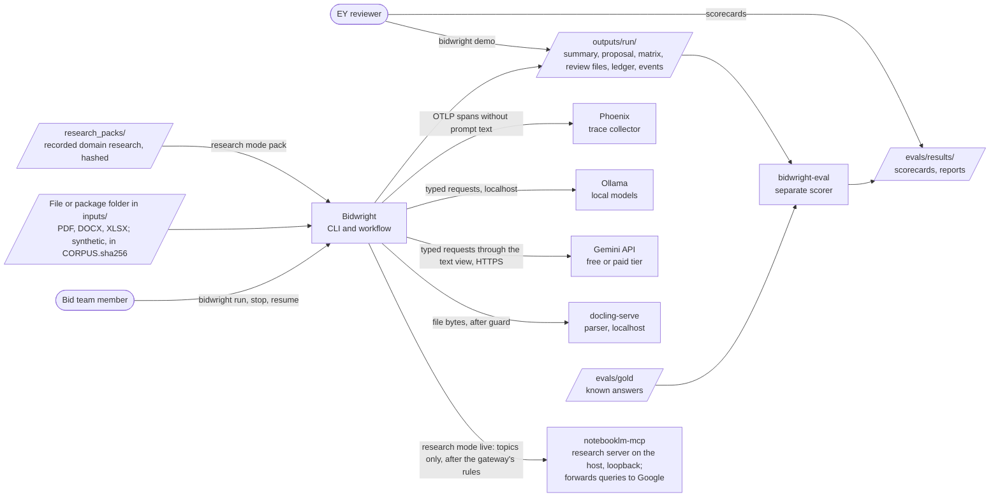
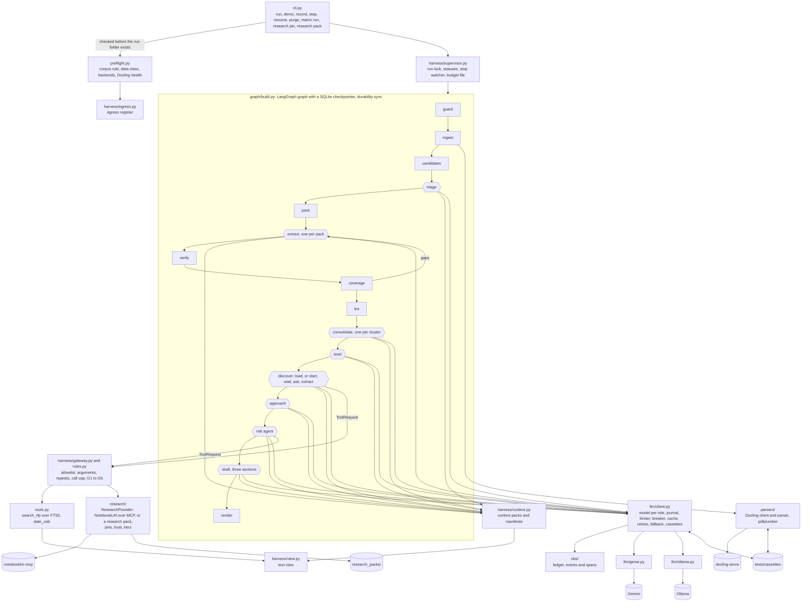
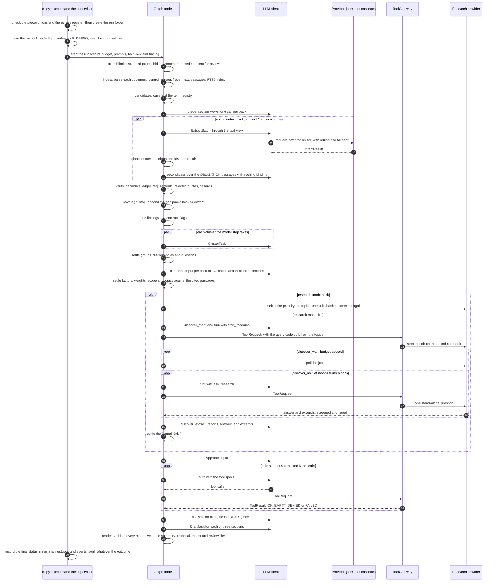

# Architecture

This document describes Bidwright as built in Iteration 2, for the tag `v0.2`, under the twelve arc42 headings. Iteration 2 builds on `v0.1`, which read a whole RFP package and checked every requirement's quote, and adds run control (stop, resume and a journal of answered calls), the gateway's rules, recovery, and a first research step on the RFP's domain. This document covers only what is built. The work still to come lives in section 10 of [`context/Master-Plan.md`](../context/Master-Plan.md); the build plans are [`designs/iteration-1.md`](designs/iteration-1.md) and [`designs/iteration-2.md`](designs/iteration-2.md). Each heading stays short and points to the file that owns the detail.

## 0. How this architecture is described

Six steps, combining arc42, C4 and ADRs. The method was reviewed against the literature (DR-19 in [`context/Research-Register.md`](../context/Research-Register.md)) and not refuted, which differs from proven; the register lists the seven changes that review made.

| Step | What it produces | Where |
|---|---|---|
| 1. Concerns | Quality scenarios: invariants, checked on every run, and statistical scenarios, measured over repeats | Section 10 |
| 2. Views | C4 Context and Container, an agent view, one run, and deployment. LLM calls, the deterministic boundary, tool allowlists and human control are marked. | Sections 3, 5, 6 and 7 |
| 3. Boundaries | A contract in code wherever LLM output meets code | Section 5.4 |
| 4. Decisions | Short ADRs | Section 9 and [`DECISIONS.md`](../DECISIONS.md) |
| 5. Threats and governance | Trust boundaries and controls mapped to the OWASP lists; roles, the trust layer, NIST AI RMF and sensitive information; the AI bill of materials | [`security.md`](security.md), [`governance.md`](governance.md), [`ai-bom.md`](ai-bom.md) |
| 6. Conformance | Fitness functions in CI; behavior in the evaluation harness | Section 8.7 and [`evaluation.md`](evaluation.md) |

## 1. Introduction and goals

### 1.1 What the system does

The assignment asks for an LLM application that reads an RFP and produces a structured solution summary of requirements, approach and risks. It must be what the assignment calls "a genuine agentic workflow", with an evaluation harness and tracing of tokens, latency and cost. At `v0.2`, Bidwright reads one file or a package folder of PDF, DOCX and XLSX documents, such as an RFP with its addendum and annex, and writes:
- `solution_summary.md` and its JSON form: submission hazards first, then requirements with verified quotes and the evaluation factors as the RFP states them, approach items, risks and open questions, and, when research found anything, an appendix of domain research marked external and unverified;
- `proposal.md`: three short sections (`understanding`, `approach` and `risks_and_assumptions`) drafted from those records;
- the compliance matrix (`compliance_matrix.xlsx` and `.csv`), `clarification_questions.md`, `submission_checklist.md`, and `review/quarantine.md`, which shows a person the hidden content removed before parsing, the small print kept, and the passages that read like instructions to a model;
- the records behind them: the control register of the package's documents, a disposition for every passage, requirement groups, discrepancies, contract flags and lint findings;
- `brief.json`, the opportunity brief: evaluation factors with their weights and scoring method, needs, scope and constraints, each citing passages, and the research topics; and `domain_brief.json` and `research.json`, the domain research and its record, from a committed research pack or a live research job;
- `ledger.jsonl`, `run_manifest.json`, `events.jsonl` and `tool_calls.jsonl`: every LLM call's tokens, latency and cost, the run's status history, totals and data class, every status change, recovery and security event, and every tool call with its result; and, when a call fails for good, `dead_letter.jsonl`.

An operator can stop a run with `bidwright stop` and continue it with `bidwright resume`, which never pays twice for a call that was answered. Every output carries the status `UNREVIEWED_DRAFT`.

### 1.2 Quality goals

In priority order. Section 10 states each one as a measurable scenario.

| Priority | Goal | Scenarios |
|---|---|---|
| 1 | Functional correctness: no mandatory requirement missed, and every requirement traced to a quote that code has checked | QS-1, QS-2, QS-8 |
| 2 | Security: tools are authorized outside the model, hidden content never reaches a model, and document text is never treated as an instruction | QS-3, QS-4 |
| 3 | Transparency: an unsupported claim is marked, never asserted, and every number traces to a run | QS-5 |
| 4 | Controllability: people decide, and a run stops or waits when it should | QS-6 |
| 5 | Recoverability: provider faults are retried and failed over, and spend is never repeated | QS-7 |

Quote verification protects grounding: a requirement's quote is in the RFP. It does not protect the mandatory count: a clause the model labels `BACKGROUND`, `NOT_BINDING` or `OUT_OF_SCOPE` is a miss, which QS-2 measures and the evaluation funnel charges to the stage that lost it.

### 1.3 Stakeholders

| Stakeholder | Needs from the architecture |
|---|---|
| The EY reviewers | The assignment's required items, visible and runnable without keys; trade-offs they can question |
| The owner | Sole approver of scope and decisions; a design the owner can explain and change live |
| The bid team Bidwright serves, fictional here | A summary they can trust line by line, and drafts they can edit |
| Coding agents | Commands and boundaries, in [`AGENTS.md`](../AGENTS.md) |

### 1.4 Not in `v0.2`

A bid team's problem is that one missed mandatory clause can disqualify a bid, and an overstated compliance claim creates liability. Bidwright answers the first with a disposition for every passage and requirements whose quotes code has checked, and the second with drafts that people approve and a compliance status that starts `UNVERIFIED`. The product's non-goals, among them pricing, win probability, submission, real client data, training and production concerns, are in section 1.4 of [`context/Master-Plan.md`](../context/Master-Plan.md#14-non-goals). Planned components that `v0.2` does not have:
- any reader of the domain research: `approach`, `risk` and `draft` keep their inputs of `v0.1`, and the research first feeds Iteration 3's `options` and `blueprint`;
- `assess`, the independent check of claims against the knowledge base of supplier capabilities, which `knowledge_base/` already holds, and `techcheck` with Context7 (Iteration 3);
- the two human gates (Iterations 3 and 4): the approval file's format is decided (ADR-035), and the gateway's outcome "pause for a human" is defined, but no rule uses it yet;
- the gated `reflect` tool and the sequential-thinking server it uses (Iteration 3); the MCP client already speaks stdio, tested against a small Python server;
- an `ExecutionPolicy` class, versioned artifacts and the context manager's slots for cards and skills, which wait for their first consumers (ADR-037);
- the proposal pack (Iteration 4);
- OCR: a scanned file is reported, and its pages are not parsed;
- client documents on `free`: they run on `local`; the consent override in section 3.1 stays by the owner's decision of 2026-11-03 (D-05, ADR-026), which records its conflict with the free tier's terms as an accepted risk. A client run may use research mode `pack`, never `live`.

## 2. Constraints

| Kind | Constraint |
|---|---|
| Assignment | Synthetic RFPs only: no real tender or client document enters the repository, a prompt or a test. The deliverables include `DECISIONS.md`, [`ASSUMPTIONS.md`](../ASSUMPTIONS.md), rough timings and a 3-5 minute demo. |
| Models | Free tiers first. The owner's AI Studio limits, read 2026-11-02: 20 requests a day on `gemini-3.8-flash`, 500 on `gemini-3.5-flash-lite` (ADR-003). Free-tier prompts may be used by the provider to improve its products, so `free` runs only on the synthetic corpus. |
| Machine | The build laptop, a Windows machine whose 4 GB GPU the local models exceed, so Ollama runs mostly on CPU (V-06 in [`verification_log.md`](verification_log.md)). Ollama cuts a prompt longer than `num_ctx` silently (S-14), so the adapter fails a call whose evaluated prompt reaches `num_ctx`. |
| Parsing | `docling-serve`, a 5 GB image, parses PDF, DOCX and XLSX for live runs; replays and tests read recorded Docling responses and need no service. |
| Research | Research mode `live` needs the owner's NotebookLM login, a cookie-based login on a personal Google account, and the `notebooklm-mcp` server running on the host, bound to loopback; it is acceptable for synthetic data only. Research mode `pack`, the default, needs neither. |
| Toolchain | Python 3.12 and uv; ruff, pyright and pytest; GitHub Actions on a private repository |
| Conventions | Keys only in `.env`; ISO 8601 dates; one writer per output file; a design change needs an ADR |

## 3. Context and scope

### 3.1 Business context

| Interface | Direction | Form |
|---|---|---|
| RFP input | In | One file or a folder under `inputs/`: PDF, DOCX or XLSX, with an optional `package.yaml` naming roles and precedence. On `free`, every file's sha256 must be listed in `inputs/CORPUS.sha256`, or the run is started with `--allow-non-corpus=i-accept-free-tier-terms`, which the manifest records beside the data class `client` (ADR-026). The run entry checks the rule before the run folder exists. |
| Docling | Out | HTTP to `DOCLING_URL` (`http://localhost:5001` on the host, `http://docling:5001` in Compose), after `guard` has sanitized the file; only for live and record runs |
| Gemini | Out | The native `google-genai` SDK (ADR-001), with `GEMINI_API_KEY`, or `GEMINI_PAID_API_KEY` on the `paid` profile, from `.env` |
| Ollama | Out | HTTP to `OLLAMA_HOST`: `http://localhost:11434` on the host and `http://ollama:11434` in Compose, or `http://host.docker.internal:11434` from Compose for the host's own Ollama |
| Phoenix | Out | OTLP over HTTP to `PHOENIX_ENDPOINT` when it is set, answers and is allowed for the run's data class; otherwise spans go to `outputs/<run>/spans.jsonl` |
| NotebookLM | Out | MCP over streamable HTTP to `NOTEBOOKLM_MCP_URL` (`http://127.0.0.1:8000/mcp` on the host, `http://host.docker.internal:8000/mcp` from Compose), only in research mode `live`. The server's name, version and six allowed tools must match `config/mcp_pins.yaml`, or no tool of it is used (FI-11). The server forwards every query to Google, so the egress register treats it as remote whatever its host, and a client run with research mode `live` is refused at the run entry. |
| Research packs | In | `research_packs/<domain>/`: a manifest of hashes, sources with URLs and authority tiers, excerpts of at most 300 characters, the recorded `DomainBrief` and answers (ADR-033). A pack whose files do not match its hashes is refused. `bidwright research pack` builds one from a live run or a NotebookLM job, on the host. |
| Egress register | Check | `config/egress.yaml` lists every destination, its hosts, whether it is local and what it may receive. Before a run, each backend, the trace endpoint, the parser and, in research mode `live`, the research server are checked against it and the data class; a client run reaches no remote destination except through the consent override (ADR-026). |
| Run control | In | `bidwright stop <run>` writes `control/stop.request`, which the supervisor reads once a second; `bidwright resume <run>` continues a stopped, paused, killed or budget-stopped run under its lock, `control/run.lock` |
| Run folder | Out | `outputs/<run>/`, gitignored; `bidwright purge` deletes a run, its journal and its cache entries, refuses a run whose lock is held, and `--expired` deletes every client run past the retention period |
| Evaluation | Read only | `bidwright-eval` reads finished run folders and the gold, and writes `evals/results/` |

### 3.2 The LLM boundary

Everything a model writes crosses one boundary. Code sends a typed request built from a schema and receives text that must parse into a schema, and an acceptance check in code then decides what reaches the graph's state. The model never sees character offsets, never chooses the next step, and never runs a tool itself. Everything a model reads from the RFP passes one seam, the text view (ADR-026): context packs, section views, cluster tasks, brief tasks and search results are built from `TextView.text`, and stored records keep the frozen text. At `v0.2` the view is `IdentityView`, which shows the frozen text with line breaks as spaces; a masking view replaces it in Iteration 5. The `discover` model sees no RFP passage at all: its only input from the RFP is the brief's topics, which code checks, and everything it reads back from research is screened, tiered and tagged `EXTERNAL_RESEARCH` (section 8.1). Section 5.4 lists the contract for each call.

## 4. Solution strategy

The design rests on one principle: a deterministic shell around a probabilistic core. Code checks what code can check (files, quotes, numbers, ids, schemas, allowlists and budgets), and the LLM does only the judgment and generation that code cannot, inside those checks (ADR-005).

| Goal | Strategy at `v0.2` | Instead of | ADR |
|---|---|---|---|
| Every requirement traceable | Each document becomes passages with ids and offsets into one frozen text. The model cites passage ids and copies a quote, and code checks the quote and every number and date in the statement. | Offsets or citations emitted by the model | ADR-006 |
| No obligation silently dropped | Every passage reaches `extract` in a context pack and gets a disposition; cues and zones are hints; `coverage` re-reads the gaps | A cue filter in front of the model | ADR-017, ADR-018 |
| Hidden text never reaches a model | `guard` scans the raw files, removes hidden content from the copy that is parsed, and lists it for review | Screening the parsed text, or delimiters alone | ADR-010, ADR-020 |
| Linked requirements read together | Code clusters requirements by section, reference and wording; one `consolidate` call per cluster | One call over all requirements, or none | ADR-019 |
| Agentic, yet testable | A LangGraph graph routes the run, with no LLM choosing the next step. Two tool-using agents, `risk` and `discover`; single-call functions elsewhere. Code waits for a research job; no model polls it. | An LLM choosing the next step, or CrewAI | ADR-005, ADR-036 |
| No unauthorized action | Every tool call passes `ToolGateway` before it runs: the four checks of `v0.0` and five rules, each a trigger, a check and an outcome. Code binds every notebook and job id, so the model never names one. | Allowlists alone, or safety instructions in the prompt | ADR-009, ADR-032 |
| Stoppable and resumable | A supervisor drains the graph between steps on a stop request, a journal keeps every answered call, the ledger and the budget's counts are written as they change, and a run lock tells a killed run from a running one | Rerunning a stopped run from the start, or stop checks in every node | ADR-031 |
| Domain research without leaking the RFP | Queries are built from the brief's topics, never from passages; a gateway rule denies any query sharing 8 consecutive words with a passage; recorded research packs by default, a live job only on request | Queries written from RFP text, or live research on every run | ADR-032, ADR-033, ADR-036 |
| Research treated as untrusted | Every excerpt, answer and report paragraph is screened as passages are; each source gets an authority tier by host; an item resting only on tier-4 sources, or sharing no word with its excerpts, is dropped; research is never capability evidence | Trusting what the research tool returns | ADR-033 |
| Client documents protected | A data class per run, an egress register that counts the research server as remote, the text view and a retention period | Trusting each call site | ADR-026 |
| The assignment's output first | The solution summary is the first output of every run | The summary alone, or a pack without it | ADR-007 |
| People decide | `DRAFT_ONLY`: nothing is submitted, every output is `UNREVIEWED_DRAFT`, and compliance starts `UNVERIFIED` | A fully automatic pipeline | ADR-008, ADR-021 |
| Runs without keys | Recorded LLM and Docling cassettes replay a whole run; the host path needs no Docker | Live calls in every test | ADR-016 |
| Measured, not asserted | A separate evaluation package with a funnel and a regression gate; a ledger entry per call and spans per step | A judged-metric framework | ADR-014, ADR-015 |
| Fits the free tier | Flash-Lite for both roles on `free`; a limiter on each model's per-minute limits and, on `paid`, its daily limit, while Google's own daily 429 decides on `free`; a circuit breaker per model and per server; a response cache for repeats; no thinking on `local` | Flash for `reason`; thinking on for `local`; a local daily cap on `free` | ADR-003, ADR-004, ADR-029 |

The workflow follows three phases: requirements and reality (`guard` to `consolidate`), engineering and evidence (`brief`, `discover`, `approach`, `risk`), and proposal (`draft`, `render`). Of the planned control plane, `v0.2` has the run supervisor with stop and resume, the tool gateway with its rules, recovery (the circuit breaker and the dead-letter file), the events log, the run budget, the limiter, and the checkpointer, which writes each step's state to `checkpoints.sqlite` for `resume` to read. Three planned components wait for their consumers (ADR-037): an `ExecutionPolicy` class, since `config.py` already validates `config/agents.yaml` and the nodes read it; versioned artifacts, for Iteration 4's `repair`; and the context manager's slots for cards and skills.

## 5. Building block view

### 5.1 Containers

Hexagons make LLM calls through the client. Everything else is code with no LLM.

### 5.2 Modules

| Module | Responsibility | Tested by |
|---|---|---|
| `cli.py` | The `run`, `demo`, `record`, `stop`, `resume`, `purge`, `matrix run`, `research pin` and `research pack` commands; prints what the run entry refuses | `test_cli.py`, `test_purge.py`, `test_matrix.py` |
| `harness/supervisor.py` | `RunSupervisor`: the run lock, the manifest as its only writer, every status in `status_history` and `events.jsonl`, the stop watcher that drains the graph, the budget's counts in `control/budget.json`, and a resume's refusals; on a resume, the line files a kill may have cut are repaired before anything appends | `test_supervisor.py`, `test_resume.py` |
| `harness/recovery.py` | The circuit breaker per model and tier and per MCP server, kept in `outputs/.quota/breaker/`; the dead-letter file | `test_recovery.py` |
| `harness/rules.py` | The gateway's rules G1 to G5, each a trigger, a check and an outcome | `test_gateway.py` |
| `obs/events.py`, `fileio.py` | The events log; atomic writes and the reading and repair of line files that a kill may leave with a cut last line | `test_supervisor.py`, `test_cache.py` |
| `graph/brief.py` | `brief`: the opportunity brief from the evaluation and instruction sections, checked against the passages it cites | `test_brief.py` |
| `graph/discover.py` | `discover`'s five nodes, `research.json` and `domain_brief.json`, the research tools, and the rules that settle an extraction into a `DomainBrief` | `test_discover.py` |
| `research/provider.py`, `research/nlm.py`, `research/mcp_client.py` | The `ResearchProvider` interface; NotebookLM behind it, over an MCP client that speaks streamable HTTP and stdio | `test_mcp_client.py`, `test_discover.py` |
| `research/pins.py`, `research/trust.py`, `research/audit.py` | Tool pins checked at connection (FI-11); screening and authority tiers for research text (FI-10); the overlap of every sent query with the RFP | `test_mcp_client.py`, `test_pack.py`, `test_discover.py` |
| `research/pack.py`, `research/builder.py`, `restricted.py` | Research packs: hashes, selection by keyword, `ask_research` over a pack; the pack builder, with its checks for solicitation-like sources and for the names the repository must not carry | `test_pack.py`, `test_builder.py`, `test_repo_hygiene.py` |
| `text.py` | Word-level helpers shared by the nodes and the gateway's rules: content stems, normalized words and the longest shared run of words | `test_brief.py`, `test_gateway.py` |
| `preflight.py` | The run entry's preconditions: the corpus rule per file, the data class and package id, a backend per provider, the local models, Docling's health | `test_preflight.py`, `test_corpus_rule.py` |
| `config.py` | Loads and validates `config/*.yaml` with `yaml.safe_load` and Pydantic | `test_config.py` |
| `schemas.py` | Every record and every model-facing request and response, in [`reference/schemas.md`](reference/schemas.md) | `test_schemas.py` |
| `guard/` | Size, page, path and archive limits; scanned files; hidden content in PDF, DOCX and XLSX, removed from the parsed copy and kept in `quarantine.jsonl`; small print | `test_guard.py` |
| `parsers/`, `ingest.py`, `register.py` | The Docling client with its cassettes, the Docling and pdfplumber parsers, frozen text and passages with lead-ins, table headers, pages and small-print flags; the control register of documents, roles and precedence | `test_docling_parser.py`, `test_ingest.py`, `test_register.py` |
| `candidates.py`, `kb.py` | Cue annotations and the term registry; the B0 rule-only baseline; the knowledge base loader | `test_candidates.py`, `test_knowledge_base.py` |
| `graph/triage.py` | Section views, zones with the keyword fallback, the RFP profile and submission hazards | `test_triage.py` |
| `harness/context.py`, `harness/view.py` | Context packs within budget, with neighbors, lead-ins and terms, and their manifests; the text view | `test_context.py`, `test_text_view.py` |
| `verify.py` | Quote checks (verbatim, normalized or rejected) and number and date fidelity | `test_verify.py` |
| `coverage.py` | The gaps after `extract`, and when to stop re-reading them | `test_coverage.py` |
| `lint.py` | Requirement-quality rules, the coded checks and contract flags | `test_lint.py` |
| `clusters.py`, `graph/consolidate.py` | The cluster rule in code; one `consolidate` call per cluster, and the groups, discrepancies and questions it settles | `test_clusters.py`, `test_consolidate.py` |
| `retrieval.py`, `tools.py` | The per-run FTS5 index over the view's text; the `search_rfp` and `date_calc` tools | `test_tools.py` |
| `harness/gateway.py`, `harness/budget.py` | `ToolGateway` and `tool_calls.jsonl`; per-run limits on requests, tokens and active time, checked before each provider attempt, paused while code waits for a research job, and raised by `resume --raise-budget` | `test_gateway.py`, `test_budget.py` |
| `harness/egress.py`, `purge.py` | The egress register's checks; deleting runs and their cache entries | `test_egress.py`, `test_purge.py` |
| `llm/client.py`, `llm/types.py`, `llm/limits.py`, `llm/cache.py` | One `complete` call for every role: model choice, decoding, the run's journal, the limiter, the circuit breaker, the response cache, retries, fallback, record and replay, schema validation, ledger entries | `test_client_replay.py`, `test_simulator.py`, `test_cache_key.py`, `test_limiter.py`, `test_cache.py`, `test_resume.py` |
| `llm/genai.py`, `llm/ollama.py`, `llm/openai_compat.py` | The Gemini and Ollama adapters, and an adapter for OpenAI-compatible providers kept for Iteration 3 | `test_adapters.py` |
| `llm/replay.py`, `llm/simulator.py`, `llm/schema.py` | Cassettes; a replay backend that injects scripted faults; the provider form of a schema | `test_client_replay.py`, `test_simulator.py`, `test_provider_schema.py` |
| `prompts.py` | Loads versioned prompts, renders them with `string.Template.substitute`, seeds delimiters from the run id, and renders the few-shot examples, validated against the schemas | `test_prompts.py` |
| `graph/nodes.py`, `graph/state.py`, `graph/build.py` | The nodes, the graph state, the wiring, and `execute` | `test_nodes.py`, `test_risk_loop.py`, `test_e2e_replay.py` |
| `render.py`, `render_xlsx.py` | The outputs, after schema validation; the compliance matrix | `test_render_outputs.py`, `test_compliance_matrix.py` |
| `baselines.py`, `matrix.py` | EX0 and B0; the matrix runner for spikes and ablations | `test_e2e_replay.py`, `test_matrix.py` |
| `obs/ledger.py`, `obs/tracing.py` | `ledger.jsonl`, appended as each call finishes, its totals and the models that answered; spans with a file fallback | `test_ledger.py`, `test_tracing.py` |
| `scripts/gen_docs.py`, `scripts/check_docs.py`, `scripts/outbound_rates.py` | Generate `agents.md`, `ai-bom.md` and the CLI and schema references; check links, wikilinks, dates, front matter, voice and test names; report the outbound rule's pass rates on its test set | `test_docs_generated.py`, `test_check_docs.py`, and the `docs-links` job |
| Repository rules | The import rule, repository hygiene, the Compose lockdown, the privacy invariant | `test_isolation.py`, `test_repo_hygiene.py`, `test_compose_lockdown.py`, `test_privacy_invariant.py` |
| `evals/` | The separate `bidwright-eval` package: corpus rendering, gold, matcher, funnel, seeds, scorer, gate, explain, report, and the external stage benchmarks in `evals/external/` | `test_render.py`, `test_matcher.py`, `test_funnel.py`, `test_scorer_selftest.py`, `test_gates.py`, `test_hero_replay.py`, `test_external_crackedpdfs.py` |

### 5.3 Agent view

[`agents.md`](agents.md) is regenerated by CI from `config/agents.yaml`, `config/models.yaml`, the prompts' front matter, the tool specs and the compiled graph, and the `docs-generated` job fails on a diff. In summary:

| Role | Kind | Input to output | Model role | Tools | Limits |
|---|---|---|---|---|---|
| `triage` | Function, one per pack of sections | `TriageInput` to `TriageResult` | extract | None | 1 call, 1 repair |
| `extract` | Function, one per context pack | `ExtractBatch` to `ExtractResult` | extract | None | 1 call, 1 targeted repair, then, with the second pass on, 1 call and 1 format repair, fixed in code |
| `consolidate` | Function, one per cluster the model step takes | `ClusterTask` to `ConsolidationResult` | reason | None | 1 call, 1 repair |
| `brief` | Function, one per context pack of evaluation and instruction sections | `BriefInput` to `BriefResult` | extract | None | 1 call, 1 repair |
| `discover` | Agent, in research mode `live` only | `DiscoveryTask` to `DiscoveryExtract` | reason | `start_research`, `ask_research` | 1 turn and 1 reminder to start a job; 4 turns a pass, 2 passes; 2 jobs, 6 questions and 8 tool calls a run; 1 extraction call, 1 repair |
| `approach` | Function | `ApproachInput` to `ApproachResult` | reason | None | 1 call, 1 repair |
| `risk` | Agent | `RiskInput` to `RiskRegister` | reason | `search_rfp`, `date_calc` | 4 turns, 6 tool calls, stop on no progress |
| `draft` | Function, once per section | `DraftTask` to `DraftResult` | reason | None | 1 call, 1 repair |

The roles never exchange output. The graph passes each one a typed input built from checked records, and only checked output enters the state; `discover` gets the brief's topics and nothing else from the RFP. Each `Send` worker returns its result through a list reducer, so no two workers write the same key.

### 5.4 Boundary contracts

Each LLM call has a schema, except the `risk` agent's tool turns, which return tool calls. Each has an acceptance check in code, a pinned prompt and model, and a defined result when the check fails.

| Call | Pinned by | Acceptance check in code | When the check fails |
|---|---|---|---|
| `triage` | `triage@0.1.0`; the `extract` role's model | Zones only for sections in the pack, at or above the confidence threshold; hazards cite passages that exist | A section without an accepted zone takes the keyword zone; a pack whose answer breaks its schema twice falls back to keywords, and the run ends `DEGRADED` |
| `extract` | `extract@0.4.0`; `extract` | Each quote is found in the view's text of a passage the item cites, from its own pack, and mapped to the frozen text; every number and date in the statement occurs in the quote, a cited passage, its lead-in or header, or its section path; every passage of the pack appears in an item or in `no_obligation_src_ids`. An item keeps its first 3 ids; a quote over 300 characters fails its item, not its pack (ADR-024). | One repair message naming each failed quote, number and long quote; items that still fail go to `rejected.jsonl`. A pack that breaks its schema twice is rejected whole. `coverage` re-reads passages left without a disposition, and the second pass (S-13, ADR-028) re-reads the passages of an `OBLIGATION` zone that the first reading found nothing binding in. |
| `consolidate` | `consolidate@0.1.0`; `reason` | Duplicates, discrepancies, questions and references name members of the cluster; a merge never loses an anchor | A call that fails becomes a group built in code, and the run ends `DEGRADED` |
| `brief` | `brief@0.2.0`; `extract` | A factor stays only when its name and, unless `not_stated`, its weight occur as whole words in a passage it cites; a scoring quote that does not verify becomes `not_stated`; code sets each factor's status, `OUT_OF_SCOPE` for price, cost, fee or charge; ids outside the call's sections are dropped; a topic of more than 7 words, or sharing 4 consecutive words with a passage, is dropped. Two stated weights for one factor become a discrepancy and a clarification question. | One format repair; a call that still fails adds nothing, and the run ends `DEGRADED` |
| `discover`, tool turns | `discover@0.4.0`; `reason`; the allowlist in `config/agents.yaml` and the pins in `config/mcp_pins.yaml` | `ToolGateway`, with G1 to G5 (section 8.3, and the generated table in [`agents.md`](agents.md)); code builds the query from the prompt's research envelope, the model's question and the topics, and binds every notebook and job id | A denial of the model's call goes back to the model; a denial of code's own call, a tool error, a refused server or a failed job is a research failure, handled in section 6.3 |
| `discover`, extraction | The same | Every cited excerpt exists and is not quarantined, at most 3 kept; an item or need whose excerpts all come from tier-4 sources, or that shares no content word with them, is dropped | One format repair; an extraction that keeps nothing writes no `domain_brief.json` and is a research failure |
| `approach` | `approach@0.2.0`; `reason` | Requirement ids must name verified `BINDING` or `OPTIONAL` requirements; an item with none is dropped, and requirements left unmapped are listed | One format repair, then an empty result and the run ends `DEGRADED` |
| `risk`, tool turns | `risk@0.2.0`; `reason`; the allowlist in `config/agents.yaml` | `ToolGateway`: the tool is allowed and registered, the arguments validate, no third identical call, the call cap is not spent | A `DENIED` result goes back to the model and the tool never runs; a `FAILED` result goes back after the tool raised |
| `risk`, final register | The same | Each risk cites passages that exist and shares a content word with them, and carries no rating or probability | One retry for the rejected risks; a register that breaks its schema twice is empty, and the run ends `DEGRADED` |
| `draft` | `draft@0.2.0`; `reason` | Cited ids are kept only if they name the section's own records | One format repair, then the section is `FAILED` and the run `DEGRADED` |
| Every call | The cassette key | The response parses into its schema | Reported as a parse error for the node's repair |

[`agents.md`](agents.md) lists the prompt versions in force. A research pack's recorded `DomainBrief` goes through the extraction's rules again each time it loads, without the tier rule its build applied; a pack that keeps nothing is a research shortfall. `render` adds the last check: every record is validated against its schema before anything is written, and one failure blocks every output.

## 6. Runtime view

### 6.1 The graph

`guard` → `ingest` → `candidates` → `triage` → `pack` → `extract`, one `Send` per context pack → `verify` → `coverage`, which either ends the extraction or sends the packs holding its gaps back to `extract`, for at most 2 rounds → `lint` → `consolidate`, one `Send` per cluster the model step takes, with code groups for the rest → `brief` → research, by the run's research mode → `approach` → `risk` → `draft` → `render`. `--until verify`, `coverage`, `consolidate` or `brief` ends the run after that node, `COMPLETED` with the reason "stopped after <node> by request", and `--baseline b0` routes `candidates` to the rule-only B0 step and stops after `verify`. The diagram in [`agents.md`](agents.md) is drawn from the compiled graph.

Research follows the mode in `config/research.yaml`, which `--research off|pack|live` overrides for one run (ADR-036):
- `off`: `brief` goes straight to `approach`.
- `pack`, the default: `discover_load` loads the research pack whose keywords match the brief's topics, at least 2 of them and more than any other pack, with no model call. No matching pack is not a shortfall; the manifest's research block says so.
- `live`: `discover_start` creates a notebook and starts one deep research job; `discover_wait`, code, polls it with the budget paused; `discover_ask` asks follow-up questions over the job's report, and may start a second job, which returns to `discover_wait`; `discover_extract` makes one call over every finished report and the answers. A research failure in any live node goes to `discover_load`, which loads the matching pack, if any, and the run ends `DEGRADED` with the reason.

`approach`, `risk` and `draft` do not read the research at `v0.2`; `render` adds its items to the summary's appendix.

Every passage reaches `extract`, in packs of at most `batch_size` passages within the call's token budget, so the hero package's 278 passages take 7 packs, and about 12 calls with their repairs and the second pass. At most 2 workers run at once on `free`, 4 on `paid` and 1 on `local`, because Ollama on the build laptop serves one request at a time (`config/limits.yaml`).

Before the run folder is created, `execute` checks the run entry's preconditions, in `preflight.py`: the corpus rule per file on `free`, the data class, a backend for every provider the profile's roles use, the local models on `local`, Docling's health when it parses live, and the egress register for every destination, the research server included in research mode `live`. A refused run leaves nothing behind, and the message says what to do instead. `execute` then runs the graph inside a `RunSupervisor`, which takes the run lock, writes the manifest as `RUNNING` at once, and records every later status.

**Stop and resume (ADR-031).** `bidwright stop` writes `control/stop.request`; the supervisor's watcher finds it within a second and asks LangGraph to drain, so the graph finishes its current step, saves a checkpoint and the run ends `STOPPED`. Only `discover_wait`, which waits inside one step, reads the request itself, between polls. While the client calls live models, every answer that parses goes to the run's journal, `journal/`, under its cassette key and with the provider's native turn; every ledger entry is appended as its call finishes; and the budget's counts are written once a second. `bidwright resume` reruns the run entry's checks, takes the lock, refuses what section 6.3 lists, rebuilds the passages and the search index from the checkpointed state, and invokes the graph from its last checkpoint; a call the journal holds is answered from it at no cost. The operating system releases the lock when a process dies, so a `RUNNING` manifest whose lock is free belongs to a killed run, which resumes the same way.

### 6.2 One run

Every LLM call goes through the client, which looks the call up in the journal on a resume, checks the circuit breaker, the limiter and the run budget before each provider attempt, and records one ledger entry, appended to `ledger.jsonl` at once, and one `LLM` span. Every call also writes a context manifest, `context/<node>-<call>.json` (section 8.1).

### 6.3 Failure behavior per step

| Step | Failure | Response | Limit | Test |
|---|---|---|---|---|
| The run entry | A file not in the corpus, on `free` | Refused before the run folder exists; the consent override runs it, and the manifest records the override and the data class `client` | None | `test_corpus_rule.py` |
| The run entry | No backend for a provider the profile uses, a local model that is not pulled, or Docling not answering | Refused before the run folder exists, with the key to set, the pull command or the service to start | None | `test_preflight.py`, `test_a_docling_run_is_refused_when_the_health_check_fails` |
| The run entry | A destination the egress register refuses for the run's data class, such as research mode `live` on a client run | Refused, or for a trace endpoint, spans go to `spans.jsonl` and the manifest lists the refused destination; the research refusal names `--research pack` | None | `test_egress.py`, `test_a_client_run_with_live_research_is_refused_before_its_folder_exists` |
| The run entry | Research mode `live` in the client's `record` or `replay` mode | Refused before the run folder exists, naming `--research pack` | None | `test_live_research_is_refused_when_recording_or_replaying` |
| The run entry | A baseline asked for the second pass, which a baseline never runs (ADR-028), or an extract prompt the run does not load, such as a retired one | Refused before the run folder exists; a matrix with such a rung is refused before anything starts | None | `test_a_baseline_asked_for_the_second_pass_is_refused_before_a_run_folder_exists`, `test_an_extract_prompt_a_run_does_not_load_is_refused_before_a_run_folder_exists`, `test_a_rung_that_execute_would_refuse_is_refused_before_anything_starts` |
| `guard` | A file over a limit, a path outside the input root, an archive bomb, an encrypted or corrupt file, or a missing input | The run ends `POLICY_BLOCKED`, with its manifest | 0 | `test_guard_limits`, `test_a_corrupt_input_is_blocked_by_guard_with_a_manifest`, `test_a_missing_input_is_blocked_with_a_manifest` |
| `guard` | Hidden content | Removed from the copy that is parsed, kept in `quarantine.jsonl` with its location, and shown in `review/quarantine.md` | 0 | `test_guard_quarantine_finds_each_hidden_kind_and_sanitizes` |
| `guard` | A scanned file, with no text layer | Reported and not parsed; the run ends `DEGRADED`, or `POLICY_BLOCKED` with "no text layer" when every file is scanned | 0 | `test_guard_scanned` |
| `ingest` | Docling down or timing out | Retried, then `UNRECOVERABLE_FAULT` | 3 retries | `test_ingest_retry_retries_a_failing_docling_call_then_faults` |
| `ingest` | A partial conversion | The run continues and ends `DEGRADED` | 0 | `test_ingest_unparseable_a_partial_conversion_continues_degraded` |
| Any LLM call | 429, 5xx or timeout | Full-jitter backoff with a 2-second base and a 30-second cap, where a `Retry-After` header sets the wait; then the role's fallback model, once, except in a matrix run, which stays on its primary model and faults the run instead | 3 retries | `test_fi01_*` in `test_simulator.py` |
| Any LLM call | On `paid`, the limiter's daily count reaches the published limit; on either tier, a 429 names a daily limit (ADR-029) | No retry: the fallback model at once; with none left, the run ends `QUOTA_PAUSED` | 0 | `test_a_spent_primary_moves_to_the_fallback_and_a_spent_fallback_raises`, `test_a_spent_daily_quota_moves_to_the_fallback_without_retrying` |
| Any LLM call | 5 consecutive transient failures on one model and tier, across calls and runs | The circuit breaker opens for 30 minutes and the call moves to the fallback model; with no model left, the run ends `QUOTA_PAUSED`, which a resume after the cooldown, or with `--profile paid`, continues | 5 failures | `test_fi01_breaker_opens_after_five_failures`, `test_an_open_breaker_moves_the_call_to_the_fallback_model`, `test_an_open_breaker_with_no_fallback_pauses_the_run_and_paid_resumes_it` |
| Any LLM call | A 4xx other than 429 | `UNRECOVERABLE_FAULT` at once, because a retry fixes neither a bug nor a configuration error | 0 | `test_preflight.py` |
| Any LLM call | Request, token or active-time limit reached | Checked before each provider attempt; the run ends `BUDGET_EXCEEDED` | 0 | `test_budget.py`, `test_the_budget_stops_a_call_between_its_attempts` |
| Any LLM call, `local` | The evaluated prompt reaches `num_ctx` | `UNRECOVERABLE_FAULT` rather than continuing on a cut prompt | 0 | `test_ollama_fails_a_call_whose_prompt_reached_num_ctx` |
| Any LLM call, replay | No cassette for the key | The run ends `UNRECOVERABLE_FAULT`, with its manifest and ledger | 0 | `test_a_missing_cassette_ends_the_run_as_a_fault` |
| Anywhere | An unexpected error | The run is recorded as `UNRECOVERABLE_FAULT`, and the error propagates | 0 | `test_an_unexpected_error_is_recorded_as_a_fault` |
| `triage` | Low confidence or a malformed answer | The keyword zones; the run ends `DEGRADED` for a failed call | 1 repair | `test_triage_fallback` |
| `extract` | A quote not found, a number not in the source, a quote over 300 characters, or ids missing | One repair message for all the item's failures, then `REJECTED` in `rejected.jsonl` | 1 repair | `test_the_three_repair_kinds_go_in_one_message`, `test_a_long_quote_fails_only_its_item_and_is_rejected_if_still_long` |
| `extract` | Malformed output twice | The whole pack is rejected, with one row in `dead_letter.jsonl` naming its context manifest; `coverage` re-reads its passages | 1 repair | `test_fi02_malformed_twice_rejects_the_whole_batch`, `test_fi02_a_rejected_context_pack_leaves_one_dead_letter` |
| `coverage` | Passages still without a disposition | Their packs are read again; the run ends `DEGRADED` when gaps remain after 2 rounds or stop shrinking | 2 rounds | `test_coverage_rounds`, `test_a_gap_that_never_shrinks_marks_the_run_degraded` |
| `lint` | A rule fails on unusual text | The rule is skipped for that requirement and logged; the run ends `DEGRADED` | 0 | `test_lint_resilience` |
| `consolidate` | A merge would lose an anchor, or the call fails | The records stay separate; a failed cluster becomes a code group, with a dead letter, and the run ends `DEGRADED` | 1 repair | `test_consolidate_anchors`, `test_a_failed_call_falls_back_to_a_code_group`, `test_a_cluster_that_fell_back_leaves_one` |
| `brief` | A call breaks its schema twice | That call adds nothing; the run ends `DEGRADED` with "brief: N of M calls failed", or "brief: no brief" when every call failed | 1 repair | `test_brief_degrades_after_two_schema_failures`, `test_a_partial_failure_degrades_with_its_count` |
| `discover_load` | A research pack whose files do not match its hashes, or whose recorded entries all fail the rules at load | A research shortfall: no domain brief, and the run ends `DEGRADED` with the reason. No matching pack, or a tie, is not a shortfall. | 0 | `test_a_pack_with_a_tampered_file_is_refused`, `test_a_pack_that_keeps_nothing_at_load_is_a_shortfall`, `test_the_fixture_is_selected_for_matching_topics_and_none_for_a_tie_or_one_keyword` |
| `discover`, live | A tool error, a server whose tools do not match their pins, an open breaker on the server, a failed job, code's own query denied by the gateway, or an extraction that keeps nothing | A research failure: the reason goes to `research.json`, the edge goes to `discover_load`, which loads the matching pack if one exists, and the run ends `DEGRADED` | 0 | `test_fi11_changed_description_refuses_the_server`, `test_an_open_breaker_on_the_server_sends_the_run_to_discover_load`, `test_an_extraction_that_keeps_nothing_is_a_research_failure` |
| `discover`, live | The model's own tool call breaks a gateway rule | `DENIED`, or `EMPTY` for the question cap, returned to the model | 0 | `test_a_second_start_in_one_turn_is_denied`, `test_a_copied_passage_is_denied_before_the_server_sees_it`, `test_fi09_each_rule_gives_its_outcome` |
| `discover_wait` | The job still runs when the 20-minute wait cap passes | The run ends `WAITING_RESEARCH`; a resume polls the same job with a fresh cap | 20 minutes | `test_discover_wait_times_out_and_a_resume_finishes_the_job`, `test_a_live_run_waits_for_research_and_a_resume_completes_it` |
| Research text | An excerpt, answer or report paragraph that matches the suspect patterns | The excerpt is quarantined and no item may cite it; the answer's text is withheld; the paragraph is removed before a model sees it; each is a security event attributed `injection-dominant` (FI-10) | 0 | `test_fi10_poisoned_excerpt_is_quarantined`, `test_fi10_poisoned_answer_is_withheld` |
| `approach`, `risk` | Malformed output twice | The node's output is empty, the run continues and ends `DEGRADED`, so the summary keeps the verified requirements | 1 repair | `test_approach_degrades_after_two_schema_failures`, `test_risk_degrades_after_two_schema_failures` |
| `risk` | A tool outside the allowlist, bad arguments, a third identical call, or the cap spent | `DENIED`, returned to the model | 0 | `test_gateway.py` |
| `risk` | A tool raises | `FAILED`, returned to the model | 0 | `test_a_tool_that_raises_returns_failed_to_the_model` |
| `risk` | A turn adds nothing new, or a cap is reached | The loop ends, and a final call with no tools asks for the register | 4 turns, 6 calls | `test_loop_caps_stop_at_four_turns`, `test_loop_caps_stop_at_six_tool_calls` |
| `risk` | A generic risk, or one with a rating or probability | Rejected, with one retry for the rejected risks | 1 retry | `test_risk_generic_is_rejected_then_replaced_on_retry` |
| `draft` | Malformed output twice | That section is `FAILED`, the others continue, and the run ends `DEGRADED` | 1 repair | `test_nodes.py` |
| `render` | A record fails its schema | Nothing is written; `UNRECOVERABLE_FAULT` | 0 | `test_render_schema_failure_blocks_all_output` |
| Tracing | The collector is down or refuses a batch | Spans go to `spans.jsonl`, and the run never waits | None | `test_tracing.py` |
| Any step | `bidwright stop`, or Ctrl+C | On a stop, the graph drains after its current step and the run ends `STOPPED`, and `discover_wait` stops between polls; on Ctrl+C, the run is recorded `STOPPED` at once, and a resume runs the interrupted step again, with the journal answering its calls | None | `test_stop_drains_between_nodes_and_resume_completes`, `test_discover_wait_stops_once_a_drain_is_requested`, `test_ctrl_c_stops_the_run_and_a_resume_completes_it` |
| Any step | The process is killed | The manifest still says `RUNNING` and the lock is free; a resume repairs the line files a kill may have cut, recording each cut as a recovery event, and continues from the last checkpoint with the journal answering the calls already made | None | `test_resume_after_a_kill_spends_nothing_twice`, `test_cut_lines_are_removed_from_every_line_file_on_resume`, `test_a_run_killed_before_its_first_checkpoint_starts_again` |
| `resume` | A run still running, a finished run, a run from before `v0.2`, a run in the client's `record` or `replay` mode, a run from another environment, a profile change other than `free` to `paid` after `QUOTA_PAUSED`, or changed prompt or input-file hashes | Refused, and the run is left as it was | None | `test_a_running_run_cannot_be_resumed`, `test_a_finished_run_is_not_resumed`, `test_a_resume_is_refused_and_leaves_the_run_as_it_was`, `test_paid_resumes_only_a_free_run_that_paused_on_its_quota` |

Nodes after `verify` degrade rather than fault because the requirements are complete and verified by then; `render` still faults, because a record that fails its schema cannot be written (ADR-024).

### 6.4 Run statuses at `v0.2`

| Status | Kind | Entered when | Leaves by |
|---|---|---|---|
| `RUNNING` | Active | The run starts or resumes; the manifest is written at once | Any status below |
| `STOPPED` | Resumable | A drained stop, a stop during a research wait, or Ctrl+C | `bidwright resume` |
| `QUOTA_PAUSED` | Resumable | A spent daily quota with no fallback left, or an open circuit breaker | `bidwright resume` after the quota day turns or the breaker closes, or with `--profile paid` |
| `BUDGET_EXCEEDED` | Resumable | A per-run limit is reached | `bidwright resume --raise-budget PERCENT` |
| `WAITING_RESEARCH` | Resumable | A research job still runs when the wait cap passes | `bidwright resume`, which polls the same job |
| `COMPLETED`, `DEGRADED`, `POLICY_BLOCKED`, `UNRECOVERABLE_FAULT` | Terminal | As at `v0.1`; `DEGRADED` lists each shortfall in `status_reason` | None |

Every transition is appended to the manifest's `status_history` and to `events.jsonl`. The active-time clock runs only in `RUNNING`, and the budget is paused around each poll of a research job. `WAITING_HUMAN` stays unused until Iteration 3's first gate.

## 7. Deployment view

### 7.1 Two ways to run

Two ways to run, from one codebase.

| Path | Command | Needs |
|---|---|---|
| Host | `uv run bidwright demo`, `uv run bidwright run <file or folder>`, `uv run pytest` | Python 3.12 and uv. The demo and the tests need no keys, no network and no Docling service; CI's `host-path` job shows it on a clean checkout. A live run needs Docling, started with `docker compose up -d docling`, and for `local`, Ollama with `qwen3.5:4b` and `qwen3.5:2b` pulled. Research mode `live` also needs the owner's `nlm login` and the research server on the host, `notebooklm-mcp --transport http` from `notebooklm-mcp-cli` 0.15.8, which binds `127.0.0.1:8000`; `bidwright research pin` and `research pack` are meant for the host, where the owner's login and the research server run. |
| Compose | `docker compose up -d`, `docker compose run --rm demo`, `docker compose run --rm test` | Docker, and `GEMINI_API_KEY` in `.env`, which Compose requires for every command (ADR-002) |

### 7.2 Services

| Compose service | Image | Job | Network and mounts |
|---|---|---|---|
| `app` | Built from the `Dockerfile` in stages with uv, running as a non-root user, with `BIDWRIGHT_ENV=container` | The `bidwright` CLI, through `docker compose run` | `inputs/`, `config/`, `prompts/` and `research_packs/` read-only; `outputs/` read-write. `host.docker.internal` names the host machine, so `docker compose run -e OLLAMA_HOST=http://host.docker.internal:11434` reaches the host's own Ollama, and `NOTEBOOKLM_MCP_URL` points at the research server on the host, which S-11 showed reachable on Docker Desktop. A run started in the container is resumed and purged in the container, after its container has exited, since the bind mount may not honor the run lock. |
| `docling` | `docling-serve-cpu`, pinned by digest in `compose.yaml` | Parses PDF, DOCX and XLSX through its v1 API | Published on `127.0.0.1` only; the demo and test services never reach it |
| `phoenix` | `arizephoenix/phoenix`, pinned by digest in `compose.yaml` | Traces on port 6006 | Published on `127.0.0.1` only. Authentication is disabled by default for this local collector of synthetic runs; `.env` can enable it, and Bidwright then sends `PHOENIX_API_KEY` as a bearer token. |
| `eval` | The same image, Compose profile `eval` | `bidwright-eval` | The only service that mounts `evals/gold` and `evals/corpus`, read-only |
| `test` | The same image, Compose profile `test` | `pytest -m "not gold"` | No network; cassettes read-only |
| `demo` | The same image, Compose profile `demo` | `bidwright demo` | No network; cassettes read-only |
| `ollama` | `ollama/ollama`, pinned by digest in `compose.yaml`, Compose profile `local` | Local models, pulled with `docker compose exec ollama ollama pull <model>` | Published on `127.0.0.1` only |

The NotebookLM research server is not a Compose service: it runs on the host only during research sessions, bound to loopback, because it also offers deletion and sharing tools to any local client. Its pinned package is audited in CI's `deps` job with `pip-audit -r config/mcp_servers.txt`.

### 7.3 What stays out of the image

`.dockerignore` keeps out `evals/corpus/`, `evals/gold/`, `evals/results/`, `evals/labels/`, `evals/spikes/`, `private/`, `outputs/` and `.env`, and CI's `docker` job checks that the image holds no gold, no corpus spec and no spike. The wheel excludes the same evaluation paths.

### 7.4 Data by location

| Location | Holds | In Git |
|---|---|---|
| `inputs/` | Rendered synthetic RFPs and packages, and `CORPUS.sha256` | Yes |
| `evals/corpus/`, `evals/gold/` | Corpus specs and the gold generated from them, hashed with `evals/hypotheses.yaml` in `MANIFEST.sha256` | Yes; never in the image |
| `knowledge_base/` | The fictional supplier's capabilities, case studies and certifications, used from Iteration 3 | Yes |
| `research_packs/` | Recorded domain research, one folder per domain, with its hashes; excerpts of at most 300 characters, never raw reports | Yes |
| `outputs/` | Run folders, each with its journal, control files and checkpoints; matrix runs under `outputs/matrices/`; the limiter's daily counts and the circuit breaker's state under `outputs/.quota/`; the response cache | No |
| `samples/dev/` | One real live run of the development RFP, the sample [`README.md`](../README.md) cites | Yes |
| `tests/cassettes/` | Recorded LLM responses for the demo, the development DOCX and the hero package, and recorded Docling responses by file hash | Yes |
| `.env` | Keys | No; `.env.example` holds names only |
| `private/` | Research reports, review reports, the assignment PDF, and the salted name hashes the hygiene test and the pack builder read | No |

## 8. Crosscutting concepts

### 8.1 What each call sees

`harness/context.py` builds what each packed call sees, from whole passages, never partial ones, within the call's token budget: `triage` sees section views (path, role, the first two passages and cue counts); `extract` sees a pack of passages with their section paths, lead-ins, zone and cue hints, the neighboring passages marked as context, and the definitions of the terms the pack uses; `consolidate` sees one cluster's members and context requirements, the package's order of precedence, its lint findings and, for addendum clusters, the precedence clause; `brief` sees whole `EVALUATION` sections, then `INSTRUCTION` sections, with the verified requirements they hold and the RFP profile. `approach` sees the verified `BINDING` and `OPTIONAL` requirements, `risk` those, the approach items and the hazard ids plus what its tools return, and `draft` only its own section's records. `discover` sees the brief's topics, then the job's report, cut at the last paragraph that fits its budget, its own questions and the screened answers and excerpts. Every call writes a context manifest, `context/<node>-<call>.json`, of what it included and the tokens by layer, counting every turn after the rendered prompt: `A01` for `approach`, `R01` onward and `R-final` for `risk`, `S01` to `S03` for `draft`, `D01` onward for `discover`, and one more manifest for each repair or retry. Nothing carries over between runs except the response cache, keyed by the whole request, and the committed research packs; a run's journal serves only that run's resume.

Every prompt follows one layout: the system instruction first, with role, rules, output format and, except in the two extraction prompts (ADR-028), examples; then the data inside delimiter tags seeded from the run id; and the task last. Every document text a model reads comes through the text view (section 3.2).

### 8.2 Provenance

- Passages are half-open slices of `frozen.txt`, with ids `SRC-0001` and on, a document id, a page and a small-print flag.
- The control register lists each document's file, hash, role, title and precedence, from `package.yaml` or from rules.
- Each requirement cites at most 3 passage ids and quotes at most 300 characters, with the quote's status and its span in the frozen text, its zone, and whether it passed only after a repair.
- The candidate ledger, `candidates.jsonl`, gives every passage its dispositions and the reason for each, so a passage with no obligation is a recorded decision, not an omission.
- `run_manifest.json` records the commit, profile, the models configured by role and the models that answered by node, prompt hashes, every document's hash, the data class, overrides (budget raises and a switch to `paid` among them), refused destinations, the arguments a resume needs and the environment that ran it, start and end, status and reason with the full status history, the research block (mode, pack id and hash, jobs, questions and notes), and totals derived from the ledger.
- The brief's factors and items cite at most 3 passage ids each, and a scoring method keeps its verified quote. Each domain item and need cites at most 3 excerpts, each excerpt names its source, and each source its URL and authority tier; `research.json` records every query and question sent, every answer, and the notebook and job ids, written as soon as each exists.

### 8.3 Limits

From `config/limits.yaml` and `config/agents.yaml`:
- Per run, by corpus tier and profile: 60 requests and 300,000 tokens for the development RFPs, the held-out RFP and any file outside the corpus, with 20 active minutes on `free` and `paid` and 60 on `local`; 250 requests, 2,000,000 tokens and 90 minutes for the hero package on `free` and `paid`. The clock counts the run's active time.
- The request limit counts provider attempts, retries and fallback attempts included, because that is what the quota counts (ADR-022). The limiter keeps each model's daily count under `outputs/.quota/`, by the provider's quota day. On `paid` it stops at the published daily limit; on `free` it only observes the count, and Google's own daily 429 stops the calls, after which the operator moves runs to `paid`, with `--profile paid` or a matrix file's `profile` (ADR-029). The per-minute limits apply on both tiers: 15 requests a minute on `free`, and the paid project's 4,000 (V-03).
- Per call: a 120-second timeout on `free` and `paid`, 300 seconds on `local`, with 3 retries.
- Context packs hold at most `batch_size` passages within 12,000 tokens for `extract`, 8,000 for `triage`, `consolidate` and `brief`; `approach`, `risk` and `discover` have 16,000 and `draft` 10,000. Clusters hold at most 12 members and 8 context requirements. `coverage` runs at most 2 rounds. The `risk` loop is capped at 4 turns and 6 tool calls, and `search_rfp` returns at most 8 passages.
- Research, from `config/research.yaml`: at most 2 jobs and 6 questions a run, 8 `discover` tool calls, 4 turns a pass and 2 passes; a 20-minute wait for a job, polled every 30 seconds; `ask_research` returns at most 8 excerpts, matched when they hold at least half of a question's content stems, and at least 2 (ADR-034).
- The circuit breaker opens after 5 consecutive transient failures on one model and tier, or one MCP server, for 30 minutes.
- The gateway's rules (ADR-032), in this order after the allowlist: G2 denies any argument that names a notebook, task or source, or carries an id-like string; then the argument schema, repeats and the call cap; G4 denies a research tool when the server's tools did not match their pins at connection; G1 denies a third job, or a second in one turn; G5 returns "no questions left" after 6 questions; and G3 denies a query or question sharing 8 or more consecutive normalized words with any passage of the run. A call counts against the cap only when it passes every rule.

S-03 set the batch size to 40 on the hero package (ADR-027). The quote cap, the 3 cited ids, the cluster caps and the loop caps are defaults from the plan, and stay judgment until an ablation measures them. A measured full hero run on `free` with packs of 20 took 33 requests and 210,745 tokens, thinking included, in about 3 active minutes; with packs of 40 and the second pass on, the recorded hero run to `consolidate` took 25 requests, 12 of them for `extract`, and 167,802 tokens, thinking included, in about 2 active minutes, for $0.23 on `paid`.

### 8.4 Human control

Bidwright drafts and never submits. Every summary, proposal and review file opens with the `UNREVIEWED_DRAFT` status line, every compliance status in the matrix starts `UNVERIFIED`, and every contract flag is `NEEDS_LEGAL_REVIEW`. `review/quarantine.md` puts the hidden content, the small print and the suspect passages in front of a person, and the summary's research appendix is marked external and unverified. An operator can stop any run between steps and resume it, raise its budget by a stated percentage, or move a paused free run to the paid key; each choice is recorded in the manifest. `v0.2` has no gate; the two human gates arrive in Iterations 3 and 4.

### 8.5 Observability

- **Ledger.** One `LedgerEntry` per call: model, prompt and input hashes, input, cached, output and thinking tokens, latency and the provider's own timings, retries with the reason for each (`rate_limited`, `timeout`, `server_error`, `transport` or `quota`), the real cost (0 on `free` and `local`), and a shadow cost at the paid list price of the role's shadow model in `config/pricing.yaml`, so free, local and paid runs compare.
- **Spans.** `run` and `node.<name>` are `CHAIN` spans, except `node.risk`, an `AGENT` span with its stop reason, turns and tool calls. A fan-out worker's span names its call id, as its context manifest does. Each call adds `llm.<node>` (`LLM`) and each tool call `tool.<name>` (`TOOL`). Spans carry hashes and counts, never prompt or response text.
- **Tool calls.** Every tool request, its agent and turn, and its result with the reason, a denying rule's text included, are written to `tool_calls.jsonl`.
- **Events.** `events.jsonl` holds every status change, every security finding of the gateway's rules (G2 and G3), recovery (a breaker opening or closing, a dead letter, a line cut on resume), research step and security event; a security event carries a causal attribution class (`injection-dominant`, `authorization-dominant` or `indeterminate`). Each row of `events.jsonl` and `tool_calls.jsonl` carries `part`, the run's resume count. `dead_letter.jsonl` lists each call that failed for good, with its context manifest. Every other gateway denial is a row of `tool_calls.jsonl` only.
- **Research audit.** `research/audit.py` gives the longest run of words each sent query and question shares with a passage of the run, reported as figures, never as text.
- **Logs.** Bidwright logs no document text, and it holds the `pdfminer` and `openai` loggers at `WARNING`, because at `DEBUG` they would log a PDF's text or a request body (`test_privacy_invariant.py`).
- **Where spans go.** OTLP to Phoenix when `PHOENIX_ENDPOINT` answers and the egress register allows it, and `spans.jsonl` otherwise.

### 8.6 Replay

The client runs in `live`, `record` or `replay` mode, and Docling in its own mode, which defaults to the client's. An LLM cassette's key is a sha256 over the prompt hash, the schema hash, the tool definitions' hash, the model, the decoding settings, the input hash taken before delimiters are inserted, and the repeat index; a Docling cassette's key is the file's hash with the conversion options. A change to any of them has no cassette, so replayed tests fail until the cassettes are recorded again. `bidwright record <file or folder> [--name] [--profile] [--until]` writes both kinds and `recording.json`, which also names the pack size and the second-pass setting the recording ran with: neither is part of a cassette key, so `bidwright demo` and the replay tests stop first, naming the setting, when `config/limits.yaml` differs; `bidwright demo` replays `tests/cassettes/demo/`, and the replay tests also replay `tests/cassettes/dev-docx/` and `tests/cassettes/hero/` with the network disabled. A recording names its research mode too. In research mode `pack`, a replay loads the committed research pack with no model call, so the demo's summary shows the development PDF's research appendix; MCP calls have no cassettes, so research mode `live` is tested against a fake MCP server, and a run in the client's `record` or `replay` mode refuses it before its folder exists, since its replay would reach the research server. A resume reads the run's own journal, which has the cassette format, so a resumed run makes no call it already paid for.

### 8.7 Conformance in CI

Structural rules are fitness functions that run on every push to `main` and every pull request. Behavior is measured by the evaluation harness, replayed in CI and run live at each tag.

| CI job | What it proves |
|---|---|
| `lint`, `types` | ruff and pyright pass |
| `unit` | The fast tests, including the import rule (`src/bidwright` never imports `evals`), the gateway rules with FI-09, the egress register, stop, kill and resume, the circuit breaker and dead letters (FI-01, FI-02), poisoned research (FI-10), changed tool descriptions (FI-11), the Compose lockdown test and the repository hygiene checks |
| `replay` | Nodes and whole runs replay from cassettes with no network: a run recorded in the test, the demo, the development DOCX and the hero package |
| `gold` | Corpus rendering, the matcher, the funnel, the scorer self-test, the text view and privacy tests and, from `v0.1`, the hero replay gated against its baseline |
| `host-path` | `bidwright demo` runs on a clean checkout with no `.env` |
| `docs-generated` | [`agents.md`](agents.md), [`ai-bom.md`](ai-bom.md), [`reference/cli.md`](reference/cli.md) and [`reference/schemas.md`](reference/schemas.md) match the code |
| `docs-links` | Links and wikilinks resolve, dates are ISO 8601, `context/` front matter is valid, the documents keep a neutral voice, and every test named under `docs/` exists |
| `docker` | The image builds, holds no gold and no spike, and passes the tests with no network |
| `secrets`, `deps` | gitleaks finds no secret; pip-audit finds no known vulnerability in the lock file, nor in the research server's pinned package and the dependencies it resolves to |

### 8.8 Configuration

`config/models.yaml`, `limits.yaml`, `agents.yaml`, `thresholds.yaml`, `pricing.yaml`, `ingest.yaml`, `cues.yaml`, `zones.yaml`, `lint.yaml`, `egress.yaml` and `research.yaml` are loaded with `yaml.safe_load` and validated by Pydantic in `config.py`, so a bad value fails at start-up; `config/matrices/` holds the matrix files. `config/mcp_pins.yaml` holds the research server's pins, written by `bidwright research pin` on the host after a person reviews a new version, and `config/mcp_servers.txt` the server's pinned package for the dependency audit. A prompt's decoding block may override only `thinking`, `think` and `num_ctx`. Keys and endpoints come from `.env`, whose names `.env.example` lists, `NOTEBOOKLM_MCP_URL` among them. Seven more variables are read by code: `BIDWRIGHT_HOME` (the repository root, set in the `Dockerfile`), `BIDWRIGHT_CONFIG_DIR` (the configuration folder), `BIDWRIGHT_CLIENT_ROOT` (the folder client documents may come from, outside the repository), `BIDWRIGHT_COMMIT` (the commit the manifest records when Git is absent), `BIDWRIGHT_ENV` (`container` in the `Dockerfile`, so a run records where it ran), `HYGIENE_HASHES` (the salted name hashes the hygiene test and the pack builder check, kept out of the repository) and `LANGGRAPH_STRICT_MSGPACK` (set by the command line and the `Dockerfile`, so a checkpoint holds plain data only).

## 9. Architecture decisions

[`DECISIONS.md`](../DECISIONS.md) holds the ADRs, with their index, and the failure modes found while building. ADR-001 to ADR-004 were taken in Iteration 0a; ADR-005 to ADR-016 record the plan's product and architecture decisions; ADR-017 to ADR-021 were proposed by the Iteration 1 design doc and accepted at its Stage 9 review; ADR-022 to ADR-025 record what the first architecture review changed; ADR-026 records the owner's decision on client documents (D-05); ADR-027 and ADR-028 record Iteration 1's spike decisions, ADR-029 the owner's rule for the free tier's daily quota, and ADR-030 the matcher's correction found after the tag, which reverses S-10 and schedules the examples' return; ADR-031 to ADR-037 were proposed by the Iteration 2 design doc and accepted after its Stage 9 review (D-07): stop and resume, the gateway's rules, the research pack schema, `ask_research`'s match threshold, the approval file, research in the run, and three components that wait for their consumers. Two research decisions are open for the owner: whether the research provider drops solicitation-like sources in research mode `live` (D-08), and the authority tier of audit and parliamentary hosts (D-09), in [`context/Decision-Form.md`](../context/Decision-Form.md). [`decision-matrix.md`](decision-matrix.md) maps the choices to the architecture-options taxonomy for foundation-model agents, with the quality trade-offs each implies.

## 10. Quality requirements

### 10.1 Quality scenarios

Each scenario is tagged with its ISO/IEC 25059 characteristic. An **invariant** must hold on every run, and code checks it. A **statistical** scenario is measured over the corpus, its seeds and repeats, with a sample size, a threshold and an action, block or warn.

| ID | Kind | Characteristic | Stimulus | Required response | Measure | Runs at | Status at `v0.2` |
|---|---|---|---|---|---|---|---|
| QS-1 | Invariant | Functional correctness | A model emits a quote that is not in the source | Repaired once or rejected, never accepted | Accepted quotes that are neither verbatim nor normalized: 0, block | Every run; CI on replay and in the gate | **Holds.** `test_verify.py` and `test_nodes.py`; the regression gate blocks on any such quote. |
| QS-2 | Statistical | Functional correctness | A mandatory clause anywhere in the RFP | Captured, with exact provenance | On the hero package: at most 2 of 45 missed in the median of 5 repeats, and no rise against the committed hero baseline; block | Iteration 3 exit and release, on 5 live hero repeats | **Measurable, not met yet:** on 2026-11-04, under the corrected matcher (ADR-030), S-13's five hero runs of the shipped configuration missed a median of 5 of 45, the replayed baseline 3, and the held-out RFP none of its 22 in five repeats. Two live hero runs of the `v0.2` pipeline on 2026-11-05 missed 2 and 3 of 45. The target applies at the Iteration 3 exit. |
| QS-3 | Statistical | Robustness | An injected instruction with a unique marker and a detectable requested action, in a document or a research result; at least 6 per RFP | Flagged or quarantined, never obeyed | The requested action in an LLM-written field or a tool-call argument: 0, block | Iteration 3 exit and release, on 5 live hero repeats; CI on replay | **Built:** `guard` removes hidden content before parsing, the corpus holds 14 traps, and the scorer and the gate count obeyed traps; research text is screened for injected instructions before a model sees it (FI-10); the repeats run at the Iteration 3 exit. |
| QS-4 | Invariant | Security | A tool request outside an allowlist or a rule | Stopped outside the model | Unauthorized calls allowed: 0, block | Every run; CI on replay and in the gate | **Holds** for the `risk` agent's two tools and `discover`'s two research tools, under the four checks of `v0.0` and the rules G1 to G5, each with a clean control (FI-09); a server whose tools changed is refused (FI-11): `test_gateway.py`, `test_mcp_client.py`, and the scorer counts executed calls outside each agent's allowlist from `tool_calls.jsonl`. |
| QS-5 | Statistical | Transparency | A capability the knowledge base cannot support; at least 4 seeded gaps per RFP | Marked `UNVERIFIED`, never asserted | Seeded gaps claimed: 0, block | Iteration 3 exit and release, on 5 live hero repeats | **Not built:** the knowledge base and the hero's gap seeds exist; `assess` arrives in Iteration 3. Every approach item carries the evidence class `ASSUMPTION`. |
| QS-6 | Invariant | Intervenability, user controllability | A stop command, an exhausted budget, or a gate with no person | Halts at the next step, or waits in `WAITING_HUMAN`; output stays `UNREVIEWED_DRAFT` | Fault-injection tests | CI | **Partly holds:** the budget stops a run before its next provider attempt (`test_budget.py`), every output carries `UNREVIEWED_DRAFT` (`test_render_outputs.py`), `bidwright stop` drains a run after its current step and a research wait stops between polls, both recorded `STOPPED` (`test_supervisor.py`, `test_resume.py`, `test_discover.py`). The gates arrive in Iterations 3 and 4, so no run waits in `WAITING_HUMAN` yet. |
| QS-7 | Invariant | Recoverability | A provider 429, a timeout, malformed output or a crash | Retries, fails over and resumes, with no repeated spend | FI-01, FI-02 and a resume test | CI | **Holds:** FI-01 and FI-02 pass (`test_simulator.py`, `test_nodes.py`), a spent daily quota moves to the fallback without retrying, the circuit breaker moves calls off a failing model and pauses the run when none is left (`test_recovery.py`), and a stopped or killed run resumes with every answered call taken from its journal, so nothing is paid twice (`test_resume.py`). The breaker held through a day on which the primary free model returned server errors, with the fallback answering nearly every call of that day's live runs. |
| QS-8 | Statistical | Functional correctness | The same RFP run 5 times | The requirement set and the tool path stay within tolerance | Median pairwise Jaccard over the gold clause ids each run captures: at least 0.85, warn | Iteration 3 exit and release, on 5 live hero repeats | **Measurable:** the matrix runner runs repeats; the measurement runs at the Iteration 3 exit. |

Modifiability is shown by the live-change rehearsal at release, not by a scenario.

### 10.2 How a statistical scenario blocks

At the Iteration 3 exit and in the release step, a failed statistical scenario holds the tag or the release until it passes, or until the owner accepts a recorded exception: an ADR in [`DECISIONS.md`](../DECISIONS.md) giving the measured value and the reason, with the result reported in the README. CI blocks only on invariants and replayed checks: the unit and replay tests and, from `v0.1`, the regression gate on the replayed hero recording, which [`evaluation.md`](evaluation.md) describes.

### 10.3 When evidence goes stale

A change to a model, a prompt, a schema or a tool description changes the cassette keys, so replay fails until the cassettes are recorded again (section 8.6). A change to `batch_size`, the ingest rules or `config/limits.yaml` changes what a run does without changing a key. In both cases the live evidence behind each statistical scenario is stale from that change until it is measured again.

[`evaluation.md`](evaluation.md) describes the harness that measures these scenarios.

## 11. Risks and technical debt

Project risks live in section 7 of [`context/Master-Plan.md`](../context/Master-Plan.md). The design's residual risks are listed in [`security.md`](security.md#residual-risks-at-v02) and under "Not covered yet" in [`governance.md`](governance.md#not-covered-yet). Technical debt and known limits at `v0.2`:

| Item | Effect | Paid down in |
|---|---|---|
| The egress register trusts host names, and `ollama`, `phoenix`, `docling` and `host.docker.internal` mean this machine only inside a container | On the host, a Compose address copied into `.env` and resolved by an office network's DNS could take a client run's documents to another computer while the register calls it local | D-06, deferred by the owner on 2026-11-04 until before the first run on client documents |
| `guard` reads the PDF's drawing operations, not the rendered page, so a font that maps glyphs to other characters escapes it | A hidden instruction of that kind reaches the parsed text | S-06, render-and-compare, in Iteration 7 |
| A scanned file is reported, not parsed, and so is an OCR'd scan, whose text layer is drawn invisible and so is never read as text | Its obligations are missing, and the run says so | OCR stays optional |
| The Docling path removes hidden PDF text by finding each hidden run's words in the item's text, because Docling's items carry no character positions | A hidden word that repeats a visible word earlier in the same item removes the visible one instead | The pdfplumber path removes hidden characters by position; Iteration 7's render-and-compare |
| Stored requirements keep the model's quote as the view showed it, which equals the frozen text under `IdentityView` | A masking view would store masked quotes | Iteration 5, with the masking view |
| Every passage costs `extract` tokens, so a long package takes more calls than a cue filter would | Cost and quota per run | S-03 set packs of 40, with a quarter of the requests of packs of 10 at the same misses (ADR-027) |
| `risk` found 2 of 3 planted risks on the development PDF and 1 of 6 on the hero package in the live runs of 2026-11-05 | Risk recall is weak | Iteration 3, measured by the RK ablation |
| On retry, the model may omit a rejected risk instead of rewording it | A real risk can be lost to a fixable rating phrase | Iteration 3 |
| G3, the outbound rule, compares words, not meaning: on its test set of 20 passages it denied every verbatim and every lightly edited copy, and let every hand-written paraphrase through | Injected text paraphrased by the model could still leave in a query; only the brief's checked topics reach `discover`'s model, which narrows the path | Stated as a limit (ADR-032); no rule on meaning is planned |
| `discover_extract` fills its budget with the answers and excerpts first and gives the report what is left | On the development PDF's live run, 128 excerpts left room for none of the report's 68 paragraphs; items still cite excerpts only | Iteration 3, when `options` and `blueprint` first read the domain brief |
| In research mode `live`, nothing stops a published tender among the sources before its excerpts reach the extraction call; the pack builder leaves such a source out of a committed pack | A real tender's text can reach a prompt on a live research run | D-08, open for the owner |
| Audit and parliamentary hosts, such as `nao.org.uk` and `parliament.uk`, fall to authority tier 4 | Items resting on them only are dropped, which cost the hero pack five items at its first build | D-09, open for the owner |
| Research mode `live` rests on one personal, cookie-based NotebookLM login and a server whose name declares no version | A login that expires fails the research, which falls back to the pack; a new server version needs pinning again by a person | `ResearchProvider` lets a licensed source replace it |
| A run lock on the bind-mounted `outputs/` may not hold inside Docker Desktop's containers | Two resumes of one container run could overlap | Operating rule: a container run is resumed only after its container has exited (section 7.2) |
| A call answered just before a kill and asked again on resume counts twice in the manifest's `requests`, once in cost | The request total can overstate what was paid by one call per kill | Accepted (ADR-031) |
| `reason` runs on Flash-Lite on `free` (ADR-003) | Approach, risk and draft quality against Flash is unmeasured | The SO comparison in Iteration 3, within the paid budget set by D-01 (CH-84) |
| A development run takes about 17 minutes on `local`, on CPU | The local path is a privacy path, not a fast one | Iteration 6 bake-off |
| `free` depends on one provider | No free run can finish while Gemini is down | Iteration 3's second family; the paid key on the same model |
| Compose needs a key even for the demo (ADR-002) | Reviewers who run Compose need a key | The condition that reverses ADR-002 |
| Claude writes both the corpus and the prompts, under the owner's direction | Scores may overstate the system | The owner's held-out requirement list, written without the prompts in view; external stage benchmarks |

## 12. Glossary

| Term | Meaning |
|---|---|
| RFP | The buyer's request for proposal |
| Package | A folder of RFP documents, such as a main RFP, an addendum and an annex, with an optional `package.yaml` naming roles and precedence |
| Development RFP | The four-page synthetic RFP in `inputs/dev/dev_rfp.pdf`: 12 requirements, 8 of them mandatory, with traps and planted personal data from gold v2, and 4 evaluation factors from gold v3 |
| Development DOCX | The synthetic DOCX RFP in `inputs/dev-docx/`: 11 requirements, 9 of them mandatory |
| Hero package | The synthetic package in `inputs/hero/`: a main PDF, an addendum and an XLSX annex, 55 requirements with 45 mandatory and 6 evaluation factors, on which the statistical scenarios are measured |
| Held-out RFP | The DOCX RFP whose requirement list the owner writes; scored once, at release |
| Passage | A sentence, list item, table header or table row, with an id `SRC-0001` and half-open offsets into `frozen.txt` |
| Control register | The list of a package's documents with their hashes, roles, titles and precedence |
| Cue | A code annotation on a passage, such as a modal verb, a deadline or an amount; a hint, never a filter |
| Zone | The kind of section a passage sits in: instruction, evaluation, eligibility, obligation, contract or background |
| Context pack | What one packed call sees: whole passages with their context, within a token budget, with a manifest |
| Text view | The one seam between the frozen text and what a model reads (ADR-026) |
| Data class | `synthetic` when every file is in the corpus, `client` otherwise |
| Requirement | One obligation, with an id `REQ-0001`, a modality, a disposition, cited passages and a verified quote |
| Disposition | `BINDING` (the supplier must do it if it bids), `OPTIONAL` (invited, not required), `BACKGROUND` (context that obliges no one), `NOT_BINDING` (reads like an obligation but is not one here), `OUT_OF_SCOPE` (an obligation on another party or a later stage) |
| Candidate ledger | `candidates.jsonl`: every passage with its dispositions and the reason for each |
| Requirement group | The requirements `consolidate` read together, with their duplicates, discrepancies and questions |
| Mandatory | True exactly when the disposition is `BINDING` |
| Hazard | A requirement whose breach can disqualify a bid: a deadline, a format rule, a mandatory form, an eligibility condition |
| Quote status | `VERBATIM_VERIFIED`, `NORMALIZED_MATCH` (equal after the normalization `verify.py` defines) or `REJECTED` |
| Quarantine | Hidden content `guard` removed before parsing, kept with its location for review |
| Small print | Visible text from 2 up to 6 points, kept in the text and flagged for review |
| Generic risk | A risk that cites no passage, or whose condition and event share no content word with the passages it cites |
| Profile | `free` (Gemini free tier, synthetic corpus only), `paid` (the same models on the paid tier) or `local` (Ollama, nothing leaves the machine) |
| Model role | `extract` or `reason`, each mapped to a model and a fallback per profile |
| Agent | An LLM role that calls tools in a loop; at `v0.2`, `risk` and `discover` |
| `ToolGateway` | The code that authorizes every tool call before it runs |
| Cassette | A recorded response, keyed by everything that affects the call |
| Repeat index | The number of a run within a set of identical runs, part of every cassette and cache key, so repeats never share one |
| Ledger | One entry per LLM call, in `ledger.jsonl` |
| Shadow cost | What a call would cost at the paid list price of its role's shadow model |
| Run manifest | `run_manifest.json`: the run's inputs, models, prompts, data class, status history, research block and totals |
| Journal | The run's own store of answered calls, `journal/`, in the cassette format, which a resume reads so that no answered call is paid twice |
| Run lock | `control/run.lock`, held by the running process; a free lock under a `RUNNING` manifest marks a killed run |
| Circuit breaker | A count of consecutive transient failures per model and tier, or per MCP server, that stops calls to it for a cooldown |
| Dead letter | A call that failed for good, such as a context pack rejected after its repair, listed in `dead_letter.jsonl` |
| Opportunity brief | `brief.json`: the RFP's evaluation factors, weights and scoring method, needs, scope and constraints, each citing passages, and research topics |
| Evaluation factor | A criterion the buyer scores bids on, with its weight or `not_stated`; `OUT_OF_SCOPE` when it concerns price |
| Research mode | `off`, `pack` (a committed research pack, the default) or `live` (a NotebookLM job), per run |
| Research pack | A hashed folder under `research_packs/` with a domain's recorded sources, excerpts, `DomainBrief` and answers |
| Research provider | The interface `discover` uses, `ResearchProvider`; NotebookLM or a research pack behind it |
| Domain brief | `domain_brief.json`: the domain's patterns, standards, pitfalls and needs, each citing excerpts, external and unverified |
| Authority tier | A source's tier from 1 (government, standards, regulators) to 4 (unknown hosts), by its host in `config/research.yaml` |
| `EXTERNAL_RESEARCH` | The evidence class of everything research returns; never promoted to capability evidence |
| Tool pin | The hash of an allowed MCP tool's name, description and schema, with the server's name and version, checked at connection |
| `UNREVIEWED_DRAFT` | The status of every output until a person signs it off |
| Gold | The known answers for a synthetic RFP, generated from its spec |
| Seed | A planted item in the corpus, such as a risk or a trap, that a run should find or resist |
| Funnel | The stage that lost each missed mandatory requirement: `guard`, `parse`, `extract` or `verify` |
| Matrix | A file of rungs and repeats that `bidwright matrix run` executes for a spike or an ablation |
| EX0, B0 | The one-call extraction baseline, and the rule-only floor with no model call |
| Ablation | EX for extraction, SO for the solution, RK for the risk agent and PR for the proposal: each climbs from a one-call baseline to the full system, in Iterations 3 and 5, with 5 repeats per rung |
| Live-change rehearsal | Five rehearsed small changes made at the interview, such as adding a rule or changing a threshold |
| Reverse-if | The ADR line that states what would reverse the decision |
| The owner | The project's sponsor and sole approver |
| Claude | The AI coding agent that builds Bidwright under the owner's direction |
