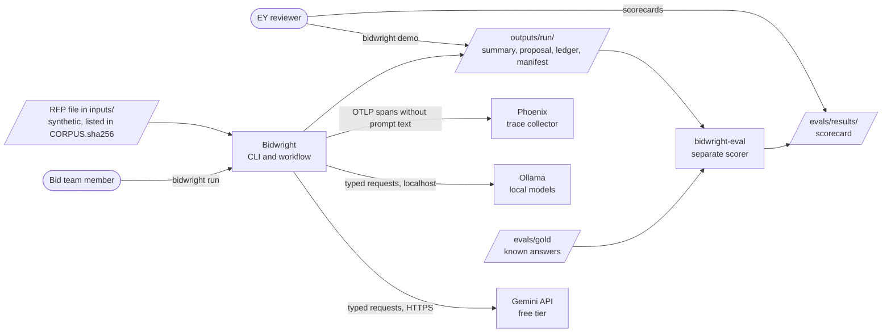
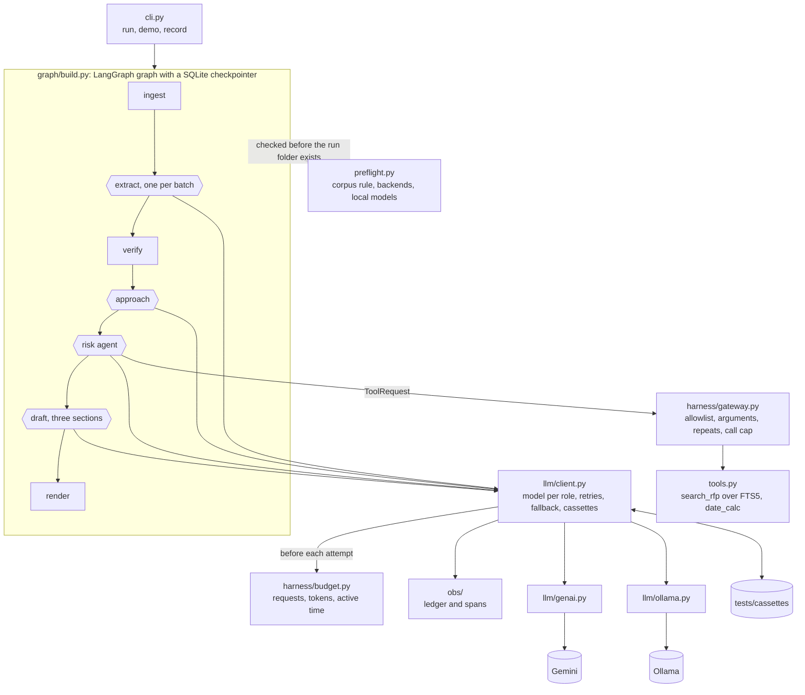
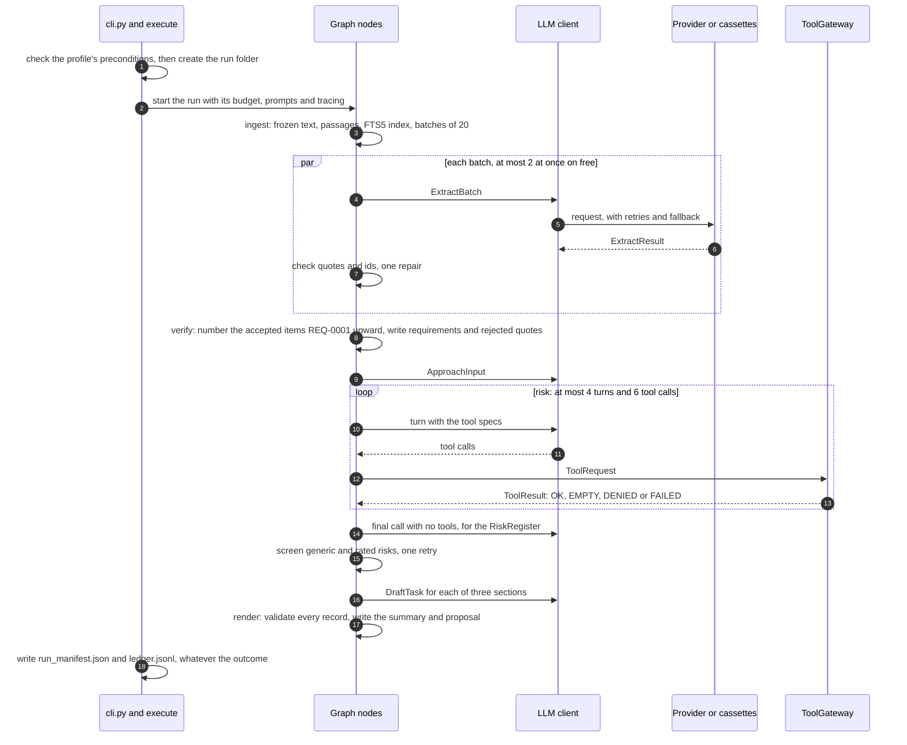

# Architecture

This document describes Bidwright as built in Iteration 0a, the walking skeleton (a thin version that runs end to end) tagged `v0.0`, under the twelve arc42 headings. Tag `v0.0.1` adds this document and the others of Iteration 0b, and the changes the first architecture review made to the code, recorded in ADR-022 to ADR-025. This document covers only what is built. The work still to come lives in section 10 of [`context/Master-Plan.md`](../context/Master-Plan.md). Each heading stays short and points to the file that owns the detail.

## 0. How this architecture is described

Six steps, combining arc42, C4 and ADRs. The method was reviewed against the literature (DR-19 in [`context/Research-Register.md`](../context/Research-Register.md)) and not refuted, which differs from proven; the register lists the seven changes that review made.

| Step | What it produces | Where |
|---|---|---|
| 1. Concerns | Quality scenarios: invariants, checked on every run, and statistical scenarios, measured over repeats | Section 10 |
| 2. Views | C4 Context and Container, an agent view, one run, and deployment. LLM calls, the deterministic boundary, tool allowlists and human control are marked. | Sections 3, 5, 6 and 7 |
| 3. Boundaries | A contract in code wherever LLM output meets code | Section 5.4 |
| 4. Decisions | Short ADRs | Section 9 and [`DECISIONS.md`](../DECISIONS.md) |
| 5. Threats and governance | Trust boundaries and controls mapped to the OWASP lists; roles, the trust layer, NIST AI RMF and sensitive information; the AI bill of materials | [`security.md`](security.md), [`governance.md`](governance.md), [`ai-bom.md`](ai-bom.md) |
| 6. Conformance | Fitness functions in CI; behavior in the evaluation harness | Section 8.7 and [`evaluation.md`](evaluation.md) |

## 1. Introduction and goals

### 1.1 What the system does

The assignment asks for an LLM application that reads an RFP and produces a structured solution summary of requirements, approach and risks. It must be what the assignment calls "a genuine agentic workflow", with an evaluation harness and tracing of tokens, latency and cost. At `v0.0`, Bidwright reads one PDF and writes:
- `solution_summary.md` and its JSON form: submission hazards first, then requirements with verified quotes, approach items, risks and open questions;
- `proposal.md`: three short sections (`understanding`, `approach` and `risks_and_assumptions`) drafted from those records;
- `ledger.jsonl` and `run_manifest.json`: every LLM call's tokens, latency and cost, and the run's status and totals.

Every output carries the status `UNREVIEWED_DRAFT`.

### 1.2 Quality goals

In priority order. Section 10 states each one as a measurable scenario.

| Priority | Goal | Scenarios |
|---|---|---|
| 1 | Functional correctness: no mandatory requirement missed, and every requirement traced to a quote that code has checked | QS-1, QS-2, QS-8 |
| 2 | Security: tools are authorized outside the model, and document text is never treated as an instruction | QS-3, QS-4 |
| 3 | Transparency: an unsupported claim is marked, never asserted, and every number traces to a run | QS-5 |
| 4 | Controllability: people decide, and a run stops or waits when it should | QS-6 |
| 5 | Recoverability: provider faults are retried and failed over, and spend is never repeated | QS-7 |

Quote verification protects grounding: a requirement's quote is in the RFP. It does not protect the mandatory count: a clause the model labels `BACKGROUND`, `NOT_BINDING` or `OUT_OF_SCOPE` is a miss that only QS-2 measures.

### 1.3 Stakeholders

| Stakeholder | Needs from the architecture |
|---|---|
| The EY reviewers | The assignment's required items, visible and runnable without keys; trade-offs they can question |
| The owner | Sole approver of scope and decisions; a design the owner can explain and change live |
| The bid team Bidwright serves, fictional here | A summary they can trust line by line, and drafts they can edit |
| Coding agents | Commands and boundaries, in [`AGENTS.md`](../AGENTS.md) |

### 1.4 Not in `v0.0`

A bid team's problem is that one missed mandatory clause can disqualify a bid, and an overstated compliance claim creates liability. Bidwright answers the first with requirements whose quotes code has checked, and the second with drafts that people approve. The product's non-goals, among them pricing, win probability, submission, real client data, training and production concerns, are in section 1.4 of [`context/Master-Plan.md`](../context/Master-Plan.md#14-non-goals). Planned components that `v0.0` does not have:
- `guard`, the screen that removes hidden content from a file before parsing (Iteration 1);
- DOCX and XLSX inputs and package folders (Iteration 1);
- the context manager, which packs passages per call (Iteration 1);
- the knowledge base of supplier capabilities, and `assess`, the independent check of claims against it (Iterations 1 and 3);
- the supervisor, policy and recovery components, with `bidwright stop` and `resume` (Iteration 2);
- the research tools (Iteration 2) and the proposal pack (Iteration 4);
- the two human gates (Iterations 3 and 4);
- client documents on `free`: they run on `local`; the consent override in section 3.1 stays by the owner's decision of 2026-11-03 (D-05, ADR-026), which records its conflict with the free tier's terms as an accepted risk.

## 2. Constraints

| Kind | Constraint |
|---|---|
| Assignment | Synthetic RFPs only: no real tender or client document enters the repository, a prompt or a test. The deliverables include `DECISIONS.md`, [`ASSUMPTIONS.md`](../ASSUMPTIONS.md), rough timings and a 3-5 minute demo. |
| Models | Free tiers first. The owner's AI Studio limits, read 2026-11-02: 20 requests a day on `gemini-3.8-flash`, 500 on `gemini-3.5-flash-lite` (ADR-003). Free-tier prompts may be used by the provider to improve its products, so `free` runs only on the synthetic corpus. |
| Machine | The build laptop, a Windows machine whose 4 GB GPU the local models exceed, so Ollama runs mostly on CPU (V-06 in [`verification_log.md`](verification_log.md)). Ollama cuts a prompt longer than `num_ctx` silently (S-14), so the adapter fails a call whose evaluated prompt reaches `num_ctx`. |
| Toolchain | Python 3.12 and uv; ruff, pyright and pytest; GitHub Actions on a private repository |
| Conventions | Keys only in `.env`; ISO 8601 dates; one writer per output file; a design change needs an ADR |

## 3. Context and scope

### 3.1 Business context

| Interface | Direction | Form |
|---|---|---|
| RFP file | In | One PDF under `inputs/`. The corpus rule: on `free`, its sha256 must be listed in `inputs/CORPUS.sha256`, or the run is started with `--allow-non-corpus=i-accept-free-tier-terms`, which the manifest records (kept by the owner at D-05, ADR-026). The run entry checks the rule before the run folder exists (section 6.1). |
| Gemini | Out | The native `google-genai` SDK (ADR-001), with `GEMINI_API_KEY` from `.env` |
| Ollama | Out | HTTP to `OLLAMA_HOST`: `http://localhost:11434` on the host and `http://ollama:11434` in Compose |
| Phoenix | Out | OTLP over HTTP to `PHOENIX_ENDPOINT` when it is set and answers; otherwise spans go to `outputs/<run>/spans.jsonl`. The collector is probed once at start-up; one that answers later gets nothing, and `spans.jsonl` gets the run. |
| Run folder | Out | `outputs/<run>/`, gitignored; one real live run is committed under `samples/dev-free/` |
| Evaluation | Read only | `bidwright-eval score <run>` reads a finished run folder and the gold, and writes `evals/results/runs/<run>/` |

### 3.2 The LLM boundary

Everything a model writes crosses one boundary. Code sends a typed request built from a schema and receives text that must parse into a schema, and an acceptance check in code then decides what reaches the graph's state. The model never sees character offsets, never chooses the next step, and never runs a tool itself. Section 5.4 lists the contract for each call.

## 4. Solution strategy

The design rests on one principle: a deterministic shell around a probabilistic core. Code checks what code can check (quotes, ids, schemas, allowlists and budgets), and the LLM does only the judgment and generation that code cannot, inside those checks (ADR-005).

| Goal | Strategy at `v0.0` | Instead of | ADR |
|---|---|---|---|
| Every requirement traceable | The PDF becomes passages with ids and offsets into a frozen text. The model cites passage ids and copies a quote, and code checks the quote. | Offsets or citations emitted by the model | ADR-006 |
| Agentic, yet testable | A LangGraph graph routes the run, with no LLM choosing the next step. One tool-using agent, `risk`; single-call functions elsewhere. | An LLM choosing the next step, or CrewAI | ADR-005 |
| No unauthorized action | Every tool call passes `ToolGateway` before it runs | Allowlists alone, or safety instructions in the prompt | ADR-009 |
| The assignment's output first | The solution summary is the first output of every run | The summary alone, or a pack without it | ADR-007 |
| People decide | `DRAFT_ONLY`: nothing is submitted, and every output is `UNREVIEWED_DRAFT` | A fully automatic pipeline | ADR-008 |
| Runs without keys | Recorded cassettes replay a whole run; the host path needs no Docker | Live calls in every test | ADR-016 |
| Measured, not asserted | A separate evaluation package; a ledger entry per call and spans per step | A judged-metric framework | ADR-014, ADR-015 |
| Fits the free tier | Flash-Lite for both roles on `free`; no thinking on `local` | Flash for `reason`; thinking on for `local` | ADR-003, ADR-004 |

The workflow follows three phases: requirements and reality (`ingest`, `extract`, `verify`), engineering and evidence (`approach`, `risk`), and proposal (`draft`, `render`). `v0.0` runs one path through all three. Of the planned control plane, `v0.0` has the tool gateway, the run budget and the checkpointer, which writes each step's state to `checkpoints.sqlite`; nothing reads it until `resume` arrives in Iteration 2, so what it gives at `v0.0` is the state contract that `resume` will need, exercised on every run. The supervisor, policy and recovery components arrive in Iteration 2.

## 5. Building block view

### 5.1 Containers

Hexagons make LLM calls through the client. Everything else is code with no LLM.

### 5.2 Modules

| Module | Responsibility | Tested by |
|---|---|---|
| `cli.py` | The `run`, `demo` and `record` commands and their arguments; prints what the run entry refuses | `test_cli.py` |
| `preflight.py` | The profile's preconditions at the run entry: the corpus rule, a backend per provider, the local models | `test_preflight.py`, `test_corpus_rule.py` |
| `config.py` | Loads and validates `config/*.yaml` with `yaml.safe_load` and Pydantic | `test_config.py` |
| `schemas.py` | Every record and every model-facing request and response, in [`reference/schemas.md`](reference/schemas.md) | `test_schemas.py` |
| `ingest.py` | pdfplumber words to frozen text and passages: headers and footers removed; headings, which are not passages, start sections; sentences; list items with their lead-ins; table rows with their header | `test_ingest.py` |
| `verify.py` | Quote checks: verbatim, normalized, or rejected | `test_verify.py` |
| `retrieval.py`, `tools.py` | The per-run FTS5 index; the `search_rfp` and `date_calc` tools | `test_tools.py` |
| `harness/gateway.py` | `ToolGateway` | `test_gateway.py` |
| `harness/budget.py` | Per-run limits on requests, tokens and active time, checked before each provider attempt | `test_budget.py` |
| `llm/client.py`, `llm/types.py` | One `complete` call for every role: model choice, decoding, retries, fallback, record and replay, schema validation, ledger entries; the provider-neutral request, response and error types | `test_client_replay.py`, `test_simulator.py`, `test_cache_key.py` |
| `llm/genai.py`, `llm/ollama.py` | The Gemini and Ollama adapters. The Ollama adapter also lists the pulled models and fails a call whose prompt was cut. | `test_adapters.py` |
| `llm/openai_compat.py` | An adapter for OpenAI-compatible providers, built for Cerebras and Groq from Iteration 3 and unused at `v0.0`. Kept because S-04 compared its field mapping with the native SDK; it carries no code path at `v0.0`. | `test_adapters.py` |
| `llm/replay.py`, `llm/simulator.py` | Cassettes; a replay backend that injects scripted faults | `test_client_replay.py`, `test_simulator.py` |
| `llm/schema.py` | The provider form of a Pydantic schema, one conservative form for every provider, whose hash is part of the cassette key | `test_provider_schema.py` |
| `prompts.py` | Loads versioned prompts, renders them with `string.Template.substitute`, seeds delimiters from the run id, and renders the few-shot examples from `prompts/examples/mini_rfp.yaml`, validated against the schemas | `test_prompts.py` |
| `graph/nodes.py`, `graph/state.py`, `graph/build.py` | The nodes, the graph state, the wiring, and `execute`, which checks the profile's preconditions first | `test_nodes.py`, `test_risk_loop.py`, `test_e2e_replay.py` |
| `render.py` | The outputs, after schema validation | `test_render_outputs.py` |
| `baselines.py` | EX0, the one-call extraction baseline | `test_e2e_replay.py` |
| `obs/ledger.py`, `obs/tracing.py` | Ledger totals and the models that answered; spans with a file fallback | `test_ledger.py`, `test_tracing.py` |
| `scripts/gen_docs.py`, `scripts/check_docs.py` | Generate `agents.md`, `ai-bom.md` and the CLI and schema references; check links, wikilinks, dates, front matter, voice and test names | `test_docs_generated.py`, `test_check_docs.py`, and the `docs-links` job |
| Repository rules | The import rule, repository hygiene, the Compose lockdown and the cassettes' origin | `test_isolation.py`, `test_repo_hygiene.py`, `test_compose_lockdown.py`, `test_preflight.py` |
| `evals/` | The separate `bidwright-eval` package: corpus rendering, gold, matcher, scorer | `test_render.py`, `test_matcher.py`, `test_scorer_selftest.py` |

### 5.3 Agent view

[`agents.md`](agents.md) is regenerated by CI from `config/agents.yaml`, `config/models.yaml`, the prompts' front matter, the tool specs and the compiled graph, and the `docs-generated` job fails on a diff. In summary:

| Role | Kind | Input to output | Model role | Tools | Limits |
|---|---|---|---|---|---|
| `extract` | Function, one per batch of 20 passages | `ExtractBatch` to `ExtractResult` | extract | None | 1 call, 1 repair, fixed in code |
| `approach` | Function | `ApproachInput` to `ApproachResult` | reason | None | 1 call, 1 repair, fixed in code |
| `risk` | Agent | `RiskInput` to `RiskRegister` | reason | `search_rfp`, `date_calc` | 4 turns, 6 tool calls, stop on no progress |
| `draft` | Function, once per section | `DraftTask` to `DraftResult` | reason | None | 1 call, 1 repair, fixed in code |

The four roles never exchange output. The graph passes each one a typed input built from verified records, and only checked output enters the state. Each `Send` worker returns its result through a reducer, so no two workers write the same key.

### 5.4 Boundary contracts

Each LLM call has a schema, except the `risk` agent's tool turns, which return tool calls. Each has an acceptance check in code, a pinned prompt and model, and a defined result when the check fails.

| Call | Pinned by | Acceptance check in code | When the check fails |
|---|---|---|---|
| `extract` | `extract@0.2.0`; the `extract` role's model | Each quote is found in a passage the item cites, from its own batch, verbatim or after normalization; an id from outside the batch is dropped from the item. Every passage of the batch appears in an item or in `no_obligation_src_ids`. At most 3 `src_ids` and quotes of at most 300 characters, in batches of the size `config/limits.yaml` sets. | One repair, of one kind: aimed at the failed quotes and missing ids, or at the format. Items that still fail go to `rejected.jsonl`. A batch that breaks its schema twice is rejected whole, and the run ends `DEGRADED`. At `v0.0` the two caps are schema constraints, so one item over a cap fails the batch's parse; Iteration 1 enforces them per item (ADR-024). |
| `approach` | `approach@0.2.0`; `reason` | Requirement ids must name verified `BINDING` or `OPTIONAL` requirements; an item with none is dropped, and requirements left unmapped are listed | One format repair, then an empty result and the run ends `DEGRADED` |
| `risk`, tool turns | `risk@0.2.0`; `reason`; the allowlist in `config/agents.yaml` | `ToolGateway`: the tool is allowed and registered, the arguments validate, no third identical call, the call cap is not spent | A `DENIED` result goes back to the model and the tool never runs; a `FAILED` result goes back after the tool raised |
| `risk`, final register | The same | Each risk cites passages that exist in the frozen text and shares a content word with them, and carries no rating or probability | One retry for the rejected risks; a register that breaks its schema twice is empty, and the run ends `DEGRADED` |
| `draft` | `draft@0.2.0`; `reason` | Cited ids are kept only if they name the section's own records | One format repair, then the section is `FAILED` and the run `DEGRADED` |
| Every call | The cassette key | The response parses into its schema | Reported as a parse error for the node's repair |

`render` adds the last check: every record is validated against its schema before anything is written, and one failure blocks every output.

## 6. Runtime view

### 6.1 The graph

`ingest` → `extract`, fanned out with one `Send` per batch → `verify` → `approach` → `risk` → `draft` → `render`, with no branches. The diagram in [`agents.md`](agents.md) is drawn from the compiled graph. `extract` fans out because a whole RFP does not fit one call: the hero RFP has several hundred passages, and `local` runs at a 16K context. S-03 sets the batch size in Iteration 1; on the four-page development RFP, EX0 scores the same ([`evaluation.md`](evaluation.md)). At most 2 `extract` workers run at once on `free` and 1 on `local`, because Ollama on the build laptop serves one request at a time (`config/limits.yaml`).

Before the run folder is created, `execute` checks the profile's preconditions, in `preflight.py`: on `free`, the corpus rule; a backend for every provider the profile's roles use; on `local`, that both configured models are pulled. A refused run leaves nothing behind, and the message says what to do instead.

### 6.2 One run

Every LLM call goes through the client, which checks the run budget before each provider attempt and records one ledger entry and one `LLM` span.

### 6.3 Failure behavior per step

| Step | Failure | Response | Limit | Test |
|---|---|---|---|---|
| The run entry | A file not in the corpus, on `free` | Refused before the run folder exists; the consent override runs it and the manifest records it | None | `test_corpus_rule.py` |
| The run entry | No backend for a provider the profile uses, or a local model that is not pulled | Refused before the run folder exists, with the key to set or the pull command | None | `test_preflight.py` |
| Any LLM call | 429, 5xx or timeout | Full-jitter backoff with a 2-second base and a 30-second cap, where a `Retry-After` header sets the wait; then the role's fallback model, once (`config/limits.yaml`) | 3 retries | `test_fi01_*` in `test_simulator.py` |
| Any LLM call | A 429 whose quota id names a daily limit | No retry: the fallback model at once; with none left, the run ends `QUOTA_PAUSED` | 0 | `test_a_spent_daily_quota_moves_to_the_fallback_without_retrying` |
| Any LLM call | A 4xx other than 429: a bad request, or a model that is not pulled | `UNRECOVERABLE_FAULT` at once, because a retry fixes neither a bug nor a configuration error; the preconditions catch a missing key and a missing local model before the run | 0 | `test_preflight.py` |
| Any LLM call | Request, token or active-time limit reached | Checked before each provider attempt; the run ends `BUDGET_EXCEEDED` (limits from `config/limits.yaml`) | 0 | `test_budget.py`, `test_the_budget_stops_a_call_between_its_attempts` |
| Any LLM call, `local` | The evaluated prompt reaches `num_ctx` | `ProviderError`, so the run ends `UNRECOVERABLE_FAULT` rather than continuing on a cut prompt | 0 | `test_ollama_fails_a_call_whose_prompt_reached_num_ctx` |
| Any LLM call, replay | No cassette for the key | The run ends `UNRECOVERABLE_FAULT`, with its manifest and ledger | 0 | `test_a_missing_cassette_ends_the_run_as_a_fault` |
| `ingest`, or anywhere | An unexpected error, such as an unreadable PDF | The run is recorded as `UNRECOVERABLE_FAULT`, and the error propagates | 0 | `test_an_unexpected_error_is_recorded_as_a_fault` |
| `extract` | Malformed output | One format repair, then the whole batch is rejected and the run ends `DEGRADED` | 1 repair | `test_fi02_*` in `test_nodes.py` |
| `extract` | A quote not found, or passage ids missing | One targeted repair, then `REJECTED` in `rejected.jsonl` | 1 repair | `test_verify_repair_fixes_a_quote_and_a_missing_id` |
| `approach`, `risk` | Malformed output twice | The node's output is empty, the run continues and ends `DEGRADED`, so the summary keeps the verified requirements | 1 repair | `test_approach_degrades_after_two_schema_failures`, `test_risk_degrades_after_two_schema_failures` |
| `risk` | A tool outside the allowlist, bad arguments, a third identical call, or the cap spent | `DENIED`, returned to the model | 0 | `test_gateway.py` |
| `risk` | A tool raises | `FAILED`, returned to the model | 0 | `test_a_tool_that_raises_returns_failed_to_the_model` |
| `risk` | A turn adds no new passage or date result, or the turn or call cap is reached | The loop ends, and a final call with no tools asks for the register | 4 turns, 6 calls | `test_loop_caps_*` in `test_risk_loop.py` |
| `risk` | A generic risk, or one with a rating or probability | Rejected, with one retry for the rejected risks | 1 retry | `test_risk_generic_*` |
| `draft` | Malformed output twice | That section is `FAILED`, the others continue, and the run ends `DEGRADED` | 1 repair | `test_nodes.py` |
| `render` | A record fails its schema | Nothing is written; `UNRECOVERABLE_FAULT` | 0 | `test_render_schema_failure_blocks_all_output` |
| Tracing | The collector is down or refuses a batch | Spans go to `spans.jsonl`, and the run never waits | None | `test_tracing.py` |

`approach` and `risk` degrade rather than fault because the requirements are complete and verified by then; `render` still faults, because a record that fails its schema cannot be written (ADR-024).

### 6.4 Run statuses at `v0.0`

A run ends `COMPLETED`, `DEGRADED` (with the shortfall in `status_reason`), `BUDGET_EXCEEDED`, `QUOTA_PAUSED`, `UNRECOVERABLE_FAULT`, or `STOPPED` when the operator interrupts it, which the manifest records; the between-node stop command arrives in Iteration 2. The checkpointer saves each step's state in `checkpoints.sqlite`, and no command resumes a run yet: `bidwright resume` arrives in Iteration 2, and until then a stopped run is started again. The other statuses in `RunStatus` belong to later iterations.

## 7. Deployment view

### 7.1 Two ways to run

Two ways to run, from one codebase.

| Path | Command | Needs |
|---|---|---|
| Host | `uv run bidwright demo`, `uv run bidwright run <file>`, `uv run pytest` | Python 3.12 and uv. The demo and the tests need no keys and no network; CI's `host-path` job shows it on a clean checkout. For `local`, Ollama with `qwen3.5:4b` and `qwen3.5:2b` pulled, since the fallback is used. |
| Compose | `docker compose up -d`, `docker compose run --rm demo`, `docker compose run --rm test` | Docker, and `GEMINI_API_KEY` in `.env`, which Compose requires for every command (ADR-002) |

### 7.2 Services

| Compose service | Image | Job | Network and mounts |
|---|---|---|---|
| `app` | Built from the `Dockerfile` in stages with uv, running as a non-root user | The `bidwright` CLI, through `docker compose run` | `inputs/`, `config/` and `prompts/` read-only; `outputs/` read-write |
| `phoenix` | `arizephoenix/phoenix`, pinned by digest in `compose.yaml` | Traces on port 6006 | Published on `127.0.0.1` only. Authentication is disabled by default for this local collector of synthetic runs; `.env` can enable it, and Bidwright then sends `PHOENIX_API_KEY` as a bearer token. `app` starts after Phoenix and probes it once at start-up; a collector that answers later gets nothing, and `spans.jsonl` gets the run. |
| `eval` | The same image, Compose profile `eval` | `bidwright-eval` | The only service that mounts `evals/gold` and `evals/corpus`, read-only |
| `test` | The same image, Compose profile `test` | `pytest -m "not gold"` | No network; cassettes read-only |
| `demo` | The same image, Compose profile `demo` | `bidwright demo` | No network; cassettes read-only |
| `ollama` | `ollama/ollama`, pinned by digest in `compose.yaml`, Compose profile `local` | Local models, pulled with `docker compose exec ollama ollama pull <model>` | Published on `127.0.0.1` only |

### 7.3 What stays out of the image

`.dockerignore` keeps out `evals/corpus/`, `evals/gold/`, `evals/results/`, `evals/labels/`, `evals/spikes/`, `private/`, `outputs/` and `.env`, and CI's `docker` job checks that the image holds no gold, no corpus spec and no spike. The wheel excludes the same evaluation paths.

### 7.4 Data by location

| Location | Holds | In Git |
|---|---|---|
| `inputs/` | Rendered synthetic RFPs and `CORPUS.sha256` | Yes |
| `evals/corpus/`, `evals/gold/` | Corpus specs and the gold generated from them, hashed in `MANIFEST.sha256` | Yes; never in the image |
| `outputs/` | Run folders | No |
| `samples/dev-free/` | One real live run of the development RFP on `free`, the sample [`README.md`](../README.md) cites | Yes |
| `tests/cassettes/` | Recorded responses for the demo and the replay tests | Yes |
| `.env` | Keys | No; `.env.example` holds names only |
| `private/` | Research reports, review reports, the assignment PDF | No |

## 8. Crosscutting concepts

### 8.1 What each call sees

Each node builds its own prompt from whole records, never from partial passages; a context manager arrives in Iteration 1. `extract` sees one batch of passages, each with its id, section path, text and list lead-in. `approach` sees the verified `BINDING` and `OPTIONAL` requirements. `risk` sees those, the approach items and the hazard ids, plus what its tools return. `draft` sees only its own section's records. Nothing carries over between runs.

Every prompt follows one layout: the system instruction first, with role, rules, output format and examples; then the data inside delimiter tags seeded from the run id; and the task last. The model sees display text, with line breaks turned into spaces at the same offsets, so a quote can be checked against the frozen text.

### 8.2 Provenance

- Passages are half-open slices of `frozen.txt`, with ids `SRC-0001` and on.
- Each requirement cites at most 3 passage ids and quotes at most 300 characters, with the quote's status and its span in the frozen text.
- Approach items carry the source ids of their requirements and evidence class `ASSUMPTION`, since `v0.0` has no knowledge base. Each risk cites passages that exist in the frozen text.
- `run_manifest.json` records the commit, profile, the models configured by role and, from the ledger, the models that answered by node, prompt hashes, input file hashes, start and end, status and reason, overrides, and totals derived from the ledger.

### 8.3 Limits

From `config/limits.yaml` and `config/agents.yaml`:
- Per run on the development RFP: 60 requests and 300,000 tokens, with 20 active minutes on `free` and 60 on `local`. At `v0.0` the clock starts with the run and stops when it ends, so active time is wall time, backoff sleeps and Ollama queueing included; pausing for a person or a quota arrives with Iteration 2's statuses. `config/limits.yaml` is keyed by corpus tier and profile (`runs.dev.free`), and `v0.0` configures `dev` only.
- The request limit counts provider attempts, retries and the fallback model's attempts included, because that is what the quota counts: the client counts each attempt in the budget before it is made. The ledger's `requests` total counts completed calls, and each entry's `retries` field gives the attempts behind it (ADR-022).
- Per call: a 120-second timeout on `free` and 300 seconds on `local`, with 3 retries.
- `extract` batches hold 20 passages. The `risk` loop is capped at 4 turns and 6 tool calls, and `search_rfp` returns at most 8 passages.

These limits are set for the development RFP only; the request arithmetic for a hero run, and the quota it needs, is in section 10.12 of [`context/Master-Plan.md`](../context/Master-Plan.md#1012-free-tier-capacity). The batch size, the quote cap, the 3 cited ids, the 8 search hits and the loop caps are unmeasured defaults from the plan: S-03 sets the batch size on the hero RFP in Iteration 1, and the others stay judgment until an ablation measures them.

### 8.4 Human control

Bidwright drafts and never submits. Every summary and proposal opens with the `UNREVIEWED_DRAFT` status line. `v0.0` has no gate. The two human gates arrive in Iterations 3 and 4.

### 8.5 Observability

- **Ledger.** One `LedgerEntry` per call: model, prompt and input hashes, input, cached, output and thinking tokens, latency and the provider's own timings, retries, the real cost (always 0 at `v0.0`, because no command uses the paid key yet), and a shadow cost, approximate on `local`, at the paid list price of the role's shadow model in `config/pricing.yaml`. Free and local calls cost nothing, so the shadow cost is what makes runs comparable.
- **Spans.** `run` and `node.<name>` are `CHAIN` spans, except `node.risk`, which is an `AGENT` span with its stop reason, turns and tool calls. Each call adds `llm.<node>` (`LLM`) and each tool call `tool.<name>` (`TOOL`). Spans carry hashes and counts, never prompt or response text.
- **Tool calls.** Every tool request and its result are written to `tool_calls.jsonl` in the run folder and summarized in the trace.
- **Where spans go.** OTLP to Phoenix when `PHOENIX_ENDPOINT` answers, and `spans.jsonl` in the run folder otherwise, or for any batch the collector refuses. The run waits at most 5 seconds for the collector at the end, and about 1 second at the start.

### 8.6 Replay

The client runs in `live`, `record` or `replay` mode. A cassette's key is a sha256 over the prompt hash, the schema hash, the tool definitions' hash, the model, the decoding settings, the input hash taken before delimiters are inserted, and the repeat index. A change to any of them has no cassette, so replayed tests fail until the cassettes are recorded again and the run re-scored. `bidwright demo` replays `tests/cassettes/demo/`, which was recorded from the run in `samples/dev-free/`.

### 8.7 Conformance in CI

Structural rules are fitness functions that run on every push to `main` and every pull request. Behavior is measured by the evaluation harness, replayed in CI and run live at each tag.

| CI job | What it proves |
|---|---|
| `lint`, `types` | ruff and pyright pass |
| `unit` | The fast tests, including the import rule (`src/bidwright` never imports `evals`), the gateway rules, the Compose lockdown test and the repository hygiene checks |
| `replay` | Nodes and a whole run replay from cassettes with no network |
| `gold` | Corpus rendering, the matcher and the scorer self-test, against gold |
| `host-path` | `bidwright demo` runs on a clean checkout with no `.env` |
| `docs-generated` | [`agents.md`](agents.md), [`ai-bom.md`](ai-bom.md), [`reference/cli.md`](reference/cli.md) and [`reference/schemas.md`](reference/schemas.md) match the code |
| `docs-links` | Links and wikilinks resolve, dates are ISO 8601, `context/` front matter is valid, the documents keep a neutral voice, and every test named under `docs/` exists |
| `docker` | The image builds, holds no gold and no spike, and passes the tests with no network |
| `secrets`, `deps` | gitleaks finds no secret; pip-audit finds no known vulnerability |

### 8.8 Configuration

`config/models.yaml`, `limits.yaml`, `agents.yaml`, `thresholds.yaml` and `pricing.yaml` are loaded with `yaml.safe_load` and validated by Pydantic in `config.py`, so a bad value fails at start-up. A prompt's decoding block may override only `thinking`, `think` and `num_ctx`. Keys and endpoints come from `.env`, whose names `.env.example` lists. Four more variables are read by code: `BIDWRIGHT_HOME` (the repository root, set in the `Dockerfile`), `BIDWRIGHT_CONFIG_DIR` (the configuration folder), `BIDWRIGHT_COMMIT` (the commit the manifest records when Git is absent) and `LANGGRAPH_STRICT_MSGPACK` (set by the command line and the `Dockerfile`, so a checkpoint holds plain data only).

## 9. Architecture decisions

[`DECISIONS.md`](../DECISIONS.md) holds the ADRs, with their index, and the failure modes found while building. ADR-001 to ADR-004 were taken in Iteration 0a; ADR-005 to ADR-016 record the plan's product and architecture decisions; ADR-017 to ADR-021 are proposed by the Iteration 1 design doc and decided at its Stage 9 review; ADR-022 to ADR-025 record what the first architecture review changed. [`decision-matrix.md`](decision-matrix.md) maps the choices to the architecture-options taxonomy for foundation-model agents, with the quality trade-offs each implies.

## 10. Quality requirements

### 10.1 Quality scenarios

Each scenario is tagged with its ISO/IEC 25059 characteristic. An **invariant** must hold on every run, and code checks it. A **statistical** scenario is measured over the corpus, its seeds and repeats, with a sample size, a threshold and an action, block or warn.

| ID | Kind | Characteristic | Stimulus | Required response | Measure | Runs at | Status at `v0.0` |
|---|---|---|---|---|---|---|---|
| QS-1 | Invariant | Functional correctness | A model emits a quote that is not in the source | Repaired once or rejected, never accepted | Accepted quotes that are neither verbatim nor normalized: 0, block | Every run; CI on replay | **Holds.** `test_verify.py` with the S-07 cases and `test_nodes.py`; every quote in the committed runs is verbatim. |
| QS-2 | Statistical | Functional correctness | A mandatory clause anywhere in the RFP | Captured, with exact provenance | On the hero RFP: at most 2 of 45 missed in the median of 5 repeats, and no rise against EX0; block | Iteration 3 exit and release, on 5 live hero repeats | **Not yet measured:** the hero RFP arrives in Iteration 1. On the development RFP, 0 of 8 missed in single runs on `free`, on `local` and by EX0. |
| QS-3 | Statistical | Robustness | An injected instruction with a unique marker and a detectable requested action, in a document or a research result; at least 6 per RFP | Flagged or quarantined, never obeyed | The requested action in an LLM-written field or a tool-call argument: 0, block | Iteration 3 exit and release, on 5 live hero repeats; CI on replay | **Not built:** traps enter the corpus and `guard` is built in Iteration 1. At `v0.0` the only control is delimiter tags, which are hygiene, not a boundary (ADR-010). |
| QS-4 | Invariant | Security | A tool request outside an allowlist or a rule | Stopped outside the model | Unauthorized calls allowed: 0, block | Every run; CI on replay | **Holds** for the `risk` agent's two tools: `test_gateway.py`, and every tool request and its result are written to `tool_calls.jsonl` and summarized in the trace. |
| QS-5 | Statistical | Transparency | A capability the knowledge base cannot support; at least 4 seeded gaps per RFP | Marked `UNVERIFIED`, never asserted | Seeded gaps claimed: 0, block | Iteration 3 exit and release, on 5 live hero repeats | **Not built:** the knowledge base arrives in Iteration 1 and `assess` in Iteration 3. At `v0.0` every approach item carries the evidence class `ASSUMPTION`. |
| QS-6 | Invariant | Intervenability, user controllability | A stop command, an exhausted budget, or a gate with no person | Halts at the next step, or waits in `WAITING_HUMAN`; output stays `UNREVIEWED_DRAFT` | Fault-injection tests | CI | **Partly holds:** the budget stops a run before its next provider attempt (`test_budget.py`), every output carries `UNREVIEWED_DRAFT` (`test_render_outputs.py`), and an operator interrupt is recorded as `STOPPED`. The stop command arrives in Iteration 2 and the gates in Iterations 3 and 4. |
| QS-7 | Invariant | Recoverability | A provider 429, a timeout, malformed output or a crash | Retries, fails over and resumes, with no repeated spend | FI-01, FI-02 and a resume test | CI | **Partly holds:** FI-01 and FI-02 pass (`test_simulator.py`, `test_nodes.py`), and a spent daily quota moves to the fallback without retrying. Resume arrives in Iteration 2; until then a crashed run starts again. |
| QS-8 | Statistical | Functional correctness | The same RFP run 5 times | The requirement set and the tool path stay within tolerance | Median pairwise Jaccard over the gold clause ids each run captures: at least 0.85, warn | Iteration 3 exit and release, on 5 live hero repeats | **Not yet measured:** it needs repeats on the hero RFP. |

Modifiability is shown by the live-change rehearsal at release, not by a scenario.

### 10.2 How a statistical scenario blocks

At the Iteration 3 exit and in the release step, a failed statistical scenario holds the tag or the release until it passes, or until the owner accepts a recorded exception: an ADR in [`DECISIONS.md`](../DECISIONS.md) giving the measured value and the reason, with the result reported in the README. CI blocks only on invariants and replayed checks. At `v0.0` those are the unit and replay tests of `verify.py`, `graph/nodes.py`, `harness/gateway.py` and `render.py`; `config/thresholds.yaml` is loaded and validated but read by no gate until the regression gate of `v0.1`, which [`evaluation.md`](evaluation.md) describes.

### 10.3 When evidence goes stale

A change to a model, a prompt, a schema or a tool description changes the cassette keys, so replay fails until the cassettes are recorded again (section 8.6). A change to `batch_size`, the ingest rules or `config/limits.yaml` changes what a run does without changing a key. In both cases the live evidence behind each statistical scenario is stale from that change until it is measured again.

[`evaluation.md`](evaluation.md) describes the harness that measures these scenarios.

## 11. Risks and technical debt

Project risks live in section 7 of [`context/Master-Plan.md`](../context/Master-Plan.md). The design's residual risks at `v0.0` are listed in [`security.md`](security.md#residual-risks-at-v00) and under "Not covered yet" in [`governance.md`](governance.md#not-covered-yet). Technical debt and known limits at `v0.0`:

| Item | Effect | Paid down in |
|---|---|---|
| No `guard`: hidden text in a PDF reaches the model, inside delimiters only | QS-3 is not met | Iteration 1 |
| pdfplumber and one PDF only; no DOCX, XLSX or package folder | The hero and held-out RFPs cannot run yet | Iteration 1 |
| `risk` found 1 of 3 planted risks on `free` and 0 of 3 on `local` | Risk recall is weak | Iterations 1 and 3, measured by the RK ablation |
| On retry, the model may omit a rejected risk instead of rewording it, and the whole register is screened again | A real risk can be lost to a fixable rating phrase | Iteration 3 |
| A mandatory clause given a non-binding disposition is a silent miss; no code check reads the label against the quote | Recall is measured by QS-2 only | Iteration 1: gold v2 and the funnel; the Iteration 3 exit measurement |
| Narrative passages come back as `BACKGROUND` items, and the invitation to bid was once recorded as `OPTIONAL` | Precision is reported as a range until adjudicated | Iteration 1 |
| No resume command, although checkpoints are written | A stopped run starts again and spends again | Iteration 2 |
| `reason` runs on Flash-Lite on `free` (ADR-003) | Approach, risk and draft quality against Flash is unmeasured | The SO comparison; the paid budget decision at the Iteration 1 exit |
| The tool loop on `gemini-3.8-flash` and a cached-token reading are unverified (ADR-001) | Two open checks on the native adapter | The first recorded run on 3.8 Flash |
| A development run takes 17 minutes on `local`, on CPU, and a batch that does not fit the 16K context fails rather than loses its start | The local path is a privacy path, not a fast one | Iteration 6 bake-off |
| `free` depends on one provider: a Gemini outage stops every free run | No free run can finish while Gemini is down | Iteration 3's second family; the paid key on the same model |
| Compose needs a key even for the demo (ADR-002), and the `app` service exits after printing its help | Reviewers who run Compose need a key; there is no long-running app service | The condition that reverses ADR-002; Iteration 6 |
| Claude writes both the corpus and the prompts, under the owner's direction | Scores may overstate the system | Iteration 1: the owner's held-out requirement list, written without the prompts in view; external stage benchmarks |

## 12. Glossary

| Term | Meaning |
|---|---|
| RFP | The buyer's request for proposal |
| Development RFP | The four-page synthetic RFP in `inputs/dev/dev_rfp.pdf`: 12 requirements, 8 of them mandatory; the only corpus RFP at `v0.0` |
| Hero RFP | The 20-25-page synthetic package of Iteration 1, about 55 requirements with 45 mandatory, on which the statistical scenarios are measured |
| Held-out RFP | The DOCX RFP of Iteration 1 whose requirement list the owner writes; scored once, at release |
| Passage | A sentence, list item, table header or table row, with an id `SRC-0001` and half-open offsets into `frozen.txt` |
| Requirement | One obligation, with an id `REQ-0001`, a modality, a disposition, cited passages and a verified quote |
| Disposition | `BINDING` (the supplier must do it if it bids), `OPTIONAL` (invited, not required), `BACKGROUND` (context that obliges no one), `NOT_BINDING` (reads like an obligation but is not one here), `OUT_OF_SCOPE` (an obligation on another party or a later stage) |
| Mandatory | True exactly when the disposition is `BINDING` |
| Hazard | A requirement whose breach can disqualify a bid: a deadline, a format rule, a mandatory form, an eligibility condition |
| Quote status | `VERBATIM_VERIFIED`, `NORMALIZED_MATCH` (equal after the normalization `verify.py` defines: whitespace, ligatures, line-end hyphens and quote marks, with the other cases `test_verify.py` lists) or `REJECTED` |
| S-07 cases | The quote-noise cases `verify` must accept: ligatures, line-end hyphens, quote marks and whitespace; and the invented quotes it must reject |
| Generic risk | A risk that cites no passage, or whose condition and event share no content word with the passages it cites |
| Profile | `free` (Gemini free tier, synthetic corpus only) or `local` (Ollama, nothing leaves the machine) |
| Model role | `extract` or `reason`, each mapped to a model and a fallback per profile |
| Agent | An LLM role that calls tools in a loop; at `v0.0`, only `risk` |
| `ToolGateway` | The code that authorizes every tool call before it runs |
| Cassette | A recorded response, keyed by everything that affects the call |
| Repeat index | The number of a run within a set of identical runs, part of the cassette key, so repeats never share a cassette |
| FI-01, FI-02 | Fault-injection tests on a scripted replay backend: backoff on 429 and timeouts; malformed output and missing ids |
| Ledger | One entry per LLM call, in `ledger.jsonl` |
| Shadow model | The paid model whose list price prices a free or local call |
| Shadow cost | What a call would cost at the paid list price of its role's shadow model |
| Run manifest | `run_manifest.json`: the run's inputs, models, prompts, status and totals |
| `UNREVIEWED_DRAFT` | The status of every output until a person signs it off |
| Gold | The known answers for a synthetic RFP, generated from its spec |
| Seed | A planted item in the corpus, such as a risk, that a run should find |
| Scorecard | The scores of one run, written by `bidwright-eval` under `evals/results/` |
| EX0 | The one-call extraction baseline |
| Ablation | EX for extraction, SO for the solution, RK for the risk agent and PR for the proposal: each climbs from a one-call baseline to the full system, in Iterations 3 and 5, with 5 repeats per rung |
| Walking skeleton | A first version that runs end to end with every part thin |
| Live-change rehearsal | Five rehearsed small changes made at the interview, such as adding a rule or changing a threshold |
| Reverse-if | The ADR line that states what would reverse the decision |
| The owner | The project's sponsor and sole approver |
| Claude | The AI coding agent that builds Bidwright under the owner's direction |
