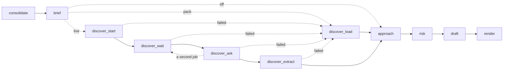

# Iteration 2 design: research the domain

**Status:** built, at the end of Iteration 2 on 2026-11-05; the iteration closes with the tag `v0.2`. The plan below is kept as written, and the section "As built at `v0.2`" records where the build departs from it. It was accepted for the build on 2026-11-04 (D-07 in [`context/Decision-Form.md`](../../context/Decision-Form.md)), after the Stage 9 review's first round (53 issues) and its one re-audit (29 issues), both resolved the same day. Its decisions are ADR-031 to ADR-037 in [`DECISIONS.md`](../../DECISIONS.md) (ADR-037 records three of the six departures, and ADR-034 and ADR-036 the other three) and CH-88 to CH-90 in the Master-Plan's change log; the examples' return goes to the start of Iteration 3's extraction ladder (CH-90). It builds on ADR-022 (the request budget), ADR-023 (the run entry), ADR-024 (acceptance checks), ADR-025 (agent configuration), ADR-026 (client documents), ADR-029 (the free tier's daily quota) and ADR-030 (the matcher), and on the checks of 2026-11-04 in [`docs/verification_log.md`](../verification_log.md): C7-06 again, C7-16, the NotebookLM server and its result shapes, and S-11.

## As built at `v0.2`

Where the build departs from this plan, the code, the ADRs and the failure-mode log of [`DECISIONS.md`](../../DECISIONS.md) hold. The departures, with the sections they touch:

**Decisions taken after this plan, from live failures and the code review**
- **Prompt versions:** `brief.md` is at 0.2.0 and `discover.md` at 0.4.0, and `config/agents.yaml` names `brief@0.2.0` and `discover@0.4.0`. `brief` 0.1.0 listed the visible trap TR-01 as an `always` item at its first live call; `discover` 0.2.0 asked no question; `discover` 0.3.0 attached excerpt ids on another subject. Each is a row of the failure-mode log of 2026-11-05 (5.3, steps 9 and 11).
- **Settling an extraction:** besides the plan's checks, an item or need that shares no content word with the excerpts it cites is dropped, with acronyms and numbers such as ISO and 27001 counted as words, in every extraction and at every pack load; an extraction that keeps no item or need is a research failure and writes no `domain_brief.json`; a pack whose entries all fail at load is a shortfall, and the run ends `DEGRADED`; a pack's entry ids are kept at load (4.4, step 11).
- **Resume:** before anything appends, a resume repairs all four line files, `ledger.jsonl`, `events.jsonl`, `tool_calls.jsonl` and `dead_letter.jsonl`, each cut recorded as a recovery event `<name>_cut`, where the plan repaired only the ledger with `ledger_cut`; and `refusal()` also refuses a run whose input files' hashes changed, since its checkpoints hold the old passages (4.2, step 4).
- **The pack builder:** `bidwright research pack` takes `--leave-out`, which leaves a source out with its excerpts and every answer citing them; it lists for review any kept source whose title or URL reads like a solicitation; and it settles the extraction again with the tier rule (step 13). A live research job had returned a university's published request for proposal.
- **`RuleContext`:** it takes `rfp: bool = True`; a context with `rfp=False`, the pack builder's run, holds no passages, and only `rfp=True` requires them (step 6).

**Additions this plan does not describe**
- **Schemas:** `PackAnswer` has `job`, the label of the job it was asked of, and `ResearchRecord` has `calls`, the run's `discover` model calls so far, so a rerun node names its calls and journal keys as before (5.1, step 11).
- **The research provider:** `bind(notebook_id, *, known=(), excerpts=0)` takes the sources and the excerpt count a run already holds, so new source and excerpt ids continue from them on a resume (4.4).
- **G1 and G5:** a `start_research` whose query is a recorded job's starts nothing and passes G1, and a recorded question, answered from `research.json`, passes G5, so a resumed node's replayed calls pass the caps; [`docs/agents.md`](../agents.md) gives the rules' checks as built (6.2).
- **Call ids:** the retry after generic risks is `R-final-generic`, and the three nodes' manifests are written through `CallManifests` in `graph/nodes.py`, which calls `ContextManager.record_manifest` and counts every turn after the rendered prompt (step 14).

**Changed by the drift report of 2026-11-05**
- `EventRecord.kind` no longer lists `gateway`, which nothing wrote: a gateway denial is a row of `tool_calls.jsonl`, and G2 and G3 denials are also security events, as ADR-032 has it (5.1).
- A run paused on a spent daily quota says to resume it with `bidwright resume` after the quota resets, or with `--profile paid`, where it said to run it again (4.3).
- Research mode `live` is refused in the client's `record` and `replay` modes, before the run folder exists, since MCP calls have no cassettes and a replay would reach the research server (step 12).

**Decided by the owner on 2026-11-05, built before the tag**
- D-08, ADR-038: the NotebookLM research provider leaves out a cited source whose title or URL reads like a published solicitation, the pattern the pack builder already used, now in `research/trust.py`, before any excerpt is made; an answer that cited one has its text withheld; `AskResult.dropped` counts them, and `discover` notes each case in `research.json` without the source's title (4.4, 5.1).
- D-09: the authority tiers stay as `config/research.yaml` sets them (6.1).

**Corrected in place:** the status line above.

## 1. Purpose

Iteration 2 makes a run controllable and resumable, and gives Bidwright its first research step, behind the gateway. It ends at tag `v0.2` when the Iteration 2 gate in section 5 of [`context/Master-Plan.md`](../../context/Master-Plan.md) passes.

In one line: an operator can stop any run and resume it without paying twice for an answered call, every tool call meets a rule whose outcome is defined, and the domain research a bid needs comes from a recorded research pack with no login, or from a live research job with one, while no query carries RFP text out.

The run at `v0.2` adds: a `RunSupervisor` around the graph, which stops and resumes it, keeps a journal of every answered call, writes the ledger as calls finish and tells a killed run from a running one; `brief` after `consolidate`; `discover` after `brief`, behind a `ResearchProvider` interface; the gateway's rules; the circuit breaker, the dead-letter file and the events log; the MCP client with its tool pins; research packs and three research modes; and, in the summary, the evaluation factors and an appendix of domain research. `approach`, `risk` and `draft` keep their prompts and their inputs: nothing reads the domain research until Iteration 3's `options` and `blueprint`.

Five terms keep one meaning each below:
- `live` names a research mode. A call that reaches a model provider, such as Gemini, is a call on a live model, made in the client's `live` mode; the client's other modes are `record` and `replay`.
- A research pack is a folder under `research_packs/`; the passages packed into one model call form a context pack.
- The research provider is the `ResearchProvider` that `discover` uses.
- A pass of `discover_ask` is one time the graph enters it.
- A client run is a run on a client document (ADR-026).

## 2. What the checks changed

| Source | Finding | Effect on this design |
|---|---|---|
| C7-06, checked again | `RunControl` (`langgraph.runtime`), passed as `control=` to `invoke`, stops a run after the current super-step once `request_drain(reason)` is called from any thread; the run saves a checkpoint and raises `GraphDrained` (`langgraph.errors`), while a drain on the last super-step returns normally. `drain_requested` reads the request. `invoke(None, config)` with the same `thread_id` resumes, and the nodes that finished in a super-step keep their writes. `durability="sync"` writes each checkpoint before the next super-step, and the first two before the first node; with no checkpoint at all, `invoke(None, config)` raises `EmptyInputError`. The locked 1.2.19 has every name | ADR-031: `bidwright stop` asks LangGraph to drain; only `discover_wait`, which waits inside one step, reads the request itself |
| C7-16 | The MCP client at 1.30 keeps `ClientSession` on `httpx`, which `uv.lock` already holds; 2.x moves to a `Client` class on `httpx2` | `mcp>=1.30,<2` |
| The NotebookLM server | The `notebooklm-mcp` command, from the package `notebooklm-mcp-cli` 0.15.8, serves `http://127.0.0.1:8000/mcp` and registers 53 tools, deletion and sharing among them. Its server is named `gemini-notebook-mcp` and declares no version, so `initialize` reports the MCP SDK's. `notebook_query` returns answers whose references carry verbatim `cited_text`. `notebook_get` lists each source's id and title, with no URL. A job's `research_status` lists each source's title, URL and type, the job's own report included as a `deep_report` with no URL; its status is `in_progress`, `completed` or `no_research`, with no failed state; and a poll can return a new task id. A failure, such as an expired login, comes back inside a normal result | Six tools on the allowlist, each pinned (ADR-032); excerpts from `cited_text`, URLs from the job's own listing (ADR-033); the provider maps the statuses, takes a new task id, and reads each result's own status |
| google-genai 2.34.0 | A Gemini model turn, function calls and thought signatures included, survives `model_dump(mode="json")` and `model_validate` unchanged; Gemini 3 needs that turn sent back as it came | The journal keeps each answer's native turn, so a tool loop resumed from it stays valid (section 4.2) |
| S-11 | On Docker Desktop a container reaches the loopback-bound server through `host.docker.internal`; Context7 answers with no key; Linux was not checked | Research mode `live` runs in the `app` container on Docker Desktop and on the host path elsewhere; the server never listens beyond loopback |
| DR-18 | The deep-research report on the hero's domain, local-government case management (listed in [`context/Research-Register.md`](../../context/Research-Register.md)). Not read yet, on purpose: the hero's research seeds come first (section 4.6) | Claude reads it at step 13 |

Q-04 asks the owner's L1, L4 and L5 research notebooks (the prompt, graph and neuro-symbolic notebooks of the Research Register) whether a change of model family decorrelates errors, for Iteration 3's `assess`. Claude asks it at step 15, and it changes nothing here.

## 3. Decisions this document closes

| Open decision | Closed by | In short |
|---|---|---|
| Stop and resume | ADR-031, accepted | `bidwright stop` drains the run through LangGraph. Every answer from a live model goes to the run's own journal, with its native turn, and every ledger entry to `ledger.jsonl` as its call finishes; the budget's counts are saved each second; an operating-system lock tells a killed run from a running one. A resume reads the checkpointed state and the journal, so it never pays twice for an answered call |
| Gateway rules beyond Iteration 0a | ADR-032, accepted | Five rules beside the four checks of `v0.0`: bound ids, pinned servers, the job limit, the question cap and the outbound overlap rule, each a trigger, a check and an outcome; six NotebookLM tools on the allowlist, each pinned |
| The research pack schema | ADR-033, accepted | `research_packs/<domain>/` holds a manifest of hashes, the sources with their URLs and authority tiers, excerpts of at most 300 characters, the `DomainBrief` and the recorded answers; a changed file refuses the pack |
| The `ask_research` match threshold | ADR-034, accepted | An excerpt or a recorded answer matches when it holds at least half of the question's content stems, and at least 2, as `content_stems` cuts them; otherwise the answer is `NOT_IN_PACK` |
| The approval-file format | ADR-035, accepted | `review/<gate>.approval.yaml` beside `review/<gate>.md`, holding the hash of what is approved; decided now, built with Iteration 3's first gate |
| Research in the run | ADR-036, accepted | `brief`, then `discover`, after `consolidate`, behind a `ResearchProvider` interface; the modes `off`, `pack` (the default) and `live`; code polls a job, never the model; a run whose domain has no research pack is not `DEGRADED`; a client run may use research mode `pack` but not `live` |

**Process changes, for the change log (CH-88 and CH-89):**
- Gold v3 adds the evaluation factors of the hero package and the development PDF, and the hero's research seeds, written from sources read directly before any research pack exists; the owner reviews and hashes it before step 13 builds the first pack. The rule is the Master-Plan's (section 10.9, research seeds); this change places it in the build order.
- Node, the pinned sequential-thinking package, `package-lock.json` and `npm audit` join the image in Iteration 3 with `reflect`, their only consumer, instead of in this iteration, and C7-17's recheck at version lock moves with them. The MCP client speaks stdio from this iteration, tested against a small Python server.

**Departures from the Master-Plan, each with its reason, accepted by the owner (D-07; ADR-034, ADR-036 and ADR-037):**
- **`check_research` is code, not a model tool.** The plan lists it among `discover`'s tools. Waiting for a job needs no judgment, and a polling tool would cost model turns and put job ids in the model's hands, which rule G2 exists to prevent; `discover_wait` polls instead.
- **No `ExecutionPolicy` class (`policy.py`).** `config.py` already validates `config/agents.yaml` at startup, and the nodes read their tools and limits from it; a class would only forward the same values, against ADR-025. The header of `config/agents.yaml`, which still names `ExecutionPolicy` as an enforcer, is corrected.
- **No `ArtifactRegistry` (`artifacts.py`) yet.** Each file keeps one writer and a run only adds files; versioned artifacts arrive with their first consumer, Iteration 4's `repair`.
- **The `ContextManager`'s slots for cards and skills** arrive with cards in Iteration 3 and skills in Iteration 4, since under ADR-025 a field returns with the code that reads it.
- **`brief.md` and `discover.md` use plain rules with positive directives,** as `triage.md` and `extract.md` have since DR-16 (Iteration 1, section 2), not the CARE pattern the plan's prompt table names.
- **`ask_research` scans a research pack instead of searching an FTS5 index.** The plan names a local FTS5 search. ADR-034 defines a match on content stems, so an FTS5 index would only pre-filter with a second stemmer that can disagree with the rule; a linear scan over at most a few hundred excerpts needs no index; and no search expression is ever built from model text. The goal, a local search that answers `NOT_IN_PACK` when nothing passes, is kept. Reverse if Iteration 3's `decide` meets packs large enough for ranking to matter.

**The open point, decided:** ADR-030 schedules the return of the `extract` examples, and a measurement of the second pass with them, as the first change after the delivery. With the delivery deferred, the owner chose the start of Iteration 3's extraction ladder, which measures extraction under the keep-or-drop rule anyway (D-07, CH-90).

## 4. The run at `v0.2`

### 4.1 Graph



The nodes up to `consolidate` are those of `v0.1`, and `brief` follows `consolidate`'s join node. `--until consolidate` still stops before `brief`, so the hero recording is unaffected; `--until brief` stops after it.

| Node | Kind | Reads | Writes | LLM calls |
|---|---|---|---|---|
| `brief` | LLM, `extract` role | The sections zoned `EVALUATION` or `INSTRUCTION`, the verified requirements in them, the RFP profile | `brief.json` | 1 per 8,000-token context pack of sections, each with 1 format repair |
| `discover_load` | Code | The selected research pack | `domain_brief.json`, `research.json` | None |
| `discover_start` | Agent, `reason` role | The brief's topics | `research.json`, with each notebook and job id written as soon as it exists | 1 turn, plus 1 reminder |
| `discover_wait` | Code | `research.json` | `research.json` | None |
| `discover_ask` | Agent, `reason` role | The latest finished job's report, and the answers so far | `research.json`, rewritten after each answer: questions, answers, excerpts and sources | At most 4 turns a pass, 2 passes, and 6 questions a run |
| `discover_extract` | LLM, `reason` role | Every finished job's report, the answers and their excerpts | `domain_brief.json` | 1, plus 1 format repair |

Each live node catches a research failure: a tool error, a refused server, an open breaker, a failed or empty job, or code's own query refused by G2 or G3. It writes the reason to `research.json` and sets `research_failed` in the run state, and the edge after it goes to `discover_load`, which loads the matching research pack and marks the run `DEGRADED` with the reason, or loads none. Answers gathered before the failure stay in `research.json` and feed nothing.

Run-level files, each with one writer: `journal/` (the LLM client), `ledger.jsonl` (`LedgerFile`), `run_manifest.json`, `control/run.lock` and `control/budget.json` (the supervisor), `events.jsonl` (`EventRecorder`), `dead_letter.jsonl` (`DeadLetters`), `tool_calls.jsonl` (`ToolLog`, in `harness/gateway.py`), `brief.json` (`graph/brief.py`), `research.json` and `domain_brief.json` (`graph/discover.py`), and `control/stop.request` (`bidwright stop`; the supervisor removes it when the run resumes).

### 4.2 Stop, resume and the journal (ADR-031)

- **Stop.** `bidwright stop <run>`, which takes a run id under `outputs/` or a run folder as `purge` does, refuses a run whose manifest is not `RUNNING`, writes `control/stop.request` and returns. The supervisor's watcher thread checks for the file once a second; when the file exists, the watcher calls `RunControl.request_drain("stop requested")` on the control passed to `graph.invoke(..., control=)`. The graph finishes its current super-step, saves a checkpoint and raises `GraphDrained`; the supervisor records `STOPPED` with the status reason "stopped by request". A drain on the last super-step lets the run complete. Nodes make no stop checks, except `discover_wait`, which waits inside one step: it reads `drain_requested` between polls and stops within about 30 seconds (section 4.4). Ctrl+C keeps its meaning of `v0.1`: the run is recorded `STOPPED`, the interrupt propagates, and a resume runs the interrupted super-step again, with the journal answering the calls it had made.
- **The journal.** When `LLMClient` runs in the client's `live` mode, it saves every answer that parses to the run's journal, a cassette store at `outputs/<run>/journal/`, under the cassette key it already computes, whatever `--cache` says. Each entry keeps the backend's native turn, so a Gemini function call goes back with its thought signature. Each entry is written through `fileio.write_atomic`, a staging file moved into place, so a kill never leaves half an entry. On a resume, the client looks a call up in the journal under every model of its role, primary first, before any attempt, so a call the fallback model answered is not paid again. The shared response cache keeps its `v0.1` rules (on in matrix runs, off in single runs unless `--cache`), so a single run never feeds a later matrix. `bidwright purge` deletes the journal with the run folder.
- **The ledger and the budget.** `RunContext` appends each ledger entry to `ledger.jsonl` as its call finishes, through `obs/ledger.py`'s `LedgerFile`, so a killed run keeps its ledger. The file is created empty when the run starts; on a resume, a truncated last line is cut back to the last newline before the first append, and an event `ledger_cut` records it; both `LedgerFile.load` and `read_ledger`, which the scorer uses, skip a truncated last line. The manifest's totals come from that file. The supervisor writes the budget's counts (provider attempts, tokens, active seconds and the raises so far) to `control/budget.json` once a second and at each status change, through `fileio.write_atomic`. A resume reloads both, so a run's limits hold across all its parts, and at most a second of active time is lost after a kill. A call the journal answers on a resume adds a replayed ledger entry at no cost, as a cache hit does at `v0.1`, and no budget attempt; so a call answered just before a kill and asked again counts twice in the manifest's `requests` and once in cost. Rows of `tool_calls.jsonl` and `events.jsonl` carry `part`, the run's resume count, so a row written again after a resume is told apart and nothing is deleted.
- **Resume.** `bidwright resume <run> [--raise-budget PERCENT] [--profile paid]` reads the manifest's `run_args`, refusing a manifest without them ("this run predates `v0.2`; start it again"), and calls `execute` with them, `resume=True` and the raise. `execute` runs the run entry's checks again (ADR-023, and egress), builds the full manifest, and builds the supervisor, which takes the run lock and applies the other refusals under it: a terminal status; a run in the client's `replay` or `record` mode; `--profile paid` on a run that did not end `QUOTA_PAUSED` on `free`; prompt hashes that differ from the manifest's, naming the prompts, since their journal keys would no longer match; and a run started in another environment (below). A changed commit is allowed and noted in `status_history`. A refused resume leaves the run as it was. Before invoking, `execute` reads the checkpointed state with `graph.get_state(config)` and rebuilds what the nodes keep outside it: `ctx.passages` and the text view's binding from the state's passages, the passage index from `search.sqlite`, and the input documents from the package folder. Every node then sees the passages, the `Send` workers of `extract` and `consolidate` included. The graph is invoked with `None` and the run id as the thread id; a run killed before its first checkpoint starts again from the beginning, under the same run id and with its journal.
- **Raises and profiles.** `--raise-budget PERCENT` adds `ceil(limit × PERCENT / 100)` to each configured per-run limit, and raises add up across resumes: a resume re-applies the raises recorded in `control/budget.json` before any new one. Each raise is recorded in `overrides`. `--profile paid` keeps the models: the `free` and `paid` profiles have identical role configurations, so the journal's keys still match. The manifest's `profile` becomes `paid`, and `overrides` records the switch.
- **Durability.** The graph runs with `durability="sync"`, so each checkpoint is written before the next super-step starts.
- **A killed run.** The supervisor holds an exclusive lock on the run lock, `control/run.lock`, until its context exits, with `msvcrt.locking` on Windows and `fcntl.flock` elsewhere, never blocking. The operating system releases the lock when the process ends, however it ends; Windows can release it after a short delay, so the supervisor retries for up to 5 seconds before refusing. A kill writes no status, so the manifest still says `RUNNING`. When the supervisor of a resume cannot take the lock, the run is still running, and the refusal says "stop it first"; when it can, a `RUNNING` manifest means the run was killed, and it resumes. The lock also keeps two resumes of one run apart, as C7-06's fork issue requires, and `bidwright purge` refuses a run whose lock is held. The manifest records the process id for information only: testing a process id is unsafe, since on Windows `os.kill` ends the process it tests, and ids are reused.
- **Environments.** A lock taken on the Windows host and one taken in the Linux container do not see each other on the bind-mounted `outputs/`. So `run_args` records the environment, `container` when `BIDWRIGHT_ENV` says so (the Dockerfile sets it) and `host:<machine name>` otherwise, and `resume` and `purge` refuse a run started in another environment, naming where to run the command. `stop` writes a file, so it works from either. Inside containers on Docker Desktop, the bind mount may not honor locks at all, as the Master-Plan already records for SQLite; so a container run is resumed only after its container has exited.

### 4.3 Run statuses at `v0.2`

| Status | Kind | Entered when | Leaves by |
|---|---|---|---|
| `RUNNING` | Active | The run starts or resumes; the manifest is written at once | Any status below |
| `STOPPED` | Resumable | A drained stop, a stop during a wait, or Ctrl+C | `bidwright resume` |
| `QUOTA_PAUSED` | Resumable | A spent daily quota with no fallback, or an open circuit breaker | `bidwright resume` after the quota day turns or the breaker closes, or with `--profile paid` |
| `BUDGET_EXCEEDED` | Resumable | A per-run limit is reached | `bidwright resume --raise-budget` |
| `WAITING_RESEARCH` | Resumable | A job still runs when the wait cap expires | `bidwright resume`, which polls the same job |
| `COMPLETED`, `DEGRADED`, `POLICY_BLOCKED`, `UNRECOVERABLE_FAULT` | Terminal | As at `v0.1` | None |

`WAITING_HUMAN` stays unused until Iteration 3's gate. A fault stays terminal, as the plan's state machine has it. Every transition is appended to the manifest's `status_history` and to `events.jsonl`. The active-time clock runs only in `RUNNING`, and the budget is paused around each poll of `discover_wait`.

### 4.4 Research modes, the research provider and research packs (ADR-033, ADR-034, ADR-036)

| Mode | What runs | Status when research is missing |
|---|---|---|
| `off` | No research; `discover` is skipped | Not degraded: none was asked for |
| `pack`, the default | The research pack whose keywords match the brief's topics is loaded with no model call | Not degraded when no pack matches: the manifest's research block says "no pack for this domain" |
| `live` | A fresh notebook and one deep job, then follow-up questions and one extraction call | `DEGRADED` when research fails: the run continues with the matching research pack if one exists, or with none, and finishes `DEGRADED` with the reason |

- **The research provider.** `discover` depends on `ResearchProvider` (`research/provider.py`), not on NotebookLM: `create_notebook(title)` gives a notebook id; `start(notebook_id, query)` a task id; `status(notebook_id, task_id, wait_s)` a `JobStatus`; `import_sources(notebook_id, task_id)` the number imported; `sources(notebook_id)` each source's id and title; `bind(notebook_id)` sets the notebook `ask` uses; and `ask(question)` gives an `AskResult`, an answer with its excerpts and sources. `NotebookLMProvider` (`research/nlm.py`) implements it over the MCP client, turning each answer's references into excerpts and sources; code binds it to a job's notebook when that job finishes, and again on a resume. `PackProvider` (`research/pack.py`) is bound to its research pack, implements `ask`, and refuses the rest. A licensed source can replace NotebookLM behind the same interface.
- **Pack selection.** `pack.yaml` lists keywords. A keyword matches when one of its content stems, cut by `text.content_stems`, is among the stems of the brief's topics. A research pack is selected when at least 2 of its keywords match and no other pack matches as many; a tie selects none, and the manifest records it. With no topics, nothing is selected.
- **Starting a job.** `discover_start` reads `research.json` first and reuses a notebook or job recorded there, so running it again never creates a second one. Otherwise code creates a notebook titled with the run id, writes its id to `research.json`, and runs one agent turn whose only tool is `start_research(question, topics)`. A turn without the call gets one reminder, and if that turn has none either, code calls `start_research` with the brief's topics as the question. Only the first `start_research` call of a turn runs. `start_research` is idempotent: when `research.json` holds a job whose query hash equals the built query's, it returns that job's label and starts nothing. Code builds the query from the research envelope in `prompts/discover.md` and the model's question, the gateway's rules check it, and the job starts on the bound notebook; its id goes to `research.json` as soon as it exists. `start_research` gives the model a job label, `J1` or `J2`, never an id. A denial of the model's call goes back to the model; a denial of code's own call is a research failure. With no topics, no job starts, and the run finishes `DEGRADED` with "research: the brief gave no topics".
- **Waiting.** `discover_wait` loops, with an injected clock and sleep. Before each poll it checks `RunControl.drain_requested`, and a request raises `ResearchStopped`, leaving the run `STOPPED`. It pauses the budget, calls `status` with a 30-second wait, and starts the budget again; it adds the elapsed time to the job's `waited_seconds`; and when the job still runs and the server answered early, it sleeps the rest of `poll_seconds` with the budget paused. A job's state goes from `running` to `completed`, to `failed` (an error result, or a `no_research` status, since the server has no failed state), or to `timed_out` when the wait cap passes, which raises `ResearchPending` and leaves the run `WAITING_RESEARCH`. A resume sets `timed_out` back to `running` and grants a fresh wait cap. When a poll returns a task id other than the recorded one, the new id replaces it. A finished job's cited sources are imported, and the research provider is bound to its notebook.
- **Asking.** `discover_ask` offers `ask_research(question)` and, while the run's second job is unspent, `start_research`. A pass ends when `start_research` succeeds, and the edge goes to `discover_wait`; a second job gets a fresh notebook. Each pass has 4 turns, and there are at most 2 passes; a pass also ends at a turn that adds no new excerpt. Each question stands alone and runs in a fresh NotebookLM conversation, so an answer depends on its question only. The run's caps (2 jobs, 6 questions, 8 `discover` tool calls) are counted from `research.json` at each check, so they hold across nodes and resumes. On a resume, `ask_research` answers a question already recorded in `research.json` from the file, so the model sees the same transcript and every later journal key matches.
- **Extracting.** `discover_extract` gets every finished job's report, newest first, cut together at the last paragraph that fits its budget, with the cut noted in `research.json`. Its one call returns a `DiscoveryExtract`, and code turns it into the `DomainBrief`: every cited excerpt must exist and not be quarantined, and an item whose excerpts all come from tier-4 sources is dropped.
- **Sources and excerpts.** A source's URL comes from the job's `research_status` listing, matched by exact title to the source that `sources` lists. A source with no URL, the job's `deep_report` included, is never a pack source, and a reference to it is dropped. Each remaining reference's `cited_text` becomes an excerpt, cut at the last word boundary within 300 characters by `candidates.cut`.
- **Inbound trust.** Every excerpt, answer and report paragraph is screened with the suspect patterns of `config/ingest.yaml`, as `ingest` screens passages; a research pack's excerpts and answers are screened again each time it loads. A suspect excerpt is quarantined, and no item may cite it. A suspect answer's text is withheld from the model, while its clean excerpts still return. A suspect report paragraph is removed from what the model sees and noted in `research.json`. Each match logs a security event attributed `injection-dominant`. A source's host, read with `egress.hostname`, takes the lowest tier with a matching entry in `config/research.yaml`: an entry that starts with a dot matches any host ending with it, and another entry matches that host and its subdomains; a host with no match is tier 4. Everything carries the evidence class `EXTERNAL_RESEARCH` and is never promoted to capability evidence.
- **What the model sees.** The `discover` model never sees RFP passages: its only input from the RFP is the brief's topics, which code has checked (step 9). The outbound rule G3 is the backstop.
- **In the summary.** After the four parts, `solution_summary.md` gains "Appendix: domain research (external, unverified)" when the `DomainBrief` has items (section 6.3); with no items, there is no appendix.

### 4.5 Research and client documents (ADR-026)

The egress register gains a `notebooklm` destination with the hosts `localhost`, `127.0.0.1` and `host.docker.internal`, `local: false` and `receives: queries`: the server runs on this machine but forwards every query to Google, so the register treats it as remote whatever its host. `check_run` gains the research server's URL when the run's research mode is `live`, so a client run with research mode `live` raises `EgressRefused` at the run entry, before any folder exists, with a message naming `--research pack`; research mode `pack` stays local and allowed. A stdio server entry has no host, so `check_run` refuses it on any run; stdio serves tests, through an injected research provider. Context7 joins the register in Iteration 3, with `techcheck`.

### 4.6 Research seeds before the first research pack

Step 8 writes gold v3: the evaluation factors of the hero package and the development PDF, and the hero's research seeds, the patterns, standards and pitfalls of its domain that the hero never states, which Claude writes from standards bodies' and public guidance pages read directly, without NotebookLM and before DR-18 is read. The owner reviews and hashes gold v3. Only then does Claude read DR-18 and build the hero's research pack, at step 13. The domain seeds are scored from Iteration 3 (SO4, research against none), so this iteration proves the plumbing and keeps what the research found out of the seeds.

## 5. Contracts

### 5.1 Schemas

New models go in `src/bidwright/schemas.py`, in the order listed, except the two tool-argument models, which sit in `src/bidwright/tools.py` beside `SearchArgs`. Model-facing models extend `Facing` and carry types only, with every list defaulting to empty: code enforces each limit below per item, dropping or cutting the item with a note, as ADR-024 settled for `ExtractItem`, so one long item never fails a whole call. Stored records extend `Record` and carry the limits as constraints.

**Brief**
- `EvaluationFactorProposal` (`Facing`): `name` (at most 80 characters, as the RFP writes it), `weight` (at most 20, as written, or `not_stated`), `scoring` (a quote of at most 200 characters from a cited passage, or `not_stated`), `src_ids` (1 to 3).
- `BriefItemProposal` (`Facing`): `text` (at most 200 characters), `src_ids` (1 to 3).
- `BriefSection` (`Facing`): `doc_id`, `section_path`, `passages` (`PassageView`, which carries the zone).
- `BriefInput` (`Facing`): `sections`, `profile` (`RfpProfile`), `requirements` (`RequirementView`).
- `BriefResult` (`Facing`): `factors`, `scoring_method` (`BriefItemProposal` or `None`), `needs`, `scope_in`, `scope_out`, `constraints`, `never`, `ask`, `always` (lists of `BriefItemProposal`), and `topics` (1 to 5 strings of at most 80 characters).
- `EvaluationFactor`: `id` (`EF-` and 2 digits), the proposal's fields, and `status` (`IN_SCOPE` or `OUT_OF_SCOPE`), which code sets.
- `BriefItem`: `id` (`BI-` and 3 digits, numbered across the lists in the order `needs`, `scope_in`, `scope_out`, `constraints`, `never`, `ask`, `always`), `text`, `src_ids`.
- `FactorDiscrepancy`: `id` (`DS-` and 3 digits, numbered after `consolidate`'s last), `kind` (`INCONSISTENT_VALUE`), `state` (`established`), `factor` (the name), `weights` (the weights as written), `src_ids`.
- `OpportunityBrief`: `factors`, `scoring_method` (`BriefItem` or `None`), `needs`, `scope_in`, `scope_out`, `constraints`, `never`, `ask`, `always`, `topics`, `discrepancies` (`FactorDiscrepancy`), `questions` (`ClarificationQuestion`) and `notes` (what code dropped or cut, and why). The stored form of `brief.json`.
- `ClarificationQuestion` gains the origin `brief`, and its `group_id` becomes optional.

**Research**
- `StartResearchArgs`: `question` (at most 300 characters), `topics` (1 to 5 strings of at most 80). `AskResearchArgs`: `question` (at most 300). Both forbid extra keys.
- `ListedSource`: `index` (`int`), `title`, `url` (`str | None`), `type_name` (`deep_report` or `web`), `cited` (`bool`). `JobStatus`: `state` (`running`, `completed` or `failed`), `task_id` (the id the poll returned), `report` (`str | None`), `listing` (`list[ListedSource]`). `Reference`: `source_id`, `citation_number`, `cited_text`. The research provider's return types, with `AskResult` below.
- `PackSource`: `id` (`PS-` and 3 digits), `provider_source_id`, `url`, `title`, `host`, `tier` (1 to 4), `retrieved` (a date).
- `PackExcerpt`: `id` (`PX-` and 4 digits), `source_id`, `text` (at most 300 characters, a verbatim slice of a reference's cited text), `quarantined` (`bool`).
- `PackAnswer`: `question`, `answer` (at most 2,000 characters; a longer answer is cut at a word boundary, with a note), `excerpt_ids`, `quarantined` (`bool`).
- `AskResult`: `answer` (`str | None`), `excerpts` (`list[PackExcerpt]`), `sources` (`list[PackSource]`).
- `ExcerptView` (`Facing`): `id`, `source_title`, `tier`, `text`. `AnswerView` (`Facing`): `question`, `answer`, `excerpt_ids`.
- `DiscoveryTask` (`Facing`): `topics`, `report` (the latest finished job's report cut to the context budget, or `None` before a job ends), `answers` (`AnswerView`), `excerpts` (`ExcerptView`, quarantined ones left out), `questions_left`, `jobs_left`.
- `DomainItemProposal` (`Facing`): `kind` (`pattern`, `standard` or `pitfall`), `statement` (at most 300 characters), `excerpt_ids` (1 to 3). `DomainNeedProposal` (`Facing`): `need` (at most 200), `excerpt_ids` (1 to 3).
- `DiscoveryExtract` (`Facing`): `summary` (at most 1,200 characters), `items`, `needs`, `open_questions` (at most 5 strings). The extraction call's response.
- `DomainItem`, `DomainNeed`: the proposals with ids `DI-` and `DN-` and 3 digits.
- `DomainBrief`: `domain_id` (`None` before a research pack exists), `mode` (`pack` or `live`), `summary`, `items`, `needs`, `open_questions` (strings), `evidence_class` (always `EXTERNAL_RESEARCH`). The stored form of `domain_brief.json`.
- `ResearchJob`: `label` (`J1` or `J2`), `notebook_id`, `task_id`, `query` (the text sent), `query_sha256`, `state` (`running`, `completed`, `failed` or `timed_out`), `started`, `waited_seconds`.
- `ResearchRecord`: `mode`, `pack_id` (or `None`), `pack_sha256` (the hash of the research pack's `pack.yaml`, which holds every file's hash, or `None`), `notebooks` (ids), `jobs`, `answers` (`PackAnswer`), `excerpts`, `sources`, `tool_calls` (the run's `discover` tool calls so far), `notes` (strings such as "no pack for this domain"). The stored form of `research.json`.
- `PackManifest`: `domain_id`, `title`, `version`, `created` (a date), `keywords` (at least 2), `topics`, `files` (file name to `sha256:` hash), `counts`. The stored form of `pack.yaml`.

**Control**
- `StatusChange`: `at`, `status`, `reason`.
- `EventRecord`: `at`, `part`, `kind` (`status`, `gateway`, `recovery`, `research` or `security`), `node`, `detail`, `attribution` (`injection-dominant`, `authorization-dominant`, `combined`, `indeterminate` or `None`; set on security events only).
- `DeadLetter`: `id` (`DL-` and 3 digits), `node`, `call_id`, `reason`, `attempts`, `manifest` (the call's context manifest path, or `None`).
- `BudgetSnapshot`: `attempts`, `tokens`, `active_seconds`, `raise_percent`. The stored form of `control/budget.json`.
- `RunManifest` gains `pid: int | None = None`, `status_history: list[StatusChange] = []`, `run_args: dict[str, Any] = {}` and `research: ResearchSummary | None = None`, where `ResearchSummary` holds `mode`, `pack_id`, `pack_sha256`, `jobs` (`int`), `questions` (`int`) and `notes`.
- `ContextManifest` gains `included_record_ids: list[str] = []`, for calls whose evidence is records or excerpts rather than passages.
- `SolutionSummary` gains `factors` and `domain_items`, both lists of ids that default to empty.
- `RetryReason` gains `circuit`.

### 5.2 Configuration

| File | New or changed | Holds |
|---|---|---|
| `config/research.yaml` | New | The default mode, pack selection, job and question limits, the wait cap, the outbound rule's word count, the match threshold, the server's address, package and version, and the authority tiers by host |
| `config/mcp_pins.yaml` | New | Each server's name and version as `initialize` reports them, its declared package, and the hash of each allowed tool's name, description and input schema |
| `config/mcp_servers.txt` | New, at step 13 | The pinned server package, `notebooklm-mcp-cli==0.15.8`, for the dependency audit |
| `config/egress.yaml` | Changed | The `notebooklm` destination; the header notes that `local: false` overrides the host |
| `config/limits.yaml` | Changed | `breaker: {failures: 5, cooldown_minutes: 30}`; `context.budgets` gains `brief: 8000` and `discover: 16000` (step 1), then `approach: 16000`, `risk: 16000` and `draft: 10000` (step 14) |
| `config/agents.yaml` | Changed | The header corrected (step 1); `brief` (step 9) and `discover` (step 11) |
| `config/matrices/*.yaml` | Changed | A rung may set the `research` key to `off` or `pack` |

`config.py` loads each new file with `yaml.safe_load` into a Pydantic model with `extra="forbid"`, and a bad value fails at startup, as in `v0.1`. `research/pack.py` resolves `packs_dir` against `preflight.HOME` where it uses it; `config.py`, which `preflight.py` imports, does not.

### 5.3 Prompts

| Prompt | Version | Pattern | Examples | Decoding |
|---|---|---|---|---|
| `brief.md` | 0.1.0 | Plain rules and a factor table, positive directives (DR-16): copy factor names and weights exactly as written, `not_stated` when absent, quote the scoring rule, cite passage ids, topics in general domain words only. Elements: `task` and `repair_format` | 1, an evaluation table with a price row, from `prompts/examples/mini_rfp.yaml` | `gemini: {thinking: low}`, `ollama: {think: false}` |
| `discover.md` | 0.1.0 | Plain rules with positive directives for the turns; the research envelope of M18 for the query text (objective, scope, authority tiers, exclusions, disconfirming evidence sought by default). Schema `DiscoveryExtract`. Elements: `task` (plan the question and start the job), `ask` (follow-up questions, each one standing alone), `extract` (the extraction), `reminder` (the one reminder turn), `envelope` (the query template, with `$question` and `$topics`, never sent to the model and counted in the prompt hash) and `repair_format` | 1, an extraction with cited excerpts | `gemini: {thinking: low}`, `ollama: {think: false}` |

Both keep the skeleton of `v0.1`: the system instruction first, the data inside delimiter tags seeded from the run id, the task last. `prompts.py`'s task pattern gains `ask`, `extract`, `reminder` and `envelope` (step 11).

## 6. Starting values and formats

### 6.1 Starting values

| Setting | Value | File |
|---|---|---|
| Research mode | `pack`; `--research` overrides | `research.yaml` |
| Pack selection | At least 2 keywords matched, and no tie | `research.yaml` |
| Jobs | At most 2 a run, `deep` mode, a fresh notebook each, one a turn | `research.yaml` |
| Wait cap | 20 minutes of waiting each time `discover_wait` is entered, polled every 30 seconds | `research.yaml` |
| Questions | At most 6 a run, each in a fresh conversation | `research.yaml` |
| `ask_research` results | At most 8 excerpts, the evidence cap of `search_rfp` | `research.yaml` |
| Outbound rule | A query sharing 8 or more consecutive normalized words with a passage is denied | `research.yaml` |
| Match threshold | `max(2, ceil(0.5 × n))` of the question's `n` content stems | `research.yaml` |
| Authority tiers | Tier 1: government, standards and regulator hosts; tier 2: academic and DOI hosts; tier 3: named professional bodies; tier 4: everything else | `research.yaml` |
| MCP calls | 360 seconds each; `research_import` and `notebook_query` are given `timeout: 300` | `research.yaml` |
| Circuit breaker | 5 consecutive failed attempts on one model and tier, or one server, open it for 30 minutes | `limits.yaml` |
| Context budgets | `brief` 8,000 tokens; `discover` 16,000; `approach` 16,000 (the Master-Plan's artifact map, for `ApproachItem`); `risk` 16,000; `draft` 10,000 | `limits.yaml` |
| Stop watcher and budget snapshot | Once a second, injectable for tests | Code |
| Lock retry | Up to 5 seconds | Code |

### 6.2 The gateway's rules (ADR-032)

Every tool call meets the four checks of `v0.0` and the five new rules, in this order: the allowlist, G2, the argument schema, repeats, the call cap, G4, G1, G5 and G3. G2 runs before the schema check so that an attempt to name a notebook leaves a security event; G3 runs last because it needs the query code would send. A call counts against the call cap only when it passes every rule. A denial returns `DENIED` with the rule's text; "return to the model" returns `EMPTY` with the rule's text, so the model can finish. The four checks of `v0.0` keep their reason strings byte for byte, since the development PDF recording's `risk` transcript holds one ("the tool-call budget of 6 is spent") and every later cassette key depends on it.

| Rule | Trigger | Check | Outcome |
|---|---|---|---|
| G2 bound ids | `start_research`, `ask_research` | No argument key outside the tool's schema has a name containing notebook, task or source, in any letter case, and no string value, at any depth, contains a UUID or a run of 30 or more letters, digits, hyphens and underscores | Deny, with a security event attributed `authorization-dominant` |
| G4 pinned server | `start_research`, `ask_research`, when the research provider is NotebookLM | The server's reported name and version, and its tools, matched their pins when the run first connected | Deny: "server refused: its tools do not match their pins" |
| G1 job limit | `start_research` | Fewer than 2 jobs this run, and no other `start_research` in the same turn | Deny: "the run's research jobs are spent", or "one job a turn" |
| G5 question cap | `ask_research` | Fewer than 6 questions this run | Return to the model: "no questions left; finish" |
| G3 outbound overlap | `start_research`, `ask_research` | The text the tool would send shares fewer than 8 consecutive normalized words with every passage of the run | Deny, with a security event attributed `injection-dominant` when the passage is marked `suspect` and `indeterminate` otherwise |

Words are normalized by `text.normalized_words`: as `verify.normalize` does, casefolded with `str.casefold`, and split on every character that is not a letter or a digit. The text the tool would send is the rendered envelope for `start_research` and the question for `ask_research`. G3 applies in every mode; at `v0.2` no node calls a research tool in research mode `pack`, so the tests exercise the rule there, and Iteration 3's `decide` will. A rule is a small class with `name`, `trigger`, `description` (the Check text), `check(request, context)` and `outcome`; `scripts/gen_docs.py` writes the table above into `docs/agents.md` from the classes, so the table follows the code as long as each step's `gen_docs.py --check` passes. The outcome "pause for a human" is defined for Iteration 3's gate, and no rule uses it yet.

### 6.3 Formats

**`config/research.yaml`:**

```yaml
mode: pack                      # off | pack | live; --research overrides
packs_dir: research_packs       # resolved against HOME by research/pack.py
selection: {min_keyword_matches: 2}
jobs: {max_per_run: 2, mode: deep, wait_minutes: 20, poll_seconds: 30, import: cited}
questions: {max_per_run: 6, max_matches: 8, match_share: 0.5, min_terms: 2}
outbound: {max_shared_words: 7}  # a query sharing 8 or more consecutive words with a passage is denied
servers:
  notebooklm: {transport: http, url: "http://127.0.0.1:8000/mcp", timeout_s: 360, tool_timeout_s: 300,
               package: notebooklm-mcp-cli, version: 0.15.8}
tiers:
  1: [".gov", ".gov.uk", ".europa.eu", "iso.org", "w3.org", "ico.org.uk"]
  2: [".ac.uk", ".edu", "doi.org", "arxiv.org"]
  3: ["socitm.net", "bcs.org"]
  default: 4
```

The `tiers` model has integer keys 1 to 3, each a list of host entries, and `default`, from 1 to 4. A stdio server entry, as the tests use, has `transport: stdio`, `command`, `args` and `env` instead of `url`. `NOTEBOOKLM_MCP_URL` overrides the URL on the host, and an empty variable means the file's value. `compose.yaml` sets it for the `app` service to the fixed value `http://host.docker.internal:8000/mcp`, with no `${…:-…}` substitution, so a host `.env` value never reaches the container. The server binds `127.0.0.1`, and on Windows `localhost` may resolve to `::1` first, so the default names the address.

**`config/egress.yaml`**, the added row:

```yaml
  notebooklm: {hosts: [localhost, "127.0.0.1", host.docker.internal], local: false, receives: queries}
```

**`config/mcp_pins.yaml`**, written by `bidwright research pin` on the host, so a change shows in Git. Before step 13 it reads `notebooklm: {server: null, package: null, tools: {}}`, and every NotebookLM call is refused:

```yaml
notebooklm:
  server: {name: gemini-notebook-mcp, version: "…"}   # as `initialize` reports them; the version is the MCP SDK's
  package: notebooklm-mcp-cli==0.15.8                 # as research.yaml declares it
  tools:
    notebook_create: "sha256:…"
    research_start: "sha256:…"
    research_status: "sha256:…"
    research_import: "sha256:…"
    notebook_get: "sha256:…"
    notebook_query: "sha256:…"
```

**Tool results** the model sees, as `ToolResult`'s `status`, `data` and `reason`; `ToolResult` gains no field. `start_research`:

```json
{"status": "OK", "data": {"job": "J1", "state": "running"}, "reason": null}
```

`ask_research`, with a match, with none, and at the question cap:

```json
{"status": "OK", "data": {"answer": "Migration from legacy systems is the most common cause of delay [1].", "excerpts": [{"id": "PX-0007", "source": "Case management system procurement guidance", "tier": 1, "text": "…"}]}, "reason": null}
{"status": "EMPTY", "data": null, "reason": "NOT_IN_PACK"}
{"status": "EMPTY", "data": null, "reason": "no questions left; finish"}
```

In a research pack, `answer` is the recorded answer that holds the most of the question's stems, or `null` when only excerpts matched; its excerpts come first. A live question with no referenced source returns `EMPTY` with "no answer with a source".

**`research_packs/<domain>/`:** `pack.yaml`, `summary.md`, `sources.jsonl`, `excerpts.jsonl`, `domain_brief.json` and `answers.jsonl`. `pack.yaml`:

```yaml
domain_id: local-government-case-management
title: "Digital case-management services for local government"
version: 1
created: 2026-11-06
keywords: [case management, local government, council, casework, resident services]
topics: [digital case management, public sector casework platforms]
files: {summary.md: "sha256:…", sources.jsonl: "sha256:…", excerpts.jsonl: "sha256:…", domain_brief.json: "sha256:…", answers.jsonl: "sha256:…"}
counts: {sources: 31, excerpts: 58, items: 22, needs: 14, answers: 6}
```

A source line and an excerpt line:

```json
{"id": "PS-003", "provider_source_id": "…", "url": "https://www.w3.org/TR/WCAG22/", "title": "Web Content Accessibility Guidelines (WCAG) 2.2", "host": "www.w3.org", "tier": 1, "retrieved": "2026-11-06"}
{"id": "PX-0007", "source_id": "PS-003", "text": "…", "quarantined": false}
```

A `domain_brief.json` item and need:

```json
{"items": [{"id": "DI-004", "kind": "pitfall", "statement": "Data migration from legacy case systems is underestimated in schedule and cost.", "excerpt_ids": ["PX-0007", "PX-0019"]}],
 "needs": [{"id": "DN-002", "need": "Accessible online forms for residents", "excerpt_ids": ["PX-0011"]}]}
```

**`brief.json`**, one factor:

```json
{"factors": [{"id": "EF-06", "name": "Price", "weight": "40", "scoring": "Price is scored by dividing the lowest total price by the bidder's total price and multiplying by 40.", "src_ids": ["SRC-0241", "SRC-0249"], "status": "OUT_OF_SCOPE"}],
 "topics": ["digital case management", "resident services"], "discrepancies": [], "questions": [], "notes": []}
```

**In `solution_summary.md`**, the factors after the hazards in part 1, and the appendix after part 4:

```markdown
**Evaluation factors**, as the RFP states them
- Technical solution: 20 (SRC-0236)
- Integration and migration: 15 (SRC-0237)
- Price: 40 (SRC-0241), out of scope for the bid team

## Appendix: domain research (external, unverified)

From the research pack `local-government-case-management`, version 1.
- Pitfall: Data migration from legacy case systems is underestimated in schedule and cost. Sources: Case management system procurement guidance (tier 1).
```

**`clarification_questions.md`** gains a section "Evaluation factors" listing the brief's questions, each with its `CQ-` id and the factor's passages; a question reads "The RFP gives <factor> two weights, <w1> and <w2>; which applies?". The summary's count line reads "Discrepancies: N, in `discrepancies.jsonl` and `brief.json`".

**`control/budget.json`:**

```json
{"attempts": 14, "tokens": 61234, "active_seconds": 72.4, "raise_percent": 0}
```

**`events.jsonl`:**

```json
{"at": "2026-11-06T10:12:03Z", "part": 0, "kind": "security", "node": "discover_ask", "detail": "G3 denied ask_research: 9 words shared with SRC-0102", "attribution": "indeterminate"}
```

**`dead_letter.jsonl`:**

```json
{"id": "DL-001", "node": "extract", "call_id": "B04", "reason": "malformed output after repair", "attempts": 2, "manifest": "context/extract-B04.json"}
```

**`review/<gate>.approval.yaml`**, the format ADR-035 fixes for Iteration 3's first gate:

```yaml
gate: solution_gate
run_id: 20261110T090000Z-hero-paid
approves: "sha256:…"            # the hash of the artifacts under review; a change voids the file
decision: null                  # approve | edit | reject, filled by a person
approver: null
decided_at: null
edits: {}                       # record id to the changed fields
```

**Gold v3 lines**, generated from the specs:

```json
{"gold_id": "FS-06", "gold_version": 3, "doc_id": "hero-rfp", "kind": "factor_seed", "name": "Price", "weight": "40", "status": "OUT_OF_SCOPE"}
{"gold_id": "DM-03", "gold_version": 3, "doc_id": "hero-rfp", "kind": "domain_seed", "category": "standard", "terms": [["accessibility", "WCAG"]], "source": "https://www.w3.org/TR/WCAG22/"}
```

## Detailed Implementation Plan

Fifteen steps, in build order. Each leaves the repository buildable with the full suite passing; steps 8, 13 and 15 wait for the owner. Every step ends with `uv run python scripts/gen_docs.py --check`. When it reports a stale file, `uv run python scripts/gen_docs.py` regenerates the generated documents, and they are committed with the step. Before a module is written, Claude checks the claims this design makes about the module's libraries through Context7 and logs them in [`docs/verification_log.md`](../verification_log.md). A run on live models, or a recording, uses `--profile free`, and `paid` once Google returns HTTP 429 for the daily quota (ADR-029).

### Step 1: Dependencies and configuration

**Files.** Modify `pyproject.toml` and `uv.lock` (`mcp>=1.30,<2`). Create `config/research.yaml` and `config/mcp_pins.yaml` (`notebooklm: {server: null, package: null, tools: {}}`). Modify `config/egress.yaml` (the `notebooklm` row and the header note), `config/limits.yaml` (the breaker and the `brief` and `discover` budgets), `config/agents.yaml` (the header only), `src/bidwright/config.py`, `compose.yaml` (`NOTEBOOKLM_MCP_URL` for `app`, a fixed value), `.env.example` (`NOTEBOOKLM_MCP_URL=`, with a comment on its default) and `tests/test_config.py`.

**Does.**
- `config.py` gains `ResearchConfig`, `PinsConfig` and `BreakerConfig`; `LimitsConfig` gains `breaker`, and `Config` gains `research` and `pins`.
- The header of `config/agents.yaml` names what enforces the file's settings: `config.py` validates it at startup, the nodes read their tools and limits from it, and `ToolGateway` enforces the allowlists and caps. The `brief` and `discover` entries arrive with their prompts, in steps 9 and 11, because `run_prompts` loads every listed agent's prompt.
- `mcp` brings its server-side dependencies, Starlette and Uvicorn, into the lock file; the client uses neither, and the fake server of step 7 uses both.

**Tests.** Each new file loads; an unknown research mode, a `tiers` key outside 1 to 3, or a `default` outside 1 to 4 fails startup; the `notebooklm` destination is not local.

### Step 2: Schemas

**Files.** Modify `src/bidwright/schemas.py`, `src/bidwright/tools.py` (the two argument models) and `tests/test_schemas.py`.

**Does.** Step 2 adds every model of section 5.1, with defaults on every new stored field, so `v0.1` records stay valid.

**Tests.** JSON round trips; id patterns; length limits on stored records; a `v0.1` manifest from `samples/` still validates; a model-facing proposal with an 81-character name still parses, and a `BriefResult` with no fields parses as empty.

### Step 3: The journal and the ledger file

**Files.** Create `src/bidwright/fileio.py`. Modify `src/bidwright/llm/client.py`, `src/bidwright/llm/cache.py`, `src/bidwright/llm/replay.py`, `src/bidwright/llm/genai.py`, `src/bidwright/llm/limits.py`, `src/bidwright/graph/nodes.py`, `src/bidwright/obs/ledger.py`, `src/bidwright/render.py`, `src/bidwright/graph/build.py`, `tests/test_cache.py`, `tests/test_ledger.py`, `tests/test_client_replay.py` and `tests/test_adapters.py`.

**Does.**
- `fileio.write_atomic(path, text)` writes to a staging file and moves it into place with `os.replace`; `llm/limits.py`'s `_write` becomes a call to it.
- `llm/cache.py` gains `run_journal(run_dir)`, a `CassetteStore` at `run_dir / "journal"`.
- `CassetteStore.save` writes each entry through `write_atomic`, with `native`, the backend's native turn as `model_dump(mode="json", exclude_none=True)`, when the response has one; `load` returns `native` as a dict, and an entry without it loads as before. `genai._content` validates a dict `native` into `types.Content`. Keys do not change.
- `LLMClient` takes `journal: CassetteStore | None` and `journal_read: bool`. In the client's `live` mode it saves each answer that parses to the journal, as it saves to the cache. With `journal_read`, `complete` looks the call up in the journal under every model of the role, primary first, before any attempt.
- `obs/ledger.py` gains `LedgerFile(path)`: `create()` writes an empty file; `repair()` cuts a truncated last line back to the last newline and returns the cut text; `append(entry)` writes and flushes one line; `load()` returns the entries, skipping a truncated last line. `read_ledger` also skips a truncated last line. `RunContext` takes an optional `LedgerFile` and appends each entry in `record`, under its thread lock; without one it keeps the ledger in memory only, as the test doubles and `gen_docs.py` need.
- `write_manifest` writes only the manifest; `execute` creates the `LedgerFile` and the journal before the graph runs, with `journal_read` off until step 4's resume.

**Tests.** A call on a live model with the cache off still lands in the journal; a second identical call with `journal_read` off reaches the backend; with it on, the journal answers, the ledger entry is replayed at no cost, and the budget counts no attempt; a call the fallback answered is found on a resume (`ProviderSimulator`'s `quota_exhausted` fault); an entry with a native Gemini turn, dumped with `exclude_none=True`, reloads with its thought signature intact; a staging file left by a kill is ignored; a run that raises after its first call leaves that call's entry in `ledger.jsonl`; a truncated last line is skipped by both readers, and after `repair()` and an append both readers read every entry; the ledger's totals still match the manifest's.

### Step 4: The supervisor, the events log, stop and resume

**Files.** Create `src/bidwright/harness/supervisor.py`, `src/bidwright/obs/events.py`, `tests/test_supervisor.py`, `tests/test_resume.py` and `tests/kill_target.py`. Modify `src/bidwright/graph/build.py`, `src/bidwright/cli.py`, `src/bidwright/purge.py`, `src/bidwright/harness/budget.py`, `src/bidwright/render.py` (`write_manifest` moves to the supervisor), `Dockerfile` (`BIDWRIGHT_ENV=container`), `scripts/gen_docs.py` (the `stop` and `resume` commands) and `tests/test_cli.py`.

**Does.**
- `execute` builds the full `RunManifest`, with every field it computes at `v0.1` plus `run_args` and the prompt hashes, and passes it to `RunSupervisor(run_dir, manifest, *, control, budget, resume, watch_interval_s=1.0)`, a context manager. The supervisor takes the run lock without blocking, retrying for up to 5 seconds, or raises `RunBusy` (a `Refused`) with "the run is still running; stop it first". On a resume it rereads the stored manifest under the lock and applies the refusals of section 4.2, merges the two manifests (it keeps `started` and `status_history`, and appends `overrides`), removes `control/stop.request`, and restores the budget from `control/budget.json`, raises included. It writes the manifest with `RUNNING` and the process id when the run starts. Methods: `transition(status, reason)` and `finish(status, reason, totals, models_used, research)`, which sets `ended`. It records every transition in `status_history` and, through `EventRecorder`, in `events.jsonl`, and it is the manifest's only writer.
- `EventRecorder`, the only writer of `events.jsonl`, appends with `record(kind, node, detail, attribution=None)` under a lock, since parallel workers record events; each row carries `part`.
- The watcher thread runs every `watch_interval_s`: it calls `request_drain("stop requested")` when `control/stop.request` exists, and writes `control/budget.json`, which `transition` also writes.
- `execute` gains `research: Literal["off", "pack", "live"] | None = None` (`None` means `research.yaml`'s mode), `resume: bool = False`, `raise_budget: int | None = None`, and, for tests, `control: RunControl | None = None` and `config: Config | None = None`, used instead of `load_config()`. It records `run_args`: the source relative to `HOME`, profile, outputs, baseline, consent, limits tier, until, batch size, second pass, extract prompt, research mode, repeat, cache, Docling mode, fallback, the client's mode (`live`, `record` or `replay`) and the environment. It passes `control=` and `durability="sync"` to `graph.invoke` and maps `GraphDrained` to `STOPPED` with "stopped by request". Each invoke gets a fresh `RunControl`, since a drained control stays drained.
- A resume, before invoking: `LedgerFile.repair()` and an event `ledger_cut` if it cut anything; `graph.get_state(config)` read, and from its values `ctx.passages` filled, the text view bound, the `PassageIndex` reopened from `search.sqlite` and `rt.paths` set to `package_documents(rt.source)` when the source is a folder, where `v0.1`'s `ingest_node` passes the folder itself; `journal_read` turned on; then `invoke(None, ...)`, or, on `EmptyInputError`, `invoke({}, ...)` from the start.
- `RunBudget` gains `snapshot()`, `restore(snapshot)` and `raise_by(percent)`, which adds `ceil(limit × percent / 100)` to each limit; `restore` re-applies the snapshot's raises.
- `cli.py` gains `stop <run>` and `resume <run> [--raise-budget PERCENT] [--profile paid]`, both resolving the run as `purge` does; `resume` reads `run_args` from the manifest and calls `execute`, and never takes the lock itself. `purge` refuses a run whose lock is held, or one started in another environment.

**Tests.**
- `test_stop_drains_between_nodes_and_resume_completes`: the test passes its own `RunControl` and a watcher interval of 0.05 seconds; a scripted backend blocks during `extract`; while it blocks, the test runs `bidwright stop <run>`; the watcher finds `control/stop.request` and drains the test's control; the backend then returns. The run ends `STOPPED` with a checkpoint, a resume with a fresh control ends `COMPLETED`, and no answered call reaches the backend twice.
- `test_resume_after_a_kill_spends_nothing_twice`, the resume that enters inside the `extract` fan-out:
  - Setup: a subprocess runs `tests/kill_target.py`, which calls `execute` on the development PDF with Docling replayed and a test `config` setting concurrency 1. The quota and cache folders and the outputs point into the test's folder, since the fixtures of `tests/conftest.py` do not reach a subprocess.
  - The scripted backend: `triage` answers; B01's first answer omits a required id; B01's repair blocks.
  - Action: the test kills the subprocess once B01's first answer is in the journal and waits for the process to exit. It then resumes in-process with a backend that logs the calls it receives.
  - Assertions: the resumed ledger shows B01's first call `replayed: true`, the backend receives no call under that key, and the run completes with the outputs of an uninterrupted run.
- Resumes that enter inside the `consolidate` fan-out with one cluster falling back to code, and at `render` after a stop following `draft`, each match an uninterrupted run's outputs.
- `test_a_running_run_cannot_be_resumed`: a second handle holds the run lock, and resume refuses after its retries.
- Also: a terminal run is refused; a manifest without `run_args` is refused; a changed prompt hash is refused, and the refusal names the prompt; a run started in another environment is refused; two resumes after one `--raise-budget 50` keep the raised limits; `--raise-budget 50` lets a `BUDGET_EXCEEDED` run finish and records the raise; `--profile paid` resumes a `QUOTA_PAUSED` run of `free` and records the switch; a run killed before its first checkpoint starts again under the same run id; the hero package stopped after `guard` rebuilds its input documents from the package folder; every transition appears in `status_history` and `events.jsonl`; `purge` refuses a locked run.

### Step 5: Recovery

**Files.** Create `src/bidwright/harness/recovery.py` and `tests/test_recovery.py`. Modify `src/bidwright/llm/client.py`, `src/bidwright/graph/build.py`, `tests/conftest.py` and `tests/kill_target.py`.

**Does.**
- `CircuitBreaker` counts consecutive failed attempts per model provider, tier and model, and per MCP server. Its state lives in `outputs/.quota/breaker/`, one file each, named as `Limiter.path` names a count without the day (`gemini-free-gemini-3.5-flash-lite.json`, `mcp-notebooklm.json`). Each file is written through `fileio.write_atomic` and guarded by an in-process lock. Keying on the tier lets `--profile paid` resume past a breaker opened on `free`.
- A failure is an attempt that fails with a transient error: a rate limit, a timeout, a server error or a transport error, where a rate limit is a 429 that `genai._translate` does not classify as a spent daily quota (ADR-029); for a server, a tool error or a failed connection. A spent quota, any other 4xx status and an unparseable answer do not count. A success resets the count.
- The breaker is checked before each attempt, so one that opens during a call's retries stops the next attempt. Five consecutive failures open it for 30 minutes; it then closes with its count reset.
- `LLMClient` and, from step 7, `McpClient` take an optional breaker, so existing callers are unchanged. An open breaker raises `CircuitOpen`, a separate exception with the retry reason `circuit`: it moves a call to the fallback model as a spent quota does, and with no fallback `execute` records `QUOTA_PAUSED` with "circuit open on <model> until <ISO 8601 UTC time>", never "rerun after the quota resets".
- `DeadLetters(run_dir)` appends once per call id, under a lock, so a call run again after a resume adds nothing. An `extract` context pack rejected after its repair, and a `consolidate` cluster that fell back, are written with their context manifest. Each breaker change and dead letter is an event of kind `recovery`.
- `tests/conftest.py` and `tests/kill_target.py` point the breaker folder into the test's folder, as they do the quota and cache folders.

**Tests.** `test_fi01_breaker_opens_after_five_failures`, on `ProviderSimulator`'s `timeout` and `server_error` faults, with a clean control of four failures and a success; the breaker's state survives a new `LLMClient`; an open breaker on a model with no fallback pauses the run with the circuit reason; `test_fi02_a_rejected_context_pack_leaves_one_dead_letter`, on the `malformed_json` fault, with a clean control in which a well-formed context pack leaves none; a cluster that fell back leaves one; a resumed run adds none.

### Step 6: The gateway's rules

**Files.** Create `src/bidwright/text.py`, `src/bidwright/harness/rules.py`, `tests/data/outbound_cases.yaml` and `scripts/outbound_rates.py`. Modify `src/bidwright/graph/nodes.py`, `src/bidwright/harness/gateway.py`, `src/bidwright/graph/build.py`, `scripts/gen_docs.py` and `tests/test_gateway.py`.

**Does.**
- `text.py` takes `content_stems` and `STOPWORDS` from `graph/nodes.py` unchanged, which re-exports them, and adds `normalized_words(text)` (section 6.2's normalization); G3, the brief's topic rule, `query_overlaps` and ADR-034 all use it.
- The four checks of `v0.0` and G1 to G5 become `Rule` classes, evaluated in section 6.2's order: the allowlist, G2, the argument schema, repeats, the call cap, G4, G1, G5, G3. The four checks keep their reason strings byte for byte.
- `ToolGateway.for_agent` gains `executed: int = 0`, a starting count, and an optional `RuleContext`, so `risk` and the existing tests keep the four checks. The context holds the run's passages through the text view, with their normalized 8-word runs built once and cached on it, and refuses to build from an empty passage set; it reads the research record's counts live at each check, and holds the pin results, the event recorder, and `query_for(request)`, which gives the text the tool would send.
- `ToolLog`, in `harness/gateway.py`, the only writer of `tool_calls.jsonl`, appends every gateway's calls with the fields `risk_node` writes at `v0.1`, `agent` included, plus `part`; `risk_node` stops rewriting the file. The scorer's unauthorized check and `evals/seeds.py` already read every agent's rows.
- `gen_docs.py` adds the rules table to `docs/agents.md` and replaces `CONTROLS`' four checks with the rule classes.
- `scripts/outbound_rates.py` runs G3 over `outbound_cases.yaml` and prints the edited-copy pass rate and the paraphrase pass rate, the shares G3 lets through, which step 15 reports.

**Tests.**
- `test_fi09_each_rule_gives_its_outcome`, parametrized over the four checks and G1 to G5: a call that breaks each rule gets that rule's outcome (`DENIED`, or `EMPTY` for G5), with a clean control.
- `test_outbound_rule_denies_every_copied_passage`: `outbound_cases.yaml` holds 20 passages of the synthetic corpus, each of at least 8 words and at most 300 characters and none holding planted personal data, in three variants: a verbatim copy, an edit with one word in ten replaced, and a paraphrase Claude writes by hand. The test calls G3 directly, and every verbatim copy is denied.
- Also: a denied call does not count against the call cap; a gateway built with `executed: 7` allows one call; G2 records an `authorization-dominant` event; G3's attribution follows the passage's `suspect` flag; a `RuleContext` with no passages raises; `tool_calls.jsonl` holds the calls of `risk` and, from step 11, `discover`; the `risk` denial reasons of `v0.1` are unchanged.

### Step 7: The MCP client, the research provider and the pins

**Files.** Create `src/bidwright/research/__init__.py`, `src/bidwright/research/mcp_client.py`, `src/bidwright/research/provider.py`, `src/bidwright/research/nlm.py`, `src/bidwright/research/pins.py`, `tests/mcp_fakes.py` and `tests/test_mcp_client.py`. Modify `src/bidwright/cli.py`, `src/bidwright/harness/egress.py`, `src/bidwright/graph/build.py` and `scripts/gen_docs.py` (the `research pin` command, and the NotebookLM server as a host service).

**Does.**
- `McpClient(server, breaker=None)` opens one `ClientSession` per call, over `streamable_http_client` with an `httpx.AsyncClient` carrying the timeouts, or over `stdio_client`, and runs it with `anyio.run`, so the graph's sync nodes get sync `list_tools()` and `call(name, arguments)`. A result whose `isError` is set, or whose text parses to `{"status": "error"}`, raises `McpToolError` with the message.
- `research/provider.py` defines `ResearchProvider` (section 4.4). `NotebookLMProvider` maps its methods to the six tools, following the shapes logged on 2026-11-04:
  - `notebook_create` gives `notebook_id`; `research_start` (`mode: deep`, `source: web`) gives `task_id`.
  - `research_status` (`max_wait: 30`, `poll_interval: 30`, `compact: false`, `auto_import: false`): `in_progress` maps to `running`, `completed` to `completed`, and `no_research` or an error result to `failed`. The returned `task_id` replaces the recorded one when they differ. Its `sources` give the listing, and the `deep_report` entry is the report itself.
  - `research_import` (`cited_only: true`, `timeout: 300`) gives `imported_count`.
  - `notebook_get` gives each source's `id` and `title`.
  - `notebook_query` (`new_conversation: true`, `timeout: 300`) gives the answer and its references, which the research provider turns into excerpts and sources.
- `pins.check(server, reported, tools, pins)` hashes each allowed tool's name, description and input schema with `llm.schema.sha256_of`, and compares them and the server's name and version as `initialize` reports them with the pins it is given; a mismatch raises `ServerRefused`. `NotebookLMProvider` checks the pins from the run's configuration at its first connection in a run, so tests pin the fake server. Claude runs `bidwright research pin` on the host; it lists the server's tools, checks that each pinned tool's input schema has every parameter `NotebookLMProvider` sends, and writes `config/mcp_pins.yaml` and `config/mcp_servers.txt` from `research.yaml`'s `package` and `version`.
- `egress.check_run` gains the research server's URL, which `execute` passes when the research mode is `live`; its refusal for `notebooklm` names `--research pack`, and it refuses a stdio server entry.
- Before `tests/mcp_fakes.py` is written, Claude checks FastMCP's stdio and streamable HTTP serving in the locked `mcp` version through Context7.

**Tests.** Against the fake server (`tests/mcp_fakes.py`), a FastMCP server with the six tool names and answers shaped as logged in `docs/verification_log.md` on 2026-11-04:
- Over HTTP on a free port, one process keeping its jobs across calls: tools are listed and called; a `research_status` that returns a new task id updates the job; `no_research` maps to `failed`; an error result raises.
- Over stdio: tools are listed and one tool is called.
- `test_fi11_changed_description_refuses_the_server`, with a clean control of unchanged tools; a changed reported version refuses the server; `research pin` refuses a tool whose schema lacks a parameter the research provider sends; a client run with research mode `live` is refused before its folder exists; a stdio entry is refused by `check_run`.

### Step 8: Gold v3 (the owner reviews and hashes)

**Files.** Modify `evals/corpus/hero/spec.yaml`, `evals/corpus/dev/spec.yaml`, `evals/render/spec.py`, `evals/render/gold.py`, `evals/gold/hero/gold.jsonl`, `evals/gold/dev/gold.jsonl`, `evals/score.py`, `evals/baselines/hero.json`, `evals/baselines/README.md`, `tests/eval_fakes.py`, `tests/test_render.py`, `tests/test_gold_manifest.py` and `tests/test_scorer_selftest.py`. `evals/gold/MANIFEST.sha256` is rewritten when the owner runs `hash-gold`.

**Does.**
- The spec gains two seed types. `FactorSeed`: id `FS-` and 2 digits, `type: factor`; fields `doc_id`, `name`, `weight`, `status`; one for each row of each evaluation table, the price row `OUT_OF_SCOPE`. `DomainSeed`: id `DM-` and 2 digits, `type: domain`; fields `doc_id`, `category`, `terms`, `source`; for the hero only. Neither anchors to a clause, so `_seed_line` takes their `doc_id` from the seed, `SEED_KIND` maps `factor` to `factor_seed` and `domain` to `domain_seed`, and `Spec._ids_are_unique_and_anchors_exist` checks anchors only on seeds that have them.
- Claude writes the hero's domain seeds, about 12: patterns, standards and pitfalls of digital case management in local government that the hero never states, each from a standards body's or public body's page that Claude reads directly, with its URL. Claude does not read DR-18 before the owner hashes gold v3.
- Gold moves to version 3 for the hero and the development PDF. Their clauses do not change, so the rendered inputs and every cassette stay as they are.
- `evals/score.py` gains the factor line: factor seeds matched, of the corpus's factor seeds; wrong statuses; and extra factors, counted but not failed. A brief factor matches a seed when its name and weight equal the seed's after `verify.normalize` and casefolding, and its status equals the seed's. The scorer reports the line as not run when the run has no `brief.json`, and as "no factor seeds" for a corpus without them. Domain seeds are not scored before Iteration 3. `eval_fakes.write_run` and `oracle` write a `brief.json`.
- The owner reviews the new seeds and runs `hash-gold`; Claude never runs it. Claude then writes the hero baseline again with `bidwright-eval baseline` on the replayed hero run, because the baseline check refuses a baseline scored on an earlier gold version, and commits the hashes and the baseline together. Since no clause changed, the baseline's misses must stay 3 of 45; a different count stops the commit.

**Tests.** `test_render.py`: every factor seed's name and weight appear in one row of its RFP's evaluation table; no domain seed's terms occur in the hero's text. `test_gold_manifest.py` expects version 3 for the hero and the development PDF, and `test_dev_gold_v2_has_the_planned_contents` becomes the v3 test of the development gold's kinds. The scorer self-test: an oracle brief matches every factor seed, and one changed weight loses exactly one.

### Step 9: `brief`

**Files.** Create `prompts/brief.md`, `src/bidwright/graph/brief.py` and `tests/test_brief.py`. Modify `config/agents.yaml`, `prompts/examples/mini_rfp.yaml`, `src/bidwright/prompts.py` (an examples renderer for `brief`), `src/bidwright/harness/context.py`, `evals/seeds.py`, `tests/node_fakes.py`, `tests/privacy_fakes.py` and `tests/test_prompts.py`.

**Does.**
- `config/agents.yaml` gains `brief`: `kind: function`, `input: BriefInput`, `output: BriefResult`, `prompt: brief@0.1.0`, `model_role: extract`, `tools: []`.
- `ContextManager.pack_brief(sections, requirements, profile, *, fixed_tokens, budget_tokens) -> list[ContextPack]` packs the `EVALUATION` sections, then the `INSTRUCTION` sections, whole and in document order, with the verified requirements they hold and the RFP profile, into as many context packs as the 8,000-token budget needs; a section over the budget goes alone in its own pack, as `pack_sections` sends one, with a note. `CALL_PREFIX` gains `brief: "F"`. Every passage view, word check and quote check reads the run's text view (`ctx.view`), as `extract` does (D-05). Each call goes through `RunContext.structured` and writes its context manifest.
- Code applies these rules to each answer:
  - A factor is kept only when its name and, unless `not_stated`, its weight each occur as whole words in one cited passage, compared after `verify.normalize` and casefolding; `%` belongs to the weight, so "20%" matches the development PDF's row, "40" the hero's, and "1" never matches inside "10". Otherwise the factor is dropped and named in `notes`.
  - A scoring quote that `verify.check_quote` does not accept becomes `not_stated`, with a note.
  - Code sets every status: a factor whose name holds the word price, cost, fee or charge, in any letter case, singular or plural, is `OUT_OF_SCOPE`, and every other factor is `IN_SCOPE`.
  - Code drops any cited id outside the packed sections, and any factor or item left with no id.
  - A factor whose name exceeds 80 characters is dropped; a weight over 20 characters becomes `not_stated`; an item over 200 characters is cut at a word boundary; each with a note.
  - A topic of more than 7 words, or one sharing 4 or more consecutive normalized words with a passage of the run, is dropped; the first 5 that remain are kept.
- The calls' results merge: the same factor with the same weight from two context packs is one factor, its `src_ids` united up to 3, the first pack's first; one name with two different weights keeps both, adds a `FactorDiscrepancy` and adds its `ClarificationQuestion` (origin `brief`, ids numbered after `consolidate`'s last); items in order, de-duplicated by normalized text; the first 5 distinct topics; the first scoring method.
- With no `EVALUATION` or `INSTRUCTION` section, no call is made, the brief is empty, and the run is not `DEGRADED`. When some calls fail twice, the run finishes `DEGRADED` with "brief: N of M calls failed", as `triage` degrades; when every call fails, the brief is empty and the reason is "brief: no brief".
- `evals/seeds.py`'s `model_texts` reads `brief.json`'s model-written fields (topics, items and scoring quotes), since the development RFP's trap printed in plain text (TR-01) sits in an `INSTRUCTION` section that `brief` reads.
- `tests/node_fakes.py`: `RuleBackend` answers `BriefResult` with each `EVALUATION` table row as a factor, its first cell the name and its second the weight, and the topic "digital service procurement"; `PROMPT_IDS` gains `brief`. `tests/privacy_fakes.py`: `ScriptedModel` answers `BriefResult` with no factors and that topic.
- `graph/brief.py` writes `brief.json`. Step 12 wires the node into the graph.

**Tests.** `test_brief_not_stated`: a factor with no weight in the RFP keeps `not_stated`. `test_brief_copies_factors_and_weights_exactly`, on fixture passages shaped like the hero's evaluation table with its two header rows: an exact factor is kept, a factor with a changed weight is dropped, a factor whose weight "1" sits against a row reading "10" is dropped, a factor named Price is `OUT_OF_SCOPE` (code sets every status), and a paraphrased scoring rule becomes `not_stated`. Also `test_brief_drops_a_topic_that_quotes_the_rfp`, `test_brief_contradiction_raises_a_question`, `test_brief_splits_sections_over_its_budget`, `test_brief_degrades_after_two_schema_failures`, a partial failure that degrades with its count, the same factor from two packs merged into one, and a run with no evaluation or instruction section that makes no call and is not `DEGRADED`.

### Step 10: Research packs and `ask_research`

**Files.** Create `src/bidwright/research/pack.py`, `src/bidwright/research/trust.py`, `research_packs/README.md` (one line per file of a research pack), `tests/test_pack.py` and `tests/data/packs/fixture/`, a research pack of 3 sources and 6 excerpts, one excerpt and one answer carrying an instruction to a model. Modify `src/bidwright/tools.py`, `Dockerfile` (`COPY research_packs ./research_packs`) and `compose.yaml` (a read-only `./research_packs` mount for `app`).

**Does.**
- `load_pack(path)` checks every hash in `pack.yaml`, raising `PackRefused` for a changed or missing file, and screens every excerpt and answer, quarantining a suspect one in memory; `select_pack(topics, packs_dir)` applies section 4.4's rule, with `packs_dir` resolved against `preflight.HOME`.
- `trust.screen(items, patterns, events)` quarantines a suspect excerpt or answer, as `ingest` flags a suspect passage, and records a security event through the event recorder; `trust.tier(url, tiers)` applies the tier rule to `egress.hostname(url)`.
- `PackProvider.ask(question)` returns an `AskResult`. It scans the recorded answers, matched on their questions' stems, then the excerpts, applying ADR-034's rule: the question's content stems are `text.content_stems(question)`; an excerpt holds a stem when it is among `content_stems` of its text; the threshold is `max(2, ceil(0.5 × n))`; a question with fewer than 2 stems is `NOT_IN_PACK`. The matching answer that holds the most stems fills `answer` (ties go to pack order), and its excerpts come first, then the other matching excerpts, ordered by stems held, then pack order.
- The `ask_research` tool returns at most 8 excerpts in section 6.3's shape, or `EMPTY` with the reason `NOT_IN_PACK`; a quarantined excerpt or answer is never returned.

**Tests.** `test_fi10_poisoned_excerpt_is_quarantined` and `test_fi10_poisoned_answer_is_withheld`, each with a clean control; a research pack with a tampered file is refused; the fixture is selected for matching topics, and none for a tie or a single keyword; `test_ask_research_returns_not_in_pack`; a question the fixture answers returns its excerpts with their sources; with two matching answers, the one holding more stems fills `answer`; tier cases for a suffix entry, a subdomain, the lowest matching tier and an unknown host.

### Step 11: `discover`

**Files.** Create `prompts/discover.md`, `src/bidwright/graph/discover.py`, `src/bidwright/research/audit.py` and `tests/test_discover.py`. Modify `config/agents.yaml`, `prompts/examples/mini_rfp.yaml`, `src/bidwright/prompts.py`, `src/bidwright/tools.py` (`start_research`), `src/bidwright/harness/context.py`, `src/bidwright/graph/build.py` (the `Runtime` fields and the status mapping), `evals/seeds.py`, `scripts/gen_docs.py` (the two tools and `TOOL_ACCESS`), `tests/node_fakes.py`, `tests/privacy_fakes.py`, `tests/test_config.py` and `tests/test_prompts.py`.

**Does.**
- `config/agents.yaml` gains `discover`: `kind: agent`, `input: DiscoveryTask`, `output: DiscoveryExtract`, `prompt: discover@0.1.0`, `model_role: reason`, `tools: [ask_research, start_research]`, `limits: {max_turns: 4, max_tool_calls: 8, stop_on_no_progress: true}`. The turn limit bounds each pass of `discover_ask`; the call cap applies to `discover_start` and `discover_ask` together, since each `discover` node builds its gateway with `executed` from `research.json`. `tests/test_config.py`'s tool set gains the two research tools.
- `prompts.py`'s task pattern becomes `task|final_task|second_pass|ask|extract|reminder|envelope|repair_[a-z_]+`, and `render_examples` gains a `discover` renderer. `test_every_prompt_loads_and_renders` also renders `discover.md`'s `envelope` with `question` and `topics`.
- Bidwright's `Runtime` gains `control`, `events`, `tool_log`, `dead_letters`, `provider` (the research provider, or `None`) and `research` (the research configuration).
- Step 11 builds the nodes of sections 4.1 and 4.4 over the research provider, with the starting, waiting and asking rules of section 4.4: only the first `start_research` call of a turn runs, the call is idempotent on its query hash, the wait loop pauses the budget around each poll, and a resume re-binds the research provider from `research.json`. Code builds each `DiscoveryTask`. `CALL_PREFIX` gains `discover: "D"`; `D` call ids run across the three nodes in call order, continuing from `research.json`'s count; each call writes its context manifest, listing in `included_record_ids` the excerpt ids it was given, and its ledger node is `discover_start`, `discover_ask` or `discover_extract`.
- `discover_extract`'s answer is checked as section 4.4 says, and the items and needs get their ids.
- `graph/discover.py` is the only writer of `research.json`, which it rewrites through `fileio.write_atomic` after each answer, and of `domain_brief.json`. `discover_load` copies a research pack's `DomainBrief` and records the pack's id and hash; on a `PackRefused`, the run continues without research and finishes `DEGRADED`.
- `build.py` maps `ResearchPending` to `WAITING_RESEARCH` and `ResearchStopped` to `STOPPED`.
- `research/audit.py`'s `query_overlaps(run_dir)` gives each query in `research.json` its longest run of consecutive normalized words shared with a passage of its run, through `text.normalized_words`.
- `evals/seeds.py`'s `model_texts` reads `research.json`'s questions and queries and `domain_brief.json`'s summary, items and needs. `RuleBackend` answers `DiscoveryExtract`, and on `discover` turns calls `start_research` on the first turn, `ask_research` once on the second, and no tool after; `PROMPT_IDS` gains `discover`. `ScriptedModel` answers `DiscoveryExtract`.

**Tests.** Against the fake server (`tests/mcp_fakes.py`) over HTTP, through `NotebookLMProvider`, calling the nodes directly:
- A live discovery runs end to end with scripted answers and writes both files.
- A second `discover_start` over the same `research.json` starts no second job (the fake counts `research_start` calls).
- A rerun `discover_ask` whose replayed turn calls `start_research` after J2 exists gets J2's label, and the fake receives no second `research_start`.
- A second `start_research` in one turn is denied with "one job a turn".
- A copied passage in the model's question is denied by G3 before the fake receives anything.
- `discover_wait`, with a fake clock and sleep, pauses the budget around each poll, raises `ResearchPending` past a short wait cap with the job `timed_out`, and raises `ResearchStopped` once the control's drain is requested.
- `test_discover_fallback`: a run whose server is refused falls back to the fixture research pack with `DEGRADED`; a run whose job failed (`no_research`) continues without research.
- A resumed `discover_ask` answers a recorded question from `research.json` and sends it to no server.
- A suspect report paragraph is removed from the task the model sees, with a security event.
- Also: research mode `pack` makes no model call; an item that cites only tier-4 excerpts is dropped; a source with no URL never becomes a pack source; `query_overlaps` finds a planted copy.

### Step 12: Graph, state, CLI, render and the recordings

**Files.** Modify `src/bidwright/graph/build.py`, `src/bidwright/graph/state.py`, `src/bidwright/harness/supervisor.py`, `src/bidwright/cli.py`, `src/bidwright/llm/client.py`, `src/bidwright/render.py`, `src/bidwright/matrix.py`, `tests/recordings.py`, `tests/test_e2e_replay.py`, `tests/test_hero_replay.py`, `tests/test_render_outputs.py`, `tests/test_matrix.py`, `tests/test_cli.py`, `tests/test_client_replay.py`, `tests/cassettes/demo/` and `tests/cassettes/dev-docx/`.

**Does.**
- Wires the graph of section 4.1, the fallback edges included. `RunState` gains `brief`, `research`, `domain_brief` and `research_failed`. The new `DEGRADED` reasons join `_degraded`'s list in graph order, `brief` before research.
- `UNTIL`, the CLI's `--until` choices and the matrix file's `until` gain `brief`.
- `bidwright run` and `record` gain `--research off|pack|live`, defaulting to `research.yaml`'s mode, which they pass to `execute`'s `research`. `execute` gains, for tests, `provider: ResearchProvider | None = None`, used instead of the configured server.
- `bidwright record` gains `--fill`. In the client's `record` mode with `fill`, `LLMClient` loads a cassette already stored under the key before any attempt, and reports it `replayed: true`; Docling replays its cassettes; only calls whose keys the recording folder lacks reach the model. After a fill, `bidwright record` deletes the cassettes the run did not use, so the folder holds exactly the calls of one replayable run. A full recording again was the alternative: it would replace every answer that `docs/demo_script.md` describes.
- `recording.json` records the research mode. `tests/recordings.replay` and `bidwright demo` pass the recording's own research mode to `execute` (`off` when the recording has none), so `stale_recording` needs no new comparison.
- The matrix runner accepts the `research` key, and `check_rungs` refuses `live`, since each repeat would start a deep job, minutes long, on the owner's NotebookLM account. `matrix.fell_back`'s role map gives `discover_start`, `discover_ask` and `discover_extract` the `discover` agent's role.
- `render` lists the evaluation factors after the hazards in part 1, adds the brief's questions to part 4 and to `clarification_questions.md`'s "Evaluation factors" section, writes the discrepancy count line with the brief's discrepancies, and adds the appendix, in section 6.3's formats; it fills `SolutionSummary`'s `factors` and `domain_items`. The supervisor fills the manifest's `research` block from `research.json`.
- Claude fills the development PDF recording (`tests/cassettes/demo/`) and the development DOCX recording (`tests/cassettes/dev-docx/`) with `--research pack`. Neither RFP's domain has a research pack yet, so `discover_load` records "no pack for this domain"; the new cassettes are `brief`'s calls, and every earlier answer stays as recorded.

**Tests.**
- The development PDF recording replays end to end in research mode `pack` and in `off`.
- Through `execute`, with the fake server over HTTP and a test `config` and `provider`: `WAITING_RESEARCH`, and a resume that completes it; `test_a_crash_after_discover_start_resumes_without_a_second_job`, the crash being a `KeyboardInterrupt` the fake raises from its next call, which leaves the run `STOPPED`; a resume that enters at `discover_ask` and still denies a copied passage; an open breaker on the server sending the run to `discover_load`.
- A client run with research mode `live` is refused before any folder exists.
- The summary keeps its four parts, with the factors after the hazards and the appendix after part 4.
- A matrix rung with `research: live` is refused before anything starts.
- A fill leaves every stored cassette byte-identical, adds only missing keys and deletes unused ones.
- `test_the_development_replay_matches_every_factor_seed` (marked `gold`) scores the replayed brief against the development factor seeds and requires every one matched, so the `gold` CI job checks it on every push.

### Step 13: The research packs and the live research job (the owner's login)

**Files.** Create `src/bidwright/research/builder.py`, `tests/test_builder.py`, `config/mcp_servers.txt`, `research_packs/local-government-case-management/` and the development PDF's research pack folder. Modify `src/bidwright/cli.py`, `config/mcp_pins.yaml`, `.github/workflows/ci.yml`, `scripts/gen_docs.py` (the `research pack` command) and `tests/test_e2e_replay.py`.

**Does.**
- `research/builder.py`'s `build_pack` serves `bidwright research pack --domain <id> --title <text> --keyword <words> ... --select-for <run folder> (--run <run> | --notebook <id> --job <task id> --topic <words> ...) [--profile free|paid]`. It refuses fewer than 2 keywords, more than 5 topics, and a pack that the code-settled topics in the `--select-for` run's `brief.json` would not select over the research packs already present.
  - From a finished run in research mode `live`: `sources.jsonl`, `excerpts.jsonl` (quarantined excerpts left out) and `answers.jsonl` are built from the run's `research.json`, which never enters the pack; `domain_brief.json` is copied with `domain_id` set; `summary.md` is the `DomainBrief`'s summary with its source list; no model call is made.
  - From an existing notebook: a run under a `RunSupervisor`, with a manifest of no documents, data class `synthetic` and `run_args` naming the command; egress checks the `notebooklm` destination and the model backends as for a synthetic run. Its research provider calls, in order: `status` for the report and the listing (taking any new task id), `sources`, `bind`, the follow-up questions, then the extraction call, as `discover_ask` and `discover_extract` make them. Such a run is not resumable; a stopped one is started again. Its run id is `<UTC time in ISO 8601 basic format, such as 20261106T101203Z>-pack-<domain>-<profile>`.
  - `pack.yaml` takes the flags, the hashes and the counts. Rebuilding a research pack raises its `version` by one and replaces its files. The committed packs pass `test_no_committable_file_names_restricted_sources`, and the builder leaves out a source that test flags.
- After gold v3 is hashed, the owner signs in (`nlm login`), keeps `notebooklm-mcp-cli` at 0.15.8, the version checked, and starts the server on the host (`notebooklm-mcp --transport http`). Claude runs `bidwright research pin`, which pins the six tools. The `deps` CI job also audits the pinned package with `pip-audit` on `config/mcp_servers.txt`, after Claude confirms its flags with `pip-audit --help`. An upgrade of the server takes three actions: `bidwright research pin` again, then one call each of `research_status`, `notebook_get` and `notebook_query` to recheck the result shapes the research provider parses, and a row in the verification log.
- Claude runs the hero package to its brief on live models (`--until brief --research off`), then reads DR-18 and builds the hero's research pack with `bidwright research pack --domain local-government-case-management --title … --keyword … --select-for <that run> --notebook <DR-18's notebook> --job <its task id> --topic …`. DR-18's sources were imported when its report was extracted, so the build makes no import.
- A run of the development PDF in research mode `live` completes one live research job, and Claude runs `research/audit.py`'s `query_overlaps` on it. Claude then builds the development PDF's research pack with `bidwright research pack --run <that run> --select-for <a replay of the development PDF recording> …`, choosing its id and keywords from the topics of that replay's `brief.json`. Because research mode `pack` makes no model call, the replayed development PDF recording then loads that pack and shows its appendix with no new recording.
- Raw reports stay in `private/research/`; a research pack holds only `pack.yaml`, `summary.md`, excerpts of at most 300 characters with their sources, the `DomainBrief` and the recorded answers.

**Tests.** The builder, on a notebook of the fake server, writes a research pack that `load_pack` accepts, with every excerpt at most 300 characters and a slice of its cited text, and no source without a URL; the builder refuses a pack that its `--select-for` run's topics would not select; the development PDF recording's replay shows the development PDF's research pack in its appendix.

### Step 14: Context manifests for `approach`, `risk` and `draft`

**Files.** Modify `config/limits.yaml`, `src/bidwright/harness/context.py`, `src/bidwright/graph/nodes.py`, `src/bidwright/graph/build.py` and `tests/test_context.py`.

**Does.** CH-81's deferred part: a context manifest for every model call, by `ContextManager.record_manifest(node, call_id, record_ids, src_ids, fixed_tokens, evidence_tokens, budget_tokens)`. `config/limits.yaml`'s `context.budgets` gains `approach: 16000`, `risk: 16000` and `draft: 10000`. `CALL_PREFIX` gains `approach: "A"`, `risk: "R"` and `draft: "S"`. Call ids: `A01`, and `A01-repair` for a repair; `R01` onwards for each `risk` turn, then `R-final` and `R-final-repair`; `S01` to `S03` by section, a repair `S0n-repair`, since the sections run in parallel. Call ids name manifest files only and never enter a rendered prompt, so no cassette key changes. Each call writes `context/<node>-<call_id>.json`, listing in `included_record_ids` the requirement ids (`approach`), the requirement and approach ids (`risk`, with each turn's search results in `included_src_ids`) or the section's record ids (`draft`), with its tokens by layer. `build.py` builds the context manager for the three nodes. Every model call of `v0.2` then has a context manifest.

**Tests.** Each of the three nodes writes one context manifest per call, whose record ids are the call's input; `test_bad_inputs_are_refused`, which expects "no call ids" for `draft`, uses a node with none, such as `render`; the development PDF recording still replays, so no key changed.

### Step 15: Documents, reviews and the tag

**Files.** Modify `docs/architecture.md`, `docs/security.md`, `docs/evaluation.md`, `docs/governance.md`, `docs/demo_script.md`, `README.md`, `DECISIONS.md` (the failure-mode log, and the ADRs' status), `ASSUMPTIONS.md`, `TIMELOG.md` (the owner's hours, or an exception recorded as at `v0.1`), `context/Master-Plan.md`, `context/Research-Register.md` and `samples/`.

**Does.**
- Claude runs the hero package with research mode `pack` on live models; step 13 has shown that its brief selects the hero's research pack. The run's scorecard gives the hero's factor line, and its summary shows the pack's appendix. With the development PDF's run of step 13, these runs give `docs/evaluation.md`:
  - the factor results for both RFPs;
  - the two pass rates from `scripts/outbound_rates.py`;
  - the live research job's wait in `waited_seconds`, and its queries' longest shared runs from `query_overlaps`, as figures, not the query texts.
- `docs/security.md` documents the supervisor, the gateway's rules, the breaker, the research modes, the new trust boundary (queries leave for Google, and results come back as untrusted data) and the container-run lock limit. Claude runs `security-review` on the iteration's changes, and its findings are recorded in that document.
- Claude asks Q-04 of the L1, L4 and L5 notebooks and saves the answer in `private/research/` for Iteration 3's design.
- Claude refreshes `samples/`, updates `docs/demo_script.md`'s totals, runs `code-review` at medium effort and fixes its findings. The owner runs the drift report (`/egm:egm-drift-report docs`). Claude writes the Master-Plan's close-out notes and the earned-value snapshot, and makes the tag `v0.2` once the owner approves it.

**Tests.** The full suite, the development PDF recording's replay and the `gold` CI job pass before the tag.

## 7. Exit checks

| Exit check of the Iteration 2 gate | Shown by |
|---|---|
| `bidwright stop` halts a run between nodes, and `bidwright resume` completes it without re-spending cached calls (calls the run's journal answers), including after a killed run | Steps 3 and 4; `test_stop_drains_between_nodes_and_resume_completes`, which runs `bidwright stop`, and `test_resume_after_a_kill_spends_nothing_twice` |
| FI-01, FI-02, FI-09, FI-10 and FI-11 pass offline with clean controls | Steps 5, 6, 7 and 10 |
| A call that breaks a gateway rule gets that rule's outcome | Step 6; `test_fi09_each_rule_gives_its_outcome` |
| Research mode `pack` runs with no login, and `ask_research` returns `NOT_IN_PACK` for an unanswerable question | Steps 10 and 12; `test_ask_research_returns_not_in_pack`, the development PDF recording's replay in research mode `pack` |
| Research mode `live` completes one real job | Step 13, with the owner's login |
| No logged query contains RFP text, every copied passage in the test set is denied, and the paraphrase pass rate is reported | Measured as: no query in the live run's `research.json` shares 8 or more consecutive normalized words with a passage of its run (`query_overlaps`, step 13), with each query's longest shared run reported, so shorter overlaps show (section 9). G3 enforces the same rule on every query; that is the control, not the evidence. "Every copied passage" means the verbatim variant of `outbound_cases.yaml`, which `test_outbound_rule_denies_every_copied_passage` denies (step 6). The edited-copy pass rate and the paraphrase pass rate go in `docs/evaluation.md` (step 15) |
| Notebook ids come from code, and a crash in `discover` resumes without a second job | Steps 6, 11 and 12; G2, the rerun `discover_ask` test of step 11, and `test_a_crash_after_discover_start_resumes_without_a_second_job` |
| The brief copies factors and weights exactly and marks the price factor `OUT_OF_SCOPE` | Steps 8, 9, 12, 13 and 15: every factor seed matched, the price factor `OUT_OF_SCOPE`, on one run on live models of the development PDF and one of the hero, and on every push through the development PDF recording's replay. Claude fixes a miss in the prompt or the code before recording anything again, and logs it in the failure-mode log; a miss blocks the tag until it is fixed, or until the owner accepts a recorded exception, as for the statistical quality scenarios of the Master-Plan (QS-2, QS-3, QS-5 and QS-8) |

## 8. Owner inputs and open points

- **Before the build:** D-07, decided on 2026-11-04: the ADRs, the process changes and the departures accepted.
- **Step 8:** the owner reviews the gold v3 seeds, about 30 minutes, and runs `hash-gold`; Claude then writes the hero baseline again and commits it with the hashes.
- **Step 13:** the owner signs in to NotebookLM (`nlm login`), keeps the server package at 0.15.8 (0.16.0 was available at the check of 2026-11-04), starts it on the host, and lets the one live research job run; a deep job takes minutes, about 5 by the server's own description, and step 13 records the wait.
- **Step 15:** the owner runs the drift report, enters the iteration's hours in `TIMELOG.md` or records an exception, and approves the tag.
- **Decided:** the `extract` examples return at the start of Iteration 3's extraction ladder (CH-90).
- **Unchanged:** D-06, which would let Compose service names count as local only inside Bidwright's container, stays deferred. The `notebooklm` destination is remote in the register whatever its host, so D-06 does not apply to it.

## 9. Risks for this iteration

| Risk | Effect | Response |
|---|---|---|
| The NotebookLM login expires, as it did on 2026-11-04 | A live research job fails | The owner runs `refresh_auth` from an MCP client outside Bidwright (Bidwright's allowlist never includes that tool), or `nlm login`; research mode `live` falls back to the research pack, and CI never needs a login |
| The server's tools change on an update (0.16.0 was available at the check of 2026-11-04) | The pins refuse the server | The refusal is intended: step 13's upgrade path reruns `bidwright research pin`, which checks the parameters the research provider sends, and rechecks the result shapes, and the diff shows in Git |
| The shapes of the calls that create things (`notebook_create`, `research_start`, `research_import`) come from the server's source, not from a real call | The first live research job could meet a field the research provider does not expect | The research provider treats an unexpected result as a research failure, so the run falls back instead of breaking; step 13's first calls confirm the shapes, logged in the verification log |
| A drain waits for a long super-step, such as a full `extract` fan-out | A stop takes as long as that step | The response is to let the drain finish; a kill loses only the calls in flight, since the journal holds every answer that has arrived |
| A run started in a container is resumed while its container still runs | Two processes drive one checkpoint, since the bind mount may not honor locks | `run_args` records the environment, and a container run is resumed only after its container has exited (section 4.2); `docs/security.md` records the limit at step 15 |
| A job's source listing and `notebook_get` disagree on a title | Fewer pack sources, so items that cite the missing sources are dropped | The loss shows in `research.json`'s notes and in the research pack's counts; no source is ever given a guessed URL |
| Topics can identify the buyer or its domain | A query reveals the buyer or the domain of a bid | The prompt asks for general domain words; code drops topics over 7 words or sharing 4 or more consecutive normalized words with a passage; G3 denies a query sharing 8 or more consecutive normalized words. No check detects a short identifying phrase, and a client run gets no research in mode `live` |
| Research seeds written after reading DR-18 would reflect what the research found | SO4 would overstate the gain from research | The order of section 4.6, with the owner's hash between the seeds and the research pack |
