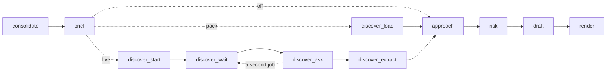

# Iteration 2 design: research the domain

**Status:** a draft for the Stage 9 review, written 2026-11-04. It proposes ADR-031 to ADR-036, two process changes and five departures from the Master-Plan, for the owner to accept or change at that review (D-07 in [`context/Decision-Form.md`](../../context/Decision-Form.md)). It builds on ADR-022 (the request budget), ADR-023 (the run entry), ADR-025 (agent configuration), ADR-026 (client documents), ADR-029 (the free tier's daily quota) and ADR-030 (the matcher), and on the checks of 2026-11-04 in [`docs/verification_log.md`](../verification_log.md): C7-06 again, C7-16, the NotebookLM server and S-11.

## 1. Purpose

Iteration 2 makes a run controllable and resumable, and gives Bidwright its first research step, behind the gateway. It ends at tag `v0.2` when the Iteration 2 gate in section 5 of [`context/Master-Plan.md`](../../context/Master-Plan.md) passes.

In one line: an operator can stop any run and resume it without paying twice for an answered call, every tool call meets a rule whose outcome is defined, and the domain research a bid needs comes from a recorded pack with no login, or live with one, while no query carries RFP text out.

The run at `v0.2` adds: a `RunSupervisor` around the graph, which stops and resumes it, keeps a journal of every answered call, writes the ledger as calls finish and tells a killed run from a running one; `brief` after `consolidate`; `discover` after `brief`, behind a `ResearchProvider` interface; the gateway's rules; the circuit breaker, the dead-letter file and the events log; the MCP client with its tool pins; research packs and three research modes; and, in the summary, the evaluation factors and an appendix of domain research. `approach`, `risk` and `draft` keep their prompts and their inputs: nothing reads the domain research until Iteration 3's `options` and `blueprint`.

## 2. What the checks changed

| Source | Finding | Effect on this design |
|---|---|---|
| C7-06, checked again | `RunControl` (`langgraph.runtime`), passed as `control=` to `invoke`, stops a run after the current super-step once `request_drain(reason)` is called from any thread; the run saves a checkpoint and raises `GraphDrained` (`langgraph.errors`), while a drain on the last super-step returns normally. `invoke(None, config)` with the same `thread_id` resumes, and the nodes that finished in a super-step keep their writes. `durability="sync"` writes each checkpoint before the next super-step, and the first two before the first node; with no checkpoint at all, `invoke(None, config)` raises `EmptyInputError`. The locked 1.2.19 has every name | ADR-031: `bidwright stop` asks LangGraph to drain, with no stop checks inside the nodes |
| C7-16 | The MCP client at 1.30 keeps `ClientSession` on `httpx`, which the lock already holds; 2.x moves to a `Client` class on `httpx2` | `mcp>=1.30,<2` |
| The NotebookLM server | `notebooklm-mcp` 0.15.8 serves `http://127.0.0.1:8000/mcp` and registers 53 tools, deletion and sharing among them. `notebook_query` returns answers whose references carry verbatim `cited_text`. `notebook_get` lists each source's id and title, with no URL; a job's `research_status` listing gives each source's title and URL, and lists the job's own report with none. A failure, such as an expired login, comes back inside a normal result | Six tools on the allowlist, each pinned (ADR-032); excerpts from `cited_text`, URLs from the job's own listing (ADR-033); the client reads each result's own status |
| S-11 | On Docker Desktop a container reaches the loopback-bound server through `host.docker.internal`; Context7 answers with no key; Linux was not checked | `live` runs in the `app` container on Docker Desktop and on the host path elsewhere; the server never listens beyond loopback |
| DR-18 | Not read yet, on purpose: the hero's research seeds come first (section 4.6) | Read at step 13 |

Q-04, on whether a change of model family decorrelates errors, informs Iteration 3's `assess`. It is asked at step 15 and changes nothing here.

## 3. Decisions this document closes

| Open decision | Closed by | In short |
|---|---|---|
| Stop and resume | ADR-031, proposed | `bidwright stop` drains the run through LangGraph. Every live answer goes to the run's own journal and every ledger entry to `ledger.jsonl` as its call finishes; the budget's counts are saved each second; an operating-system lock tells a killed run from a running one. A resume reads the journal, so it never pays twice for an answered call |
| Gateway rules beyond Iteration 0a | ADR-032, proposed | Five rules beside the four checks of `v0.0`: bound ids, pinned servers, the job limit, the question cap and the outbound overlap rule, each a trigger, a check and an outcome; six NotebookLM tools on the allowlist, each pinned |
| The research pack schema | ADR-033, proposed | `research_packs/<domain>/` holds a manifest of hashes, the sources with their URLs and authority tiers, excerpts of at most 300 characters, the `DomainBrief` and the recorded answers; a changed file refuses the pack |
| The `ask_research` match threshold | ADR-034, proposed | An excerpt or a recorded answer matches when it holds at least half of the question's content terms, and at least 2; otherwise the answer is `NOT_IN_PACK` |
| The approval-file format | ADR-035, proposed | `review/<gate>.approval.yaml` beside `review/<gate>.md`, holding the hash of what is approved; decided now, built with Iteration 3's first gate |
| Research in the run | ADR-036, proposed | `brief`, then `discover`, after `consolidate`, behind a `ResearchProvider` interface; the modes `off`, `pack` (the default) and `live`; code polls a job, never the model; a run whose domain has no pack is not `DEGRADED`; a client run may use `pack` but not `live` |

**Process changes, for the change log (CH-88 and CH-89):**
- Gold v3 adds the evaluation factors of the hero package and the development PDF, and the hero's research seeds, written from sources read directly before any pack exists; the owner reviews and hashes it before step 13 builds the first pack. The rule is the Master-Plan's (section 10.9, research seeds); this change places it in the build order.
- Node, the pinned sequential-thinking package, `package-lock.json` and `npm audit` join the image in Iteration 3 with `reflect`, their only consumer, instead of in this iteration, and C7-17's recheck at version lock moves with them. The MCP client speaks stdio from this iteration, tested against a small Python server.

**Departures from the Master-Plan, each with its reason, for the owner to accept or refuse:**
- **`check_research` is code, not a model tool.** The plan lists it among `discover`'s tools. Waiting for a job needs no judgment, and a polling tool would cost model turns and put job ids in the model's hands, which rule G2 exists to prevent; `discover_wait` polls instead.
- **No `ExecutionPolicy` class (`policy.py`).** `config.py` already validates `config/agents.yaml` at start-up, and the nodes read their tools and limits from it; a class would only forward the same values, against ADR-025. The header of `config/agents.yaml`, which still names `ExecutionPolicy` as an enforcer, is corrected.
- **No `ArtifactRegistry` (`artifacts.py`) yet.** Each file keeps one writer and a run only adds files; versioned artifacts arrive with their first consumer, Iteration 4's `repair`.
- **The `ContextManager`'s slots for cards and skills** arrive with cards in Iteration 3 and skills in Iteration 4, since under ADR-025 a field returns with the code that reads it.
- **`brief.md` and `discover.md` use plain rules with positive directives,** as `triage.md` and `extract.md` have since DR-16 (Iteration 1, section 2), not the CARE pattern the plan's prompt table names.

**An open point the owner decides, not this document:** ADR-030 schedules the return of the `extract` examples, and a measurement of the second pass with them, as the first change after the delivery. With the delivery deferred, its place is either the start of Iteration 3's extraction ladder or the delivery, whichever comes first (section 8).

## 4. The run at `v0.2`

### 4.1 Graph



The nodes up to `consolidate` are those of `v0.1`, and `brief` follows `consolidate`'s join node. `--until consolidate` still stops before `brief`, so the hero recording is unaffected.

| Node | Kind | Reads | Writes | LLM calls |
|---|---|---|---|---|
| `brief` | LLM, `extract` role | The sections zoned `EVALUATION` or `INSTRUCTION`, the verified requirements in them, the RFP profile | `brief.json` | 1 per 8,000-token pack of sections, each with 1 format repair |
| `discover_load` | Code, `pack` mode | The selected pack | `domain_brief.json`, `research.json` | None |
| `discover_start` | Agent, `reason` role | The brief's topics | `research.json`, with each notebook and job id written as soon as it exists | 1 turn, plus 1 reminder |
| `discover_wait` | Code | `research.json` | `research.json` | None |
| `discover_ask` | Agent, `reason` role | The job's report, and the answers so far | `research.json`: questions, answers, excerpts and sources | At most 4 turns, and 6 questions a run |
| `discover_extract` | LLM, `reason` role | The report, the answers and their excerpts | `domain_brief.json` | 1, plus 1 format repair |

Run-level files, each with one writer: `journal/` (the LLM client), `ledger.jsonl` (`LedgerFile`), `run_manifest.json`, `control/run.lock` and `control/budget.json` (the supervisor), `events.jsonl` (`EventRecorder`), `dead_letter.jsonl` (`DeadLetters`), `brief.json` (`graph/brief.py`), `research.json` and `domain_brief.json` (`graph/discover.py`), and `control/stop.request` (`bidwright stop`; the supervisor removes it when the run resumes).

### 4.2 Stop, resume and the journal (ADR-031)

- **Stop.** `bidwright stop <run>`, which takes a run id under `outputs/` or a run folder as `purge` does, refuses a run whose manifest is not `RUNNING`, writes `control/stop.request` and returns. The supervisor's watcher thread checks for the file once a second and then calls `RunControl.request_drain("stop requested")` on the control passed to `graph.invoke(..., control=)`. The graph finishes its current super-step, saves a checkpoint and raises `GraphDrained`, recorded as `STOPPED`; a drain on the last super-step lets the run complete. A stop during `discover_wait` takes effect at its next poll, within about 30 seconds (section 4.4). Ctrl+C keeps its meaning of `v0.1`: the run is recorded `STOPPED`, the interrupt propagates, and a resume runs the interrupted super-step again, with the journal answering the calls it had made.
- **The journal.** In `live` mode `LLMClient` saves every answer that parses to the run's journal, a cassette store at `outputs/<run>/journal/`, under the cassette key it already computes, whatever `--cache` says. On a resume it reads the journal before the shared cache and the provider. The shared response cache keeps its `v0.1` rules (on in matrix runs, off in single runs unless `--cache`), so a single run never feeds a later matrix. `bidwright purge` deletes the journal with the run folder.
- **The ledger and the budget.** `RunContext` appends each ledger entry to `ledger.jsonl` as its call finishes, through `obs/ledger.py`'s `LedgerFile`, so a killed run keeps its ledger, and the manifest's totals come from that file. The supervisor writes the budget's counts (attempts, tokens, active seconds and the raises so far) to `control/budget.json` once a second and at each status change. A resume reloads both, so a run's limits hold across all its parts, and at most a second of active time is lost after a kill. A call the journal answers on a resume is appended as a replayed entry at no cost, as a cache hit is at `v0.1`, so a call answered just before a kill and asked again counts twice in `requests` and once in cost.
- **Resume.** `bidwright resume <run> [--raise-budget PERCENT] [--profile paid]` takes the run's lock (below), reads the manifest, and refuses a terminal status, a replayed or recorded run, and `--profile paid` on a run that did not end `QUOTA_PAUSED` on `free`. It then calls `execute` with the manifest's `run_args` and `resume=True`. `execute` runs the run entry's checks again (ADR-023, and egress), so a refused resume leaves the run as it was, and invokes the graph with `None` and the run id as the thread id. A run killed before its first checkpoint starts again from the beginning, under the same run id and with its journal. A resume rebuilds what the early nodes keep outside the graph state: `ctx.passages` and the text view's binding from the checkpointed passages, and the passage index from `search.sqlite`, as `passages(state)` and `risk` already do in part.
- **Raises and profiles.** `--raise-budget PERCENT` adds that percent of each configured per-run limit, and raises add up across resumes; each is recorded in `overrides` and in `control/budget.json`. `--profile paid` keeps the models: the `free` and `paid` profiles have identical role configurations, so the journal's keys still match. The manifest's `profile` becomes `paid`, and `overrides` records the switch.
- **Durability.** The graph runs with `durability="sync"`, so each checkpoint is written before the next super-step starts.
- **A killed run.** The supervisor holds an exclusive lock on `control/run.lock` for the life of its process, with `msvcrt.locking` on Windows and `fcntl.flock` elsewhere, never blocking. The operating system releases the lock when the process ends, however it ends. A kill writes no status, so the manifest still says `RUNNING`. `bidwright resume` takes the lock first: if it cannot, the run is still running and the command says "stop it first"; if it can, a `RUNNING` manifest means the run was killed, and it resumes. The lock also keeps two resumes of one run apart, as C7-06's fork issue requires. The manifest records the process id for information only: testing a process id is unsafe, since on Windows `os.kill` ends the process it tests, and ids are reused.

### 4.3 Run statuses at `v0.2`

| Status | Kind | Entered when | Leaves by |
|---|---|---|---|
| `RUNNING` | Active | The run starts or resumes; the manifest is written at once | Any status below |
| `STOPPED` | Resumable | A drained stop, a stop during a wait, or Ctrl+C | `bidwright resume` |
| `QUOTA_PAUSED` | Resumable | A spent daily quota with no fallback, or an open circuit breaker | `bidwright resume` after the quota day turns or the breaker closes, or with `--profile paid` |
| `BUDGET_EXCEEDED` | Resumable | A per-run limit is reached | `bidwright resume --raise-budget` |
| `WAITING_RESEARCH` | Resumable | A live job still runs when the wait cap expires | `bidwright resume`, which polls the same job |
| `COMPLETED`, `DEGRADED`, `POLICY_BLOCKED`, `UNRECOVERABLE_FAULT` | Terminal | As at `v0.1` | None |

`WAITING_HUMAN` stays unused until Iteration 3's gate. A fault stays terminal, as the plan's state machine has it. Every transition is appended to the manifest's `status_history` and to `events.jsonl`. The active-time clock runs only in `RUNNING`, and stops while `discover_wait` waits between polls.

### 4.4 Research modes, the provider and packs (ADR-033, ADR-034, ADR-036)

| Mode | What runs | Status when research is missing |
|---|---|---|
| `off` | No research; `discover` is skipped | Not degraded: none was asked for |
| `pack`, the default | The pack whose keywords match the brief's topics is loaded with no model call | Not degraded when no pack matches: the manifest's research block says "no pack for this domain" |
| `live` | A fresh notebook and one deep job, then follow-up questions and one extraction call | `DEGRADED` when the job fails: the matching pack is used if one exists, and the reason names the failure |

- **The provider interface.** `discover` depends on `ResearchProvider` (`research/provider.py`), not on NotebookLM: `create_notebook(title)` gives a notebook id; `start(notebook_id, query)` a task id; `status(notebook_id, task_id, wait_s)` a `JobStatus`; `import_sources(notebook_id, task_id)` the number imported; `sources(notebook_id)` each source's id and title; and `ask(notebook_id, question)` an `Answer` with its references. `NotebookLMProvider` (`research/nlm.py`) implements it over the MCP client, and `PackProvider` (`research/pack.py`) implements `ask` over a pack and refuses the rest, so a licensed source can replace NotebookLM behind the same interface.
- **Pack selection.** `pack.yaml` lists keywords. A keyword matches when one of its content stems, cut as `content_stems` in `graph/nodes.py` cuts them, is among the stems of the brief's topics. A pack is selected when at least 2 of its keywords match and no other pack matches as many; a tie selects none, and the manifest records it.
- **Starting a job.** `discover_start` reads `research.json` first and reuses a notebook or job recorded there, so running it again never creates a second one. Otherwise code creates a notebook titled with the run id, writes its id to `research.json`, and runs one agent turn whose only tool is `start_research(question, topics)`. A turn without the call gets one reminder, and if that turn has none either, code calls `start_research` with the brief's topics as the question. Code builds the query from the research envelope in `prompts/discover.md` and the model's question, the gateway's rules check it, and the job starts on the bound notebook; its id goes to `research.json` as soon as it exists. `start_research` gives the model a job label, `J1` or `J2`, never an id.
- **Waiting.** `discover_wait` calls `status` with a 30-second wait, again and again, until the job ends, until the wait cap passes, which raises `ResearchPending` and leaves the run `WAITING_RESEARCH`, or until a stop is requested, which leaves it `STOPPED`. A finished job's cited sources are imported.
- **Asking.** `discover_ask` offers `ask_research(question)` and, while the run's second job is unspent, `start_research`; a second job gets a fresh notebook. It stops at the run's 6th question, at a turn that adds no new excerpt, or at 4 turns. `ask_research` asks the notebook of the most recent job that finished.
- **Extracting.** `discover_extract` makes one call that returns a `DiscoveryExtract`, and code turns it into the `DomainBrief`: every cited excerpt must exist and not be quarantined, and an item whose excerpts all come from tier-4 sources is dropped.
- **Sources and excerpts.** A source's URL comes from the job's `research_status` listing, matched by exact title to the source that `sources` lists. A source with no URL, the job's own report included, is never a pack source, and a reference to it is dropped. Each remaining reference's `cited_text` becomes an excerpt, cut at the last word boundary within 300 characters.
- **Fallback.** A server that is down, refused by its pins, logged out or behind an open breaker, or a job that fails, sends the run to the matching pack with `DEGRADED` and the reason, or to no research with `DEGRADED` when no pack matches.
- **Inbound trust.** Every excerpt and answer is scanned with the suspect patterns of `config/ingest.yaml`; a match quarantines that excerpt, which no item may cite, and logs a security event attributed `injection-dominant`. A source's host takes the lowest tier with a matching entry in `config/research.yaml`: an entry that starts with a dot matches any host ending with it, and another entry matches that host and its subdomains; a host with no match is tier 4. Everything carries the evidence class `EXTERNAL_RESEARCH` and is never promoted to capability evidence.
- **What the model sees.** The `discover` model never sees RFP passages: its only input from the RFP is the brief's topics, which code has checked (step 9). The outbound rule G3 is the backstop.
- **In the summary.** After the four parts, `solution_summary.md` gains "Appendix: domain research (external, unverified)", listing the `DomainBrief`'s items with their sources, or nothing when research is off or no pack matched.

### 4.5 Research and client documents (ADR-026)

The egress register gains a `notebooklm` destination with the hosts `localhost`, `127.0.0.1` and `host.docker.internal`, `local: false` and `receives: queries`: the server runs on this machine but forwards every query to Google, so the register treats it as remote. `check_run` gains the research server's URL when the run's mode is `live`, so a client run's `live` mode raises `EgressRefused` at the run entry, before any folder exists, with a message naming `--research pack`; `pack` stays local and allowed. Context7 joins the register in Iteration 3, with `techcheck`.

### 4.6 Research seeds before the first pack

Step 8 writes gold v3: the evaluation factors of the hero package and the development PDF, and the hero's research seeds, the patterns, standards and pitfalls of its domain that the hero never states, from standards bodies' and public guidance pages read directly, without NotebookLM and before DR-18 is read. The owner reviews and hashes gold v3. Only then does step 13 read DR-18 and build the hero's pack. The domain seeds are scored from Iteration 3 (SO4, research against none), so this iteration proves the plumbing and keeps the gain from research out of the gold.

## 5. Contracts

### 5.1 Schemas

New models go in `src/bidwright/schemas.py`, in the order listed, except the two tool-argument models, which sit in `tools.py` beside `SearchArgs`. Model-facing models extend `Facing`; the others extend `Record`.

**Brief**
- `EvaluationFactorProposal` (`Facing`): `name` (at most 80 characters, as the RFP writes it), `weight` (at most 20, as written, or `not_stated`), `scoring` (a quote of at most 200 characters from a cited passage, or `not_stated`), `src_ids` (1 to 3).
- `BriefItemProposal` (`Facing`): `text` (at most 200 characters), `src_ids` (1 to 3).
- `BriefSection` (`Facing`): `section_path`, `passages` (`PassageView`, which carries the zone).
- `BriefInput` (`Facing`): `sections`, `profile` (`RfpProfile`), `requirements` (`RequirementView`).
- `BriefResult` (`Facing`): `factors`, `scoring_method` (`BriefItemProposal` or `None`), `needs`, `scope_in`, `scope_out`, `constraints`, `never`, `ask`, `always` (lists of `BriefItemProposal`), and `topics` (1 to 5 strings of at most 80 characters).
- `EvaluationFactor`: `id` (`EF-` and 2 digits), the proposal's fields, and `status` (`IN_SCOPE` or `OUT_OF_SCOPE`).
- `BriefItem`: `id` (`BI-` and 3 digits), `text`, `src_ids`.
- `OpportunityBrief`: `factors`, `scoring_method` (`BriefItem` or `None`), `needs`, `scope_in`, `scope_out`, `constraints`, `never`, `ask`, `always`, `topics`, `questions` (`OpenQuestion`) and `notes` (what code dropped, and why). The stored form of `brief.json`.

**Research**
- `StartResearchArgs`: `question` (at most 300 characters), `topics` (1 to 5 strings of at most 80). `AskResearchArgs`: `question` (at most 300). Both forbid extra keys.
- `ListedSource`: `title`, `url` (or `None`), `cited`. `JobStatus`: `state` (`running`, `completed` or `failed`), `report` (or `None`), `listing` (`ListedSource`). `Reference`: `source_id`, `citation_number`, `cited_text`. `Answer`: `text`, `references`. The provider's return types.
- `PackSource`: `id` (`PS-` and 3 digits), `url`, `title`, `host`, `tier` (1 to 4), `retrieved` (a date).
- `PackExcerpt`: `id` (`PX-` and 4 digits), `source_id`, `text` (at most 300 characters, a verbatim slice of a reference's cited text), `quarantined` (bool).
- `PackAnswer`: `question`, `answer` (at most 2,000 characters), `excerpt_ids`.
- `ExcerptView` (`Facing`): `id`, `source_title`, `tier`, `text`. `AnswerView` (`Facing`): `question`, `answer`, `excerpt_ids`.
- `DiscoveryTask` (`Facing`): `topics`, `report` (the job's report cut to the context budget, or `None` before a job ends), `answers` (`AnswerView`), `excerpts` (`ExcerptView`, quarantined ones left out), `questions_left`, `jobs_left`.
- `DomainItemProposal` (`Facing`): `kind` (`pattern`, `standard` or `pitfall`), `statement` (at most 300 characters), `excerpt_ids` (1 to 3). `DomainNeedProposal` (`Facing`): `need` (at most 200), `excerpt_ids` (1 to 3).
- `DiscoveryExtract` (`Facing`): `summary` (at most 1,200 characters), `items`, `needs`, `open_questions` (at most 5). The extraction call's response.
- `DomainItem`, `DomainNeed`: the proposals with ids `DI-` and `DN-` and 3 digits.
- `DomainBrief`: `domain_id` (`None` before a pack exists), `mode` (`pack` or `live`), `summary`, `items`, `needs`, `open_questions`, `evidence_class` (always `EXTERNAL_RESEARCH`). The stored form of `domain_brief.json`.
- `ResearchJob`: `label` (`J1` or `J2`), `notebook_id`, `task_id`, `query` (the text sent), `query_sha256`, `state` (`running`, `completed`, `failed` or `timed_out`), `started`.
- `ResearchRecord`: `mode`, `pack_id` (or `None`), `pack_sha256` (or `None`), `notebooks`, `jobs`, `answers` (`PackAnswer`), `excerpts`, `sources`, `notes` (strings such as "no pack for this domain"). The stored form of `research.json`.
- `PackManifest`: `domain_id`, `title`, `version`, `created` (a date), `keywords` (at least 2), `topics`, `files` (file name to `sha256:` hash), `counts`. The stored form of `pack.yaml`.

**Control**
- `StatusChange`: `at`, `status`, `reason`.
- `EventRecord`: `at`, `kind` (`status`, `gateway`, `recovery`, `research` or `security`), `node`, `detail`, `attribution` (`injection-dominant`, `authorization-dominant`, `combined`, `indeterminate` or `None`; set on security events only).
- `DeadLetter`: `id` (`DL-` and 3 digits), `node`, `call_id`, `reason`, `attempts`, `manifest` (the call's context manifest path, or `None`).
- `BudgetSnapshot`: `requests`, `tokens`, `active_seconds`, `raise_percent`. The stored form of `control/budget.json`.
- `RunManifest` gains `pid: int | None = None`, `status_history: list[StatusChange] = []`, `run_args: dict[str, Any] = {}` and `research: ResearchSummary | None = None`, where `ResearchSummary` holds `mode`, `pack_id`, `pack_sha256`, `jobs`, `questions` and `notes`.
- `ContextManifest` gains `included_record_ids: list[str] = []`, for calls whose evidence is records or excerpts rather than passages.
- `SolutionSummary` gains `factors` and `domain_items`, both lists of ids that default to empty.

### 5.2 Configuration

| File | New or changed | Holds |
|---|---|---|
| `config/research.yaml` | New | The default mode, pack selection, job and question limits, the wait cap, the outbound rule's word count, the match threshold, the server address and the authority tiers by host |
| `config/mcp_pins.yaml` | New | Each server's version and the hash of each allowed tool's name, description and input schema |
| `config/mcp_servers.txt` | New, at step 13 | The pinned server package, such as `notebooklm-mcp==0.15.8`, for the dependency audit |
| `config/egress.yaml` | Changed | The `notebooklm` destination |
| `config/limits.yaml` | Changed | `breaker: {failures: 5, cooldown_minutes: 30}`; `context.budgets` gains `brief: 8000` and `discover: 16000` |
| `config/agents.yaml` | Changed | `brief` and `discover`; the header corrected |
| `config/matrices/*.yaml` | Changed | A rung may set `research` to `off` or `pack` |

`config.py` loads each new file with `yaml.safe_load` into a Pydantic model with `extra="forbid"`, and a bad value fails at start-up, as in `v0.1`.

### 5.3 Prompts

| Prompt | Version | Pattern | Examples | Decoding |
|---|---|---|---|---|
| `brief.md` | 0.1.0 | Plain rules and a factor table, positive directives (DR-16): copy factor names and weights exactly as written, `not_stated` when absent, quote the scoring rule, cite passage ids, topics in general domain words only. Tasks: `task` and `repair_format` | 1, an evaluation table with a price row, from `prompts/examples/mini_rfp.yaml` | `gemini: {thinking: low}`, `ollama: {think: false}` |
| `discover.md` | 0.1.0 | The research envelope of M18 for the query text (objective, scope, authority tiers, exclusions, disconfirming evidence sought by default), and plain rules with positive directives for the turns. Schema `DiscoveryExtract`; tasks: `task` (plan the question and start the job), `ask` (follow-up questions), `extract` (the extraction) and `repair_format` | 1, an extraction with cited excerpts | `gemini: {thinking: low}`, `ollama: {think: false}` |

Both keep the skeleton of `v0.1`: the system instruction first, the data inside delimiter tags seeded from the run id, the task last.

## 6. Starting values and formats

### 6.1 Starting values

| Setting | Value | File |
|---|---|---|
| Research mode | `pack`; `--research` overrides | `research.yaml` |
| Pack selection | At least 2 keywords matched, and no tie | `research.yaml` |
| Jobs | At most 2 a run, `deep` mode, a fresh notebook each | `research.yaml` |
| Wait cap | 20 minutes of waiting a run, polled every 30 seconds | `research.yaml` |
| Questions | At most 6 a run | `research.yaml` |
| Outbound rule | A query sharing 8 or more consecutive normalized words with a passage is denied | `research.yaml` |
| Match threshold | Half of the question's content terms, at least 2 | `research.yaml` |
| Authority tiers | Tier 1: government, standards and regulator hosts; tier 2: academic and DOI hosts; tier 3: named professional bodies; tier 4: everything else | `research.yaml` |
| MCP calls | 360 seconds each; `research_import` and `notebook_query` are given `timeout: 300` | `research.yaml` |
| Circuit breaker | 5 consecutive failed attempts on one model or server open it for 30 minutes | `limits.yaml` |
| Context budgets | `brief` 8,000 tokens; `discover` 16,000 | `limits.yaml` |
| Stop watcher and budget snapshot | Once a second | Code |

### 6.2 The gateway's rules (ADR-032)

Every tool call meets the four checks of `v0.0` and the five new rules, in this order: the allowlist, G2, the argument schema, repeats, the call cap, G4, G1, G5 and G3. G2 runs before the schema check so that an attempt to name a notebook leaves a security event; G3 runs last because it needs the query code builds. A call counts against the call cap only when it passes every rule.

| Rule | Trigger | Check | Outcome |
|---|---|---|---|
| G2 bound ids | Any research tool | No argument key outside the tool's schema names a notebook, task or source, and no value is shaped like a notebook or task id (a UUID, or a run of 30 or more letters, digits, hyphens and underscores) | Deny, with a security event attributed `authorization-dominant` |
| G4 pinned server | Any MCP tool | The server's version and tools matched their pins when the run first connected | Deny: "server refused: its tools do not match their pins" |
| G1 job limit | `start_research` | Fewer than 2 jobs this run | Deny: "the run's research jobs are spent" |
| G5 question cap | `ask_research` | Fewer than 6 questions this run | Return to the model: "no questions left; finish" |
| G3 outbound overlap | `start_research`, `ask_research` | The query code builds shares fewer than 8 consecutive normalized words with every passage of the run | Deny, with a security event attributed `injection-dominant` when the passage is marked `suspect` and `indeterminate` otherwise |

Words are normalized as `verify.normalize` does, lowercased, and split on every character that is not a letter or a digit. G3 applies in every mode, so a pack run tests the rule a live run relies on. A rule is a small class with `name`, `trigger`, `check(request, context)` and `outcome`; `scripts/gen_docs.py` writes the table above into `docs/agents.md` from the classes, so the document cannot drift from the code. The outcome "pause for a human" is defined for Iteration 3's gate, and no rule uses it yet.

### 6.3 Formats

**`config/research.yaml`:**

```yaml
mode: pack                      # off | pack | live; --research overrides
packs_dir: research_packs
selection: {min_keyword_matches: 2}
jobs: {max_per_run: 2, mode: deep, wait_minutes: 20, poll_seconds: 30, import: cited}
questions: {max_per_run: 6, match_share: 0.5, min_terms: 2}
outbound: {max_shared_words: 7}  # a query sharing 8 or more consecutive words with a passage is denied
servers:
  notebooklm: {transport: http, url: "http://127.0.0.1:8000/mcp", timeout_s: 360, tool_timeout_s: 300}
tiers:
  1: [".gov", ".gov.uk", ".europa.eu", "iso.org", "w3.org", "ico.org.uk"]
  2: [".ac.uk", ".edu", "doi.org", "arxiv.org"]
  3: ["socitm.net", "bcs.org"]
  default: 4
```

`NOTEBOOKLM_MCP_URL` overrides the URL, and an empty variable means the file's value. `compose.yaml` sets it to `http://host.docker.internal:8000/mcp` for the `app` service, as it sets `OLLAMA_HOST`. The server binds `127.0.0.1`, and on Windows `localhost` may resolve to `::1` first, so the default names the address.

**`config/egress.yaml`**, the added row:

```yaml
  notebooklm: {hosts: [localhost, "127.0.0.1", host.docker.internal], local: false, receives: queries}
```

**`config/mcp_pins.yaml`**, written by `bidwright research pin` on the host after the owner installs or updates the server, so a change shows in Git. Until it is pinned, the file names no tools and every NotebookLM call is refused:

```yaml
notebooklm:
  version: 0.15.8
  tools:
    notebook_create: "sha256:…"
    research_start: "sha256:…"
    research_status: "sha256:…"
    research_import: "sha256:…"
    notebook_get: "sha256:…"
    notebook_query: "sha256:…"
```

**`research_packs/<domain>/`:** `pack.yaml`, `summary.md`, `sources.jsonl`, `excerpts.jsonl`, `domain_brief.json` and `answers.jsonl`. `pack.yaml`:

```yaml
domain_id: local-government-case-management
title: "Digital case-management services for local government"
version: 1
created: 2026-11-06
keywords: [case management, local government, council, casework, resident services]
topics: [digital case management, public sector casework platforms]
files: {summary.md: "sha256:…", sources.jsonl: "sha256:…", excerpts.jsonl: "sha256:…", domain_brief.json: "sha256:…", answers.jsonl: "sha256:…"}
counts: {sources: 31, excerpts: 58, items: 22, needs: 14, answers: 6}
```

A source line and an excerpt line:

```json
{"id": "PS-003", "url": "https://www.w3.org/TR/WCAG22/", "title": "Web Content Accessibility Guidelines (WCAG) 2.2", "host": "www.w3.org", "tier": 1, "retrieved": "2026-11-06"}
{"id": "PX-0007", "source_id": "PS-003", "text": "…", "quarantined": false}
```

A `domain_brief.json` item and need:

```json
{"items": [{"id": "DI-004", "kind": "pitfall", "statement": "Data migration from legacy case systems is underestimated in schedule and cost.", "excerpt_ids": ["PX-0007", "PX-0019"]}],
 "needs": [{"id": "DN-002", "need": "Accessible online forms for residents", "excerpt_ids": ["PX-0011"]}]}
```

**`brief.json`**, one factor:

```json
{"factors": [{"id": "EF-06", "name": "Price", "weight": "40", "scoring": "Price is scored by dividing the lowest total price by the bidder's total price and multiplying by 40.", "src_ids": ["SRC-0241", "SRC-0249"], "status": "OUT_OF_SCOPE"}],
 "topics": ["digital case management", "resident services"], "questions": [], "notes": []}
```

**`control/budget.json`:**

```json
{"requests": 14, "tokens": 61234, "active_seconds": 72.4, "raise_percent": 0}
```

**`events.jsonl`:**

```json
{"at": "2026-11-06T10:12:03Z", "kind": "security", "node": "discover_ask", "detail": "G3 denied ask_research: 9 words shared with SRC-0102", "attribution": "indeterminate"}
```

**`dead_letter.jsonl`:**

```json
{"id": "DL-001", "node": "extract", "call_id": "B04", "reason": "malformed output after repair", "attempts": 2, "manifest": "context/extract-B04.json"}
```

**`review/<gate>.approval.yaml`**, the format ADR-035 fixes for Iteration 3's first gate:

```yaml
gate: solution_gate
run_id: 20261110T090000Z-hero-paid
approves: "sha256:…"            # the hash of the artifacts under review; a change voids the file
decision: null                  # approve | edit | reject, filled by a person
approver: null
decided_at: null
edits: {}                       # record id to the changed fields
```

**Gold v3 lines**, generated from the specs:

```json
{"gold_id": "FS-06", "gold_version": 3, "doc_id": "hero-rfp", "kind": "factor_seed", "name": "Price", "weight": "40", "status": "OUT_OF_SCOPE"}
{"gold_id": "DS-03", "gold_version": 3, "doc_id": "hero-rfp", "kind": "domain_seed", "category": "standard", "terms": [["accessibility", "WCAG"]], "source": "https://www.w3.org/TR/WCAG22/"}
```

## Detailed Implementation Plan

Fifteen steps, in build order. Each leaves the repository buildable with its tests passing; steps 8 and 13 wait on the owner. Every step ends with `uv run python scripts/gen_docs.py --check`, regenerating and committing the documents when it reports a stale file. Before a module is written, the claims this design makes about its libraries are checked through Context7 and logged in [`docs/verification_log.md`](../verification_log.md). A live run or recording uses `--profile free`, and `paid` once Google's daily 429 says the free quota is spent (ADR-029).

### Step 1: Dependencies and configuration

**Files.** Modify `pyproject.toml` and `uv.lock` (`mcp>=1.30,<2`). Create `config/research.yaml` and `config/mcp_pins.yaml` (no tools until step 13 pins them). Modify `config/egress.yaml`, `config/limits.yaml`, `config/agents.yaml`, `src/bidwright/config.py`, `compose.yaml` (`NOTEBOOKLM_MCP_URL` for `app`), `.env.example` (`NOTEBOOKLM_MCP_URL=`, with a comment on its default) and `tests/test_config.py`.

**Does.**
- `config.py` gains `ResearchConfig`, `PinsConfig` and `BreakerConfig`; `LimitsConfig` gains `breaker`, and `Config` gains `research` and `pins`.
- `config/agents.yaml` gains `brief` (`kind: function`, `input: BriefInput`, `output: BriefResult`, `prompt: brief@0.1.0`, `model_role: extract`, `tools: []`) and `discover` (`kind: agent`, `input: DiscoveryTask`, `output: DiscoveryExtract`, `prompt: discover@0.1.0`, `model_role: reason`, `tools: [ask_research, start_research]`, `limits: {max_turns: 4, max_tool_calls: 8, stop_on_no_progress: true}`). The limits bound `discover_ask`'s loop, and the call cap of 8 spans the run's `discover` calls.
- The header of `config/agents.yaml` says what enforces the file: `config.py` validates it at start-up, the nodes read their tools and limits from it, and `ToolGateway` enforces the allowlists and caps.
- `mcp` brings its server-side dependencies, Starlette and Uvicorn, into the lock; the client uses neither, and the test server of step 7 uses both.

**Tests.** Each new file loads; a bad mode or a tier outside 1 to 4 fails start-up; the `notebooklm` destination is not local; `test_only_the_agent_declares_limits` still passes.

### Step 2: Schemas

**Files.** Modify `src/bidwright/schemas.py`, `src/bidwright/tools.py` (the two argument models) and `tests/test_schemas.py`.

**Does.** Adds every model of section 5.1, with defaults on every new stored field, so `v0.1` records stay valid.

**Tests.** JSON round trips; id patterns; length limits; a `v0.1` manifest from `samples/` still validates.

### Step 3: The journal and the ledger file

**Files.** Modify `src/bidwright/llm/client.py`, `src/bidwright/llm/cache.py`, `src/bidwright/graph/nodes.py`, `src/bidwright/obs/ledger.py`, `src/bidwright/render.py`, `src/bidwright/graph/build.py`, `tests/test_cache.py` and `tests/test_ledger.py`.

**Does.**
- `llm/cache.py` gains `run_journal(run_dir)`, a `CassetteStore` at `run_dir / "journal"`.
- `LLMClient` takes `journal: CassetteStore | None` and `journal_read: bool`. In `live` mode it saves each answer that parses to the journal, as it saves to the cache; with `journal_read` it loads from the journal before the shared cache.
- `obs/ledger.py` gains `LedgerFile(path)`, with `append(entry)`, which writes and flushes one line, and `load()`. `RunContext` takes a `LedgerFile` and appends each entry in `record`, under its lock.
- `write_manifest` writes only the manifest; `execute` creates the `LedgerFile` and the journal before the graph runs, with `journal_read` off until step 4's resume.

**Tests.** A live call with the cache off still lands in the journal; a second identical call with `journal_read` off reaches the backend; with it on, the journal answers, the ledger entry is replayed at no cost, and the budget counts no attempt; a run that raises after its first call leaves that call's entry in `ledger.jsonl`; the ledger's totals still match the manifest's.

### Step 4: The supervisor, the events log, stop and resume

**Files.** Create `src/bidwright/harness/supervisor.py`, `src/bidwright/obs/events.py`, `tests/test_supervisor.py`, `tests/test_resume.py` and `tests/kill_target.py`. Modify `src/bidwright/graph/build.py`, `src/bidwright/cli.py`, `src/bidwright/harness/budget.py`, `src/bidwright/render.py` (`write_manifest` moves to the supervisor) and `tests/test_cli.py`.

**Does.**
- `RunSupervisor(run_dir)` is a context manager. It takes `control/run.lock` without blocking, or raises `RunBusy` (a `Refused`) with "the run is still running; stop it first". It writes the manifest at the start, with `RUNNING`, the process id and `run_args`: source, profile, outputs, baseline, consent, limits tier, until, batch size, second pass, extract prompt, research mode, repeat, cache, Docling mode and fallback. It records every transition in `status_history` and, through `EventRecorder`, in `events.jsonl`, and is the manifest's only writer.
- `EventRecorder.record(kind, node, detail, attribution=None)` appends to `events.jsonl`, the file's only writer.
- The watcher thread runs once a second: it calls `request_drain("stop requested")` once `control/stop.request` exists, and writes `control/budget.json`.
- `execute` passes `control=` and `durability="sync"` to `graph.invoke`, maps `GraphDrained` to `STOPPED` with "stopped by request", and gains `resume: bool`. A resume loads the ledger and the budget snapshot, turns `journal_read` on, removes the stop request, and invokes with `None`; on `EmptyInputError` it invokes with `{}` from the start.
- `RunBudget` gains `snapshot()`, `restore(snapshot)` and `raise_by(percent)`.
- `cli.py` gains `stop <run>` and `resume <run> [--raise-budget PERCENT] [--profile paid]`, with the refusals of section 4.2.

**Tests.**
- `test_stop_drains_between_nodes_and_resume_completes`: a scripted backend asks for a stop during `extract`; the run ends `STOPPED` with a checkpoint; resume ends `COMPLETED`, and no answered call reaches the backend twice.
- `test_resume_after_a_kill_spends_nothing_twice`: a subprocess runs `tests/kill_target.py`, which calls `execute` on the development PDF with Docling replayed and a scripted backend whose second call blocks, and with the quota, cache and breaker folders and the outputs pointed into the test's folder, since the fixtures of `tests/conftest.py` do not reach a subprocess. The test kills it once the journal holds an entry, then resumes in-process with a backend that records calls: no journaled key reaches it, and the run completes.
- `test_a_running_run_cannot_be_resumed`: a second handle holds the lock, and resume refuses.
- Also: a terminal run is refused; a resume restores the budget, so a limit applies across both parts; `--raise-budget 50` lets a `BUDGET_EXCEEDED` run finish and records the raise; `--profile paid` resumes a `QUOTA_PAUSED` run of `free` and records the switch; a run killed before its first checkpoint starts again under the same run id; every transition appears in `status_history` and `events.jsonl`.

### Step 5: Recovery

**Files.** Create `src/bidwright/harness/recovery.py` and `tests/test_recovery.py`. Modify `src/bidwright/llm/client.py`, `src/bidwright/graph/build.py` and `tests/conftest.py`.

**Does.**
- `CircuitBreaker` counts consecutive failed attempts per provider and model, and per MCP server, in `outputs/.quota/breaker/<name>.json`, so its state survives a resume. Five consecutive failures open it for 30 minutes, and a success resets it. While it is open, `LLMClient` raises `CircuitOpen`, a `QuotaExhausted`, for that model: the fallback model answers, or the run pauses `QUOTA_PAUSED` with "circuit open on <model> until <time>".
- `DeadLetters(run_dir)` appends once per call id, so a call run again after a resume adds nothing. An `extract` pack rejected after its repair, and a `consolidate` cluster that fell back, are written with their context manifest.
- Each breaker change and dead letter is an event of kind `recovery`.
- `tests/conftest.py` points the breaker folder into each test's folder, as it does the quota and cache folders.

**Tests.** `test_fi01_breaker_opens_after_five_failures`, with a clean control of four failures and a success; the breaker's state survives a new client; an open breaker on a model with no fallback pauses the run; `test_fi02_a_rejected_pack_leaves_one_dead_letter`; a fallen-back cluster leaves one; a resumed run adds none.

### Step 6: The gateway's rules

**Files.** Create `src/bidwright/harness/rules.py` and `tests/data/outbound_cases.yaml`. Modify `src/bidwright/harness/gateway.py`, `scripts/gen_docs.py` and `tests/test_gateway.py`.

**Does.** The four checks of `v0.0` and G1 to G5 of section 6.2 become `Rule` classes evaluated in that order. `ToolGateway` takes a `RuleContext`: the run's passages through the text view, with their normalized 8-word runs built once per run; the research record's counts; the pin results; and the event recorder. `gen_docs.py` adds the rules table to `docs/agents.md`.

**Tests.**
- `test_fi09_each_rule_denies_its_trigger`, parametrized over every rule, each with a clean control.
- `test_outbound_rule_denies_every_copied_passage`: `outbound_cases.yaml` holds 20 passages of the synthetic corpus, each copied, edited (one word in ten replaced) and paraphrased by hand. Every copied case is denied, and the test prints the share of edited and paraphrased cases that pass, which step 15 reports.
- Also: a denied call does not spend the call cap; G2 records an `authorization-dominant` event; G3's attribution follows the passage's `suspect` flag.

### Step 7: The MCP client, the provider interface and the pins

**Files.** Create `src/bidwright/research/__init__.py`, `research/mcp_client.py`, `research/provider.py`, `research/nlm.py`, `research/pins.py`, `tests/mcp_fakes.py` and `tests/test_mcp_client.py`. Modify `src/bidwright/cli.py`, `src/bidwright/harness/egress.py` and `src/bidwright/graph/build.py`.

**Does.**
- `McpClient(server)` opens one `ClientSession` per call, over `streamable_http_client` with an `httpx.AsyncClient` carrying the timeouts, or over `stdio_client`, and runs it with `anyio.run`, so the graph's sync nodes get sync `list_tools()` and `call(name, arguments)`. A result whose `isError` is set, or whose text parses to `{"status": "error"}`, raises `McpToolError` with the message. Each failure and success feeds the server's breaker.
- `research/provider.py` defines `ResearchProvider` (section 4.4). `NotebookLMProvider` maps its methods to the six tools: `notebook_create`, `research_start` (`mode: deep`, `source: web`), `research_status`, `research_import` (`cited_only: true`), `notebook_get` and `notebook_query`.
- `pins.check(server, version, tools)` hashes each allowed tool's name, description and input schema, and compares them and the server's version (from `initialize`) with `config/mcp_pins.yaml`; a mismatch raises `ServerRefused`. `NotebookLMProvider` checks the pins at its first connection in a run. `bidwright research pin` lists the server's tools and writes the pins file and `config/mcp_servers.txt`.
- `egress.check_run` gains the research server's URL, which `execute` passes when the mode is `live`.
- Before `tests/mcp_fakes.py` is written, FastMCP's stdio and streamable HTTP serving in the same SDK are checked through Context7.

**Tests.** Against `tests/mcp_fakes.py`, a FastMCP server with the six tool names and answers shaped as logged on 2026-11-04, started over stdio and over HTTP on a free port: tools are listed and called on both transports; an error result raises; `test_fi11_changed_description_refuses_the_server`, with a clean control of unchanged tools; a changed version refuses the server; a client run is refused the `notebooklm` destination before its folder exists.

### Step 8: Gold v3 (the owner reviews and hashes)

**Files.** Modify `evals/corpus/hero/spec.yaml`, `evals/corpus/dev/spec.yaml`, `evals/render/spec.py`, `evals/render/gold.py`, `evals/gold/hero/gold.jsonl`, `evals/gold/dev/gold.jsonl`, `evals/score.py`, `evals/baselines/hero.json`, `evals/baselines/README.md`, `tests/test_render.py`, `tests/test_gold_manifest.py` and `tests/test_scorer_selftest.py`; `evals/gold/MANIFEST.sha256` changes by the owner's `hash-gold`.

**Does.**
- The spec gains two seed types: `FactorSeed` (`FS-` and 2 digits: `doc_id`, `name`, `weight`, `status`), one for each row of each evaluation table, the price row `OUT_OF_SCOPE`; and `DomainSeed` (`DS-` and 2 digits: `doc_id`, `category`, `terms`, `source`), for the hero only. Neither anchors to a clause, so `_seed_line` takes their `doc_id` from the seed.
- The hero's domain seeds, about 12, are patterns, standards and pitfalls of digital case management in local government that the hero never states, each written from a standards body's or public body's page read directly, with its URL. DR-18 is not opened before the owner hashes gold v3.
- Gold moves to version 3 for the hero and the development PDF. Their clauses do not change, so the rendered inputs and every cassette stay as they are.
- `evals/score.py` gains the factor line: a brief factor matches a factor seed when its normalized name, weight and status equal the seed's; a run without `brief.json` reports the line as not run. Domain seeds are not scored before Iteration 3.
- The owner reviews the new seeds and runs `hash-gold`; Claude never runs it. In the same commit, the hero baseline is written again with `bidwright-eval baseline` on the replayed hero run, because the gate refuses a baseline scored on other gold; its misses stay 3 of 45.

**Tests.** `test_render.py`: every factor seed's name and weight appear in one row of its RFP's evaluation table; no domain seed's terms occur in the hero's text. `test_gold_manifest.py` expects version 3 for the hero and the development PDF. The scorer self-test: an oracle brief matches every factor seed, and one changed weight loses exactly one.

### Step 9: `brief`

**Files.** Create `prompts/brief.md`, `src/bidwright/graph/brief.py` and `tests/test_brief.py`. Modify `prompts/examples/mini_rfp.yaml`, `src/bidwright/prompts.py` (an examples renderer for `brief`), `src/bidwright/harness/context.py` and `tests/test_prompts.py`.

**Does.**
- `ContextManager` packs the `EVALUATION` sections, then the `INSTRUCTION` sections, whole and in document order, with the verified requirements they hold and the RFP profile, into as many calls as the 8,000-token budget needs; `CALL_PREFIX` gains `brief: "F"`. Each call goes through `RunContext.structured` and writes its context manifest.
- Code settles each answer:
  - A factor is kept only when its name and, unless `not_stated`, its weight occur together in one cited passage, compared after `verify.normalize` and ignoring case; otherwise it is dropped and named in `notes`.
  - A scoring quote that `verify.check_quote` does not accept becomes `not_stated`, with a note.
  - A factor whose name holds the word price, cost, fee or charge, in any case or number, is `OUT_OF_SCOPE`, whatever the model says; every other factor is `IN_SCOPE`.
  - Ids outside the packed sections are dropped, and a factor or item left with none goes.
  - A topic of more than 7 words, or one sharing 4 consecutive normalized words with a passage of the run, is dropped.
- The calls' results merge: factors by normalized name, where one name with two different weights keeps both and adds an open question; items in order; the first 5 distinct topics; the first scoring method.
- A run with no `EVALUATION` section gets no factors and is not degraded. A call that fails twice contributes nothing, and when every call failed the brief is empty and the run ends `DEGRADED` with "brief: no brief".
- Writes `brief.json`. Step 12 wires the node into the graph.

**Tests.** `test_brief_not_stated`; `test_brief_copies_factors_and_weights_exactly`, on fixture passages shaped like the hero's evaluation table with its two header rows: an exact factor is kept, a changed weight is dropped, the price factor is `OUT_OF_SCOPE` when the model says `IN_SCOPE`, and a paraphrased scoring rule becomes `not_stated`; `test_brief_drops_a_topic_that_quotes_the_rfp`; `test_brief_contradiction_raises_a_question`; `test_brief_splits_sections_over_its_budget`; `test_brief_degrades_after_two_schema_failures`.

### Step 10: Research packs and `ask_research`

**Files.** Create `src/bidwright/research/pack.py`, `research/trust.py`, `tests/test_pack.py` and `tests/data/packs/fixture/`, a pack of 3 sources and 6 excerpts, one of them carrying an instruction to a model. Modify `src/bidwright/tools.py`.

**Does.**
- `load_pack(path)` checks every hash in `pack.yaml` and raises `PackRefused` for a changed or missing file; `select_pack(topics, packs_dir)` applies section 4.4's rule.
- `trust.screen(excerpts, patterns)` quarantines an excerpt that matches a suspect pattern and records a security event; `trust.tier(url, tiers)` applies the tier rule.
- `PackProvider.ask(question)` searches the recorded answers, then the excerpts, in an in-memory FTS5 index built when the pack loads, with the tokenizer of `retrieval.py`, and applies ADR-034's rule to each hit.
- The `ask_research` tool returns at most 8 matches, best first, each with its excerpt and source, or `EMPTY` with the reason `NOT_IN_PACK`; a quarantined excerpt is never returned.

**Tests.** `test_fi10_poisoned_source_is_quarantined`, with a clean control; a pack with a tampered file is refused; the fixture pack is selected for matching topics, and none for a tie or a single keyword; `test_ask_research_returns_not_in_pack`; a question the fixture answers returns its excerpts with their sources; tier cases for a suffix entry, a subdomain, the lowest matching tier and an unknown host.

### Step 11: `discover`

**Files.** Create `prompts/discover.md`, `src/bidwright/graph/discover.py` and `tests/test_discover.py`. Modify `prompts/examples/mini_rfp.yaml`, `src/bidwright/prompts.py`, `src/bidwright/tools.py` (`start_research`), `src/bidwright/harness/context.py`, `src/bidwright/graph/build.py` and `tests/test_prompts.py`.

**Does.**
- The nodes of section 4.1, over a `ResearchProvider`. Code builds each `DiscoveryTask`; the report is cut at the last paragraph that fits the 16,000-token budget, and the cut is recorded in the manifest. `CALL_PREFIX` gains `discover: "D"`, and each call writes its context manifest, listing the excerpt ids it was given.
- `discover_extract`'s answer is checked as section 4.4 says, and the items and needs get their ids.
- `graph/discover.py` is the only writer of `research.json` and `domain_brief.json`. `discover_load` copies a pack's `DomainBrief` and records the pack's id and hash, and a `PackRefused` ends the run `DEGRADED` with no research.
- On a failure in any live node, the fallback of section 4.4 applies. `ResearchPending` maps to `WAITING_RESEARCH`, and to `STOPPED` when a stop was requested.

**Tests.** Against the fake server of step 7, through `NotebookLMProvider`:
- A live discovery runs end to end with scripted answers and writes both files.
- `test_a_crash_after_discover_start_resumes_without_a_second_job`: the fake counts `research_start` calls.
- A wait past its cap ends `WAITING_RESEARCH`, and a resume completes it.
- `test_discover_fallback`: a refused server falls back to the fixture pack with `DEGRADED`; a failed job with no matching pack ends `DEGRADED` with no research.
- Also: `pack` mode makes no model call; an item that cites only tier-4 excerpts is dropped; a source with no URL never becomes a pack source.

### Step 12: Graph, state, CLI, render and the recordings

**Files.** Modify `src/bidwright/graph/build.py`, `src/bidwright/graph/state.py`, `src/bidwright/cli.py`, `src/bidwright/render.py`, `src/bidwright/matrix.py`, `tests/test_e2e_replay.py`, `tests/test_render_outputs.py`, `tests/test_matrix.py`, `tests/test_cli.py`, `tests/cassettes/demo/` and `tests/cassettes/dev-docx/`.

**Does.**
- Wires the graph of section 4.1. `RunState` gains `brief`, `research` and `domain_brief`.
- `bidwright run` and `record` gain `--research off|pack|live`, defaulting to `research.yaml`'s mode; `recording.json` records the mode, and `stale_recording` compares it.
- The matrix runner accepts the `research` flag, and `check_rungs` refuses `live`, since a deep job per repeat is not a sample worth its quota.
- `render` lists the evaluation factors with their weights after the hazards in part 1, adds the brief's questions to part 4 and to `clarification_questions.md`, adds the appendix of section 4.4, and fills `SolutionSummary`'s `factors` and `domain_items`; the manifest's `research` block is filled.
- The development PDF and DOCX are recorded again with `--research pack`. Neither domain has a pack yet, so `discover_load` records "no pack for this domain"; the new cassettes are `brief`'s calls.

**Tests.** The development PDF replays end to end in `pack` and in `off` mode; a client document with `--research live` is refused before any folder exists; the summary keeps its four parts, with the factors after the hazards and the appendix after part 4; a matrix rung with `research: live` is refused before anything starts; a stale recording names the research mode.

### Step 13: The packs and the live job (the owner's login)

**Files.** Create `src/bidwright/research/builder.py`, `tests/test_builder.py`, `config/mcp_servers.txt`, `research_packs/local-government-case-management/` and the development domain's pack folder. Modify `src/bidwright/cli.py`, `config/mcp_pins.yaml`, `.github/workflows/ci.yml` and `tests/test_e2e_replay.py`.

**Does.**
- `bidwright research pack --domain <id> --keyword <word> ... (--run <run> | --notebook <id> --task <id> --topic <words> ...) [--profile free|paid]` writes a pack, refusing fewer than 2 keywords. From a finished live run it copies `research.json` and `domain_brief.json`, with no model call. From an existing notebook it asks the follow-up questions and makes the extraction call as `discover_ask` and `discover_extract` do, as a run with its own folder, ledger and manifest under `outputs/`.
- After gold v3 is hashed, the owner signs in (`nlm login`) and starts the server on the host (`notebooklm-mcp --transport http`). `bidwright research pin` pins the six tools, and the `deps` CI job also audits the pinned package with `pip-audit` on `config/mcp_servers.txt`, its flags confirmed with `pip-audit --help` first.
- DR-18 is read, and its notebook builds the hero's pack.
- A live run of the development PDF with `--research live` completes one real job, and its run builds the development domain's pack. The replayed demo then loads that pack, since `pack` mode makes no model call, and shows its appendix with no new recording.
- Raw reports stay in `private/research/`; a pack holds only its own summary, short excerpts with their sources, the `DomainBrief` and the recorded answers.

**Tests.** The builder, on a notebook of the fake server, writes a pack that `load_pack` accepts, with every excerpt at most 300 characters and a slice of its cited text, and no source without a URL; the demo replay shows the development pack's appendix.

### Step 14: Context manifests for `approach`, `risk` and `draft`

**Files.** Modify `src/bidwright/harness/context.py`, `src/bidwright/graph/nodes.py` and `tests/test_context.py`.

**Does.** CH-81's deferred part: `CALL_PREFIX` gains `approach: "A"`, `risk: "R"` and `draft: "S"`, and each of their calls writes `context/<node>-<call_id>.json`, listing in `included_record_ids` the record ids it was given, with its tokens by layer. Every model call of `v0.2` then has a manifest.

**Tests.** Each of the three nodes writes one manifest per call, whose record ids are the call's input.

### Step 15: Documents, reviews and the tag

**Files.** Modify `docs/architecture.md`, `docs/security.md`, `docs/evaluation.md`, `docs/governance.md`, `docs/demo_script.md`, `README.md`, `ASSUMPTIONS.md`, `context/Master-Plan.md`, `context/Research-Register.md` and `samples/`.

**Does.**
- A live hero run with `--research pack` gives the factor line on the hero and shows the hero pack's appendix; with the live development run of step 13, it gives the factor accuracy that `docs/evaluation.md` reports, beside the outbound rule's pass rates and the live job.
- `docs/security.md` documents the control plane, the research modes and the new trust boundary: queries leave for Google, and results come back as untrusted data. `security-review` runs on the iteration's changes, and its findings feed that document.
- Q-04 is asked of the L1, L4 and L5 notebooks, and its answer is saved in `private/research/` for Iteration 3's design.
- `samples/` is refreshed. `code-review` runs at medium effort and its findings are fixed; the owner runs the drift report; the Master-Plan gets its close-out notes and the earned-value snapshot; the tag `v0.2` is made.

**Tests.** The full suite, the replayed demo and the `gold` job pass before the tag.

## 7. Exit checks

| Exit check of the Iteration 2 gate | Shown by |
|---|---|
| `bidwright stop` halts a run between nodes, and `bidwright resume` completes it without re-spending cached calls, including after a killed run | Steps 3 and 4; `test_stop_drains_between_nodes_and_resume_completes`, `test_resume_after_a_kill_spends_nothing_twice` |
| FI-01, FI-02, FI-09, FI-10 and FI-11 pass offline with clean controls | Steps 5, 6, 7 and 10 |
| A call that breaks a gateway rule gets that rule's outcome | Step 6; `test_fi09_each_rule_denies_its_trigger` |
| `pack` mode runs with no login, and `ask_research` returns `NOT_IN_PACK` for an unanswerable question | Steps 10 and 12; `test_ask_research_returns_not_in_pack`, the `pack` replay |
| `live` completes one real job | Step 13, with the owner's login |
| No logged query contains RFP text, every copied passage in the test set is denied, and the paraphrase pass rate is reported | Steps 6, 13 and 15: every query in `research.json` passed G3, and the live run's queries are checked again against its passages; `test_outbound_rule_denies_every_copied_passage`; the rate in `docs/evaluation.md` |
| Notebook ids come from code, and a crash in `discover` resumes without a second job | Steps 6 and 11; G2, and `test_a_crash_after_discover_start_resumes_without_a_second_job` |
| The brief copies factors and weights exactly and marks the price factor `OUT_OF_SCOPE` | Steps 8, 9, 13 and 15; `test_brief_copies_factors_and_weights_exactly`, and the scorecard's factor line on the live development and hero runs |

## 8. Owner inputs and open points

- **Before the build:** the Stage 9 review of this document (`/egm:egm-review docs/designs/iteration-2.md implementation`), and D-07 on its ADRs, process changes and departures.
- **Step 8:** review the gold v3 seeds, about 30 minutes, and run `hash-gold`.
- **Step 13:** sign in to NotebookLM (`nlm login`), start the server on the host, and let the one live job run; a deep job takes about 5 to 20 minutes. `notebooklm-mcp` 0.16.0 is out: the pins take whichever version is installed at step 13.
- **Open, for the owner:** where the return of the `extract` examples goes, at the start of Iteration 3's extraction ladder or at the delivery, whichever comes first (ADR-030).
- **Unchanged:** D-06 stays deferred. The `notebooklm` destination is remote in the register, so the trust in host names that D-06 addresses does not reach it.

## 9. Risks for this iteration

| Risk | Effect | Response |
|---|---|---|
| The NotebookLM login expires, as it did on 2026-11-04 | A live job fails | `refresh_auth` recovers it headlessly; otherwise `nlm login`; `live` falls back to the pack, and CI never needs a login |
| The server's tools change on an update (0.16.0 is out) | The pins refuse the server | Pinning is the intent: the owner updates the server deliberately and runs `bidwright research pin`, and the diff shows in Git |
| A drain waits for a long super-step, such as a full `extract` fan-out | A stop takes as long as that step | Documented; the response is a resume, not a kill, and a kill loses at most the answers of calls in flight, which the journal holds once they arrive |
| A job's source listing and `notebook_get` disagree on a title | Fewer pack sources, so items citing them are dropped | The loss shows in `research.json`'s notes and in the pack's counts; no source is ever given a guessed URL |
| Topics derived from the RFP still say something about the buyer | A query reveals the domain of a bid | Topics are general domain words, checked by code (step 9) and by G3; a client run gets no `live` research at all (section 4.5) |
| Research seeds written after reading DR-18 would build the gain into the gold | SO4 would overstate research | The order of section 4.6, with the owner's hash between the seeds and the pack |
