# Iteration 3 design: engineer the solution

**Status:** a draft for the Stage 9 review, written 2026-11-05. It closes the four open decisions the Master-Plan sets for Iteration 3 (section 10.2 of [`context/Master-Plan.md`](../../context/Master-Plan.md)) and proposes ADR-039 to ADR-049 for [`DECISIONS.md`](../../DECISIONS.md), two departures from the Master-Plan, and two process changes for its change log; the owner accepts or changes them at the review (D-10 in [`context/Decision-Form.md`](../../context/Decision-Form.md)). It builds on ADR-005 (a supervised workflow), ADR-009 (the gateway), ADR-024 (acceptance checks), ADR-025 (agent configuration), ADR-026 (client documents), ADR-031 (stop and resume), ADR-032 (the gateway's rules), ADR-033 and ADR-034 (research packs and their matching), ADR-035 (the approval file), ADR-036 (research in the run) and ADR-038 (published solicitations), and on the checks of 2026-11-05 in [`docs/verification_log.md`](../verification_log.md): C7-02, C7-03, Q-01, Q-04, Q-09 and DR-05.

## 1. Purpose

Iteration 3 turns the verified requirements and the domain research into a solution a bid team can defend, and measures what each agent adds. It ends at tag `v0.3` when the Iteration 3 gate in section 5 of the Master-Plan passes.

In one line: for each need of the RFP, an agent decides how to answer it and drafts claims from the supplier's knowledge base; an assessor from another model family checks each claim against its evidence; code builds the capability map; `options` and `blueprint` turn it into a sourced solution manifest whose library claims are checked against current documentation; `risk` runs a pre-mortem over the manifest; and a person approves the manifest at a gate before anything is drafted from it. A small ablation then shows whether each step earns its place.

The run at `v0.3` adds, after research: `decide`, one agent loop per need; `assess`, one call per material claim, on a non-Gemini model; the capability map, in code; `options`, one call, scored in code; `blueprint`, two calls, checked in code; `techcheck`, through Context7; the full `risk` agent, with `sla_calc`; `solution_gate`, a human gate with an approval file; and the bid signal and memo, in code. Method cards and the `reflect` tool are built and stay off until a measurement switches them on. The `approach` node of `v0.2` stays as the one-call baseline of the solution ladder (SO0).

The build has two phases. Phase A, steps 1 to 12, builds the solution path and leaves every run end to end at each step. Phase B, steps 13 to 20, builds the measurements: gold v4, the scorer's new lines, the keep-or-drop rule, runs seeded from a frozen run, the extraction, solution and risk ladders, S-12, the statistical scenarios on 5 live hero repeats, and the documents.

Seven terms keep one meaning each below:
- A **need** is one row of the capability map: a requirement group that holds a `BINDING` or `OPTIONAL` requirement (origin `RFP`), or a need of the domain brief (origin `DOMAIN`).
- A **claim** is one `CapabilityClaim` that `decide` drafts for a need; every claim is material (section 3, ADR-040).
- An **assessment** is one `EvidenceAssessment` of one claim.
- An **option** is one `SolutionOption`; the **chosen option** is the one the gate approves, or the top-ranked one under `--auto-select`.
- The **manifest** is the `SolutionManifest` that `blueprint` writes for the chosen option.
- A **work package** is a leaf of the manifest's work breakdown structure.
- A **rung** is one configuration of an ablation ladder, run with 5 repeats.

## 2. What the checks changed

| Source | Finding | Effect on this design |
|---|---|---|
| C7-02, Cerebras | OpenAI-compatible at `https://api.cerebras.ai/v1`. `gpt-oss-120b` supports `json_schema` with `strict: true`; strict mode needs `additionalProperties: false` on every object; `required` need not list every property; local `$ref` and non-root `anyOf` are allowed. `reasoning_effort` takes low, medium or high, default medium. Cached tokens come in `usage.prompt_tokens_details.cached_tokens`. The free trial allows 5 requests and 30K input tokens a minute and 1M tokens a day, with a 65K-token context; V-03 adds that the trial is $5 of credits that expire 30 days after they are granted | `assess` runs on `gpt-oss-120b` through `llm/openai_compat.py`, whose schemas `llm/schema.py` already closes; the limiter gains Cerebras rows; the owner put the key in `.env` before this review (D-03, closed 2026-11-05) |
| C7-03, Groq | Strict structured outputs need every property in `required` and `additionalProperties: false`; `retry-after` and `x-ratelimit-*` headers are sent; cached tokens do not count against limits | `llm/schema.py`'s provider form already marks every property required, so Groq takes the same schemas; Groq is `assess`'s fallback for calls under its per-minute limit |
| Q-04 | No source compares a same-family with a cross-family judge directly; the one test of same-lab inflation found none; a judge's serving route moved its scores more than a change of family; errors persisted across families. Structure helped: blind calls per axis, gates in code, a verifier competent in the domain | The Assumptions table's fallback applies (ADR-045): `assess` judges entailment over the cited evidence only, after code pre-checks; the serving route is pinned and recorded; the scorer reports the generator's and the assessor's joint error; the owner spot-checks 10 assessments; the different family stays as hygiene, not as the control |
| Q-01 | Tool-selection accuracy and schema validation, per labeled case, are the trajectory metrics that suit a small evaluation of about 5 repeats; pass@k and scalar judge scores do not; intrinsic self-correction without external feedback lowers accuracy, while tool-grounded feedback raises it | `decide` is scored by decision accuracy against labeled needs and by the contrast between needs (gold v4, section 4.7); the `reflect` rungs are judged on their target metrics, and `reflect` is offered only after a failure signal, as CH-68 already sets |
| Q-09 | A bid-stage estimate states its basis, source data, resource assumptions, a range, an uncertainty statement and a maturity class; the sources hold no evidence on estimates made by language models | Every work package's effort carries a basis, a range, the roles it assumes, a maturity class and an uncertainty statement; the class is never better than conceptual, and the effort is labeled provisional for a person to review (ADR-043). The PMI sources' figures stay out of every document |
| DR-05 | A judged rubric cannot validly gate a plan, a work breakdown or a risk register; code checks must come first (the 100% rule, backward traceability, dictionary binding, six-field risk completeness, provenance), and a judge stays advisory, as binary checklists calibrated on human labels | The manifest's and the risk register's gates are code (ADR-043, section 4.5); no judge runs in this iteration; Iteration 5's judges take the checklist form, a note for its design doc |

DR-05, Q-01, Q-04 and Q-09 are notebook and deep-research answers; their figures are checked at source (V-01) before any deliverable quotes one.

## 3. Decisions this document closes

| Open decision | Closed by | In short |
|---|---|---|
| The solution path in the run | ADR-039, proposed | After research: `decide` per need, `assess` per claim, the capability map in code, `options`, `blueprint`, `techcheck`, `risk`, `solution_gate`, then `draft` and `render`; `approach` stays as the SO0 baseline |
| What counts as a material claim | ADR-040, proposed | Every claim `decide` drafts is material, of six kinds, and the manifest asserts a capability only by citing an assessed claim; nothing else may state what the supplier can deliver |
| `options` weighting when weights are `not_stated` or scoring is pass or fail | ADR-041, proposed | Stated numeric weights give a weighted mean of the 0-to-4 scores; any unstated weight among the in-scope factors gives equal weights and a provisional ranking; a pass-or-fail factor carries no weight and an option that fails it ranks below every option that passes |
| The `bid_policy.yaml` schema | ADR-042, proposed | An approved policy lists fatal triggers and conditions drawn from a fixed set that code evaluates, a minimum covered share and the inputs it requires; without one, the signal is `UNDETERMINED` |
| The manifest field list | ADR-043, proposed | Two calls: the structure (states, workstreams, the work breakdown, assumptions, ground rules, technology claims), then the detail of each work package (dictionary, provisional effort, verification, schedule logic, benefits, win themes, PDCA); code checks closure, provenance and the absence of prices and invented dates |
| `techcheck` and its recorded answers | ADR-044, proposed | Code calls Context7 for each library claim, an `assess`-role call gives the verdict with a quote found in the returned documentation, and research mode `pack` reads a committed library pack |
| `assess` and the family rule | ADR-045, proposed | Entailment over the cited evidence only, reasons before the disposition, no evidence giving `UNVERIFIED` in code; Cerebras, then Groq, then the generator's family flagged `SAME_FAMILY` and `DEGRADED` |
| The gate | ADR-046, proposed | `solution_gate` interrupts the run in `WAITING_HUMAN`; `bidwright approve` writes the approval file of ADR-035 and resumes; edits re-run `techcheck` and `risk`; `--auto-select` serves evaluation only, and a blocked gate ends `POLICY_BLOCKED` |
| `reflect` | ADR-047, proposed | The pinned sequential-thinking server over stdio, offered by a sixth gateway rule only after a failure signal, 2 thoughts an invocation, off by default |
| How the ablation runs | ADR-048, proposed | Switches for each rung, runs seeded from a frozen run, and the Master-Plan's keep-or-drop rule as a decision kind of `bidwright-eval report` |
| The `extract` examples' return | ADR-049, proposed | `extract.md` 0.5.0 brings back the examples that S-10, scored again under ADR-030, found better by more than the control's spread; it supersedes ADR-028's first decision, as CH-90 schedules, and the EX4 rung measures the second pass on the prompt that has them |

**Process changes, for the change log (CH-92 and CH-93):**
- Gold v4 adds about 20 labeled technology claims and an expected decision for each mandatory clause of the hero package, written from the knowledge base and the corpus specs; the owner reviews and hashes it, with the keep-or-drop hypotheses, before the first ablation run (CH-92).
- The owner spot-checks 10 assessments by hand before the tag, the check Q-04's fallback requires (CH-93).

**Departures from the Master-Plan, each with its reason, for the owner to accept (D-10):**
- **The RK rungs read a frozen full run, not a frozen EX3 run.** The full `risk` agent reads the manifest, which an EX3 run does not hold. Seeding RK rungs from a finished full run, and running only `risk` again, measures the risk step alone; seeding from EX3 would add the solution path's own variation to every RK comparison. The SO rungs read a frozen EX3 run, as the plan says.
- **`decide`'s `ask_research` scans the run's own research, never a live server.** The plan lists `ask_research` among `decide`'s tools. In research mode `live`, a question from `decide` would cost NotebookLM questions and send text outbound once per need; reading the run's `research.json`, or its research pack, answers from what `discover` already gathered, with ADR-034's matching and G3 still applied.

## 4. The run at `v0.3`

### 4.1 Graph

```mermaid
flowchart LR
    research["research, as at v0.2"] --> decide_plan
    decide_plan -.->|one Send per need| decide --> decide_join
    decide_join -.->|one Send per claim with evidence| assess --> assess_join
    decide_join -.->|no claim with evidence| assess_join
    assess_join --> capability_map --> options --> blueprint --> techcheck
    techcheck -.->|an INVALIDATED claim, once| blueprint
    techcheck --> risk --> solution_gate --> draft --> render
    solution_gate -.->|blocked under --auto-select| render
```



The nodes up to research are those of `v0.2`. Research's last node, `discover_load` or `discover_extract`, now leads to `decide_plan` instead of `approach`. `--until brief` still stops before research; `--until` gains `capability_map` and `solution_gate`.

| Node | Kind | Reads | Writes | LLM calls |
|---|---|---|---|---|
| `decide_plan` | Code | The requirement groups, the verified requirements, the domain brief | The needs, in state | None |
| `decide` | Agent, `reason` role, one `Send` worker per need | One need: its requirements, or the domain need and its excerpts | Its `DecideOutcome`, through a list reducer | At most 4 tool turns, then 1 final call and 1 format repair |
| `decide_join` | Code | Every worker's outcome | `claims.jsonl`, `decisions.jsonl` | None |
| `assess` | Function, `assess` role, one `Send` worker per claim that cites evidence | One claim, its cited knowledge-base records, the requirement texts it answers | Its `EvidenceAssessment`, through a list reducer | 1, and 1 format repair |
| `assess_join` | Code | Every assessment; the claims with no evidence | `assessments.jsonl` | None |
| `capability_map` | Code | The needs, decisions, claims and assessments | `capability_map.json` | None |
| `options` | Function, `reason` role | The brief's factors, the capability map, the domain brief's items | `options.json` | 1, and 1 format repair |
| `blueprint` | Function, `reason` role | The chosen option, the needs, the assessed claims, the brief | `manifest.json`, `approach.json` | 2 (the plan, then the detail), each with 1 format repair; 1 revision call after an `INVALIDATED` claim |
| `techcheck` | Code and `assess` role | The manifest's technology claims | `tech_validations.jsonl` | 1 per checkable claim, at most 15 |
| `risk` | Agent, `reason` role | The manifest, hazards, gaps, discrepancies | `risks.jsonl` | As at `v0.2`: 4 turns, 6 tool calls, a final call |
| `solution_gate` | Human gate | Everything above | `review/solution_gate.md`, `bid_signal.json`, `bid_memo.md` | None |
| `draft` | Function, `reason` role, as at `v0.2` | The manifest's workstreams, as approach items | `sections/*.md` | As at `v0.2` |

The ablation's switches (section 4.11) shorten this path: below the manifest rung, `decide_join` or `assess_join` leads to the `approach` node of `v0.2`, then to `risk`.

Run-level files, each with one writer: `claims.jsonl` and `decisions.jsonl` (`graph/decide.py`), `assessments.jsonl` (`graph/assess.py`), `capability_map.json` (`graph/capability.py`), `options.json` (`graph/options.py`), `manifest.json` (`graph/blueprint.py`), `approach.json` (`write_approach` in `graph/nodes.py`, the one function that writes it, called by the `approach` node of `v0.2` or by `blueprint` with the manifest's view, so `draft`, `render` and the scorer keep reading one file), `tech_validations.jsonl` (`graph/techcheck.py`), `review/solution_gate.md` (`graph/gate.py`), `bid_signal.json` and `bid_memo.md` (`graph/signal.py`, which the gate calls), and `review/solution_gate.approval.yaml` (`bidwright approve`).

### 4.2 `decide` (ADR-039, ADR-040)

- **The needs.** `decide_plan` lists one need for each requirement group that holds a `BINDING` or `OPTIONAL` requirement, in group order, and one for each item of the domain brief's `needs`, in brief order, origin `DOMAIN`. A need's id is its group's `RG-` id or its domain need's `DN-` id. At most 24 needs a run go to the model, `RFP` needs first; any others are listed in `capability_map.json` as `GAP`, "not decided: the run's need cap", and the run finishes `DEGRADED`.
- **The task.** `DecideTask` holds one need: for `RFP`, each member requirement's id, statement, modality and verified quote, the group's topic, and its discrepancy and question ids; for `DOMAIN`, the need's text and its excerpts, tagged `EXTERNAL_RESEARCH`. It never holds another need's claims.
- **The loop.** At most 4 turns and 6 tool calls, ending at a turn that adds nothing new, as `risk`'s loop does. The tools: `search_capabilities(query, k)`, an FTS5 index over the knowledge base's capabilities, case studies, certifications and roles, built once a run, returning each record's id, kind, name and text, at most 8; `search_rfp`, as at `v0.2`; `read_section(target)`, the passages of one section, named by its section path or by one of its passage ids, at most 8, through the text view; and `ask_research(question)`, which scans the run's own research only (section 3).
- **The final call.** `DecideResult`, the decision first: `decision` (`RETRIEVE_EVIDENCE`, `PROCEED_WITH_GAP`, `REQUEST_CLARIFICATION` or `ABSTAIN`), `reason` (at most 300 characters), `claims` (at most 3), `gap` (with `PROCEED_WITH_GAP`) and `question` (with `REQUEST_CLARIFICATION`). Each claim: `kind` (`capability`, `certification`, `delivery`, `technology`, `figure` or `role`), `text` (at most 300 characters), `evidence_ids` (0 to 3 knowledge-base ids) and `src_ids` (1 to 3 passage ids).
- **Code's checks.** An evidence id is kept only when this need's loop received it from `search_capabilities`; a passage id only when it belongs to a member or a context requirement, or this loop received it from `search_rfp` or `read_section`. A claim left with no passage id is dropped. `RETRIEVE_EVIDENCE` with no claim becomes `PROCEED_WITH_GAP`, with a note. A question becomes a `ClarificationQuestion`, origin `decide`. Each drop is named in the outcome's `notes`.
- **Ids.** Claims are numbered `CL-001` onward after the join, in need order, so the numbering does not depend on which worker finished first.

### 4.3 `assess` (ADR-045)

- **What is assessed.** Every claim with at least one evidence id gets one `assess` call. A claim with none is `UNVERIFIED` in code, with "no evidence cited", and no call.
- **What the assessor sees.** `AssessmentTask`: the claim's kind and text; each cited knowledge-base record in full (a capability's name, summary and tags; a case study's client, sector, year and summary; a certification's name and scope; a role's title and skills); and the statements of the requirements of the claim's need, or the domain need's text. It never sees `decide`'s turns, its reason or the other claims.
- **The answer.** `AssessmentResult`: `reason` (at most 600 characters, written before the label), `disposition` (`SUPPORTED`, `PARTIALLY_SUPPORTED`, `UNVERIFIED`, `CONTRADICTED` or `NOT_APPLICABLE`), `supporting_ids` (a subset of the cited ids) and `missing` (what the evidence does not cover, at most 300 characters).
- **Code's checks.** An id outside the cited ones is dropped; `SUPPORTED` or `PARTIALLY_SUPPORTED` with no supporting id left becomes `UNVERIFIED`; a claim whose only support is evidence tagged `partner` is marked `partner_only`. Each `EvidenceAssessment` records the assessor's provider, model, base URL and prompt version, the serving route Q-04 asks to pin.
- **The family rule.** The `assess` role maps to Cerebras `gpt-oss-120b` on `free` and `paid`, with Groq's `openai/gpt-oss-120b` as its fallback, both of a family other than the generator's. When neither has a backend, the role falls back to the `reason` role's model, each assessment is flagged `same_family`, and the run finishes `DEGRADED` with "assess: SAME_FAMILY". On `local`, the role uses the local model, flagged the same way.

### 4.4 The capability map and `options` (ADR-041, ADR-042)

- **The map.** One row per need: origin, the decision, the claim and assessment ids, and a status set in code, checked in this order: `PARTNER` when every supported claim is `partner_only`; `COVERED` when every claim is `SUPPORTED`; `PARTIAL` when at least one is `SUPPORTED` or `PARTIALLY_SUPPORTED`; `GAP` otherwise, which covers no claim, `PROCEED_WITH_GAP`, `REQUEST_CLARIFICATION` and `ABSTAIN`.
- **The task.** `OptionsTask`: the brief's factors (id, name, weight, scoring, status), the map's rows (need id, origin, text, status, the claims' texts with their dispositions), the domain brief's items tagged `EXTERNAL_RESEARCH`, and the gaps.
- **The answer.** `OptionsResult`: 2 or 3 options, exactly one marked `baseline`, the simplest that meets what the `BINDING` needs allow. Each option: `name`, `summary` (at most 600 characters), `approach` per need (`need_id`, `delivery_mode`: `OOTB`, `CONFIG`, `CUSTOM`, `PARTNER`, `ALTERNATIVE` or `EXCLUDED`, `claim_ids`), `assumptions`, and `scores`, one per `IN_SCOPE` factor: `factor_id`, `score` from 0 to 4 and `reason`.
- **Weights (ADR-041).** A factor is pass-or-fail when its weight reads "pass/fail", "pass or fail" or "pass-fail", in any letter case, or its scoring quote holds both "pass" and "fail"; it carries no weight, and an option scored below 2 on it fails that gate. A stated weight is the number at its start, so "40", "40%" and "40 points" are 40; any other text, such as "high", counts as `not_stated`. When every other in-scope factor has a stated weight, an option's total is the weighted mean of its scores, `sum(score × weight) / sum(weight)`, from 0 to 4, and `weighting` is `stated`; when any of them is `not_stated`, every one counts equally, `weighting` is `equal`, and the ranking is provisional, with the assumption written into `options.json`'s notes. Every option that passes its gates ranks above every option that fails one, whatever their totals.
- **Code's checks and the score.** A score for an `OUT_OF_SCOPE` or unknown factor is dropped, and a missing in-scope score counts 0, with a note. An option citing a claim that is not `SUPPORTED` or `PARTIALLY_SUPPORTED` is `needs_proof`. Weights and the pass-or-fail rule follow ADR-041, and the weighted total is code's. Ties break on fewer `GAP` needs `EXCLUDED`, then fewer `needs_proof` claims, then fewer `CUSTOM` needs, then option order. The ranking is labeled hypothetical unless an approved bid policy is loaded (BA-002).

### 4.5 `blueprint` and the manifest (ADR-043)

- **Call P01, the plan.** `BlueprintPlanTask`: the chosen option, the needs with their requirements, the assessed claims, and the brief's scope, constraints and `never` items. `BlueprintPlan`: `current_state` and `target_state` (at most 3 facts each), `workstreams` (name, objective, requirement ids), `wbs` (each node: `code` such as `1.2.3`, `name`, `deliverable`, and for a work package `requirement_ids`, `need_ids` and `claim_ids`), `assumptions`, `ground_rules` and `tech_claims` (text, `library` or `null`, `version` or `null`, the work package's code).
- **Call P02, the detail.** `BlueprintDetailTask`: the plan as code settled it, the claims, the knowledge base's roles. `BlueprintDetail`: per work package, `dictionary` (scope, exclusions, acceptance), `effort` (`low_days`, `high_days`, `basis`: `analogy`, `parametric`, `expert_judgment` or `bottom_up`, `basis_text`, `role_ids`, `uncertainty`), `verification` (per requirement: `INSPECTION`, `DEMONSTRATION`, `ANALYSIS` or `TEST`) and `predecessors`; per workstream, `pdca` (plan, do, check and act, one sentence each); and `benefits` (hypothesis, measure, need id) and `win_themes` (feature, metric, benefit, proof claim id or `null`).
- **Code's checks**, each failure named in `manifest.json`'s `checks`:
  - the tree: codes unique, every parent present, a depth of at least 2, every leaf a work package;
  - the 100% rule: every `BINDING` requirement is in at least one work package, or listed in `gaps` with its need's status;
  - the backward trace: every work package names a requirement or a need, or is flagged `untraced`;
  - dictionary binding: every work package has a dictionary;
  - effort: `low_days` at most `high_days`, a basis, and at least one known role; code sets the maturity class to `CLASS_5`, conceptual, because the sources hold no evidence on estimates made by a model (Q-09), and labels every effort provisional;
  - schedule logic: predecessors name work packages, and the graph has no cycle;
  - provenance: code sets each fact's `evidence_class` from what it cites, `RFP_SOURCE` for passages or requirements, `CAPABILITY_EVIDENCE` for a claim assessed `SUPPORTED` or `PARTIALLY_SUPPORTED`, `EXTERNAL_RESEARCH` for a domain item, and `ASSUMPTION` for nothing; a fact citing a claim that is not supported becomes `ASSUMPTION`, with `needs_proof`;
  - a win theme with no supported proof claim is `NO_PROOF`;
  - no prices and no invented dates: a currency amount anywhere in the manifest drops its field, and so does a calendar date that no passage of the run holds, each with a note.
- **A failed call.** P01 or P02 breaking its schema twice ends the solution path: `manifest.json` holds what settled, `approach.json` comes from the `approach` node of `v0.2`, and the run finishes `DEGRADED`.
- **The view.** `approach.json` lists one `ApproachItem` per workstream, with its requirement ids, `basis` from its objective, and the evidence class of its weakest fact, so `draft` and the summary read it as before.

### 4.6 `techcheck` (ADR-044)

- **What is checked.** Each technology claim with a `library` is checkable, at most 15 a run in work package order; any further one is `SKIPPED_CAP`. A claim with no library is `NOT_CHECKABLE`.
- **Research modes `live` and `off`.** Code calls Context7's remote MCP server through `McpClient`, with its two tools pinned in `config/mcp_pins.yaml`: `resolve-library-id` with the library's name, then `query-docs` with the first id returned and a query code builds from the claim's library, version and content stems; G3 checks that query against the run's passages. The documentation text, cut at the last paragraph within 6,000 tokens, goes with the claim to one `assess`-role call, `TechVerdict`: `reason`, `verdict` (`VALIDATED`, `INVALIDATED` or `INSUFFICIENT_DOCS`) and `quote`, a passage of the documentation. A verdict whose quote, after `verify.normalize`, is not a substring of the returned text, normalized the same way, becomes `INSUFFICIENT_DOCS`. Context7 out of reach, or its breaker open, leaves the claim `UNVALIDATED`, which the gate shows.
- **Research mode `pack`.** `techcheck` makes no network call: it scans the library pack, `research_packs/libraries/`, built like a research pack (ADR-033) with one excerpt file per library, for excerpts of the claim's library that hold the claim's content stems by ADR-034's rule; matching excerpts take Context7's place in the verdict call, and none gives `INSUFFICIENT_DOCS` with "not in the library pack". `bidwright research libraries --run <run>` builds or extends the library pack from a finished live run's recorded documentation.
- **A false claim.** An `INVALIDATED` claim sends `blueprint` one revision call, P03, with the claim, its verdict and its quote; the revised manifest goes through every check again. A claim still `INVALIDATED` blocks the gate.

### 4.7 The full `risk`

- **Input.** `RiskInput` gains the manifest's work packages (code, name, predecessors, effort range), its assumptions, the technology claims with their verdicts, the capability map's `GAP` rows and the discrepancies, beside the requirements and hazards of `v0.2`.
- **Tools.** `search_rfp`, `date_calc`, and `sla_calc(target_percent, period, unit)`, which gives the downtime a service level allows in a period, or the share a measured downtime meets, in code.
- **Checks.** Those of `v0.2`: six fields filled, evidence cited, no generic risk, no rating or probability. A risk may also name work package codes and need ids in `affects`, which code keeps only when they exist.

### 4.8 `solution_gate` and the statuses (ADR-046)

- **The gate.** `solution_gate` calls LangGraph's `interrupt()` first, since a resumed node runs again from its start. Before the interrupt, code writes `review/solution_gate.md`: the chosen option and the ranking with each score and reason, the capability map, the manifest's checks, every technology verdict, the risks, the bid signal, and the research appendix's origin. The run's part then ends `WAITING_HUMAN`.
- **`bidwright approve <run> [--option OPT-n] [--edit FILE] [--override REASON]`** writes `review/solution_gate.approval.yaml` (ADR-035: the approver's role, the decision, the hashes of `manifest.json` and `options.json` as reviewed, the edited fields and any override reason) and resumes the run with it. `--option` switches the chosen option and runs `blueprint` again; `--edit` replaces named manifest fields (assumptions, ground rules, dictionary text, effort ranges, predecessors), after which `techcheck` and `risk` run again on the changed work packages before the gate passes; `--override` passes a blocked gate with a logged reason.
- **`--auto-select`**, for matrices, recordings and tests only: the gate approves the top-ranked option, tags it `AUTO_SELECTED` in the approval file, and never passes a blocked gate; a run with a claim still `INVALIDATED` ends `POLICY_BLOCKED` with "GATE_BLOCKED".
- **Statuses.** `WAITING_HUMAN` joins the resumable statuses, and leaves by `bidwright approve`; `bidwright resume` refuses a run that waits at the gate and names `approve`. Everything else is as at `v0.2`.

### 4.9 The bid signal and the memo (ADR-042)

At the gate, code computes the `BidSignal` from the loaded policy, if any: a fatal trigger gives `NO_GO`; otherwise a condition, or a covered share below the policy's minimum, gives `CONDITIONAL_GO`; otherwise `GO`; with no policy, or a required input missing, `UNDETERMINED`, listing what is missing. `bid_memo.md` is one page: the signal and the triggers it found, with their record ids; the share of `BINDING` needs `COVERED` or `PARTNER`; the options' ranking, labeled hypothetical without a policy; the open clarifications; the unvalidated technology claims; and the line that a person decides. No probability of winning and no price appear anywhere.

### 4.10 Method cards and `reflect` (ADR-047)

- **Cards.** The owner's 18 method cards go verbatim into `knowledge_base/methods/cards.yaml`, each with its id, family, consumer and status, from the PMI notebook's source that holds the owner's own cards. `config/limits.yaml` gains `methods: {enabled: []}`; a family listed there has its cards inlined into its consumers' system instructions by the context manager's card slot, and each such call cites the card ids it applied. Every family starts off; S-12 (steps 16 and 17) measures each one, and only its result switches a family on, with an ADR.
- **`reflect`.** The reference sequential-thinking server, pinned in `package.json` and `package-lock.json` and installed in the image at build time with `DISABLE_THOUGHT_LOGGING=true`, runs over stdio through `McpClient`. `config/agents.yaml` lists `reflect` among the tools of `decide` and `risk`, with `reflect: false` in each agent's limits by default. G6 (section 6.2) offers it only after a failure signal, and allows 2 thoughts an invocation, outside the turn and call caps. Each thought is a `TOOL` span with counts and hashes only.

### 4.11 The ablation (ADR-048)

- **Switches**, as `execute` arguments, matrix rung flags and recorded `run_args`:
  - `solution`: `oneshot` (SO0, the `approach` node of `v0.2`), `fixed` (SO1-F: code retrieves the top 5 knowledge-base records and the group's passages for each need, and `decide` makes its final call only, with no loop), `decide` (SO1), `assess` (SO2), or `manifest` (SO3, the default). Below `manifest`, the run goes from the last solution node to `approach`, then to `risk`.
  - `risk_mode`: `oneshot` (RK0, `risk_oneshot.md`, one call with no tools), `fixed` (RK1-F: code computes each hazard's deadline arithmetic with `date_calc` and retrieves the top 5 passages for each hazard, then one call with no tools), or `agent` (RK1, the default).
  - `reflect`: `off`, the default, or `on` (SO1-T, RK1-T).
  - `extract_context`: `full`, the default, or `bare` (EX1: each passage's id and text only, with no section path, lead-in, neighbor or term); `triage`: `on` or `off` (EX1 and EX2: every section zoned `OBLIGATION`); `coverage`: `on` or `off` (EX1 and EX2).
- **Seeded runs.** `execute(seed_run=<run folder>, seed_from="decide" | "risk")` starts a run from a finished run's files instead of its documents: `seed_load`, a new first node, reads the seed's passages, frozen text, requirements, groups, brief and research, and for `risk` also its claims, assessments, options and manifest; it checks that the seed's commit and the hashes of every prompt the seed's nodes used match the new run's, and routes to `decide_plan` or `risk`. The run records the seed's folder and hash in `run_args`. The SO rungs seed from a frozen EX3 run and the RK rungs from a frozen full run (section 3).
- **The rule.** `bidwright-eval report` gains the decision kind `keep_or_drop`: each rung is compared with the last rung kept; it is kept when a 90% bootstrap interval of the difference of the two rungs' medians, from 10,000 resamples seeded from the matrix name, excludes zero in the favorable direction, and missed mandatory requirements do not rise. For a metric near zero (missed mandatory, seeded gaps claimed), non-inferiority applies instead: the median may rise by at most its margin (1 miss, 0 gaps) and the rung's named secondary metric must improve. Cost is reported, as dollars per avoided miss, and never decides. A repeat that ends `BUDGET_EXCEEDED`, `DEGRADED` for a reason its rung did not plan, or on a fallback model, runs again until 5 valid repeats exist.
- **The ladders**, in `config/matrices/`, with their hypotheses in `evals/hypotheses.yaml`, hashed with gold v4 before the first run:
  - `ex-ladder.yaml`, on the hero package to `coverage`: EX0, EX1, EX2 and EX3, each rung but EX0 with the examples of CH-90, and EX4, which is EX3 with the second pass and so measures the second pass on the prompt that has the examples (CH-90).
  - `so-ladder.yaml`, seeded from a frozen EX3 run: SO0, SO1-F, SO1, SO1-T, SO2 and SO3.
  - `rk-ladder.yaml`, seeded from a frozen full run: RK0, RK1-F, RK1 and RK1-T.
- **The statistical scenarios.** `hero-repeats.yaml`: 5 live repeats of the full configuration on the hero package with `--auto-select`, scored for QS-2, QS-3, QS-5 and QS-8.

### 4.12 Client documents and egress (ADR-026)

The egress register gains `cerebras` (`api.cerebras.ai`), `groq` (`api.groq.com`) and `context7` (`mcp.context7.com`), each `local: false`, receiving prompts or queries; and `reflect`, the stdio server the app launches from its own pinned package, `local: true`, receiving thoughts. Every other stdio entry stays refused. A client run reaches none of the remote ones, so on a client run `assess` uses the local model on `local`, `techcheck` reads only the library pack, and research stays `pack` or `off`; the consent override of ADR-026 opens Gemini only, as before.

### 4.13 What the evaluation adds

- **Gold v4** (CH-92). Two seed kinds, for the hero package. `TechSeed`, id `TS-` and 2 digits: a technology claim's text, its library, and `true` or `false`; about 20, written from the knowledge base and the libraries' own documentation read directly, one of them the knowledge base's false claim that `pdfplumber` exports PDF/A (CAP-005). `DecisionSeed`, id `DD-` and 2 digits: a mandatory clause's gold id and the decision a need holding it should reach: `PROCEED_WITH_GAP` for the anchors of the four gap seeds (GS-01 to GS-04), `REQUEST_CLARIFICATION` for the anchors of the clarification seeds, and `RETRIEVE_EVIDENCE` for every clause the knowledge base supports. No clause changes, so the rendered inputs stay as they are.
- **The scorer's new lines**, each reported as not run when the run lacks its file:
  - seeded gaps claimed (QS-5): a claim assessed `SUPPORTED` or `PARTIALLY_SUPPORTED`, or a manifest fact of class `CAPABILITY_EVIDENCE`, that holds one of a gap seed's absent terms; the gate blocks on any (`config/thresholds.yaml`'s `seeded_gaps_claimed: 0`);
  - `UNVERIFIED` precision and recall against the gap seeds;
  - decision accuracy: a need's expected decision is the most common one among its mandatory gold clauses' decision seeds, and the line gives the share of needs whose decision matches, with the contrast, the number of distinct decisions in the run;
  - the manifest's checks, each passed or failed, with untraced work packages and gaps counted;
  - `techcheck` verdict accuracy against the technology seeds that the manifest's claims name, by library and content stems;
  - risk completeness: six fields filled on every risk, and no rating;
  - options reproduced: the weighted totals recomputed from `options.json`'s logged scores and the brief's weights, with the tie-break replayed;
  - the joint error of `decide` and `assess` (Q-04): claims that the generator wrote and the assessor accepted although they name a gap seed's capability.

## 5. Contracts

### 5.1 Schemas

New models go in `src/bidwright/schemas.py`, in the order listed, except the tool-argument models, which sit in `src/bidwright/tools.py` beside `SearchArgs`. Model-facing models extend `Facing`, carry types only, and default every list to empty, so code enforces each limit per item with a note, as ADR-024 settled; stored records extend `Record` and carry the limits as constraints.

**Needs and decisions**
- `NeedView` (`Facing`): `need_id`, `origin` (`RFP` or `DOMAIN`), `topic`, `requirements` (`RequirementView` with `quote`), `excerpts` (`ExcerptView`), `discrepancy_ids`, `question_ids`. `DecideTask` (`Facing`): `need`.
- `ClaimProposal` (`Facing`): `kind`, `text`, `evidence_ids`, `src_ids`. `DecideResult` (`Facing`): `decision`, `reason`, `claims`, `gap` (`str | None`), `question` (`str | None`).
- `CapabilityClaim`: `id` (`CL-` and 3 digits), `need_id`, `kind`, `text` (at most 300 characters), `evidence_ids` (at most 3 knowledge-base ids), `src_ids` (1 to 3).
- `NeedDecision`: `need_id`, `origin`, `decision`, `reason`, `claim_ids`, `gap`, `question_id`, `turns`, `tool_calls`, `stop_reason`, `notes`. The stored form of each line of `decisions.jsonl`.
- `SearchCapabilitiesArgs`: `query` (1 to 200 characters), `k` (1 to 8, default 5). `ReadSectionArgs`: `target` (a section path or a passage id, at most 200 characters). `SlaArgs`: `target_percent` (90 to 100), `period` (`day`, `week`, `month`, `quarter` or `year`), `measured_minutes` (`float | None`).

**Assessments and the map**
- `EvidenceView` (`Facing`): `id`, `kind` (`capability`, `case_study`, `certification` or `role`), `text`. `AssessmentTask` (`Facing`): `claim_kind`, `claim_text`, `evidence`, `need_text` (the statements, or the domain need).
- `AssessmentResult` (`Facing`): `reason`, `disposition`, `supporting_ids`, `missing`.
- `EvidenceAssessment`: `claim_id`, `disposition`, `reason` (at most 600 characters), `supporting_ids`, `missing` (at most 300), `partner_only`, `called` (`false` for a claim with no evidence), `assessor` (`provider`, `model`, `base_url`, `prompt`) and `same_family`.
- `CapabilityRow`: `need_id`, `origin`, `text` (at most 300 characters), `decision`, `status` (`COVERED`, `PARTIAL`, `PARTNER` or `GAP`), `claim_ids`, `reason`. `CapabilityMap`: `rows` and `counts`. The stored form of `capability_map.json`.

**Options**
- `FactorScore` (`Facing`): `factor_id`, `score` (0 to 4), `reason`. `NeedApproach` (`Facing`): `need_id`, `delivery_mode`, `claim_ids`. `OptionProposal` (`Facing`): `name`, `summary`, `baseline`, `approach`, `assumptions`, `scores`. `OptionsResult` (`Facing`): `options`.
- `SolutionOption`: `id` (`OPT-` and 1 digit), the proposal's fields with their limits (`name` at most 80 characters, `summary` at most 600, each `reason` at most 300), `needs_proof` (claim ids), `failed_gates` (factor ids), `total` (`float`), `rank`.
- `SolutionOptions`: `options`, `weighting` (`stated` or `equal`), `hypothetical`, `notes`. The stored form of `options.json`.

**The manifest**
- Model-facing: `WorkstreamProposal` (`name`, `objective`, `requirement_ids`); `WbsNodeProposal` (`code`, `name`, `deliverable`, `requirement_ids`, `need_ids`, `claim_ids`); `TechClaimProposal` (`text`, `library`, `version`, `wbs_code`); `BlueprintPlanTask` and `BlueprintPlan` (section 4.5); `EffortProposal` (`low_days`, `high_days`, `basis`, `basis_text`, `role_ids`, `uncertainty`); `PackageDetail` (`code`, `scope`, `exclusions`, `acceptance`, `effort`, `verification`, `predecessors`); `PdcaProposal` (`workstream`, `plan`, `do`, `check`, `act`); `BenefitProposal` (`hypothesis`, `measure`, `need_id`); `WinThemeProposal` (`feature`, `metric`, `benefit`, `proof_claim_id`); `BlueprintDetailTask` and `BlueprintDetail` (section 4.5); `RevisionTask` (the plan, the invalidated claims with their verdicts and quotes).
- `Fact`: `text` (at most 300 characters), `evidence_class`, `source_ids`, `needs_proof`.
- `EffortEstimate`: the proposal's fields, with `maturity` (`CLASS_5`) and `provisional` (`true`).
- `WorkPackage`: `code`, `name`, `deliverable`, `requirement_ids`, `need_ids`, `claim_ids`, `scope`, `exclusions`, `acceptance`, `effort`, `verification`, `predecessors`, `evidence_class`, `needs_proof`, `untraced`.
- `TechClaim`: `id` (`TC-` and 2 digits), `text`, `library`, `version`, `wbs_code`, `kind` (`LIBRARY` or `NOT_CHECKABLE`).
- `WinTheme`: the proposal's fields and `proof` (`NO_PROOF` or the claim id). `ManifestCheck`: `name`, `passed`, `detail`.
- `SolutionManifest`: `option_id`, `revision` (0, or 1 after P03), `current_state` and `target_state` (`Fact`), `workstreams`, `wbs` (the non-leaf nodes, as `code`, `name`, `deliverable`), `work_packages`, `assumptions` and `ground_rules` (`Fact`), `tech_claims`, `benefits`, `win_themes`, `pdca`, `gaps` (`requirement_id`, `need_id`, `status`), `checks`, `notes`. The stored form of `manifest.json`.

**`techcheck`, the gate and the signal**
- `TechVerdictTask` (`Facing`): `claim_text`, `library`, `version`, `documentation`. `TechVerdict` (`Facing`): `reason`, `verdict`, `quote`.
- `TechValidation`: `claim_id`, `library`, `version`, `verdict` (`VALIDATED`, `INVALIDATED`, `INSUFFICIENT_DOCS`, `UNVALIDATED`, `SKIPPED_CAP` or `NOT_CHECKABLE`), `quote`, `source` (the Context7 library id, or the library pack's id), `reason`, `revision` (the manifest revision it judged).
- `GateApproval`: `approver_role`, `decided` (a timestamp), `decision` (`approve`, `switch_option`, `edit` or `override`), `option_id`, `manifest_sha256`, `options_sha256`, `edits` (field path and value), `override_reason`, `auto_selected`. The stored form of `review/solution_gate.approval.yaml`, the file ADR-035 named.
- `BidTrigger`: `id`, `when`, `record_ids`. `BidSignal`: `signal` (`GO`, `CONDITIONAL_GO`, `NO_GO` or `UNDETERMINED`), `triggers`, `covered_share`, `policy_sha256` (`str | None`), `missing_inputs`. The stored form of `bid_signal.json`.
- `RiskInput` gains `work_packages` (code, name, predecessors, effort range), `assumptions`, `tech_claims` (text and verdict), `gaps` (need text and status) and `discrepancies`; `Risk` and `RiskProposal` gain `affects` (work package codes and need ids).
- `ClarificationQuestion` gains the origin `decide`. `SolutionSummary` gains `option_id`, `capability_counts`, `tech_counts` and `bid_signal`, defaulting to empty.

### 5.2 Configuration

| File | New or changed | Holds |
|---|---|---|
| `config/models.yaml` | Changed | The `assess` role on each profile; `RoleConfig` gains `fallback_provider` (another provider's model, for `assess`'s Groq fallback) and `same_family_role` (the role whose model serves, flagged, when no other family has a backend) |
| `config/limits.yaml` | Changed | The Cerebras and Groq rows of the limiter, read from each account's limits page at step 1 (V-03); `ModelQuota` gains `tpd`, a daily token cap; `context.budgets` gains `decide: 16000`, `assess: 4000`, `options: 16000`, `blueprint: 24000` and `techcheck: 6000`; `solution: {need_cap: 24, claims_per_need: 3, tech_claim_cap: 15}`; `methods: {enabled: []}` |
| `config/agents.yaml` | Changed | `decide`, `assess`, `options`, `blueprint`, `blueprint_detail`, `techcheck` and `risk_oneshot`; `risk` gains `sla_calc` and `reflect`; `AgentLimits` gains `reflect: false` |
| `config/research.yaml` | Changed | `servers` gains `context7` (streamable HTTP, `https://mcp.context7.com/mcp`) and `reflect` (stdio, the pinned package's entry point, with `DISABLE_THOUGHT_LOGGING=true`) |
| `config/mcp_pins.yaml` | Changed | The pins of `context7`'s two tools and of `reflect`'s one tool |
| `config/egress.yaml` | Changed | `cerebras`, `groq`, `context7` and `reflect` (section 4.12) |
| `config/thresholds.yaml` | Changed | `block` gains `seeded_gaps_claimed: 0` |
| `config/bid_policy.example.yaml` | New | An example policy, never loaded unless named |
| `config/matrices/` | New files | `ex-ladder.yaml`, `so-ladder.yaml`, `rk-ladder.yaml`, `hero-repeats.yaml` |
| `knowledge_base/methods/cards.yaml` | New | The 18 method cards |
| `research_packs/libraries/` | New | The library pack |
| `package.json`, `package-lock.json` | New | The pinned sequential-thinking server, audited by `npm audit` in CI's `deps` job |

`config.py` loads each changed file into its Pydantic model with `extra="forbid"`; a bid policy loads into `BidPolicy` only when named, and a `when` outside the fixed set fails at startup.

### 5.3 Prompts

| Prompt | Version | Pattern | Examples | Decoding |
|---|---|---|---|---|
| `decide.md` | 0.1.0 | Plain rules with positive directives; a typed decision before the claims. Elements: `task` (the loop's first turn), `final` (the final call), `fixed` (SO1-F's one call), `repair_format` | 2, contrasting: a need the knowledge base supports, and a gap | `gemini: {thinking: low}`, `ollama: {think: false}` |
| `assess.md` | 0.1.0 | Plain rules; the five dispositions defined; the reason before the label; "the evidence must state it, not imply it" | 1 per disposition, from `prompts/examples/mini_rfp.yaml` | `openai: {reasoning_effort: medium}` for Cerebras and Groq, `gemini: {thinking: low}`, `ollama: {think: false}` |
| `options.md` | 0.1.0 | Distinct options compared before scoring (the plan's Tree-of-Thoughts, kept to one call); the baseline first | 1 | `gemini: {thinking: medium}` |
| `blueprint.md` | 0.1.0 | Skeleton first: the plan. Elements: `task`, `revise` (P03), `repair_format` | 1 | `gemini: {thinking: medium}` |
| `blueprint_detail.md` | 0.1.0 | The detail of each work package, adding no new fact | 1 | `gemini: {thinking: medium}` |
| `techcheck.md` | 0.1.0 | A strict three-way verdict; unsure means `INSUFFICIENT_DOCS`; the quote copied from the documentation | 1 per verdict | as `assess.md` |
| `risk.md` | 0.3.0 | As 0.2.0, over the manifest, with `sla_calc` | as 0.2.0 | as 0.2.0 |
| `risk_oneshot.md` | 0.1.0 | Plain instruction, no tools (RK0, RK1-F) | as `risk.md` | as `risk.md` |
| `extract.md` | 0.5.0 | 0.4.0 with the examples of 0.3.0 back (CH-90, ADR-049) | 5 | as 0.4.0 |

SO0 uses `approach.md` 0.2.0, which is the one-call baseline from the requirements to an approach that the plan calls `solution_oneshot.md`; it keeps its name, so the SO0 rung replays the `v0.2` node. Every prompt keeps the skeleton of `v0.1`, and `prompts.py`'s task pattern gains `final`, `fixed` and `revise`. A provider family `openai` joins the decoding blocks, for Cerebras and Groq.

## 6. Starting values and formats

### 6.1 Starting values

| Setting | Value | File |
|---|---|---|
| Needs a run | At most 24, `RFP` first | `limits.yaml` |
| Claims a need | At most 3 | `limits.yaml` |
| `decide` loop | 4 turns, 6 tool calls, stop on no progress; `search_capabilities` and `read_section` return at most 8 | `agents.yaml`, `limits.yaml` |
| Technology claims checked | At most 15 a run | `limits.yaml` |
| Context budgets | `decide` 16,000 tokens, `assess` 4,000, `options` 16,000, `blueprint` 24,000 for each call, `techcheck` 6,000 | `limits.yaml` |
| Option scores | 0 to 4 per in-scope factor; a pass-or-fail factor is failed below 2 | Code |
| Effort maturity | `CLASS_5`, provisional | Code |
| `reflect` | Off; 2 thoughts an invocation when on | `agents.yaml` |
| Bootstrap | 10,000 resamples, a 90% interval, seeded from the matrix name | `evals/report.py` |
| Non-inferiority margins | 1 missed mandatory requirement; 0 seeded gaps claimed | `evals/hypotheses.yaml` |
| Concurrency of `decide` and `assess` workers | As each profile's `concurrency`; `assess` on Cerebras paced by the limiter to its 5 requests a minute | `limits.yaml` |

### 6.2 The gateway's rules

G1 to G5 stay as ADR-032 set them, and G3 also checks `decide`'s `ask_research` questions and `techcheck`'s Context7 queries. G5 counts the questions `discover` sends to a research provider, so it triggers on `discover`'s `ask_research` only; `decide`'s questions scan the run's own research and count against its call cap. G4 does not trigger on them, since no server answers them. One rule is new, placed after the call cap:

| Rule | Trigger | Check | Outcome |
|---|---|---|---|
| G6 reflection gate | `reflect` | The agent's limits have `reflect: true`; the previous tool result in this invocation was `DENIED`, `EMPTY` or `FAILED`, or the previous turn made no progress; and fewer than 2 thoughts this invocation | Deny: "reflect is offered only after a failure, twice an invocation" |

A `reflect` call that passes does not count against the agent's turn or call cap.

### 6.3 Formats

**`config/models.yaml`**, the `assess` role:

```yaml
  free:
    assess: {provider: cerebras, model: gpt-oss-120b, fallback_provider: groq, fallback: openai/gpt-oss-120b, same_family_role: reason, reasoning_effort: medium}
  local:
    assess: {provider: ollama, model: "qwen3.5:4b", same_family_role: reason, num_ctx: 16384, think: false}
```

**`claims.jsonl`**, one line:

```json
{"id": "CL-004", "need_id": "RG-003", "kind": "capability", "text": "Residents follow their case on a portal tested against WCAG 2.2 at level AA.", "evidence_ids": ["CAP-002", "CS-001"], "src_ids": ["SRC-0118"]}
```

**`assessments.jsonl`**, one line:

```json
{"claim_id": "CL-004", "disposition": "SUPPORTED", "reason": "CAP-002 states the portal and its WCAG 2.2 AA testing; CS-001 shows it delivered.", "supporting_ids": ["CAP-002", "CS-001"], "missing": "", "partner_only": false, "called": true, "assessor": {"provider": "cerebras", "model": "gpt-oss-120b", "base_url": "https://api.cerebras.ai/v1", "prompt": "assess@0.1.0"}, "same_family": false}
```

**`options.json`**, one option:

```json
{"options": [{"id": "OPT-1", "name": "Configure the case platform", "summary": "...", "baseline": true, "approach": [{"need_id": "RG-003", "delivery_mode": "CONFIG", "claim_ids": ["CL-004"]}], "assumptions": ["..."], "scores": [{"factor_id": "EF-01", "score": 3, "reason": "..."}], "needs_proof": [], "failed_gates": [], "total": 2.85, "rank": 1}],
 "weighting": "stated", "hypothetical": true, "notes": []}
```

**`manifest.json`**, one work package:

```json
{"code": "2.1", "name": "Resident portal configuration", "deliverable": "Configured portal forms for the eight case types", "requirement_ids": ["REQ-0012"], "need_ids": ["RG-003"], "claim_ids": ["CL-004"], "scope": "...", "exclusions": "...", "acceptance": "...",
 "effort": {"low_days": 15, "high_days": 30, "basis": "analogy", "basis_text": "CS-001's portal, scaled to eight case types", "role_ids": ["ROLE-002"], "uncertainty": "Wide until the forms are listed", "maturity": "CLASS_5", "provisional": true},
 "verification": [{"requirement_id": "REQ-0012", "method": "DEMONSTRATION"}], "predecessors": ["1.2"], "evidence_class": "CAPABILITY_EVIDENCE", "needs_proof": false, "untraced": false}
```

**`config/bid_policy.example.yaml`**:

```yaml
approved_by: "Head of bids"          # a role, never a name
approved_on: 2026-11-05
version: 1
fatal:
  - {id: F1, when: hazard_on_gap}                          # a submission hazard's need is GAP
  - {id: F2, when: contract_flag, categories: [uncapped_liability]}
conditions:
  - {id: C1, when: gap_on_mandatory}                       # any BINDING need is GAP
  - {id: C2, when: deadline_within_days, days: 10}
  - {id: C3, when: every_option_needs_proof}
min_covered_share: 0.7                                     # BINDING needs COVERED or PARTNER
required_inputs: [capability_map, options, tech_validations]
```

**`review/solution_gate.approval.yaml`**:

```yaml
approver_role: "Solution lead"
decided: 2026-11-07T10:12:00Z
decision: edit
option_id: OPT-1
manifest_sha256: "sha256:..."
options_sha256: "sha256:..."
edits: [{field: "work_packages[2.1].effort.high_days", value: 40}]
override_reason: null
auto_selected: false
```

**`knowledge_base/methods/cards.yaml`**, the shape of one card; the text is the owner's card, copied verbatim at step 17:

```yaml
- {id: RISK-002, family: RISK, consumers: [risk], status: PROPOSED, text: "..."}
```

**`config/matrices/so-ladder.yaml`**, its head:

```yaml
name: so-ladder
rfp: inputs/hero
profile: paid
seed_run: outputs/matrices/ex-ladder/ex-ladder-ex3-r0   # the frozen EX3 run
seed_from: decide
repeats: 5
max_cost_usd: 8
rungs:
  - {name: so0, flags: {solution: oneshot}}
  - {name: so1-f, flags: {solution: fixed}}
  - {name: so1, flags: {solution: decide}}
  - {name: so1-t, flags: {solution: decide, reflect: "on"}}
  - {name: so2, flags: {solution: assess}}
  - {name: so3, flags: {solution: manifest}}
```

## Detailed Implementation Plan

Twenty steps, in build order, in two phases. Each step leaves the repository buildable with the full suite passing. Phase A (steps 1 to 12) builds the solution path; as in Iteration 2, steps 4 to 11 build and test each node module on its own, and step 12 wires them into the graph and records the recordings again. Phase B (steps 13 to 20) builds and runs the measurements. Steps 1, 13, 17, 19 and 20 wait for the owner where they say so. Every step ends with `uv run python scripts/gen_docs.py --check`, and the generated documents are regenerated and committed with the step when it reports a stale file. Before a module is written, Claude checks the claims this design makes about its libraries through Context7 and logs them in [`docs/verification_log.md`](../verification_log.md). Runs on live models use `--profile free`, and `paid` once Google returns HTTP 429 for the daily quota (ADR-029).

### Phase A: the solution path

### Step 1: Providers, the `assess` role and configuration

**Files.** Modify `src/bidwright/config.py`, `src/bidwright/llm/client.py` (`default_backends`), `src/bidwright/llm/openai_compat.py`, `src/bidwright/llm/limits.py`, `src/bidwright/preflight.py`, `config/models.yaml`, `config/limits.yaml`, `config/pricing.yaml`, `config/egress.yaml`, `.env.example`, `tests/test_config.py`, `tests/test_adapters.py`, `tests/test_limiter.py` and `tests/test_egress.py`.

**Does.**
- `CEREBRAS_API_KEY` is in `.env` (D-03); `GROQ_API_KEY` is optional and not set, so the Groq fallback stays unused until the owner adds it. Claude reads each account's limits page with the owner and writes the limiter rows, as V-03 did for Gemini.
- `default_backends` builds an `OpenAICompatBackend` for `cerebras` (`https://api.cerebras.ai/v1`) and for `groq` (`https://api.groq.com/openai/v1`) when its key is set; it passes `reasoning_effort` from the decoding block.
- `RoleConfig` gains `fallback_provider` and `same_family_role`; `ModelQuota` gains `tpd`, which the limiter counts as it counts `rpd`. The client resolves a role in order: the primary's provider, then `fallback_provider`, then `same_family_role`'s model, and flags a call made on the last `same_family`.
- `preflight.py` refuses no run for a missing Cerebras or Groq key: it records which providers have a backend, and the run's manifest notes `assess` on the same family when neither does.
- `config/pricing.yaml` gains `gpt-oss-120b`'s paid prices on Cerebras and Groq, read on their pricing pages, and `shadow_model.assess: gpt-oss-120b`.
- The egress rows of section 4.12; `config/egress.yaml`'s header notes that the app's own `reflect` server is the one stdio entry allowed.

**Tests.** Each file loads; `assess` resolves to Cerebras with its key, to Groq with only Groq's, and to the `reason` model flagged `same_family` with neither; a `tpd` cap stops a call; the adapter sends `reasoning_effort` and reads `cached_tokens` from `prompt_tokens_details`; a client run refuses Cerebras, Groq and Context7 as remote.

### Step 2: Schemas

**Files.** Modify `src/bidwright/schemas.py`, `src/bidwright/tools.py` (the three argument models) and `tests/test_schemas.py`.

**Does.** Every model of section 5.1, with defaults on every new stored field, so `v0.2` records stay valid.

**Tests.** JSON round trips; id patterns; limits on stored records; a `v0.2` manifest and `solution_summary.json` from `samples/` still validate; a model-facing answer with an over-long field still parses.

### Step 3: The knowledge-base index and the new tools

**Files.** Modify `src/bidwright/kb.py`, `src/bidwright/retrieval.py`, `src/bidwright/tools.py` and `tests/test_tools.py`; create `tests/data/sla_cases.yaml`.

**Does.**
- `kb.py` gains `KnowledgeIndex`, an FTS5 index over every capability, case study, certification and role, built in the run folder as `kb.sqlite`, with the tokenizer and query escaping of `search_rfp`; each hit gives the record's id, kind, name and text.
- `search_capabilities`, `read_section` and `sla_calc` (section 4.7) as `Tool`s; `read_section` resolves a passage id to its section, and reads through the text view.
- `sla_calc` computes allowed downtime as `period_minutes × (1 − target_percent / 100)`, with a 30-day month, a 91-day quarter and a 365-day year, and with `measured_minutes` gives the achieved percentage; the explanation names these period lengths.

**Tests.** A query for "resident portal" returns CAP-002 first; a query for "sign language" returns nothing above the threshold; `read_section` returns at most 8 passages of one section; the 12 cases of `sla_cases.yaml`, among them 99.5% of a month (216 minutes) and an invalid percentage, which returns `FAILED`.

### Step 4: `decide`

**Files.** Create `prompts/decide.md`, `src/bidwright/graph/decide.py` and `tests/test_decide.py`. Modify `config/agents.yaml`, `prompts/examples/mini_rfp.yaml`, `src/bidwright/prompts.py` (the task pattern and an examples renderer), `src/bidwright/harness/context.py` (`CALL_PREFIX` gains `decide: "N"`), `src/bidwright/research/pack.py` (`RecordProvider`), `tests/node_fakes.py`, `tests/privacy_fakes.py` and `tests/test_prompts.py`.

**Does.**
- `config/agents.yaml` gains `decide`: `kind: agent`, `input: DecideTask`, `output: DecideResult`, `prompt: decide@0.1.0`, `model_role: reason`, `tools: [search_capabilities, search_rfp, read_section, ask_research, reflect]`, `limits: {max_turns: 4, max_tool_calls: 6, stop_on_no_progress: true, reflect: false}`.
- `research/pack.py` gains `RecordProvider`, the `ask` of a `PackProvider` over the excerpts and answers of a run's `research.json`, so `decide`'s `ask_research` scans the run's own research in every mode.
- `graph/decide.py` holds `plan_needs` (section 4.2), the worker, which runs the loop through `ToolGateway` with the rules G1 to G6 that its tools trigger and the final call through `RunContext.structured`, and `join`, which numbers claims and writes `claims.jsonl` and `decisions.jsonl`. Each call writes its context manifest, `context/decide-N01.json` onward, the turn's ids in `included_record_ids`. The `fixed` mode (SO1-F) retrieves the top 5 hits of `search_capabilities` for the need's topic and member statements, and calls the `fixed` element once.
- `RuleBackend` answers `DecideResult` with `RETRIEVE_EVIDENCE` and one claim citing the first knowledge-base id its turns received, and `PROCEED_WITH_GAP` when they received none; `ScriptedModel` answers likewise.

**Tests.** `test_two_needs_get_different_decisions`, on fixture needs, one the knowledge base supports and one gap seed's anchor; an evidence id the loop never received is dropped; a passage id outside the need is dropped, and a claim left with none is dropped; `RETRIEVE_EVIDENCE` with no claim becomes `PROCEED_WITH_GAP`; a question becomes a `ClarificationQuestion` with origin `decide`; claim numbering is the same whatever order the workers finish in; the need cap lists the rest as `GAP` and degrades the run; the loop stops at its caps and on no progress; `ask_research` answers from `research.json` and calls no server; `test_decide_context_holds_no_other_need`.

### Step 5: `assess` and the capability map

**Files.** Create `prompts/assess.md`, `src/bidwright/graph/assess.py`, `src/bidwright/graph/capability.py`, `tests/test_assess.py` and `tests/test_capability_map.py`. Modify `config/agents.yaml`, `prompts/examples/mini_rfp.yaml`, `src/bidwright/harness/context.py` (`assess: "E"`), `tests/node_fakes.py` and `tests/privacy_fakes.py`.

**Does.**
- `config/agents.yaml` gains `assess`: `kind: function`, `input: AssessmentTask`, `output: AssessmentResult`, `prompt: assess@0.1.0`, `model_role: assess`, `tools: []`.
- `graph/assess.py` builds each `AssessmentTask` from the claim and the knowledge base only, makes the call, applies section 4.3's checks and records the serving route. A claim with no evidence gets its `EvidenceAssessment` in code.
- `graph/capability.py` applies section 4.4's rule, `PARTNER` first, and writes `capability_map.json`.

**Tests.** `test_assess_no_evidence` (no call, `UNVERIFIED`); `test_assess_never_receives_the_authors_reasoning`, which checks the rendered request holds no text of `decide`'s turns or reason; an id outside the cited ones is dropped, and a `SUPPORTED` answer left with none becomes `UNVERIFIED`; partner-only evidence gives `PARTNER`; the four statuses on fixture needs; a run with no Cerebras or Groq backend flags every assessment `same_family` and degrades the run.

### Step 6: `options`, the bid policy and the signal

**Files.** Create `prompts/options.md`, `src/bidwright/graph/options.py`, `src/bidwright/graph/signal.py`, `config/bid_policy.example.yaml`, `tests/test_options.py` and `tests/test_bid_signal.py`. Modify `config/agents.yaml`, `src/bidwright/config.py` (`BidPolicy`), `src/bidwright/harness/context.py` (`options: "O"`) and `tests/node_fakes.py`.

**Does.** `options` per section 4.4 and ADR-041; `signal.py` computes the `BidSignal` (section 4.9) from a loaded `BidPolicy`, and writes `bid_memo.md`. `bidwright run` gains `--bid-policy FILE`, and the manifest records the policy's hash.

**Tests.** `test_options_scores_reproduce_from_the_logged_scores`, including a tie broken on fewer `GAP` needs; equal weights when one in-scope weight is `not_stated`, with the ranking provisional; a pass-or-fail factor scored 1 ranks its option below every passing one; a price factor's score is dropped; `test_options_needs_proof`; with no policy the signal is `UNDETERMINED`; each trigger kind on fixture data; a policy with an unknown `when` fails at load.

### Step 7: `blueprint` and the manifest

**Files.** Create `prompts/blueprint.md`, `prompts/blueprint_detail.md`, `src/bidwright/graph/blueprint.py` and `tests/test_blueprint.py`. Modify `config/agents.yaml` (`blueprint` and `blueprint_detail`), `src/bidwright/harness/context.py` (`blueprint: "P"`), `tests/node_fakes.py` and `tests/privacy_fakes.py`.

**Does.** P01 and P02, the checks of section 4.5, the provenance classes, the revision call P03, and `approach.json` as a view of the manifest. `RuleBackend` answers a two-level breakdown with one work package per requirement group.

**Tests.** `test_blueprint_closure`: a `BINDING` requirement in no work package is listed in `gaps`, and a work package naming nothing is `untraced`; a duplicate code, a missing parent and a cycle in the predecessors each fail their check; `low_days` above `high_days` fails; a fact citing an `UNVERIFIED` claim becomes `ASSUMPTION` with `needs_proof`; a win theme without a supported proof is `NO_PROOF`; a currency amount and a date absent from the passages are dropped; the maturity class is `CLASS_5` on every effort; `approach.json` holds one item per workstream; a schema failure twice falls back to `approach` and degrades the run.

### Step 8: `techcheck`, Context7 and the library pack

**Files.** Create `prompts/techcheck.md`, `src/bidwright/graph/techcheck.py`, `src/bidwright/research/context7.py`, `research_packs/libraries/` and `tests/test_techcheck.py`; extend `tests/mcp_fakes.py` with a fake Context7 server. Modify `config/agents.yaml`, `config/research.yaml`, `config/mcp_pins.yaml`, `src/bidwright/research/pack.py` (`LibraryPack`), `src/bidwright/research/builder.py` and `src/bidwright/cli.py` (`research libraries`), `src/bidwright/harness/context.py` (`techcheck: "X"`).

**Does.**
- `research/context7.py`'s `Context7Docs` calls the two tools through `McpClient`, with the pins checked at its first connection (G4) and G3 on its query, and returns the documentation text cut to the budget.
- `LibraryPack` loads `research_packs/libraries/` with ADR-033's hash check and answers by ADR-034's stem rule per library.
- `graph/techcheck.py` applies section 4.6, writes `tech_validations.jsonl`, and asks `blueprint` for P03 once.
- `bidwright research libraries --run <run>` writes the documentation a live run fetched into the library pack, raising its version. Claude runs `bidwright research pin --server context7` on the host and builds the first library pack from a live run of the hero package, which covers `pdfplumber` and every library the manifest names.

**Tests.** Against the fake Context7: a claim the fake's documentation supports is `VALIDATED` with a found quote; `pdfplumber`'s `to_pdfa()` is `INVALIDATED` (`test_techcheck_blocks_gate` in step 10 uses it); a verdict whose quote is not in the documentation becomes `INSUFFICIENT_DOCS`; the sixteenth checkable claim is `SKIPPED_CAP`; a claim with no library is `NOT_CHECKABLE`; the server out of reach leaves `UNVALIDATED`; a changed tool description refuses the server (FI-11); in research mode `pack`, a claim is judged from the library pack with no network call, and a library the pack lacks gives `INSUFFICIENT_DOCS`.

### Step 9: The full `risk`

**Files.** Create `prompts/risk_oneshot.md`. Modify `prompts/risk.md` (0.3.0), `config/agents.yaml` (`risk`'s tools and prompt; `risk_oneshot`), `src/bidwright/graph/nodes.py` (`risk` and the two baseline modes), `tests/test_risk_loop.py` and `tests/node_fakes.py`.

**Does.** `RiskInput`'s new fields from the manifest (section 4.7); `sla_calc` in the loop; the `oneshot` and `fixed` modes of section 4.11; `affects` kept only when its codes and ids exist.

**Tests.** The loop's caps and checks of `v0.2` still hold; `sla_calc` is called and its result enters the register's evidence; an `affects` code that does not exist is dropped; `test_risk_no_invented_rating` on a register with a probability; the `oneshot` mode makes one call with no tools, and `fixed` computes its date arithmetic in code before its one call.

### Step 10: `solution_gate`, the approval file and `bidwright approve`

**Files.** Create `src/bidwright/graph/gate.py` and `tests/test_gate.py`. Modify `src/bidwright/harness/supervisor.py` (`WAITING_HUMAN` and the refusal that names `approve`), `src/bidwright/cli.py` (`approve`), `src/bidwright/graph/build.py` (mapping LangGraph's interrupt to `WAITING_HUMAN`, and the resume with the approval) and `scripts/gen_docs.py` (the `approve` command).

**Does.** Section 4.8: the interrupt first, the review file, the approval file, the option switch, the edits that re-run `techcheck` and `risk` on the changed work packages, the override, `--auto-select` and the `POLICY_BLOCKED` exit. Before invoking, a check of C7-06's interrupt and `Command(resume=...)` behavior in the locked LangGraph is logged.

**Tests.** `test_gate_waiting_human`: a run with no `--auto-select` ends `WAITING_HUMAN` with the review file written, and `bidwright approve` completes it; `test_gate_recheck`: an edited effort and an edited predecessor re-run `techcheck` and `risk` on that work package only; `test_techcheck_blocks_gate`: an `INVALIDATED` claim still present after P03 keeps the gate blocked, `--override` passes it with the reason recorded, and under `--auto-select` the run ends `POLICY_BLOCKED` with "GATE_BLOCKED"; `bidwright resume` on a waiting run is refused and names `approve`; the approval file's hashes match the files as reviewed.

### Step 11: `reflect`

**Files.** Create `package.json`, `package-lock.json`, `src/bidwright/harness/reflect.py` and `tests/test_reflect.py`. Modify `Dockerfile` (Node and `npm ci` at build time), `.github/workflows/ci.yml` (`npm audit` in `deps`), `config/research.yaml`, `config/mcp_pins.yaml`, `config/egress.yaml`, `src/bidwright/config.py` (`Destination` gains `transport`, `http` by default or `stdio`, which needs no hosts, and `receives` gains `thoughts`), `src/bidwright/harness/egress.py` (the `reflect` entry), `src/bidwright/harness/rules.py` (G6) and `scripts/gen_docs.py`.

**Does.** C7-17 is checked again at version lock: the server's `sequentialthinking` tool schema, its stdio launch and `DISABLE_THOUGHT_LOGGING`. `reflect.py` exposes one tool, `reflect(thought, next_thought_needed)`, which forwards a thought to the server over stdio and returns its counters; the server's tools are pinned. G6 applies section 6.2.

**Tests.** `test_reflect_gating`: with `reflect: true`, the tool is denied on a first turn, allowed after a `DENIED` result, and denied at a third thought; with `reflect: false` it is always denied; a passing thought counts against no cap; each thought is a `TOOL` span with no text. With Node absent, the server test is skipped visibly, and a small Python stdio server stands in for the gating tests.

### Step 12: Graph, CLI, render, switches and the recordings

**Files.** Modify `src/bidwright/graph/build.py`, `src/bidwright/graph/state.py`, `src/bidwright/graph/nodes.py` (the `approach` node's place), `src/bidwright/cli.py`, `src/bidwright/render.py`, `src/bidwright/matrix.py`, `prompts/extract.md` (0.5.0), `config/agents.yaml`, `tests/recordings.py`, `tests/test_e2e_replay.py`, `tests/test_hero_replay.py`, `tests/test_render_outputs.py`, `tests/test_matrix.py`, `tests/test_cli.py`, `tests/cassettes/demo/`, `tests/cassettes/dev-docx/`, `tests/cassettes/hero/` and `evals/baselines/hero.json`.

**Does.**
- Wires section 4.1's graph and the `solution`, `risk_mode` and `reflect` switches of section 4.11; `RunState` gains `needs`, `decisions`, `claims`, `assessments`, `capability_map`, `options`, `manifest`, `tech_validations`, `gate` and `bid_signal`. The new `DEGRADED` reasons join `_degraded`'s list in graph order. `UNTIL` gains `capability_map` and `solution_gate`.
- `bidwright run` and `record` gain `--auto-select`, `--bid-policy`, and the three switches; `recording.json` records them, and `bidwright demo` passes them back.
- `render` adds the summary's solution block (the chosen option, the map's counts, the gaps, the technology verdicts' counts and the bid signal) after the approach part; the gate's files keep their writers (section 4.1).
- `extract.md` 0.5.0 brings back the examples (ADR-049). Since that changes every `extract` cassette key, Claude records the three recordings again on `free` rather than filling them: the development PDF and the development DOCX to `render`, with `--auto-select` and research mode `pack`, and the hero package to `consolidate`, as before; then writes the hero baseline again with `bidwright-eval baseline` on the replayed hero run.

**Tests.** The development PDF recording replays end to end through the gate with `--auto-select`; a run without it waits; each `solution` rung reaches `render`; the summary keeps its four parts, with the solution block after the approach; a matrix rung with each switch value runs; `test_every_tool_call_matches_agents_yaml` reads a replayed run's `tool_calls.jsonl` against `config/agents.yaml`; the hero replay passes the regression gate against its new baseline.

### Phase B: the measurements

### Step 13: Gold v4 and the ladders' hypotheses (the owner reviews and hashes)

**Files.** Modify `evals/corpus/hero/spec.yaml`, `evals/render/spec.py`, `evals/render/gold.py`, `evals/gold/hero/gold.jsonl`, `evals/hypotheses.yaml`, `tests/test_render.py`, `tests/test_gold_manifest.py` and `tests/test_scorer_selftest.py`. `evals/gold/MANIFEST.sha256` is rewritten when the owner runs `hash-gold`.

**Does.** The `TechSeed` and `DecisionSeed` kinds of section 4.13, about 20 technology seeds and one decision seed for each mandatory hero clause; gold moves to version 4 for the hero package; `evals/hypotheses.yaml` gains the blocks of `ex-ladder`, `so-ladder` and `rk-ladder`, with the `keep_or_drop` kind and each rung's metric, secondary metric and margin, and the block of `s12-cards`, whose families switch on under `superiority` on their violations, with missed mandatory requirements and seeded gaps claimed held as secondary metrics. The owner reviews the seeds and the hypotheses and runs `hash-gold`; Claude never runs it, and writes the hero baseline again on gold v4, which must still miss what it missed.

**Tests.** Every technology seed names a library that a knowledge-base record or the corpus names; every decision seed names a mandatory clause; `test_gold_manifest.py` expects version 4 for the hero.

### Step 14: The scorer's new lines

**Files.** Modify `evals/score.py`, `evals/seeds.py`, `evals/gates.py`, `config/thresholds.yaml`, `tests/eval_fakes.py`, `tests/test_scorer_selftest.py` and `tests/test_gates.py`.

**Does.** Section 4.13's lines; the gate blocks on `seeded_gaps_claimed`; `seeds.model_texts` reads the claims, the options, the manifest and the gate's review file, so a trap's marker in any of them counts as obeyed.

**Tests.** The scorer self-test: an oracle run scores every new line full; a claim naming a gap seed's capability, assessed `SUPPORTED`, raises seeded gaps claimed by one, and the gate blocks it; a wrong decision lowers decision accuracy by one need; a changed logged score breaks the options reproduction; a risk with an empty trigger fails risk completeness; shuffling the records changes nothing.

### Step 15: The ablation machinery

**Files.** Modify `src/bidwright/graph/build.py` (`seed_load`, the extraction switches), `src/bidwright/harness/context.py` (the `bare` packing), `src/bidwright/graph/triage.py` and `src/bidwright/coverage.py` (their `off` paths), `src/bidwright/matrix.py` (`seed_run`, `seed_from` and the new flags), `evals/report.py` (`keep_or_drop`) and `tests/test_matrix.py`; create `tests/test_report.py` and `tests/test_seed.py`.

**Does.** Section 4.11's switches and seeded runs, and the `keep_or_drop` decision kind, whose bootstrap uses `numpy`'s default generator seeded from a hash of the matrix name.

**Tests.** A seeded run from a replayed development run reaches `render` with the seed's requirements and makes no `extract` call; a seed whose prompt hashes differ is refused before any folder exists; `bare` packs hold no section path, lead-in, neighbor or term; triage `off` zones every section `OBLIGATION` with no call; coverage `off` makes no second round; `keep_or_drop` keeps a rung that lowers the metric beyond the interval, drops one inside it, applies the non-inferiority margin, and gives the same verdict on every run of the same input.

### Step 16: Method cards and S-12

**Files.** Create `knowledge_base/methods/cards.yaml`, `evals/cards/cases.yaml`, `evals/cards.py`, `tests/test_cards.py`. Modify `src/bidwright/kb.py` (the cards' loader), `src/bidwright/harness/context.py` (the card slot), `src/bidwright/config.py` (`methods`), `evals/cli.py` (`bidwright-eval cards`) and `scripts/gen_docs.py` (each card's consumers in `docs/agents.md`).

**Does.** Claude copies the owner's 18 cards verbatim from the PMI notebook's source of the owner's cards into `cards.yaml`; the card slot inlines the enabled families' cards for their consumers among `decide`, `assess`, `options`, `blueprint` and `risk`; `cases.yaml` holds one negative case per card that a node of this iteration consumes, such as a register that invites a rating (RISK-002) or a generic API offered as proof of a named integration (BA-003), each with the code check that counts a violation; `bidwright-eval cards --repeats 5` runs each case with the family off and on, on live models, and writes `evals/results/s12-cards/`.

**Tests.** The cards load, their ids are unique and every consumer is a known role; a family off inlines nothing; a family on inlines exactly its cards and a call cites them; each case's check counts a fixture violation and passes a clean fixture.

### Step 17: The ladders (the paid budget)

**Files.** Create `config/matrices/ex-ladder.yaml`, `so-ladder.yaml` and `rk-ladder.yaml`, and their results under `evals/results/`. Modify `docs/evaluation.md` and `DECISIONS.md` (an ADR for each dropped rung).

**Does.** Claude runs the EX ladder to `coverage` on the hero package (25 runs), freezes its first EX3 repeat as the SO seed, runs the SO ladder (30 seeded runs), freezes the first SO3 repeat as the RK seed, runs the RK ladder (20 seeded runs) and S-12, each on `paid` within its matrix's cost cap and the budget D-01 set, and reports each under the keep-or-drop rule. A dropped rung's flag stays off, with an ADR; the code stays.

**Tests.** Each matrix passes `check_rungs`; the reports reproduce from their runs.

### Step 18: The statistical scenarios

**Files.** Create `config/matrices/hero-repeats.yaml` and its results. Modify `docs/evaluation.md`, and `DECISIONS.md` if an exception is needed.

**Does.** 5 live repeats of the full configuration on the hero package with `--auto-select`, scored for QS-2 (at most 2 of 45 missed in the median, and no rise on the baseline), QS-3 (no trap's action obeyed), QS-5 (no seeded gap claimed) and QS-8 (a median pairwise Jaccard of at least 0.85 over the captured gold clauses). A scenario that fails holds the tag until it passes or the owner accepts a recorded exception, an ADR with the measured value and the reason.

**Tests.** None beyond the scorer's; the results are committed.

### Step 19: The owner's gate and spot-check

**Files.** `evals/labels/assess_spotcheck.jsonl`, and the run the owner approves, under `evals/results/`.

**Does.** The owner runs one development PDF run without `--auto-select`, reads `review/solution_gate.md`, and approves it with `bidwright approve`, editing one field, which shows `techcheck` and `risk` running again. The owner then marks 10 assessments, drawn by code from the hero repeats with a seed, as right or wrong, and the scorer reports the agreement beside the joint error (CH-93).

**Tests.** None; the labels and the approval file are committed.

### Step 20: Documents, reviews and the tag

**Files.** Modify `docs/architecture.md`, `docs/security.md`, `docs/evaluation.md`, `docs/governance.md`, `docs/demo_script.md`, `README.md`, `DECISIONS.md`, `ASSUMPTIONS.md`, `TIMELOG.md`, `context/Master-Plan.md`, `context/Research-Register.md` and `samples/`.

**Does.** Claude writes the documents for `v0.3`, runs `security-review` and `code-review` at medium effort and fixes their findings, and refreshes `samples/` with a live run of the development PDF. The owner runs the second Goldfish architecture review (`/egm:egm-review docs/architecture.md feature_spec`, with the quality scenarios and `docs/decision-matrix.md` as context) and the drift report, and triages both with Claude; Claude writes the close-out notes and the earned-value snapshot, and tags `v0.3` once the owner approves it.

**Tests.** The full suite, the replays and the `gold` CI job pass before the tag.

## 7. Exit checks

| Exit check of the Iteration 3 gate | Shown by |
|---|---|
| Two requirement groups get different tool decisions in one run | Step 4's `test_two_needs_get_different_decisions`; the decision contrast line on every hero repeat (step 18) |
| A capability the knowledge base cannot support comes back `UNVERIFIED` with no prompt instruction | Step 5's `test_assess_no_evidence`; seeded gaps claimed at 0 on the hero repeats |
| Every tool call in a trace matches `config/agents.yaml` | Step 12's `test_every_tool_call_matches_agents_yaml`; the scorer's unauthorized-call line |
| `assess` never receives the author's reasoning | Step 5's `test_assess_never_receives_the_authors_reasoning`, and each assessment's context manifest |
| The capability map follows its rule, `PARTNER` first | Step 5's map tests |
| In `pack` mode `techcheck` replays recorded Context7 answers and `discover` makes no LLM call | Step 8's library pack test; Iteration 2's `test_research_mode_pack_makes_no_model_call` |
| `options` scores reproduce from the logged scores and published weights, including a tie-break | Step 6's reproduction test; the scorer's reproduction line |
| Every manifest fact has an evidence class and an existing source, every binding requirement maps to a work package or a gap, and every work package has effort with a basis | Step 7's `test_blueprint_closure`; the manifest's checks on every hero repeat |
| No risk carries an invented rating | Step 9's `test_risk_no_invented_rating`; risk completeness on the hero repeats |
| A false technology claim is `INVALIDATED` and blocks the gate until revised or overridden with a logged reason, and under `--auto-select` the blocked run ends `POLICY_BLOCKED` | Steps 8 and 10, `test_techcheck_blocks_gate`; the technology seed for CAP-005 |
| With no human the run waits in `WAITING_HUMAN`, and an edited field re-runs `techcheck` and `risk` | Step 10's `test_gate_waiting_human` and `test_gate_recheck`; the owner's approval at step 19 |
| S-12 is reported | Step 16's cases, run at step 17 |
| The small ablation is scored under the keep-or-drop rule | Steps 15 and 17 |
| `reflect`, when enabled, is offered only after a failure signal and allows 2 thoughts | Step 11's `test_reflect_gating` |
| QS-2, QS-3, QS-5 and QS-8 pass on 5 live hero repeats, or the owner accepts a recorded exception | Step 18 |
| The second architecture review is triaged | Step 20 |

## 8. Owner inputs and open points

- **The Cerebras key** is in `.env` (D-03, closed 2026-11-05); its trial credits expire 30 days after they were granted, a date only the owner's account shows, so step 1 records it and step 17 plans the ladders before it. The Groq key stays optional.
- **D-10**, at this review: ADR-039 to ADR-049, the two departures and the two process changes.
- **Gold v4**, at step 13: review the technology and decision seeds and the ladders' hypotheses, about 45 minutes, and run `hash-gold`.
- **The gate and the spot-check**, at step 19: approve one manifest and mark 10 assessments, about 30 minutes.
- **The paid budget.** D-01 set $40 for Iterations 2 and 3; each matrix file carries a cost cap, and step 17 reports the spend before it starts the SO and RK ladders.
- **The second architecture review and the drift report**, at step 20, triaged with Claude; and the iteration's hours in `TIMELOG.md`.

## 9. Risks for this iteration

| Risk | Effect | Response |
|---|---|---|
| The Cerebras trial's 5 requests a minute and 1M tokens a day | A hero run's assessments, about 40 calls, take about 8 minutes, and the SO and RK ladders need several days of trial quota | The limiter paces `assess`; the ladders run `assess` on Groq or the paid tier within the budget; a fallback answer is flagged and the run is repeated, as matrix runs require |
| `decide` multiplies the requests of a hero run, about 18 needs at up to 5 calls each | Free-tier days run out sooner, and a run takes longer | The need cap; `paid` for the ladders; Send workers within each profile's concurrency |
| A model persists in a false library claim | Every `--auto-select` run of the hero package ends `POLICY_BLOCKED` | P03's revision with the verdict's quote; the scorer counts `POLICY_BLOCKED` runs, and step 18 reports them as failed repeats |
| The library pack covers only the libraries one live run named | A later manifest's new library gives `INSUFFICIENT_DOCS` in `pack` mode | The verdict says so, and the gate shows it; `research libraries` extends the pack from any live run |
| Iteration 3 is twice Iteration 2's size | The review and the build take longer, and the plan's estimate of 12 hours is low | Two phases, with every step leaving runs end to end; the owner can stop after Phase A with a working solution path and no ablation |
