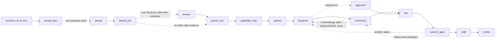

# Iteration 3 design: engineer the solution

**Status:** written 2026-11-05 and revised the same day after its Stage 9 review's first round and re-audit (`private/egm/iteration-3-stage9/`). It closes the four open decisions the Master-Plan sets for Iteration 3 (section 10.2 of [`context/Master-Plan.md`](../../context/Master-Plan.md)) and records its decisions as ADR-039 to ADR-050 in [`DECISIONS.md`](../../DECISIONS.md), with two departures from the Master-Plan and three process changes for its change log. The owner accepted them on 2026-11-05: ADR-039 to ADR-049, the two departures and CH-92 and CH-93 as the review left them, with WP-3.6 added (CH-94), by D-10's option C; and ADR-050 by D-11's option A, both in [`context/Decision-Form.md`](../../context/Decision-Form.md). It builds on ADR-005 (a supervised workflow), ADR-009 (the gateway), ADR-024 (acceptance checks), ADR-025 (agent configuration), ADR-026 (client documents), ADR-031 (stop and resume), ADR-032 (the gateway's rules), ADR-033 and ADR-034 (research packs and their matching rule), ADR-035 (the approval file), ADR-036 (research in the run) and ADR-038 (published solicitations), and on the checks of 2026-11-05 in [`docs/verification_log.md`](../verification_log.md): C7-02, C7-03, Q-01, Q-04, Q-09 and DR-05.

## 1. Purpose

Iteration 3 turns the verified requirements and the domain research into a solution a bid team can defend, and measures what each agent adds. It ends at tag `v0.3` when the Iteration 3 gate in section 5 of the Master-Plan passes.

In one line: for each need of the RFP, an agent decides how to answer it and drafts claims from the supplier's knowledge base; an assessor from another model family checks each claim against its evidence; code builds the capability map; `options` and `blueprint` turn it into a sourced solution manifest whose technology claims are checked against current documentation; `risk` runs a pre-mortem over the manifest; and a person approves the manifest at a gate before anything is drafted from it. A small ablation then shows whether each step earns its place.

The run at `v0.3` adds, after research: `decide`, one agent loop per need; `assess`, one call per claim, on a non-Gemini model; the capability map, in code; `options`, one call, scored in code; `blueprint`, two calls, checked in code; `techcheck`, through Context7; the full `risk` agent, with `sla_calc`; `solution_gate`, a human gate with an approval file; and the bid signal and memo, in code. Method cards and the `reflect` tool are built and stay off until a measurement switches them on. The `approach` node of `v0.2` stays as the one-call baseline of the solution ladder (SO0). Beside the run, a Streamlit UI shows a run's files on Run, Review and Ops pages, approves the gate through `bidwright approve`, and replays a run's spans into the local Phoenix (WP-3.6).

The build has two phases. Phase A, steps 1 to 12, builds the solution path; steps 4 to 11 build and test each new node on its own, and step 12 wires them into the graph, changes the calls the committed recordings make, and records them again. Phase B, steps 13 to 22, builds the UI and the measurements: the UI's first version, the scorer's new lines, gold v4, the keep-or-drop rule with runs seeded from a frozen run, the UI's Iteration 3 version, S-12, the extraction, solution and risk ladders, the statistical scenarios on 5 live hero repeats, and the documents.

Terms with one meaning each below:
- A **need** is one row of the capability map: a requirement group that holds a `BINDING` or `OPTIONAL` requirement (origin `RFP`), or a need of the domain brief (origin `DOMAIN`). A **binding need** is an `RFP` need whose group holds a `BINDING` requirement.
- A **claim** is one `CapabilityClaim` that `decide` drafts for a need; every claim is material (ADR-040).
- An **assessment** is one `EvidenceAssessment` of one claim.
- A **technology claim** is one `TechClaim` of the manifest, a statement about a library or another technology; it is not a claim in the sense above, and `techcheck` judges it.
- An **option** is one `SolutionOption`; the **chosen option** is the one the gate approves, or the top-ranked one under `--auto-select`.
- The **manifest** is the `SolutionManifest`, in `manifest.json`. The **run manifest** is `run_manifest.json`, and a **context manifest** is a call's `context/<node>-<call id>.json`.
- A **work package** is a leaf of the manifest's work breakdown structure; a **workstream** is one of its top-level nodes.
- The **gate** is `solution_gate`; the **regression gate** is `bidwright-eval gate` (`evals/gates.py`).
- A **rung** is one configuration of an ablation ladder, run with 5 repeats; a **side rung** (SO1-T, RK1-T) is measured against the rung it extends and is never another rung's comparator; a **seed run** is a finished run another run starts from.
- A **seed** alone is a gold seed of the corpus (a gap, risk, clarification, technology or decision seed); a **random seed** is the integer that fixes a draw.
- The LLM client's **recording modes** are `live`, `record` and `replay`; the **research modes** are `off`, `pack` and `live`. A **client run** is a run on a client document (ADR-026).
- The **Iteration gate** is the Master-Plan's gate for Iteration 3, whose exit checks section 7 lists.

## 2. What the checks changed

| Source | Finding | Effect on this design |
|---|---|---|
| C7-02, Cerebras | OpenAI-compatible at `https://api.cerebras.ai/v1`. `gpt-oss-120b` supports `json_schema` with `strict: true`; strict mode needs `additionalProperties: false` on every object; `required` need not list every property; local `$ref` and non-root `anyOf` are allowed. `reasoning_effort` takes low, medium or high, default medium. Cached tokens come in `usage.prompt_tokens_details.cached_tokens`. The free trial allows 5 requests and 30K input tokens a minute and 1M tokens a day, with a 65K-token context; V-03 adds that the trial is $5 of credits that expire 30 days after they are granted, and the owner's account shows them running until 2026-12-03 | `assess` and `techcheck`'s verdicts run on `gpt-oss-120b` through `llm/openai_compat.py`, whose schemas `llm/schema.py` already closes and already lists as required; the limiter gains Cerebras rows; the owner put the key in `.env` before this review (D-03, closed 2026-11-05) |
| C7-03, Groq | Strict structured outputs need every property in `required` and `additionalProperties: false`; `retry-after` and `x-ratelimit-*` headers are sent; cached tokens do not count against limits | `llm/schema.py`'s provider form fits Groq too; the owner added `GROQ_API_KEY` on 2026-11-05, so Groq is `assess`'s fallback provider |
| Q-04 | No source compares a same-family with a cross-family judge directly; the one test of same-lab inflation found none; a judge's serving route moved its scores more than a change of family; errors persisted across families. Structure helped: blind calls per axis, gates in code, a verifier competent in the domain | The Assumptions table's fallback applies (ADR-045): `assess` judges entailment over the cited evidence only, after code pre-checks; the serving route is recorded; the scorer reports the generator's and the assessor's joint error; the owner spot-checks 10 assessments; the different family stays as hygiene, not as the control |
| Q-01 | Tool-selection accuracy and schema validation per labeled case suit a small evaluation of about 5 repeats; pass@k and scalar judge scores do not; self-correction without external feedback lowers accuracy, while tool-grounded feedback raises it | `decide` is scored by decision accuracy against labeled needs and by the contrast between needs (section 4.13); `reflect` is offered only after a tool returned a failure, as CH-68 already sets |
| Q-09 | A bid-stage estimate states its basis, source data, resource assumptions, a range, an uncertainty statement and a maturity class; the sources hold no evidence on estimates made by language models | Every work package's effort carries a basis, a range, the roles it assumes, a maturity class and an uncertainty statement; the class is never better than conceptual, and the effort is labeled provisional for a person to review (ADR-043). The PMI sources' figures stay out of every document |
| DR-05 | A judged rubric cannot validly gate a plan, a work breakdown or a risk register; code checks must come first (the 100% rule, backward traceability, dictionary binding, six-field risk completeness, provenance), and a judge stays advisory, as binary checklists calibrated on human labels | The manifest's and the risk register's gates are code (ADR-043, section 4.7); no judge runs in this iteration; Iteration 5's judges take the checklist form, a note for its design doc |

DR-05, Q-01, Q-04 and Q-09 are notebook and deep-research answers; their figures are checked at source (V-01) before any deliverable quotes one.

## 3. Decisions this document closes

| Open decision | Closed by | In short |
|---|---|---|
| The solution path in the run | ADR-039, accepted | After research: `decide` per need, `assess` per claim, the capability map in code, `options`, `blueprint`, `techcheck`, `risk`, `solution_gate`, then `draft` and `render`; `approach` stays as the SO0 baseline; the run limits rise to fit it |
| What counts as a material claim | ADR-040, accepted | Every claim `decide` drafts is material, of six kinds, and the manifest asserts a capability only by citing an assessed claim; nothing else may state what the supplier can deliver |
| `options` weighting when weights are `not_stated` or scoring is pass or fail | ADR-041, accepted | Stated numeric weights give a weighted mean of the 0-to-4 scores; any unstated weight among the in-scope factors gives equal weights and a provisional ranking; a pass-or-fail factor carries no weight, and an option that fails it ranks below every option that passes |
| The `bid_policy.yaml` schema | ADR-042, accepted | An approved policy lists fatal triggers and conditions from a fixed set that code evaluates, a minimum covered share and the inputs it requires; without one, the signal is `UNDETERMINED` |
| The manifest field list | ADR-043, accepted | Two calls: the structure (states, workstreams, the work breakdown, assumptions, ground rules, technology claims), then the detail of each work package (dictionary, provisional effort, verification, schedule logic, benefits, win themes, PDCA); code checks closure, provenance and the absence of prices and invented dates |
| `techcheck` and its recorded answers | ADR-044, accepted | In research mode `live`, code calls Context7 for each technology claim that names a library, and an `assess`-role call gives the verdict with a quote found in the returned documentation; research mode `pack` reads a committed library pack; research mode `off` checks nothing |
| `assess` and the family rule | ADR-045, accepted | Entailment over the cited evidence only, reasons before the disposition, no evidence giving `UNVERIFIED` in code; the role's route is set once a run, Cerebras, then Groq, then the generator's family flagged `SAME_FAMILY`, and recorded so replays and resumes reuse it; a fallback to the same family makes the run `DEGRADED` |
| The gate | ADR-046, accepted | `solution_gate` interrupts the run in `WAITING_HUMAN`; `bidwright approve` resumes it with an approval in ADR-035's format; edits re-run `techcheck` and `risk`; automatic approval serves tests, matrices and recordings, and a blocked gate ends `POLICY_BLOCKED` |
| `reflect` | ADR-047, accepted | The pinned sequential-thinking server over stdio, allowed by a sixth gateway rule only after a failed tool call or a turn with no progress, 2 thoughts an invocation, outside the agent's caps; such a turn does not end the loop while a thought is left; off by default |
| How the ablation runs | ADR-048, accepted | Switches for each rung, runs seeded from a frozen run, re-runs of invalid repeats, and the Master-Plan's keep-or-drop rule as a decision kind of `bidwright-eval report`; the last rung each ladder keeps sets the switches' defaults |
| The `extract` examples' return | ADR-049, accepted | `extract.md` 0.5.0 brings back the examples that S-10, scored again under ADR-030, found better by more than the control's spread; it supersedes ADR-028's first decision, as CH-90 schedules, and the EX4 rung measures the second pass on the prompt that has them |
| The UI's view of scores in Docker | ADR-050, accepted (D-11) | A `ui` service runs the UI with the `app` service's mounts and `evals/results/` read-only, so the UI shows scores and ladder reports while every run started in `app` keeps gold-derived files out of reach; results hold scores, gold ids and stage names but no clause text, and `src/bidwright` never reads them |

**Process changes, for the change log (CH-92 to CH-94):**
- Gold v4 adds about 20 technology seeds and an expected decision for each mandatory clause of the hero package, written from the knowledge base and the corpus specs; the owner reviews and hashes it, with the ladders' hypotheses, before the first ladder run (CH-92).
- The owner spot-checks 10 assessments by hand before the tag, the check Q-04's fallback requires (CH-93).
- WP-3.6, the first version of the Streamlit UI (Run, Review and Ops pages) and span replay into Phoenix, moves forward from WP-6.1, which keeps the proposal pack's review views and the bake-off's results. The owner's decision (D-10, option C): the pages serve the gate's review and the ladders' inspection at `v0.3`, and under the walking-skeleton rule (CH-17) the assignment's dashboard stretch item (A15) then holds at any later stopping point (CH-94).

**Departures from the Master-Plan, each with its reason, accepted with D-10:**
- **The SO rungs read a frozen run of the EX3 configuration to `brief`, and the RK rungs a frozen full run.** The plan has both read a frozen EX3 run. An EX3 rung of the extraction ladder stops at `coverage` and holds no requirement groups or brief, which the solution path needs; a separate frozen run of the same extraction, run to `brief`, gives the SO rungs one fixed extraction. The full `risk` agent reads the manifest, which an EX3 run does not hold; seeding the RK rungs from a finished full run and running only `risk` again measures the risk step alone.
- **`decide`'s `ask_research` answers only from the research the run already holds.** The plan lists `ask_research` among `decide`'s tools. A live question from `decide` would cost NotebookLM questions and send text outbound once per need; answering from the loaded research pack, or from `research.json` in research mode `live`, uses what `discover` already gathered, with ADR-034's matching rule and G3 still applied.

## 4. The run at `v0.3`

### 4.1 Graph



The nodes up to research are those of `v0.2`. Research's last node, `discover_load` or `discover_extract`, and `brief` in research mode `off`, now lead to `decide_plan` instead of `approach`. `--until brief` still stops before research; `--until` gains `capability_map` and `solution_gate`. Below the manifest rung of the ablation (section 4.11), `decide_join` or `assess_join` leads to `approach`, and the run skips `options`, `blueprint`, `techcheck` and the gate; with `solution: oneshot`, research leads to `approach`, as at `v0.2`. A gate that is blocked under automatic approval, or rejected, raises `PolicyBlocked`, so the run ends `POLICY_BLOCKED` with no draft.

| Node | Kind | Reads | Writes | LLM calls |
|---|---|---|---|---|
| `decide_plan` | Code | The requirement groups, the verified requirements, the domain brief | The needs, in state | None |
| `decide` | Agent, `reason` role, one `Send` worker per need | One need | Its `NeedDecision` and claim proposals, through a list reducer | At most 4 tool turns, then 1 final call and 1 format repair |
| `decide_join` | Code | Every worker's outcome | `claims.jsonl`, `decisions.jsonl` | None |
| `assess` | Function, `assess` role, one `Send` worker per claim that cites evidence | One claim, its cited knowledge-base records, its need's requirement statements or text | Its `EvidenceAssessment`, through a list reducer | 1, and 1 format repair |
| `assess_join` | Code | Every assessment; the claims with no evidence | `assessments.jsonl` | None |
| `capability_map` | Code | The needs, decisions, claims and assessments | `capability_map.json` | None |
| `options` | Function, `reason` role | The brief's factors, the capability map, the domain brief's items | `options.json` | 1, and 1 format repair |
| `blueprint` | Function, `reason` role | The chosen option, the needs, the assessed claims, the brief | `manifest.json`, and `approach.json` through `write_approach` | P01 and P02, each with 1 format repair, P01 also with 1 closure repair; P03 after an `INVALIDATED` technology claim |
| `techcheck` | Code and `assess` role | The manifest's technology claims | `tech_validations.jsonl`, `tech_docs.jsonl` | 1 per checkable technology claim, at most 15 |
| `risk` | Agent, `reason` role | The manifest, hazards, gaps, discrepancies | `risks.jsonl` | As at `v0.2`: 4 turns, 6 tool calls, a final call |
| `solution_gate` | Human gate | Everything above | `review/solution_gate.md`, `review/solution_gate.approval.yaml`, `bid_signal.json`, `bid_memo.md` | None |
| `draft` | Function, `reason` role, as at `v0.2` | The manifest's workstreams, as approach items | `sections/*.md` | As at `v0.2` |

Run-level files, each with one writer:
- `claims.jsonl` and `decisions.jsonl`: `graph/decide.py`.
- `assessments.jsonl`: `graph/assess.py`.
- `capability_map.json`: `graph/capability.py`.
- `options.json`: `graph/options.py`.
- `manifest.json`: `graph/blueprint.py`, which also applies the gate's edits (`blueprint.apply_edits`).
- `approach.json`: `write_approach` in `graph/nodes.py`, the one function that writes it, called by the `approach` node or by `blueprint` with the manifest's view, so `draft`, `render` and the scorer keep reading one file.
- `tech_validations.jsonl` and `tech_docs.jsonl`: `graph/techcheck.py`.
- `review/solution_gate.md` and `review/solution_gate.approval.yaml`: `graph/gate.py` (`write_review` and `write_approval`); `bidwright approve` builds the approval and passes it to the run, which writes it.
- `bid_signal.json` and `bid_memo.md`: `graph/signal.py`, which the gate calls.
- `risk_rejected.jsonl`: the `risk` node, from step 12: each rejected risk with its reason.
- In a seeded run, the files `seed_load` copies from its seed (section 4.11).

Context manifests name their unit, as `consolidate`'s name the cluster: `decide`'s calls are `<need id>-<turn>` and `<need id>-final` (`context/decide-RG-003-1.json`), `assess`'s the claim id (`context/assess-CL-004.json`), `options`' `O01`, `blueprint`'s `P01`, `P02`, `P03` and their repairs, and `techcheck`'s the technology claim id. `CALL_PREFIX` gains `options: "O"` and `blueprint: "P"`; `harness/context.py`'s new `UNIT_NODES` (`decide`, `assess`, `techcheck`) lists the nodes whose call ids are their unit, which `record_manifest` takes without a prefix.

### 4.2 `decide` (ADR-039, ADR-040)

- **The needs.** `decide_plan` lists one need for each requirement group that holds a `BINDING` or `OPTIONAL` requirement, in group order, and one for each item of the domain brief's `needs`, in brief order, origin `DOMAIN`. A need's id is its group's `RG-` id or its domain need's `DN-` id. At most 24 needs a run go to the model, `RFP` needs first; any others are listed in `capability_map.json` as `GAP`, "not decided: the run's need cap", and the run finishes `DEGRADED`.
- **The task.** `DecideTask` holds one need, as a `NeedView`: for `RFP`, each member requirement as a `NeedRequirement` (its id, statement, modality, verified quote and passage ids), the group's topic, and its discrepancy and question ids; for `DOMAIN`, the need's text, in `text`, and its excerpts, which the prompt names as external research. It never holds another need's claims.
- **The loop.** At most 4 turns and 6 tool calls, ending at a turn that adds nothing new, as `risk`'s loop does; a turn's progress is a record id from `search_capabilities`, a passage id from `search_rfp` or `read_section`, or an excerpt id from `ask_research`, not seen before. The tools:
  - `search_capabilities(query, k)`: an FTS5 index over the knowledge base, built once a run as `kb.sqlite`, returning each record's id, kind, name and text, at most 8. A record's name is a capability's name, a case study's client and sector, a certification's name and a role's title; its text is a capability's summary, a case study's summary, a certification's name, holder and expiry, and a role's summary.
  - `search_rfp`, as at `v0.2`.
  - `read_section(src_id)` or `read_section(doc_id, section_path)`: the first 8 passages of one section, named by one of its passages or by its document and path, through the text view.
  - `ask_research(question)`, from the research the run holds (section 3): in research mode `pack`, the `PackProvider` of the pack `discover_load` loaded, found by the id and hash `research.json` records; in `live`, a `PackProvider` over `record_pack(research.json)`, a `Pack` built from the answer, excerpt and source rows `research.json` holds; in `off`, `decide` is not offered the tool. A pack whose hash no longer matches is not offered either, with a note.
- **The final call.** `DecideResult`, the decision first: `decision` (`RETRIEVE_EVIDENCE`, `PROCEED_WITH_GAP`, `REQUEST_CLARIFICATION` or `ABSTAIN`), `reason` (at most 300 characters), `claims` (at most 3), `gap` (with `PROCEED_WITH_GAP`) and `question` (with `REQUEST_CLARIFICATION`). Each claim: `kind` (`capability`, `certification`, `delivery`, `technology`, `figure` or `role`), `text` (at most 300 characters), `evidence_ids` (0 to 3 knowledge-base ids) and `src_ids` (1 to 3 passage ids).
- **Code's checks.** An evidence id is kept only when this need's loop received it from `search_capabilities`; a passage id only when it belongs to a member or a context requirement, or this loop received it from `search_rfp` or `read_section`. A claim left with no passage id is dropped. `RETRIEVE_EVIDENCE` with no claim becomes `PROCEED_WITH_GAP`, with a note. Each drop is named in the outcome's `notes`.
- **Ids and questions.** After the join, claims are numbered `CL-001` onward in need order, so the numbering does not depend on which worker finished first; questions become `ClarificationQuestion`s with origin `decide`, numbered after the brief's last `CQ-` id, kept in state as `decide_questions` and written in `decisions.jsonl`; `render` adds them to the summary's part 4 and to `clarification_questions.md`, as it adds the brief's.

### 4.3 `assess` (ADR-045)

- **What is assessed.** Every claim with at least one evidence id gets one `assess` call. A claim with none is `UNVERIFIED` in code, with "no evidence cited", and no call.
- **What the assessor sees.** `AssessmentTask`: the claim's kind and text; each cited knowledge-base record in full (a capability's name, summary and tags; a case study's client, sector, year and summary; a certification's name, holder and expiry; a role's title and summary); and the statements of the requirements of the claim's need, or the domain need's text. It never sees `decide`'s turns, its reason or the other claims.
- **The answer.** `AssessmentResult`: `reason` (at most 600 characters, written before the label), `disposition` (`SUPPORTED`, `PARTIALLY_SUPPORTED`, `UNVERIFIED`, `CONTRADICTED` or `NOT_APPLICABLE`), `supporting_ids` (a subset of the cited ids) and `missing` (what the evidence does not cover, at most 300 characters).
- **Code's checks.** An id outside the cited ones is dropped; `SUPPORTED` or `PARTIALLY_SUPPORTED` with no supporting id left becomes `UNVERIFIED`; a claim is `partner_only` when every supporting id names a capability tagged `partner`. Each `EvidenceAssessment` records the assessor's provider, model, base URL (`null` for a backend with none) and prompt version, the serving route Q-04 asks to record.
- **The family rule.** The `assess` role's route is set once, at run start, and recorded in the run's arguments: `primary`, its `provider`, Cerebras `gpt-oss-120b`; else `fallback`, its `fallback_provider`, Groq's `openai/gpt-oss-120b`, whose key the owner added on 2026-11-05; else `same`, its `same_family_role`'s model, the `reason` role's. A live or recording run takes the first route whose provider has a backend; a replay takes the route its recording names, `primary` when it names none, and a resume takes the first part's, refusing when that provider has no backend, so the route never changes within a run. `execute` hands the client the route's `RoleConfig` through `LLMClient`'s new `role_overrides`, which `complete` reads before `config.models`. Within the route's provider, the client's model fallback, and `fallback=False` in matrix runs, apply as at `v0.2`. Every assessment on route `same`, and every assessment on a profile whose `RoleConfig` sets `same_family: true` (`local`), is flagged `same_family`. A run on route `same` whose profile names another family for `assess` finishes `DEGRADED` with "assess: SAME_FAMILY" once an `assess`-role call has run; on `local`, where the same family is configured, the flag stays and the status does not change, as the Master-Plan's model table sets. The run manifest's configured model for `assess` is the route's.
- **Client runs.** A client run takes route `same` before the egress check: with the consent override on `free`, the Gemini model, and the run finishes `DEGRADED`; on `local`, the local model. A client run therefore names no Cerebras, Groq or Context7 destination.

### 4.4 The capability map and `options` (ADR-041, ADR-042)

- **The map.** One row per need: origin, `text` (a group's topic, or a domain need's text), the decision, the claim and assessment ids, a status set in code, and `reason`, code's note on the status. The status is checked in this order: `GAP` when no claim is `SUPPORTED` or `PARTIALLY_SUPPORTED`; else `PARTNER` when every supported claim is `partner_only`; else `COVERED` when the decision is `RETRIEVE_EVIDENCE` and every claim is `SUPPORTED`; else `PARTIAL`.
- **The task.** `OptionsTask`: the brief's factors (id, name, weight, scoring, status), the map's rows (need id, origin, text, status, the claims' texts with their dispositions), the domain brief's items tagged `EXTERNAL_RESEARCH`, and the gaps (each `GAP` row's need id with `decide`'s gap text).
- **The answer.** `OptionsResult`: 2 or 3 options, exactly one marked `baseline`, the simplest that meets what the binding needs allow. Each option: `name`, `summary`, `approach` per need (`need_id`, `delivery_mode`: `OOTB`, `CONFIG`, `CUSTOM`, `PARTNER`, `ALTERNATIVE` or `EXCLUDED`, `claim_ids`), `assumptions`, and `scores`, one per `IN_SCOPE` factor: `factor_id`, `score` from 0 to 4 and `reason`.
- **Counts.** One option is kept, with a note; beyond 3, the first 3. With no option marked `baseline`, code marks the one with the fewest `CUSTOM` needs; with two or more, the first stays and the others lose the mark, with a note.
- **Weights (ADR-041).** A factor is pass-or-fail when its weight reads "pass/fail", "pass or fail" or "pass-fail", in any letter case, or its scoring quote holds both "pass" and "fail"; it carries no weight, and an option scored below 2 on it fails that gate. A stated weight is the number at its start, so "40", "40%" and "40 points" are 40; any other text, such as "high", counts as `not_stated`. When every other in-scope factor has a stated weight, an option's total is the weighted mean of its scores, `sum(score * weight) / sum(weight)`, from 0 to 4, and `weighting` is `stated`; when any of them is `not_stated`, every one counts equally, `weighting` is `equal`, and the ranking is provisional, with the assumption written into `options.json`'s notes. With no weighted factor at all, every total is 0. Every option that passes its gates ranks above every option that fails one, whatever their totals.
- **Code's checks.** A score for an `OUT_OF_SCOPE` or unknown factor is dropped, and a missing in-scope score counts 0, with a note. An option citing a claim that is not `SUPPORTED` or `PARTIALLY_SUPPORTED` is `needs_proof`. Ties break on fewer open gaps (the `GAP` needs an option marks neither `PARTNER` nor `ALTERNATIVE`), then fewer `needs_proof` claims, then fewer `CUSTOM` needs, then option order. The ranking is labeled hypothetical unless an approved bid policy is loaded (BA-002).

### 4.5 `blueprint` and the manifest (ADR-043)

- **Call P01, the plan.** `BlueprintPlanTask`: the chosen option, the needs with their requirements, the assessed claims, and the brief's scope, constraints and `never` items. `BlueprintPlan`: `current_state` and `target_state` (at most 3 facts each), `workstreams` (name, objective), `wbs` (each node: `code` such as `1.2.3`, `name`, `deliverable`, and for a work package `requirement_ids`, `need_ids` and `claim_ids`), `assumptions`, `ground_rules` and `tech_claims` (text, `library` or `null`, `version` or `null`, the work package's code). Every fact, in the states, assumptions and ground rules, is a `FactProposal`: `text`, `src_ids`, `requirement_ids`, `claim_ids` and `domain_item_ids`.
- **Workstreams.** Workstream `n` is the top-level node with code `n`, so a work package belongs to the workstream of its code's first part; a top-level node without a workstream, or a workstream without a node, fails the tree check.
- **Settling P01.** Code runs the tree, 100%, trace and provenance checks on the plan before P02. A plan that fails a tree check (duplicate codes, a missing parent, a depth of 1, an unmatched workstream) gets the format repair message naming it, and a second failure is a blueprint failure. A plan that leaves `BINDING` requirements in no work package gets one closure repair message naming them, as the Master-Plan's failure table asks; those still left go to `gaps` with their need's status.
- **Call P02, the detail.** `BlueprintDetailTask`: the settled plan, the claims, the knowledge base's roles. `BlueprintDetail`: per work package, `scope`, `exclusions`, `acceptance`, `effort` (`low_days`, `high_days`, `basis`: `analogy`, `parametric`, `expert_judgment` or `bottom_up`, `basis_text`, `role_ids`, `uncertainty`), `verification` (per requirement: `INSPECTION`, `DEMONSTRATION`, `ANALYSIS` or `TEST`) and `predecessors`; per workstream, `pdca` (plan, do, check and act, one sentence each); and `benefits` (hypothesis, measure, need id) and `win_themes` (feature, metric, benefit, proof claim id or `null`).
- **Call P03, the revision.** `RevisionTask` returns a revised `BlueprintPlan`, which code settles as it settles P01's; P02 then runs again over it, since codes may change, and the manifest's `revision` becomes 1.
- **Code's checks**, each failure named in `manifest.json`'s `checks`:
  - the tree: codes unique, every parent present, a depth of at least 2, every leaf a work package, workstreams matched to top-level nodes;
  - the 100% rule: every `BINDING` requirement is in at least one work package, or listed in `gaps`;
  - the backward trace: every work package names a requirement or a need, or is flagged `untraced`;
  - dictionary binding: every work package has a scope, exclusions and acceptance;
  - effort: `low_days` at most `high_days`, a basis, and at least one role id that the knowledge base holds; code sets the maturity class to `CLASS_5`, conceptual, because the sources hold no evidence on estimates made by a model (Q-09), and labels every effort provisional;
  - schedule logic: predecessors name work packages, and the graph has no cycle; code removes the edges that close a cycle, with a note;
  - provenance: code drops an id that does not exist, and sets each fact's `evidence_class` from what it still cites, the strongest first: `RFP_SOURCE` for passages or requirements, `CAPABILITY_EVIDENCE` for a claim assessed `SUPPORTED` or `PARTIALLY_SUPPORTED`, `EXTERNAL_RESEARCH` for a domain item, and `ASSUMPTION` for nothing; a fact citing a claim that is not supported becomes `ASSUMPTION`, with `needs_proof`;
  - a work package's class rests on its claims: `CAPABILITY_EVIDENCE` when it cites claims and each is assessed `SUPPORTED` or `PARTIALLY_SUPPORTED`; else `ASSUMPTION`, with `needs_proof` when a cited claim is not supported; its requirement ids are its trace, not its evidence;
  - a win theme with no supported proof claim is `NO_PROOF`;
  - no prices and no invented dates: a fact holding a currency amount, or a calendar date that no passage of the run holds, is dropped, and in a work package's text fields the amount or date is replaced by "[removed]", each with a note; amounts and dates are found by `verify.values` and the `AMOUNT` cue.
- **A failed check** is listed in `checks`, shown at the gate and scored; it never blocks the gate or changes the run's status.
- **A failed call.** P01 or P02 breaking its schema twice sets `blueprint_failed`: `manifest.json` holds what settled, the edge goes to the `approach` node of `v0.2`, which writes `approach.json`, the run skips `techcheck` and the gate, and it finishes `DEGRADED`.
- **The view.** `write_approach` gets one `ApproachItem` per workstream that names at least one requirement (any other is noted): `text` the workstream's name and objective, `requirement_ids` its work packages' requirements, `basis` its objective, `evidence_class` its work packages' weakest class, `source_ids` its requirements' passages; `unmapped` the `BINDING` requirement ids in `gaps`; `questions` empty, since `decide`'s go by `decide_questions`; `failure` the blueprint failure, if any.

### 4.6 `techcheck` (ADR-044)

- **What is checked.** Each technology claim with a `library` is checkable, at most 15 a run in work package order; any further one is `SKIPPED_CAP`. A technology claim with no library is `NOT_CHECKABLE`.
- **Research mode `live`.** Code calls Context7's remote MCP server through `McpClient`, with `Authorization: Bearer` and `CONTEXT7_API_KEY` when that variable is set, and the server's tools pinned in `config/mcp_pins.yaml`. For each library, once a run, it calls `resolve-library-id` with the library's name and the first technology claim's query; for each technology claim, `query-docs` with the first library id and a query code builds from the library, the version and the claim's content stems, a repeated query reusing its documentation. Each call is a `ToolRequest` through a `ToolGateway` for agent `techcheck`, whose allowlist is `config/agents.yaml`'s entry and whose cap is twice the technology claim cap; G3 checks the query and the library name against the run's passages, and G4 the pins; G2 does not apply, since code builds every argument. A denial leaves the technology claim `UNVALIDATED` with the rule's reason. The documentation is split into paragraphs of at most 1,200 characters, each screened by `trust.screen`; the quarantined ones are dropped and the rest joined by blank lines and cut at the last paragraph within 4,500 tokens. It is written to `tech_docs.jsonl` and goes with the technology claim to one `assess`-role call, `TechVerdict`: `reason`, `verdict` (`VALIDATED`, `INVALIDATED` or `INSUFFICIENT_DOCS`) and `quote`. A verdict whose quote, after `verify.normalize`, is not a substring of the documentation normalized the same way becomes `INSUFFICIENT_DOCS`. Context7 out of reach, or its breaker open, leaves the technology claim `UNVALIDATED`.
- **Research mode `pack`.** `techcheck` makes no network call. The library pack, `research_packs/libraries/`, holds `library.yaml` (each file's hash, as ADR-033's `pack.yaml` does), `sources.jsonl` and `excerpts.jsonl`, each excerpt with its `library`; `pack_keywords` reads only `pack.yaml`, so research-pack selection never sees it. `LibraryPack` refuses a changed or missing file, and answers the query code builds by ADR-034's matching rule among the clean excerpts of the technology claim's library; the matching excerpts, joined by blank lines in match order and cut within 4,500 tokens, take the documentation's place in the verdict call, and none gives `INSUFFICIENT_DOCS` with "not in the library pack".
- **Research mode `off`.** Every checkable technology claim is `UNVALIDATED` with "research off"; nothing is called.
- **Building the library pack.** `bidwright research libraries --library NAME --topic WORDS ...` calls Context7 directly, with no run, for each library and topic, and writes the pack, raising its version; `--run RUN` adds a live run's `tech_docs.jsonl`. Each fetched documentation becomes one `LibrarySource`, and its paragraphs, split as in research mode `live`, become `LibraryExcerpt`s, each screened by `trust.screen` and kept with its `quarantined` flag. The topics are general words, such as "PDF/A export", never RFP text.
- **A false technology claim.** An `INVALIDATED` technology claim sends `blueprint` one revision call, P03, with the technology claim, its verdict and its quote; the revised manifest goes through every check again. A technology claim still `INVALIDATED` blocks the gate.

### 4.7 The full `risk`

Step 12 makes these changes, which alter every recorded `risk` call:
- **Input.** `RiskInput` gains the manifest's work packages (code, name, predecessors, effort range), its assumptions, the technology claims with their verdicts, the capability map's `GAP` rows and the discrepancies, beside the requirements and hazards of `v0.2`; `risk.md` moves to 0.3.0.
- **Tools.** `search_rfp`, `date_calc`, and `sla_calc(target_percent, period, measured_minutes)`, which gives the downtime a service level allows in a period, or with a measured downtime the percentage achieved. A new `sla_calc` result counts as progress in the loop. A risk may state a computed figure in its effect; `evidence_src_ids` stays passage ids.
- **Checks.** Those of `v0.2` (evidence cited, no generic risk, no rating or probability), and the six fields: condition, event, effect, owner role and trigger not empty, and at least one response; a risk failing them is rejected with the generic risks' one retry. `RiskProposal.responses` loses its minimum, so a risk with no response fails its own check rather than the register's parse. A risk may name work package codes and need ids in `affects`, which code keeps only when they exist. Each rejected risk is written to `risk_rejected.jsonl` with its reason.

### 4.8 `solution_gate` and the statuses (ADR-046)

- **The gate.** The node writes `review/solution_gate.md` (the chosen option and the ranking with each score and reason, the capability map, the manifest's checks, every technology verdict, the risks, the bid signal and the research appendix's origin), then calls LangGraph's `interrupt()`, and the run's part ends `WAITING_HUMAN`. When the run resumes, LangGraph runs the node again from its start: it writes the same file again and `interrupt()` returns the approval.
- **The approval**, in ADR-035's format: `gate` (`solution_gate`), `run_id`, `reviewed` (the hashes of `manifest.json` and `options.json` the approver saw), `decision` (`approve`, `edit` or `reject`), `option_id`, `approver_role`, `decided`, `edits` (each a field path and value), `override_reason`, `reject_reason`, `auto_selected`, and `edited_sha256` (the manifest after the gate applied the edits). A `reviewed` hash that no longer matches voids the approval, and the gate waits again.
- **`bidwright approve <run> --role TEXT [--option OPT-n] [--edit FILE] [--override REASON] [--reject REASON]`** builds the approval and resumes the run with `execute(approval=...)`, which passes it through `Command(resume=...)`; the gate node writes it. The decision is `reject` with `--reject`, which takes no other flag; `edit` with `--edit`; else `approve`. `--option` switches the chosen option and sends the run back to `blueprint`; it does not combine with `--edit`, since edits apply to the reviewed manifest. `--edit FILE` takes a YAML list of `{field, value}`, from standard input when `FILE` is `-`, whose fields are `work_packages[<code>].effort.low_days`, `work_packages[<code>].effort.high_days`, `work_packages[<code>].predecessors`, `work_packages[<code>].scope`, `work_packages[<code>].exclusions`, `work_packages[<code>].acceptance`, `assumptions[<n>].text` and `ground_rules[<n>].text`; `blueprint.apply_edits` applies them, the run goes to `techcheck` for the changed work packages' technology claims and then to `risk`, which builds the whole register again, and the gate passes without waiting while the manifest's hash equals `edited_sha256`. `--override` passes a blocked gate with its reason recorded; without it, `approve` on a blocked gate is refused before the run resumes, naming the `INVALIDATED` technology claims. `--reject` ends the run `POLICY_BLOCKED` with "GATE_REJECTED".
- **Automatic approval.** `execute` gains `gate: "wait" | "auto"`, default `auto`, for its programmatic callers: tests, matrix runs and recordings. `bidwright run` and `bidwright record` pass `wait` unless `--auto-select` is given. Automatic approval approves the top-ranked option with `auto_selected: true`; it never passes a blocked gate, so a technology claim still `INVALIDATED` ends the run `POLICY_BLOCKED` with "GATE_BLOCKED".
- **Statuses.** `WAITING_HUMAN` joins the resumable statuses, and leaves by `bidwright approve`; `bidwright resume` refuses a run that waits at the gate and names `approve`; `bidwright run` exits 0 on a run that waits there, naming the review file and `approve`. `approve`, like `resume`, continues only a run made in the client's `live` mode. Everything else is as at `v0.2`.

### 4.9 The bid signal and the memo (ADR-042)

A bid policy is loaded only when `bidwright run --bid-policy FILE` names one; the run manifest records its hash in `bid_policy_sha256`. A trigger's `when` is one of: `hazard_on_gap` (a submission hazard's requirement sits in a `GAP` need), `gap_on_mandatory` (a binding need is `GAP`), `contract_flag` (a contract flag of the listed `ContractCategory` values), `deadline_within_days` (the RFP's submission deadline falls within `days` of the run's start date) and `every_option_needs_proof`; `required_inputs` names files from `capability_map`, `options`, `manifest` and `tech_validations`. At the gate, code computes the `BidSignal`: a fatal trigger gives `NO_GO`; otherwise a condition, or a covered share (binding needs `COVERED` or `PARTNER`) below the policy's minimum, gives `CONDITIONAL_GO`; otherwise `GO`; with no policy, or a required input missing, `UNDETERMINED`, listing what is missing. `bid_memo.md` is one page: the signal and the triggers it found, with their record ids; the covered share; the options' ranking, labeled hypothetical without a policy; the open clarifications; the unvalidated technology claims; and the line that a person decides. No probability of winning and no price appear anywhere. When the RFP profile's submission deadline is `not_stated` or does not parse as a date, `deadline_within_days` counts as a missing input, "submission deadline". With no binding need the covered share is `null`, and the minimum does not apply. The run's start date is the UTC date of the run manifest's `started`.

### 4.10 Method cards and `reflect` (ADR-047)

- **Cards.** The owner's 18 method cards are the owner's own wording, not PMI book text, held as the owner's note in the PMI notebook. At step 18 Claude checks that the source is that note and not one of the PMI PDFs, records the check in [`context/Research-Register.md`](../../context/Research-Register.md), and copies the cards verbatim into `knowledge_base/methods/cards.yaml`, each with its id, family, consumers (agents in `config/agents.yaml`) and status. `config/limits.yaml` gains `methods: {enabled: []}`; for a family listed there, the context manager appends its cards to its consumers' system instruction, in a `<method_cards>` element after the examples, and appends nothing when no family is on. The appended text joins the prompt's hash, so a call with cards and one without never share a cassette or cache key, and code records the inlined card ids in the call's context manifest; no output schema changes. Every family starts off; S-12 (steps 18 and 19, section 4.11) measures each one, and only its result switches a family on, with an ADR.
- **`reflect`.** The reference sequential-thinking server, `@modelcontextprotocol/server-sequential-thinking`, pinned in `package.json` and `package-lock.json` and installed in the image at build time with `DISABLE_THOUGHT_LOGGING=true`, runs over stdio through `McpClient`, one process a thought. The tool the model sees is `reflect(thought)`, with `ReflectArgs` (`thought`, 1 to 2,000 characters); code fills the server's `thoughtNumber` (1 or 2), `totalThoughts` (2) and `nextThoughtNeeded` (`true` on the first thought, `false` on the second), so nothing relies on the server's own history. From step 11, `config/agents.yaml` lists `reflect` among the tools of `decide` and `risk`, with `reflect: false` in each agent's limits by default; an agent with `reflect: false` sends no `reflect` definition and its loop runs as at `v0.2`, so no recorded call changes. With `reflect: true`, the definition goes with every turn, and G6 (section 6.2) allows a call only after a failed tool call or a turn with no progress, CH-68's signals for these agents (neither writes a quote that `verify` checks, so a rejected quote does not arise), 2 thoughts an invocation. A `reflect` call counts as neither progress nor failure; a turn holding only `reflect` calls is outside the turn cap; and a turn with no progress does not end the loop while a thought is left, so the model can reflect and then act; once the thoughts are spent, the next turn with no progress ends the loop, as at `v0.2`. Each thought is a `TOOL` span with counts and hashes only.

### 4.11 The ablation (ADR-048)

- **Switches**, as `execute` arguments, matrix rung flags and recorded `run_args`:
  - `solution`: `oneshot` (SO0, the `approach` node of `v0.2`), `fixed` (SO1-F: for each need, code retrieves the top 5 hits of `search_capabilities` for the need's topic and member statements, or a domain need's text, adds the group's passages or the need's excerpts, and `decide` makes its final call only, with no loop), `decide` (SO1), `assess` (SO2), or `manifest` (SO3, the default).
  - `risk_mode`: `oneshot` (RK0, one `risk_oneshot.md` call with no tools, its `RiskFixedInput` holding no dates or passages), `fixed` (RK1-F: for each hazard whose quote holds a date by `verify.values`, code computes with `date_calc` the days from the run's start date and the weekday, retrieves the top 5 passages with `search_rfp` on the hazard's statement, and makes one `risk_oneshot.md` call with no tools, its `RiskFixedInput` holding the results), or `agent` (RK1, the default).
  - `reflect`: `false`, the default, or `true` (SO1-T, RK1-T), for the agent its ladder measures: `decide` on SO1-T, `risk` on RK1-T.
  - `extract_context`: `full`, the default, or `bare` (each passage's id and text, `section_path` an empty string, no lead-in, neighbor or term); `triage`: `true`, the default, or `false` (every section zoned `OBLIGATION`, with the `ZoneSource` value `forced`, and no call); `coverage`: `true`, or `false` (`max_rounds` 0).
  - The defaults live in `config/limits.yaml`'s `switches` block (step 12). After a ladder, the configuration of the last rung its main chain keeps sets the defaults, each change with an ADR, and a side rung that is kept sets `reflect: true` for its agent. The honesty controls stay on whatever the ladders show, as the Master-Plan's rule requires: `verify`, the gateway and `assess`'s independence, so the default `solution` is never below `assess`.
- **Seed runs.** `bidwright seed <run> --name NAME` freezes a seed run by copying its folder, its checkpoint included, to `outputs/seeds/<name>/` with `seed.sha256`, the hash of each file. `execute(seed_run=<folder>, seed_from="research" | "risk")` starts from it with `seed_load`, a new first node. `seed_load` checks `seed.sha256`, and that the prompts the seed's nodes before the seed point used have the hashes the current prompts have, refusing a stale seed before the run folder exists. It then reads the seed's last checkpoint and returns, as its state update, the keys `graph/state.py`'s `SEED_KEYS[seed_from]` lists; copies the files `SEED_FILES[seed_from]` lists, unchanged; and restores the passages, the text view and the search index with `_rebuild`, as a resume does. With `research`, the keys and files are those of the nodes up to `brief`, and the graph runs research and the solution path; with `risk`, they add those of research, `decide`, `assess`, the map, `options`, `blueprint` (`approach.json` among them) and `techcheck`, and the graph runs `risk`, the gate and the rest. A test replays a development run and checks that every key and file a node before each seed point writes is listed. In a seeded run, `seed_load` is the only writer of those copies; the run manifest records the seed's folder, its hash, both commits and the seed's extraction settings, which a seeded rung never changes: `check_rungs` refuses an extraction switch on a seeded matrix. The SO seed is one run of the EX3 configuration on the hero package with `--until brief`; the RK seed is the first SO3 repeat, frozen after the SO ladder.
- **Re-runs.** A matrix repeat that ends `BUDGET_EXCEEDED` or `POLICY_BLOCKED`, on a fallback model, or `DEGRADED` with a part of its reason (the `; `-separated parts) that starts with none of its matrix's `allow_degraded` prefixes, is cleared and run again, at most twice; after a third failure it is recorded invalid and the report leaves it out with a note.
- **The rule.** `bidwright-eval report` gains the decision kind `keep_or_drop`. A ladder's main chain is taken in order, its first rung kept as the control; each later rung is compared with the last rung kept, and a side rung with the rung its `compare_to` names. For a rung and its comparator, `d` is the difference of their medians on the rung's metric, signed so that a positive `d` is favorable (comparator minus rung for `lower`, rung minus comparator for `higher`), and `[lo, hi]` is its 90% bootstrap interval. With no `margin`, the rung is kept when `lo > 0`. With a margin `m`, non-inferiority replaces that test: the rung is kept when `lo > -m` and the signed difference of the medians of its `secondary` metric is above 0. The EX ladder's metric is missed mandatory requirements, so its margin is the guard against more misses; the SO and RK rungs keep their seed run's requirements. The bootstrap uses `random.Random(seed)` from the standard library, `seed = int.from_bytes(sha256(matrix name).digest()[:8], "big")`, resamples each rung's valid repeats with replacement, independently, 10,000 times, and takes the 5th and 95th percentiles of the resampled `d`. Cost is reported as dollars per avoided miss, the difference of median costs over the difference of median misses, `n/a` when no miss is avoided, and never decides. A hypothesis reads `{metric, kind: keep_or_drop, direction, margin, secondary: {metric, direction}, compare_to, hypothesis}`, with `margin`, `secondary` and `compare_to` optional.
- **The ladders**, with their hypotheses in `evals/hypotheses.yaml`:

| Ladder and file | Seed | Rungs and flags | Metric (direction, margin) | Secondary |
|---|---|---|---|---|
| EX, `config/matrices/ex-ladder.yaml`, hero to `coverage` | None | EX0: `baseline: ex0`; EX1: `extract_context: bare`, `triage: off`, `coverage: off`, `second_pass: false`; EX2: EX1 with `extract_context: full`; EX3: `second_pass: false`; EX4: `second_pass: true` | `missed_mandatory_count` (lower, margin 1) | `precision_low` (higher) |
| SO, `config/matrices/so-ladder.yaml` | The SO seed, `seed_from: research` | SO0 `solution: oneshot`; SO1-F `fixed`; SO1 `decide`; SO1-T `decide`, `reflect: true`, a side rung on SO1; SO2 `assess`; SO3 `manifest` | `gap_assertions` (lower, margin 0) | `approach_mapping`, binding requirements mapped (higher) |
| RK, `config/matrices/rk-ladder.yaml` | The RK seed, `seed_from: risk` | RK0 `risk_mode: oneshot`; RK1-F `fixed`; RK1 `agent`; RK1-T `agent`, `reflect: true`, a side rung on RK1 | `risk_seed_recall` (higher) | `generic_risks_rejected` (lower) |

  Every rung but EX0 runs `extract.md` 0.5.0, with the examples (ADR-049). A gap assertion is a gap seed whose absent terms appear in an approach item, a manifest fact, or a claim that is unassessed or assessed `SUPPORTED` or `PARTIALLY_SUPPORTED`, so every SO rung, SO0 included, has the metric, and SO1's unchecked claims count.
- **The statistical scenarios.** `config/matrices/hero-repeats.yaml`: 5 live repeats on the hero package with the switches' defaults as the ladders set them, automatic approval and research mode `pack`, scored for QS-2, QS-3, QS-5 and QS-8. `bidwright-eval report` gains QS-8: the median pairwise Jaccard over the gold clause ids the repeats capture, warning below 0.85.
- **S-12.** `bidwright-eval cards --repeats 5` runs each case of `evals/s12/cases.yaml` once a repeat with its family off and on, through `graph/single.py`'s `call_node`, and counts violations with the case's check. A family whose violations fall beyond the off runs' spread then gets a rung in `config/matrices/s12-scorecard.yaml`: the development PDF, 5 repeats, one rung with every family off and one per such family, under `within_noise` hypotheses on missed mandatory requirements and seeded gaps claimed. A family switches on when both pass.

### 4.12 Client documents and egress (ADR-026)

The egress register gains `cerebras` (`api.cerebras.ai`), `groq` (`api.groq.com`) and `context7` (`mcp.context7.com`), each `local: false`, receiving prompts or queries; `check_run` takes a list of research destinations, `context7` among them in research mode `live`. At step 11 it gains `reflect`, the stdio server the app launches from its own pinned package, `local: true`, which `check_run` receives when an agent's limits have `reflect: true`: `Destination` gains `transport` (`http`, the default, or `stdio`, which needs no hosts), and `receives` gains `thoughts`; every other stdio entry stays refused. A client run's `assess` resolves to the same family (section 4.3), its `techcheck` reads only the library pack, and its research stays `pack` or `off`; the consent override of ADR-026 opens Gemini only, as before.

### 4.13 What the evaluation adds

- **The scorer's new lines** (step 14), each reported as not run when the run lacks its file:
  - seeded gaps claimed (QS-5): a claim assessed `SUPPORTED` or `PARTIALLY_SUPPORTED`, or a manifest fact of class `CAPABILITY_EVIDENCE`, that holds one of a gap seed's absent terms; the regression gate blocks on any, through `config/thresholds.yaml`'s existing `seeded_gaps_claimed: 0`, which `evals/gates.py` now reads;
  - gap assertions, the SO ladder's metric (section 4.11);
  - `UNVERIFIED` precision and recall against the gap seeds: a claim matches a gap seed when its text holds one of the seed's absent terms, case-insensitively at word boundaries; recall is the share of matching claims assessed `UNVERIFIED`, and precision the share of `UNVERIFIED` claims that match a gap seed or cite no evidence;
  - decision accuracy: the share of scored needs whose decision matches the expected one, and the contrast, the number of distinct decisions in the run;
  - the manifest's checks, each passed or failed, with untraced work packages and gaps counted;
  - the manifest's technology claims that match a technology seed (the same library, case-insensitively, and at least half of the seed's content stems, and at least 2), with their verdicts; `INSUFFICIENT_DOCS`, `UNVALIDATED` and `SKIPPED_CAP` count as not judged. Verdict accuracy itself comes from `bidwright-eval techcheck --repeats 5`, which judges each technology seed in research mode `pack` through `graph/single.py`'s `call_node` and reports the Master-Plan's rule: each false seed `INVALIDATED` in at least 4 of 5 repeats, and no true seed ever `INVALIDATED`;
  - risk completeness: the six fields filled on every risk, and no rating;
  - generic risks rejected, counted from `risk_rejected.jsonl`;
  - options reproduced: the weighted totals recomputed from `options.json`'s logged scores and the brief's weights, with the tie-break replayed;
  - the joint error of `decide` and `assess` (Q-04): claims the generator wrote and the assessor accepted although they name a gap seed's capability.
  - QS-3's trap scan over every model-written file: `seeds.model_texts` gains the claims, the decisions' reasons, gaps and questions, the assessments' reasons and `missing`, the options, the manifest, the technology validations' reasons, the gate's review file and `bid_memo.md`.
- **Gold v4** (step 15, CH-92). Two seed kinds, for the hero package. `TechSeed`, id `TS-` and 2 digits: `library`, `text` and `holds` (`true` or `false`); about 20, written from the libraries the knowledge base and the corpus name and their own documentation read directly, one of them the knowledge base's false claim that `pdfplumber` exports PDF/A (CAP-005). `DecisionSeed`, id `DD-` and 2 digits, with `gold_id` and `decision`, one per mandatory clause: `PROCEED_WITH_GAP` for a clause among a gap seed's anchors (GS-01 to GS-04), else `REQUEST_CLARIFICATION` for one among a clarification seed's anchors, else `RETRIEVE_EVIDENCE`. A need's expected decision is the most common among the decision seeds of the gold clauses its members capture, ties going in that order; a need that captures none is not scored. No clause changes, so the rendered inputs stay as they are. Domain seeds stay unscored until Iteration 5's SO4 rung.
- **The spot-check** (CH-93). `bidwright-eval spotcheck --runs DIRS --n 10 --seed INT`, the last a random seed, draws 10 assessments and writes `evals/labels/assess_spotcheck.jsonl` (the claim, its evidence, the disposition and `owner_label: null`, to be `right` or `wrong`); `--score` reports the share of the 10 the owner labels `right`, beside the joint error.

### 4.14 The UI and span replay (WP-3.6, CH-94, ADR-050)

- **Pages.** `app/main.py` builds Streamlit's navigation over three pages, `app/pages/run.py`, `app/pages/review.py` and `app/pages/ops.py`, and `app/data.py` reads a run's files into their `schemas.py` models. The pages list the run folders under `outputs/` that hold a `run_manifest.json`, read files only, and write none. `bidwright ui` starts the app with `streamlit run app/main.py --server.address 127.0.0.1 --server.port 8501 --server.headless true --browser.gatherUsageStats false`, on the host and in the `ui` service, which publishes `127.0.0.1:8501`.
- **Untrusted text.** Every artifact holds RFP-derived or model-written text, so the pages show it as plain text and tables, never as Markdown or HTML: a link or an image planted in a quote is never rendered or fetched.
- **The first version (step 13)** reads the files a `v0.2` run writes:
  - Run: the run manifest (status, reason, models, prompt versions, totals), the summary's four parts from `solution_summary.json`, and `compliance_matrix.xlsx` as a table;
  - Review: `review/quarantine.md` and the summary's open questions;
  - Ops: the ledger's requests, tokens (input, output, cached and thinking), cost, shadow cost and latency by node and by model, whose sums equal the run manifest's `totals`; the run's scores from `evals/results/runs/<run>/scores.json` and `scorecard.md` when they exist (the scorer writes no `scorecard.json`); and a button that replays `spans.jsonl` into Phoenix.
- **Span replay.** `bidwright spans replay <run> [--endpoint URL]`, in `obs/replay.py`, reads `spans.jsonl`, builds an OTLP `ExportTraceServiceRequest` with `opentelemetry-proto`, which the OTLP exporter already installs, keeping each span's trace and span ids, times, attributes, events and resource, and posts it with `httpx` to `PHOENIX_ENDPOINT`'s `/v1/traces`, or to `http://127.0.0.1:6006/v1/traces`, the owner's local Phoenix, when that variable is unset. An endpoint whose host the egress register's `phoenix` entry does not list is refused. The Ops page calls the same function, and says before it sends that a run replayed twice appears twice.
- **The Iteration 3 version (step 17)** adds:
  - Review: for a run waiting at `solution_gate`, `review/solution_gate.md` as plain text, the ranking, the capability map and the manifest's work packages, and a form with the approver's role, the option, the edits (section 4.8's field paths only, each with a typed input), and an override or a reject reason. Submitting runs `bidwright approve` as a subprocess with those arguments, the edits on standard input through `--edit -`, and shows its output; the page writes no file, so the gate node stays the approval's one writer. For a run not waiting at the gate, the page shows its approval file;
  - Run: `capability_map.json` by status, the manifest's breakdown as a tree with each work package's dictionary, effort, evidence class and checks, and the technology verdicts;
  - Ops: for each `keep_or_drop` report in `evals/results/<matrix>/report.json`, each rung's medians, interval, verdict and cost per avoided miss; and each matrix's totals, summed from its runs' `ledger.jsonl` files.
- **Docker (ADR-050, D-11).** The pages read scores and ladder reports from `evals/results/`, which the `app` service has never mounted. A `ui` service, under the Compose profile `ui`, runs the UI from the same image: it publishes `127.0.0.1:8501`, mounts what `app` mounts and `evals/results/` read-only, and takes the same keys and environment, `PHOENIX_ENDPOINT` included, so its Review page can resume a waiting run and replay spans to the `phoenix` service. The `app` service keeps its mounts, so every run started in it, matrices included, keeps gold-derived files out of reach. Only a part of a run that the Review page resumes runs where results are visible, and that code reads only its run folder, as `test_isolation.py` checks: no module under `src/bidwright` names `evals/`. Results hold scores, gold ids and stage names, but no clause text, spec or gold file; `evals/gold` and `evals/corpus` stay mounted in the `eval` service only.

## 5. Contracts

### 5.1 Schemas

New models go in `src/bidwright/schemas.py`, in the order listed, except the tool-argument models, which sit in `src/bidwright/tools.py` beside `SearchArgs`. Model-facing models extend `Facing`, carry types only, and default every list to empty; code enforces each limit per item, as ADR-024 settled: an over-long text is cut at a word boundary, and list items beyond a cap are dropped, each with a note. Stored records extend `Record` and carry the limits as constraints. Step 2 adds the new models, except `BidPolicy` (step 6), the library pack's models (step 8) and the tool-argument models added with their tools, and the defaulted fields the list below dates to step 2; the changes to models that recorded calls already use (`RiskInput`, `RiskProposal`, `Risk`) wait for step 12, which records again.

**Needs and decisions**
- `NeedRequirement` (`Facing`): `id`, `statement`, `modality`, `quote`, `src_ids` (the passages a claim may cite). `NeedView` (`Facing`): `need_id`, `origin` (`RFP` or `DOMAIN`), `topic`, `text` (a domain need's text, empty for `RFP`), `requirements` (`NeedRequirement`), `excerpts` (`ExcerptView`), `discrepancy_ids`, `question_ids`.
- `DecideTask` (`Facing`): `need`. `DecideFixedTask` (`Facing`), for SO1-F: `need`, `evidence` (`EvidenceView`) and `passages` (`PassageView`).
- `ClaimProposal` (`Facing`): `kind`, `text`, `evidence_ids`, `src_ids`. `DecideResult` (`Facing`): `decision`, `reason`, `claims`, `gap` (`str | None`), `question` (`str | None`).
- `CapabilityClaim`: `id` (`CL-` and 3 digits), `need_id`, `kind`, `text` (at most 300 characters), `evidence_ids` (at most 3 knowledge-base ids), `src_ids` (1 to 3).
- `NeedDecision`: `need_id`, `origin`, `decision`, `reason`, `claim_ids`, `gap`, `question` (the `ClarificationQuestion`, or `null`), `turns`, `tool_calls`, `stop_reason`, `notes`. The stored form of each line of `decisions.jsonl`.
- `SearchCapabilitiesArgs`: `query` (1 to 200 characters), `k` (1 to 8, default 5). `ReadSectionArgs`: `src_id` (a passage id), or `doc_id` with `section_path` (at most 200 characters), exactly one of the two forms. `SlaArgs`: `target_percent` (90 to 100), `period` (`day`, `week`, `month`, `quarter` or `year`), `measured_minutes` (`float | None`, at least 0).
- Added with their tools: `ResolveLibraryArgs` (`libraryName`, `query`) and `QueryDocsArgs` (`libraryId`, `query`) in `research/context7.py` at step 8, as the pinned tools name them; `ReflectArgs` (`thought`, 1 to 2,000 characters) in `harness/reflect.py` at step 11.

**Assessments and the map**
- `EvidenceView` (`Facing`): `id`, `kind` (`capability`, `case_study`, `certification` or `role`), `name`, `text` (section 4.2's fields). `AssessmentTask` (`Facing`): `claim_kind`, `claim_text`, `evidence` (each cited record's every field, as section 4.3 lists, in `text`), `need_text` (the statements, or the domain need).
- `AssessmentResult` (`Facing`): `reason`, `disposition`, `supporting_ids`, `missing`.
- `Assessor`: `provider`, `model`, `base_url` (`str | None`), `prompt`. `EvidenceAssessment`: `claim_id`, `disposition`, `reason` (at most 600 characters), `supporting_ids`, `missing` (at most 300), `partner_only`, `called` (`false` for a claim with no evidence), `assessor` (`Assessor | None`, `null` when not called) and `same_family`.
- `CapabilityRow`: `need_id`, `origin`, `text` (at most 300 characters), `decision`, `status` (`COVERED`, `PARTIAL`, `PARTNER` or `GAP`), `claim_ids`, `reason`. `CapabilityMap`: `rows` and `counts`. The stored form of `capability_map.json`.

**Options**
- `FactorView` (`Facing`): `factor_id`, `name`, `weight`, `scoring`, `status`. `ClaimView` (`Facing`): `claim_id`, `text`, `disposition`. `MapRowView` (`Facing`): `need_id`, `origin`, `text`, `status`, `claims` (`ClaimView`). `OptionsTask` (`Facing`): `factors`, `needs` (`MapRowView`), `domain_items` (`DomainItemProposal`'s fields with their ids), `gaps` (each need id with `decide`'s gap text). `OptionView` (`Facing`): `option_id`, `name`, `summary`, `approach` (`NeedApproach`), `assumptions`.
- `FactorScore` (`Facing`): `factor_id`, `score` (0 to 4), `reason`. `NeedApproach` (`Facing`): `need_id`, `delivery_mode`, `claim_ids`. `OptionProposal` (`Facing`): `name`, `summary`, `baseline`, `approach`, `assumptions`, `scores`. `OptionsResult` (`Facing`): `options`.
- `SolutionOption`: `id` (`OPT-` and 1 digit), the proposal's fields with their limits (`name` at most 80 characters, `summary` at most 600, each `reason` at most 300), `needs_proof` (claim ids), `failed_gates` (factor ids), `total` (`float`), `rank`.
- `SolutionOptions`: `options`, `weighting` (`stated` or `equal`), `hypothetical`, `notes`. The stored form of `options.json`.

**The manifest**
- Model-facing parts: `FactProposal` (`text`, `src_ids`, `requirement_ids`, `claim_ids`, `domain_item_ids`); `WorkstreamProposal` (`name`, `objective`); `WbsNodeProposal` (`code`, `name`, `deliverable`, `requirement_ids`, `need_ids`, `claim_ids`); `TechClaimProposal` (`text`, `library`, `version`, `wbs_code`); `BriefItemView` (`id`, `text`); `RoleView` (`id`, `title`, `summary`); `EffortProposal` (`low_days`, `high_days`, `basis`, `basis_text`, `role_ids`, `uncertainty`); `VerificationProposal` (`requirement_id`, `method`); `PackageDetail` (`code`, `scope`, `exclusions`, `acceptance`, `effort`, `verification`, `predecessors`); `PdcaProposal` (`workstream`, `plan`, `do`, `check`, `act`); `BenefitProposal` (`hypothesis`, `measure`, `need_id`); `WinThemeProposal` (`feature`, `metric`, `benefit`, `proof_claim_id`).
- `BlueprintPlanTask` (`Facing`): `option` (`OptionView`), `needs` (`NeedView`), `claims` (`ClaimView`), and `scope_in`, `scope_out`, `constraints` and `never` (`BriefItemView`). `BlueprintPlan` (`Facing`), P01's and P03's answer: `current_state` and `target_state` (`FactProposal`), `workstreams`, `wbs`, `assumptions` and `ground_rules` (`FactProposal`), `tech_claims`.
- `BlueprintDetailTask` (`Facing`): `plan` (the settled `BlueprintPlan`), `claims` (`ClaimView`), `roles` (`RoleView`). `BlueprintDetail` (`Facing`), P02's answer: `packages` (`PackageDetail`), `pdca`, `benefits`, `win_themes`.
- `RevisionTask` (`Facing`): `plan` (the settled `BlueprintPlan`) and `invalidated` (each `INVALIDATED` technology claim's text, library, verdict reason and quote).
- `Fact`: `text` (at most 300 characters), `evidence_class`, `source_ids`, `needs_proof`.
- `EffortEstimate`: the proposal's fields, with `maturity` (`CLASS_5`) and `provisional` (`true`).
- `WorkPackage`: `code`, `name`, `deliverable`, `requirement_ids`, `need_ids`, `claim_ids`, `scope`, `exclusions`, `acceptance`, `effort`, `verification`, `predecessors`, `evidence_class`, `needs_proof`, `untraced`.
- `TechClaim`: `id` (`TC-` and 2 digits), `text`, `library`, `version`, `wbs_code`, `kind` (`LIBRARY` or `NOT_CHECKABLE`).
- `WinTheme`: the proposal's fields and `proof` (`NO_PROOF` or the claim id). `ManifestCheck`: `name`, `passed`, `detail`.
- `SolutionManifest`: `option_id`, `revision` (0, or 1 after P03), `current_state` and `target_state` (`Fact`), `workstreams`, `wbs` (the non-leaf nodes, as `code`, `name`, `deliverable`), `work_packages`, `assumptions` and `ground_rules` (`Fact`), `tech_claims`, `benefits`, `win_themes`, `pdca`, `gaps` (`requirement_id`, `need_id`, `status`), `checks`, `failed` (`bool`), `notes`. The stored form of `manifest.json`.

**Risk baselines**
- `DateFact` (`Facing`): `requirement_id`, `date`, `days_from_start`, `weekday`. `RiskFixedInput` (`Facing`): `RiskInput`'s fields, `dates` (`DateFact`) and `passages` (`PassageView`); the input of `risk_oneshot.md`, holding no dates or passages for RK0.

**`techcheck`, the gate and the signal**
- `TechVerdictTask` (`Facing`): `claim_text`, `library`, `version`, `documentation`. `TechVerdict` (`Facing`): `reason`, `verdict`, `quote`.
- `TechDoc`: `claim_id`, `library`, `library_id`, `query`, `text`, `retrieved`. The stored form of each line of `tech_docs.jsonl`.
- The library pack's stored forms, added at step 8: `LibrarySource` (`id`, `LS-` and 3 digits; `library`, `library_id`, `query`, `retrieved`); `LibraryExcerpt` (`id`, `LX-` and 4 digits; `source_id`, `library`, `text` of at most 1,200 characters, `quarantined`); `LibraryManifest` (`id`, `version`, `created`, `libraries`, `files` with a `sha256:` hash each, `counts`).
- `TechValidation`: `claim_id`, `library`, `version`, `verdict` (`VALIDATED`, `INVALIDATED`, `INSUFFICIENT_DOCS`, `UNVALIDATED`, `SKIPPED_CAP` or `NOT_CHECKABLE`), `quote`, `source` (the Context7 library id, or the library pack's id and version), `reason`, `revision` (the manifest revision it judged).
- `GateEdit`: `field` (one of section 4.8's paths), `value`. `GateApproval`: `gate`, `run_id`, `reviewed` (`manifest` and `options`, each a `sha256:` hash), `decision` (`approve`, `edit` or `reject`), `option_id`, `approver_role`, `decided` (a timestamp), `edits`, `override_reason`, `reject_reason`, `auto_selected`, `edited_sha256` (`str | None`). The stored form of `review/solution_gate.approval.yaml`, in ADR-035's format.
- `BidPolicy`, in `config.py`: `approved_by` (a role), `approved_on`, `version`, `fatal` and `conditions` (each `id`, `when`, and `categories` or `days` where the `when` takes one), `min_covered_share`, `required_inputs`.
- `BidTrigger`: `id`, `when`, `record_ids`. `BidSignal`: `signal` (`GO`, `CONDITIONAL_GO`, `NO_GO` or `UNDETERMINED`), `triggers`, `covered_share`, `policy_sha256` (`str | None`), `missing_inputs`. The stored form of `bid_signal.json`.

**Changes to existing models**
- At step 2, with defaults so `v0.2` records stay valid: `ClarificationQuestion`'s origin gains `decide`; `SolutionSummary` gains `option_id`, `capability_counts`, `tech_counts` and `bid_signal`; `RunManifest` gains `bid_policy_sha256`, `seed` (folder, hash, commit and extraction settings, or `null`), `assess_route` and the run's switches; `ZoneSource` gains `forced`.
- At step 12: `RiskInput` gains `work_packages` (code, name, predecessors, effort range), `assumptions`, `tech_claims` (text and verdict), `gaps` (need text and status) and `discrepancies`; `RiskProposal` and `Risk` gain `affects` (work package codes and need ids); `RiskProposal.responses` loses its minimum.

### 5.2 Configuration

| File | Step | Change |
|---|---|---|
| `config/models.yaml` | 1 | The `assess` role on each profile. `RoleConfig` gains `fallback_provider` (a provider and model, for Groq), `same_family_role` (the role whose model serves when no other family has a backend), `same_family` (`true` where `assess` shares the generator's family, on `local`) and `reasoning_effort`; the `paid` profile's `assess` is `free`'s |
| `config/limits.yaml` | 1 | Cerebras's rows under one tier, `trial`, and Groq's under `free`, each provider's one tier used on every profile, with `quota_day_tz: UTC`, `reserve: 0.0` and `daily: enforce`, read from the accounts' limits pages; `ModelQuota` gains an optional `tpd`, the daily token cap, enforced on the input, output and thinking tokens each call reports |
| `config/limits.yaml` | 4 to 8 | `context.budgets` gains `decide: 16000` (4), `assess: 4000` (5), `options: 16000` (6), `blueprint: 24000` (7) and `techcheck: 6000` (8); `solution` holds `need_cap: 24` and `claims_per_need: 3` (4) and `tech_claim_cap: 15` (8) |
| `config/limits.yaml` | 12 | The run limits rise (section 6.1); `switches` holds the defaults of section 4.11's switches |
| `config/limits.yaml` | 18 | `methods: {enabled: []}` |
| `config/pricing.yaml` | 1 | `gpt-oss-120b`'s list prices on Cerebras and Groq, as shadow prices; `shadow_model.assess: gpt-oss-120b` |
| `config/egress.yaml` | 1, 11 | `cerebras`, `groq` and `context7` at step 1; `reflect`, `local: true`, at step 11 (section 4.12) |
| `config/agents.yaml` | 4 to 12 | `decide` (4), `assess` (5), `options` (6), `blueprint` and `blueprint_detail` (7), `techcheck` (8), `risk_oneshot` (9); `AgentLimits` gains `reflect: false`, and `decide` and `risk` gain `reflect` (11); `risk` gains `sla_calc` and `risk.md` 0.3.0 (12); `techcheck` lists the two Context7 tools its code calls (section 6.3) |
| `config/research.yaml` | 8, 11 | `servers` gains `context7` (streamable HTTP, `https://mcp.context7.com/mcp`, `bearer_env: CONTEXT7_API_KEY`, `timeout_s: 30`, `tool_timeout_s: 60`) at step 8, and `reflect` (stdio, `node` and the pinned package's entry point, with `DISABLE_THOUGHT_LOGGING=true`) at step 11; `HttpServer` gains `bearer_env` |
| `config/mcp_pins.yaml` | 8, 11 | The pins of `context7`'s two tools, then of `reflect`'s one tool |
| `config/bid_policy.example.yaml` | 6 | An example policy, never loaded unless named |
| `config/matrices/` | 19, 20 | `ex-ladder.yaml`, `so-ladder.yaml`, `rk-ladder.yaml` and `s12-scorecard.yaml`, then `hero-repeats.yaml`; `MatrixFile` gains `seed_run`, `seed_from`, `allow_degraded` and the new `until` values (step 16) |
| `knowledge_base/methods/cards.yaml` | 18 | The 18 method cards |
| `evals/s12/` | 18 | `cases.yaml`, with `max_cost_usd: 1`, and each case's task under `fixtures/` |
| `compose.yaml` | 1, 8, 13 | The `app` service passes `CEREBRAS_API_KEY` and `GROQ_API_KEY` (1) and `CONTEXT7_API_KEY` (8) from `.env` as optional variables; the `ui` service (13; section 4.14, ADR-050) |
| `pyproject.toml`, `uv.lock` | 13 | `streamlit`, its version fixed when C7-14 is checked |
| `research_packs/libraries/` | 8 | The library pack |
| `package.json`, `package-lock.json` | 11 | The pinned sequential-thinking server, audited by `npm audit` in CI's `deps` job |

`config.py` loads each changed file into its Pydantic model with `extra="forbid"`. A bid policy loads into `BidPolicy` only when named, and a `when` outside section 4.9's set fails at load. `config/thresholds.yaml` already holds `seeded_gaps_claimed: 0`; only `evals/gates.py` changes.

### 5.3 Prompts

| Prompt | Version | Step | Pattern | Examples | Decoding |
|---|---|---|---|---|---|
| `decide.md` | 0.1.0 | 4 | Plain rules with positive directives; the typed decision before the claims. Elements: `task` (the loop's first turn), `final_task` (the final call), `fixed` (SO1-F's one call), `repair_format` | 2, contrasting: a need the knowledge base supports, and a gap | `gemini: {thinking: low}`, `ollama: {think: false}` |
| `assess.md` | 0.1.0 | 5 | Plain rules; the five dispositions defined; the reason before the label; "the evidence must state it, not imply it" | 1 per disposition | `cerebras: {reasoning_effort: medium}`, `groq: {reasoning_effort: medium}`, `gemini: {thinking: low}`, `ollama: {think: false}` |
| `options.md` | 0.1.0 | 6 | Distinct options compared before scoring, in one call; the baseline first | 1 | `gemini: {thinking: medium}`, `ollama: {think: false}` |
| `blueprint.md` | 0.1.0 | 7 | Skeleton first: the plan. Elements: `task`, `repair_closure`, `revise` (P03), `repair_format` | 1 | `gemini: {thinking: medium}`, `ollama: {think: false}` |
| `blueprint_detail.md` | 0.1.0 | 7 | The detail of each work package, adding no new fact | 1 | as `blueprint.md` |
| `techcheck.md` | 0.1.0 | 8 | A strict three-way verdict; unsure means `INSUFFICIENT_DOCS`; the quote copied from the documentation | 1 per verdict | as `assess.md` |
| `risk_oneshot.md` | 0.1.0 | 9 | Plain instruction, no tools (RK0, RK1-F) | as `risk.md` | as `risk.md` |
| `risk.md` | 0.3.0 | 12 | As 0.2.0, over the manifest, with `sla_calc` and the six fields | as 0.2.0 | as 0.2.0 |
| `extract.md` | 0.5.0 | 12 | 0.4.0 with the examples of 0.3.0 back (CH-90, ADR-049) | 5 | as 0.4.0 |

SO0 uses `approach.md` 0.2.0, the one-call baseline from the requirements to an approach that the plan calls `solution_oneshot.md`; it keeps its name, so the SO0 rung runs the `v0.2` node. Every prompt keeps the skeleton of `v0.1`. `prompts.py`'s task-element pattern gains `fixed` and `revise`; `repair_closure` already matches its `repair_` form. `Decoding` gains `reasoning_effort` (`low`, `medium` or `high`); the client's decoding keys, `_with_decoding` and `_settings` carry it, and `OpenAICompatBackend` sends it, the prompt's block overriding the role's setting, as it does for `thinking`. Each step that adds a prompt with examples adds its examples to `prompts/examples/mini_rfp.yaml` and its renderer to `prompts.py`, and `test_every_prompt_loads_and_renders` gains its placeholders.

## 6. Starting values and formats

### 6.1 Starting values

| Setting | Value | File |
|---|---|---|
| Needs a run | At most 24, `RFP` first | `limits.yaml` |
| Claims a need | At most 3 | `limits.yaml` |
| `decide` loop | 4 turns, 6 tool calls, stop on no progress; `search_capabilities` and `read_section` return at most 8 | `agents.yaml`, `limits.yaml` |
| Technology claims checked | At most 15 a run | `limits.yaml` |
| Library pack excerpts | At most 1,200 characters each | Code |
| The UI | `127.0.0.1:8501`, headless, usage statistics off | `bidwright ui` |
| Context budgets | `decide` 16,000 tokens, `assess` 4,000, `options` 16,000, `blueprint` 24,000 for each call, `techcheck` 6,000, of which the documentation takes at most 4,500 | `limits.yaml` |
| Run limits, from step 12 | Development RFPs: 150 requests and 600,000 tokens, 30 active minutes on `free` and `paid` and 90 on `local`; the hero package: 450 requests, 3,000,000 tokens and 120 minutes | `limits.yaml` |
| Option scores | 0 to 4 per in-scope factor; a pass-or-fail factor is failed below 2 | Code |
| Effort maturity | `CLASS_5`, provisional | Code |
| `reflect` | Off; 2 thoughts an invocation when on | `agents.yaml`, `rules.py` |
| Matrix cost caps | `ex-ladder` $6, `so-ladder` $8, `rk-ladder` $3, `hero-repeats` $6; S-12 $1 for its cases and $1 for its scorecard matrix | Each matrix file |
| Repeat re-runs | At most 2 more attempts, then invalid | `matrix.py` |
| Bootstrap | 10,000 resamples, a 90% interval, seeded from the matrix name | `evals/report.py` |
| Non-inferiority margins | 1 missed mandatory requirement; 0 gap assertions | `evals/hypotheses.yaml` |
| Concurrency of `decide` and `assess` workers | As each profile's `concurrency`; `assess` on Cerebras paced by the limiter to its 5 requests a minute | `limits.yaml` |

### 6.2 The gateway's rules

G1 to G5 stay as ADR-032 set them, with these changes. G5's trigger adds `agent == "discover"`, so only the questions `discover` sends to a research provider count against it, while `decide`'s `ask_research` counts against `decide`'s call cap; and `decide`'s `RuleContext` names no server, so G4 does not trigger on its questions. G3 checks `decide`'s `ask_research` questions. `rules.py` gains `CONTEXT7_TOOLS` (`resolve-library-id`, `query-docs`): G3 and G4 trigger on them as on the research tools, G3's `sent` reading their `query` and `libraryName` and G4's server being `context7`, and `ToolGateway.for_agent` asks a `RuleContext` for them; G2 does not trigger on them, since code builds their arguments. The argument-schema rule denies arguments outside a tool's model, such as an `sla_calc` percentage above 100. One rule is new, placed before the call cap:

| Rule | Trigger | Check | Outcome |
|---|---|---|---|
| G6 reflection gate | `reflect` | The agent's limits have `reflect: true`; the most recent result in this invocation of a tool other than `reflect` was `DENIED`, `EMPTY` or `FAILED`, or the most recent turn of other tools made no progress; and fewer than 2 thoughts this invocation | Deny: "reflect is offered only after a failed tool call or a turn with no progress, twice an invocation" |

A `reflect` call that passes is outside the agent's caps: `CallCap` skips it, and the gateway's call count does not rise.

### 6.3 Formats

**`config/models.yaml`**, the `assess` role:

```yaml
  free:
    assess: {provider: cerebras, model: gpt-oss-120b, fallback_provider: {provider: groq, model: openai/gpt-oss-120b}, same_family_role: reason}
  paid:
    assess: {provider: cerebras, model: gpt-oss-120b, fallback_provider: {provider: groq, model: openai/gpt-oss-120b}, same_family_role: reason}
  local:
    assess: {provider: ollama, model: "qwen3.5:4b", same_family_role: reason, same_family: true, num_ctx: 16384, think: false}
```

**`config/agents.yaml`**, `techcheck`'s entry; the two tools are the calls code makes, listed so the allowlist and the scorer's unauthorized-call line cover them:

```yaml
techcheck:
  kind: function
  input: TechVerdictTask
  output: TechVerdict
  prompt: techcheck@0.1.0
  model_role: assess
  tools: [resolve-library-id, query-docs]
```

**`claims.jsonl`**, one line:

```json
{"id": "CL-004", "need_id": "RG-003", "kind": "capability", "text": "Residents follow their case on a portal tested against WCAG 2.2 at level AA.", "evidence_ids": ["CAP-002", "CS-001"], "src_ids": ["SRC-0118"]}
```

**`assessments.jsonl`**, one line:

```json
{"claim_id": "CL-004", "disposition": "SUPPORTED", "reason": "CAP-002 states the portal and its WCAG 2.2 AA testing; CS-001 shows it delivered.", "supporting_ids": ["CAP-002", "CS-001"], "missing": "", "partner_only": false, "called": true, "assessor": {"provider": "cerebras", "model": "gpt-oss-120b", "base_url": "https://api.cerebras.ai/v1", "prompt": "assess@0.1.0"}, "same_family": false}
```

**`options.json`**, one option:

```json
{"options": [{"id": "OPT-1", "name": "Configure the case platform", "summary": "...", "baseline": true, "approach": [{"need_id": "RG-003", "delivery_mode": "CONFIG", "claim_ids": ["CL-004"]}], "assumptions": ["..."], "scores": [{"factor_id": "EF-01", "score": 3, "reason": "..."}], "needs_proof": [], "failed_gates": [], "total": 2.85, "rank": 1}],
 "weighting": "stated", "hypothetical": true, "notes": []}
```

**`manifest.json`**, one work package:

```json
{"code": "2.1", "name": "Resident portal configuration", "deliverable": "Configured portal forms for the eight case types", "requirement_ids": ["REQ-0012"], "need_ids": ["RG-003"], "claim_ids": ["CL-004"], "scope": "...", "exclusions": "...", "acceptance": "...",
 "effort": {"low_days": 15, "high_days": 30, "basis": "analogy", "basis_text": "CS-001's portal, scaled to eight case types", "role_ids": ["ROLE-002"], "uncertainty": "Wide until the forms are listed", "maturity": "CLASS_5", "provisional": true},
 "verification": [{"requirement_id": "REQ-0012", "method": "DEMONSTRATION"}], "predecessors": ["1.2"], "evidence_class": "CAPABILITY_EVIDENCE", "needs_proof": false, "untraced": false}
```

**`tech_docs.jsonl`**, one line:

```json
{"claim_id": "TC-03", "library": "pdfplumber", "library_id": "/jsvine/pdfplumber", "query": "pdfplumber PDF/A export", "text": "...", "retrieved": "2026-11-08T09:14:00Z"}
```

**`research_packs/libraries/library.yaml`**:

```yaml
id: libraries
version: 1
created: 2026-11-08
libraries: [pdfplumber, python-docx, openpyxl]
files:
  sources.jsonl: "sha256:..."
  excerpts.jsonl: "sha256:..."
counts: {sources: 3, excerpts: 24}
```

An excerpt line: `{"id": "LX-0001", "source_id": "LS-001", "library": "pdfplumber", "text": "...", "quarantined": false}`.

**`config/bid_policy.example.yaml`**:

```yaml
approved_by: "Head of bids"          # a role, never a name
approved_on: 2026-11-05
version: 1
fatal:
  - {id: F1, when: hazard_on_gap}                          # a submission hazard's need is GAP
  - {id: F2, when: contract_flag, categories: [LIABILITY]}
conditions:
  - {id: C1, when: gap_on_mandatory}                       # a binding need is GAP
  - {id: C2, when: deadline_within_days, days: 10}
  - {id: C3, when: every_option_needs_proof}
min_covered_share: 0.7                                     # binding needs COVERED or PARTNER
required_inputs: [capability_map, options, tech_validations]
```

**`review/solution_gate.approval.yaml`**:

```yaml
gate: solution_gate
run_id: 20261107T100000Z-dev-rfp-db9eeb00-free
reviewed: {manifest: "sha256:...", options: "sha256:..."}
decision: edit
option_id: OPT-1
approver_role: "Solution lead"
decided: 2026-11-07T10:12:00Z
edits: [{field: "work_packages[2.1].effort.high_days", value: 40}]
override_reason: null
reject_reason: null
auto_selected: false
edited_sha256: "sha256:..."
```

**`knowledge_base/methods/cards.yaml`**, the shape of one card; the text is the owner's card, copied verbatim at step 18:

```yaml
- {id: RISK-002, family: RISK, consumers: [risk], status: PROPOSED, text: "..."}
```

**`config/matrices/so-ladder.yaml`**, its head:

```yaml
name: so-ladder
rfp: inputs/hero
profile: paid
seed_run: outputs/seeds/so-seed       # one EX3-configuration run to brief, frozen
seed_from: research
repeats: 5
max_cost_usd: 8
allow_degraded: []                    # reason prefixes a rung plans; none here
rungs:
  - {name: so0, flags: {solution: oneshot}}
  - {name: so1-f, flags: {solution: fixed}}
  - {name: so1, flags: {solution: decide}}
  - {name: so1-t, flags: {solution: decide, reflect: true}}
  - {name: so2, flags: {solution: assess}}
  - {name: so3, flags: {solution: manifest}}
```

**`evals/hypotheses.yaml`**, two rungs of the `so-ladder` block:

```yaml
so-ladder:
  control: "so0"
  rungs:
    "so1-f": {metric: gap_assertions, kind: keep_or_drop, direction: lower, margin: 0, secondary: {metric: approach_mapping, direction: higher}, hypothesis: "The fixed retrieval asserts no more gaps than the one-call baseline and maps more binding requirements"}
    "so1-t": {metric: gap_assertions, kind: keep_or_drop, direction: lower, margin: 0, secondary: {metric: approach_mapping, direction: higher}, compare_to: "so1", hypothesis: "Reflection after a failed tool call asserts no more gaps than decide alone and maps more binding requirements"}
```

## Detailed Implementation Plan

The plan has twenty-two steps, in build order, in two phases. Each step leaves the repository buildable with the full suite passing. Phase A (steps 1 to 12) builds the solution path. Steps 1 to 11 change no recorded call's request or cassette key, so every committed recording replays unchanged until step 12, which wires the nodes into the graph, changes the calls the recordings make (`risk` 0.3.0 over the manifest with `sla_calc`, and `extract` 0.5.0) and records them again. Phase B (steps 13 to 22) builds the UI of WP-3.6 and the measurements, and runs them.

ADR-039 to ADR-050 are in [`DECISIONS.md`](../../DECISIONS.md) and CH-92 to CH-94 in the Master-Plan's change log, accepted on 2026-11-05 (D-10 and D-11). The owner acts at step 1 (the accounts' limits pages), step 15 (the seeds, the hypotheses and `hash-gold`), step 19 (the paid spend before the ladders), step 20 (an exception, only if a scenario fails), step 21 (the gate and the spot-check) and step 22 (the architecture review, the drift report and the tag). Claude ends every step with `uv run python scripts/gen_docs.py --check`, and regenerates and commits the generated documents with the step when it reports a stale file. Before Claude writes a module, it checks through Context7 the statements this design makes about the module's libraries and logs them in [`docs/verification_log.md`](../verification_log.md), which every step that names a library check lists. Runs on live models use `--profile free`, and `paid` once Google returns HTTP 429 for the daily quota (ADR-029); the ladders run on `paid` (step 19).

### Phase A: the solution path

### Step 1: Providers, the `assess` route and configuration

**Files.** Create `tests/test_routes.py`. Modify `src/bidwright/config.py`, `src/bidwright/prompts.py`, `src/bidwright/llm/client.py`, `src/bidwright/llm/openai_compat.py`, `src/bidwright/llm/limits.py`, `src/bidwright/preflight.py`, `src/bidwright/graph/build.py`, `src/bidwright/cli.py`, `scripts/gen_docs.py` (a routed role's fallbacks in `docs/agents.md` and `docs/ai-bom.md`), `compose.yaml`, `config/models.yaml`, `config/limits.yaml`, `config/pricing.yaml`, `config/egress.yaml`, `docs/verification_log.md`, `tests/recordings.py`, `tests/test_config.py`, `tests/test_adapters.py`, `tests/test_limiter.py`, `tests/test_egress.py`, `tests/test_preflight.py`, `tests/test_prompts.py`, `tests/test_cli.py` and `tests/test_ledger.py`.

**Does.**
- The Cerebras credits run until 2026-12-03 (D-03), and the owner added `GROQ_API_KEY` on 2026-11-05. Claude reads both accounts' limits pages with the owner and writes the limiter rows of section 5.2, as V-03 did for Gemini, and checks again through Context7 the headers by which Cerebras and Groq name a per-day limit in a 429 (C7-02, C7-03).
- `default_backends` builds an `OpenAICompatBackend` for `cerebras` (`https://api.cerebras.ai/v1`) with `paid=False`, since trial credits are not D-01 money unless the owner says they count, and one for `groq` (`https://api.groq.com/openai/v1`); `compose.yaml`'s `app` service passes `CEREBRAS_API_KEY` and `GROQ_API_KEY` from `.env` as optional variables (`${VAR:-}`). Cerebras calls cost 0, with a shadow cost at the list price. A 429 whose headers or body name a per-day limit raises `QuotaExhausted`; any other 429 is retried as now.
- `RoleConfig` gains `fallback_provider`, `same_family_role`, `same_family` and `reasoning_effort`; `Decoding` gains `reasoning_effort`; the client's decoding keys, `_with_decoding` and `_settings` carry it, and the adapter sends it. `_settings` omits it when unset, so no existing call's settings or cassette key change.
- `ModelQuota` gains an optional `tpd`. `Limiter.record_usage`, which the client calls after each call, adds the input, output and thinking tokens to the quota day's count file, which gains `tokens`, and `acquire` stops a call once `tpd` less the reserve is spent. `quota_for` uses a provider's only tier on every profile.
- `execute` gains `assess_route` (`primary`, `fallback`, `same` or `None`) and sets the route by section 4.3's rule: from the backends present on a live or recording run, from `run_args` on a replay (`primary` when absent), and from the first part on a resume, which is refused when the route's provider has no backend. The route goes into `run_args`, `RunResult.assess_route`, which `bidwright record` writes to `recording.json`, `Runtime.assess_route`, which the nodes read, and the run manifest; `bidwright demo`, `tests/recordings.py` and `resume_arguments` pass it back. `LLMClient` gains `role_overrides`, which `complete` reads before `config.models`, and `execute` fills it with the route's `RoleConfig`. A client run takes route `same` before the egress check. `preflight.py` refuses no run for a missing Cerebras or Groq key.
- `LimitsConfig.solution` and the new `context.budgets` entries arrive with their readers, at steps 4 to 8, since ADR-025 lets configuration declare only what code enforces. `config/pricing.yaml` gains `gpt-oss-120b`'s list prices on Cerebras and Groq, with an `effective_from` no later than 2026-11-03, and `shadow_model.assess: gpt-oss-120b`; a call on route `same` takes the `reason` role's shadow model. `config/egress.yaml` gains `cerebras`, `groq` and `context7`.

**Tests.** Each file loads; on a live run the route is `primary` with Cerebras's backend, `fallback` with only Groq's and `same` with neither; a replay takes its recording's route, and one with none takes `primary`; a resume keeps the first part's route and is refused when its provider has no backend; the `local` profile's `assess` is flagged `same`; a client run with the consent override takes route `same` and names no Cerebras, Groq or Context7 destination; `role_overrides` replaces the configured role in `complete`; a `tpd` cap stops a call, and the count survives a new process; a daily 429 raises `QuotaExhausted` and a per-minute one is retried; the adapter sends `reasoning_effort`, and a prompt block's value overrides the role's; a Cerebras call costs 0 with a shadow cost at the list price; the demo's cassette keys are unchanged and the replay suite passes.

### Step 2: Schemas

**Files.** Modify `src/bidwright/schemas.py`, `src/bidwright/tools.py` and `tests/test_schemas.py`.

**Does.** Step 2 adds the new models of section 5.1, except `BidPolicy` (step 6), the library pack's models (step 8) and the tool-argument models added with their tools, and the defaulted fields section 5.1 dates to step 2, so `v0.2` records stay valid. The changes dated to step 12 wait.

**Tests.** JSON round trips; id patterns; limits on stored records; the `run_manifest.json` and `solution_summary.json` of `samples/dev/` still validate; a model-facing answer with an over-long field still parses; `ReadSectionArgs` refuses an argument set with both forms or with neither; the replay suite passes unchanged.

### Step 3: The knowledge-base index and the new tools

**Files.** Create `tests/data/sla_cases.yaml`. Modify `src/bidwright/kb.py`, `src/bidwright/retrieval.py`, `src/bidwright/tools.py`, `scripts/gen_docs.py` (`TOOL_ACCESS`), `tests/test_tools.py`, `tests/test_knowledge_base.py` and `tests/test_config.py` (`KNOWN_TOOLS`).

**Does.**
- `kb.py` gains `KnowledgeIndex`, an FTS5 index over every capability, case study, certification and role, built in the run folder as `kb.sqlite`, with the tokenizer and query escaping of `search_rfp`; each hit gives the record's id, kind, name and text as section 4.2 defines them. `retrieval.py`'s `match_expression` and `STOPWORDS` stay unchanged, since `search_rfp`'s results feed the recorded `risk` transcripts.
- `search_capabilities`, `read_section` and `sla_calc` become `Tool`s. `read_section` takes a passage id, or a document id with a section path, and returns the first 8 passages of that section through the text view.
- `sla_calc` computes the allowed downtime as `period_minutes × (1 − target_percent / 100)`, with a 30-day month, a 91-day quarter and a 365-day year, and with `measured_minutes` gives the percentage achieved; its explanation names the period lengths. The argument-schema rule denies a percentage outside 90 to 100.
- `KNOWN_TOOLS` and `TOOL_ACCESS` gain the three tools.

**Tests.** A query for "resident portal" returns CAP-002 first; a query for "British Sign Language interpreter" returns no record whose text holds "sign language" (GS-02); `read_section` by passage id and by document id with its path returns the same passages, at most 8; the 12 cases of `sla_cases.yaml` pass, among them 99.5% of a month (216 minutes) and a measured downtime; a percentage of 120 is denied.

### Step 4: `decide`

**Files.** Create `prompts/decide.md`, `src/bidwright/graph/decide.py` and `tests/test_decide.py`. Modify `config/agents.yaml`, `config/limits.yaml` (`decide`'s budget; `solution`'s `need_cap` and `claims_per_need`), `src/bidwright/config.py` (`SolutionLimits`), `prompts/examples/mini_rfp.yaml`, `src/bidwright/prompts.py` (the `fixed` element and `decide`'s examples renderer), `src/bidwright/research/pack.py` (`record_pack`), `src/bidwright/harness/rules.py` (G5's trigger), `src/bidwright/harness/context.py` (`UNIT_NODES`), `scripts/gen_docs.py` (`ask_research`'s access line), `tests/node_fakes.py`, `tests/privacy_fakes.py`, `tests/test_prompts.py`, `tests/test_context.py` and `tests/test_gateway.py`.

**Does.**
- `config/agents.yaml` gains `decide`: `kind: agent`, `input: DecideTask`, `output: DecideResult`, `prompt: decide@0.1.0`, `model_role: reason`, `tools: [search_capabilities, search_rfp, read_section, ask_research]`, `limits: {max_turns: 4, max_tool_calls: 6, stop_on_no_progress: true}`.
- `research/pack.py` gains `record_pack`, which builds a `Pack` from the answer, excerpt and source rows of a run's `research.json`, so `decide` asks a `PackProvider` over it in research mode `live`.
- `graph/decide.py` holds `plan_needs`, the body of the `decide_plan` node (section 4.2); the worker, which runs the loop through `ToolGateway` with the rules its tools trigger, counts progress by section 4.2's keys, and makes the final call through `RunContext.structured`; the `fixed` mode (section 4.11), one call with a `DecideFixedTask`; and `join`, the body of `decide_join`, which numbers claims and questions and writes `claims.jsonl` and `decisions.jsonl`. `ask_research` is backed by section 4.2's provider for the run's research mode, or not offered.
- G5's trigger adds `agent == "discover"`. `context.py` gains `UNIT_NODES`, and `record_manifest` takes a call id without a prefix for a node it lists.
- `RuleBackend`'s tool branch simulates `decide`'s loop when `search_capabilities` is among the tools, checked before its `ask_research` branch: it answers `RETRIEVE_EVIDENCE` with one claim citing the first knowledge-base id its turns received, and `PROCEED_WITH_GAP` when they received none; `ScriptedModel` answers likewise.

**Tests.** `test_two_needs_get_different_decisions`, on two fixture needs: one the knowledge base supports, and one whose group holds a gap seed's anchor clause; an evidence id the loop never received is dropped; a passage id outside the need is dropped, and a claim left with none is dropped; `RETRIEVE_EVIDENCE` with no claim becomes `PROCEED_WITH_GAP`; a question becomes a `ClarificationQuestion` with origin `decide`, numbered after the brief's last `CQ-` id; claim numbering is the same whatever order the workers finish in; past the need cap, the rest are listed `GAP` and the node's outcome carries the degraded reason; the loop stops at its caps and on no progress; in research mode `pack`, `ask_research` answers from the loaded pack, and in `live` from `research.json`, and neither calls a server; in `off` it is not offered; G5 does not count `decide`'s questions; `test_decide_context_holds_no_other_need`; the context manifests are named `decide-<need id>-<turn>` and `decide-<need id>-final`; the `fixed` mode makes one call holding the retrieved evidence and the group's passages.

### Step 5: `assess` and the capability map

**Files.** Create `prompts/assess.md`, `src/bidwright/graph/assess.py`, `src/bidwright/graph/capability.py`, `tests/test_assess.py` and `tests/test_capability_map.py`. Modify `config/agents.yaml`, `config/limits.yaml` (`assess`'s budget), `prompts/examples/mini_rfp.yaml`, `src/bidwright/prompts.py` (`assess`'s examples renderer), `src/bidwright/harness/context.py`, `tests/node_fakes.py`, `tests/privacy_fakes.py` and `tests/test_prompts.py`.

**Does.**
- `config/agents.yaml` gains `assess`: `kind: function`, `input: AssessmentTask`, `output: AssessmentResult`, `prompt: assess@0.1.0`, `model_role: assess`, `tools: []`.
- `graph/assess.py` builds each `AssessmentTask` from the claim, its cited records and its need's statements or text, and nothing else; makes the call; applies section 4.3's checks; records the serving route; and flags each assessment `same_family` from the run's route and profile. A claim with no evidence gets its `EvidenceAssessment` in code. `RuleBackend` and `ScriptedModel` answer `AssessmentResult`.
- `graph/capability.py` applies section 4.4's rule, with each row's `text` and `reason`, and writes `capability_map.json`.

**Tests.** `test_assess_no_evidence` (no call, `UNVERIFIED`); `test_assess_never_receives_the_authors_reasoning`, which checks the rendered request holds no text of `decide`'s turns or reason; an id outside the cited ones is dropped, and a `SUPPORTED` answer left with none becomes `UNVERIFIED`; partner-only support gives `PARTNER`; the four statuses on fixture needs, `GAP` checked first, `PARTNER` before `COVERED`, and `COVERED` only with `RETRIEVE_EVIDENCE`; on route `same` on `free` every assessment is flagged and the node's outcome carries "assess: SAME_FAMILY", while on `local` the assessments are flagged and the outcome carries no reason; the context manifests are named by claim id.

### Step 6: `options`, the bid policy and the signal

**Files.** Create `prompts/options.md`, `src/bidwright/graph/options.py`, `src/bidwright/graph/signal.py`, `config/bid_policy.example.yaml`, `tests/test_options.py` and `tests/test_bid_signal.py`. Modify `config/agents.yaml`, `config/limits.yaml` (`options`'s budget), `prompts/examples/mini_rfp.yaml`, `src/bidwright/prompts.py` (`options`'s examples renderer), `src/bidwright/config.py` (`BidPolicy` and its loader), `src/bidwright/harness/context.py` (`CALL_PREFIX` gains `options: "O"`), `tests/node_fakes.py`, `tests/privacy_fakes.py` and `tests/test_prompts.py`.

**Does.**
- `config/agents.yaml` gains `options`: `kind: function`, `input: OptionsTask`, `output: OptionsResult`, `prompt: options@0.1.0`, `model_role: reason`, `tools: []`.
- `graph/options.py` implements section 4.4 and ADR-041. `signal.py` computes the `BidSignal` (section 4.9) from a loaded `BidPolicy` and the run's files, and writes `bid_signal.json` and `bid_memo.md`; the tests here call it directly, and the gate calls it from step 10. `bidwright run` gains `--bid-policy` at step 12.
- `RuleBackend` and `ScriptedModel` answer `OptionsResult` with two options, the first the baseline.

**Tests.** `test_options_scores_reproduce_from_the_logged_scores`, including a tie broken on fewer open gaps; "40", "40%" and "40 points" read as 40, and "high" as `not_stated`; equal weights when one in-scope weight is `not_stated`, with the ranking provisional; a pass-or-fail factor scored 1 ranks its option below every passing one; with no weighted factor every total is 0; an `OUT_OF_SCOPE` factor's score is dropped; a result with a single option is kept with a note, a fourth option is dropped, no baseline marks the option with the fewest `CUSTOM` needs, and a second baseline loses its mark; `test_options_needs_proof`; with no policy the signal is `UNDETERMINED`, and with a required input missing, or a deadline that is `not_stated`, it lists what is missing; each trigger kind on fixture data; a covered share below the minimum gives `CONDITIONAL_GO`, and with no binding need the share is `null`; a policy with an unknown `when` fails at load; the memo holds no probability and no currency amount.

### Step 7: `blueprint` and the manifest

**Files.** Create `prompts/blueprint.md`, `prompts/blueprint_detail.md`, `src/bidwright/graph/blueprint.py` and `tests/test_blueprint.py`. Modify `config/agents.yaml`, `config/limits.yaml` (`blueprint`'s budget), `prompts/examples/mini_rfp.yaml`, `src/bidwright/prompts.py` (the `revise` element and the examples renderer), `src/bidwright/graph/nodes.py` (`write_approach`), `src/bidwright/graph/build.py` (`approach_node` writes through `write_approach`), `src/bidwright/harness/context.py` (`CALL_PREFIX` gains `blueprint: "P"`), `tests/node_fakes.py`, `tests/privacy_fakes.py` and `tests/test_prompts.py`.

**Does.**
- `config/agents.yaml` gains `blueprint` (`input: BlueprintPlanTask`, `output: BlueprintPlan`, `prompt: blueprint@0.1.0`) and `blueprint_detail` (`input: BlueprintDetailTask`, `output: BlueprintDetail`, `prompt: blueprint_detail@0.1.0`), each `kind: function`, `model_role: reason`, `tools: []`; P02's calls run under the node name `blueprint`.
- `graph/blueprint.py` makes P01, settles it with the tree checks, the format repair and the one closure repair, makes P02, and applies section 4.5's checks, provenance classes and work-package classes. It makes the revision call P03 with a `RevisionTask`, settles the `BlueprintPlan` that P03 returns, and makes P02 again. `approach_node`'s inline write moves into `write_approach`, which `blueprint` also calls with the manifest's view. Amounts and dates are found by `verify.values` and the `AMOUNT` cue.
- `RuleBackend` and `ScriptedModel` answer a `BlueprintPlan` with a two-level breakdown and one work package per requirement group, and a `BlueprintDetail` with one `PackageDetail` per work package.

**Tests.** `test_blueprint_closure`: a `BINDING` requirement left in no work package gets one repair message naming it, and is listed in `gaps` if the repair leaves it out, and a work package naming nothing is `untraced`; a duplicate code, a missing parent, a depth of 1 and a workstream with no top-level node each get the format repair, and a second failure sets `blueprint_failed`; a cycle in the predecessors loses its closing edges and fails its check; `low_days` above `high_days`, and a role id the knowledge base lacks, each fail their check, and the manifest is still written; an unknown id is dropped, and a fact left with none is `ASSUMPTION`; a fact citing an `UNVERIFIED` claim becomes `ASSUMPTION` with `needs_proof`; a fact's class is its strongest source's, and a work package's rests on its claims; a win theme without a supported proof is `NO_PROOF`; a fact holding a currency amount, or a date no passage holds, is dropped, and in a work package's scope the amount is replaced by "[removed]"; the maturity class is `CLASS_5` on every effort; P03's plan is settled and P02 runs again, giving `revision` 1; the view holds one item per workstream that names a requirement, with `unmapped` from `gaps`; a schema failure twice sets `blueprint_failed`, keeps what settled, and the node's outcome carries the degraded reason; `approach.json` from the `approach` node is byte-identical to `v0.2`'s on the demo replay.

### Step 8: `techcheck`, Context7 and the library pack

**Files.** Create `prompts/techcheck.md`, `src/bidwright/graph/techcheck.py`, `src/bidwright/research/context7.py`, `research_packs/libraries/library.yaml`, `research_packs/libraries/sources.jsonl`, `research_packs/libraries/excerpts.jsonl` and `tests/test_techcheck.py`. Modify `compose.yaml` (`CONTEXT7_API_KEY` for the `app` service), `config/agents.yaml`, `config/limits.yaml` (`techcheck`'s budget and `tech_claim_cap`), `config/research.yaml`, `config/mcp_pins.yaml`, `prompts/examples/mini_rfp.yaml`, `src/bidwright/prompts.py`, `src/bidwright/schemas.py` (the library pack's models), `src/bidwright/config.py` (`HttpServer.bearer_env`), `src/bidwright/research/mcp_client.py` (the bearer header), `src/bidwright/research/pack.py` (`LibraryPack`), `src/bidwright/research/trust.py` (`screen` over library excerpts), `src/bidwright/research/pins.py` and `src/bidwright/cli.py` (each server's sent parameters, `research libraries`), `src/bidwright/research/builder.py`, `src/bidwright/harness/rules.py` (`CONTEXT7_TOOLS`), `src/bidwright/harness/gateway.py`, `src/bidwright/harness/context.py`, `src/bidwright/harness/egress.py` (`check_run` takes a list of research destinations), `src/bidwright/graph/build.py` (`context7` among them in research mode `live`), `scripts/gen_docs.py` (Context7's two tools; `_host_services` lists only servers with a package), `docs/verification_log.md`, `tests/mcp_fakes.py` (a fake Context7 server), `tests/node_fakes.py`, `tests/privacy_fakes.py`, `tests/test_mcp_client.py`, `tests/test_pack.py`, `tests/test_builder.py`, `tests/test_egress.py`, `tests/test_gateway.py`, `tests/test_config.py` (`KNOWN_TOOLS`) and `tests/test_prompts.py`.

**Does.**
- Claude runs `bidwright research pin --server context7` on the host. `_pin` takes each server's sent parameters from its own module (`nlm.SENT`, `context7.SENT`), and `write_pins` takes the server configs, so it writes only HTTP servers' Python packages to `config/mcp_servers.txt`. Before writing `context7.py`, Claude checks the tool names and parameters the server lists (`resolve-library-id` with `libraryName` and `query`, `query-docs` with `libraryId` and `query`) against this design, and fixes any difference in the design first.
- `config/agents.yaml` gains `techcheck` (section 6.3). `rules.py` gains `CONTEXT7_TOOLS` and section 6.2's triggers. `research/context7.py`'s `Context7Docs` makes the calls of section 4.6 through a `ToolGateway` for agent `techcheck` with a `RuleContext` whose server is `context7`, a cap of twice the technology claim cap, one resolve call per library and a cache per query, and splits, screens and cuts the documentation.
- `LibraryPack` loads `research_packs/libraries/` into `LibrarySource`, `LibraryExcerpt` and `LibraryManifest`, refuses a file whose hash differs from `library.yaml`'s, and answers by ADR-034's matching rule; `pack_keywords` reads only `pack.yaml`. `trust.screen` accepts library excerpts.
- `graph/techcheck.py` applies section 4.6 per research mode, writes `tech_validations.jsonl` and `tech_docs.jsonl`, names its context manifests by technology claim id, and reports whether P03 is due; step 12 wires the edge. `RuleBackend` and `ScriptedModel` answer `TechVerdict`, quoting the first sentence of the documentation.
- `bidwright research libraries --library NAME --topic WORDS ... [--run RUN]` builds or extends the pack. Claude builds the first pack for the libraries the knowledge base and the corpus name, `pdfplumber` among them, with general topics, and commits it; step 15 extends it to the technology seeds' libraries.

**Tests.** Against the fake Context7: a technology claim the fake's documentation supports is `VALIDATED` with a found quote; `pdfplumber`'s `to_pdfa()` (CAP-005) is `INVALIDATED`; a verdict whose quote is not in the documentation becomes `INSUFFICIENT_DOCS`; the sixteenth checkable technology claim is `SKIPPED_CAP`; one with no library is `NOT_CHECKABLE`; three technology claims on one library make one resolve call; `test_techcheck_unknown`: the server out of reach leaves `UNVALIDATED`; a changed tool description refuses the server (FI-11); G3 denies a query copying a passage, leaving `UNVALIDATED` with the rule's reason; a documentation paragraph that reads like an instruction is quarantined and absent from the verdict call; the bearer header is sent when the variable is set and absent otherwise; in research mode `off` every checkable technology claim is `UNVALIDATED` with no call; in `pack` a technology claim is judged from the library pack with no network call, a library the pack lacks gives `INSUFFICIENT_DOCS`, and a changed file is refused; `pack_keywords` never lists the library pack; `research libraries` against the fake writes a pack whose hashes check, and `--run` adds a run's `tech_docs.jsonl`; `research pin --server context7` against the fake writes its pins and no package line.

### Step 9: The risk baselines

**Files.** Create `prompts/risk_oneshot.md`. Modify `config/agents.yaml`, `src/bidwright/graph/nodes.py` (the `oneshot` and `fixed` modes, and `RunContext.started`), `src/bidwright/graph/build.py` (`started` from the run manifest), `tests/test_risk_loop.py`, `tests/node_fakes.py` and `tests/test_prompts.py`.

**Does.**
- `config/agents.yaml` gains `risk_oneshot`: `kind: function`, `input: RiskFixedInput`, `output: RiskRegister`, `prompt: risk_oneshot@0.1.0`, `model_role: reason`, `tools: []`; its calls run under the node name `risk`.
- The `oneshot` mode (RK0) makes one `risk_oneshot.md` call with a `RiskFixedInput` holding no dates or passages. The `fixed` mode (RK1-F) finds the dates in each hazard's quote with `verify.values`, computes with `date_calc` the days from the run's start date and the weekday, retrieves the top 5 passages with `search_rfp` on the hazard's statement, and makes one call with the results in its `RiskFixedInput`. `RunContext` gains `started`, the UTC date of the run manifest's `started`, which a resume keeps.
- `risk.md`, `RiskInput` and the agent's tools stay as at `v0.2` until step 12, so no recording changes.

**Tests.** The `oneshot` mode makes one call with no tools; the `fixed` mode computes its date arithmetic in code before its one call; the generic-risk check applies to both modes; `test_risk_no_invented_rating` on a register with a probability, in all three modes; the loop's `v0.2` tests pass unchanged.

### Step 10: `solution_gate`, the approval file and `bidwright approve`

**Files.** Create `src/bidwright/graph/gate.py` and `tests/test_gate.py`. Modify `src/bidwright/graph/blueprint.py` (`apply_edits`), `src/bidwright/harness/supervisor.py` (`WAITING_HUMAN` and the refusal that names `approve`), `src/bidwright/cli.py` (the `approve` command and `approval_from_args`), `scripts/gen_docs.py` (the `approve` command), `docs/verification_log.md`, `tests/test_supervisor.py` and `tests/test_cli.py`.

**Does.**
- Before writing the gate, Claude checks through Context7 C7-06's interrupt and `Command(resume=...)` behavior in the locked LangGraph (the node runs again from its start, and `interrupt()` returns the resume value) and logs it as a new row.
- `graph/gate.py` holds `write_review`, `write_approval` and the node of section 4.8, which calls `signal.py`. `blueprint.apply_edits` applies the approved edits, so `blueprint.py` stays `manifest.json`'s writer.
- `cli.py`'s `approval_from_args` builds a `GateApproval` from the flags by section 4.8's rules, reading the edits from a file or, with `-`, from standard input, and refuses an unknown field path, a forbidden flag combination, or a blocked gate without `--override` before anything resumes. Step 12 connects `approve` to `execute`.
- The tests here build a LangGraph test graph inside the test, with `blueprint`, `techcheck`, `risk`, the gate and a stub `draft` over fakes and an in-memory checkpointer, and resume it with `Command(resume=...)`; `execute` and the end-to-end gate tests come at step 12.

**Tests.** On the test graph: the gate writes the review file and interrupts; resumed with an approval, it writes the approval file, whose `reviewed` hashes match the files as reviewed, and a manifest changed after review voids the approval and the gate interrupts again; `test_gate_recheck`: an edited effort and an edited predecessor are applied by `apply_edits`, `techcheck` runs again for that work package's technology claims, `risk` builds the register again, and the gate passes without interrupting while the manifest's hash equals `edited_sha256`; an approval with another option leads back to `blueprint`; `test_techcheck_blocks_gate`: an `INVALIDATED` technology claim still present after P03 blocks the gate, an override passes it with the reason recorded, and an automatic approval raises `PolicyBlocked` with "GATE_BLOCKED"; a reject raises `PolicyBlocked` with "GATE_REJECTED". On `approval_from_args`: the decision for each flag set; `--reject` with another flag, and `--option` with `--edit`, are refused; an unknown field path is refused; `--edit -` reads standard input. The supervisor refuses `bidwright resume` on a waiting run and names `approve`.

### Step 11: `reflect`

**Files.** Create `package.json`, `package-lock.json`, `src/bidwright/harness/reflect.py` and `tests/test_reflect.py`. Modify `Dockerfile`, `.github/workflows/ci.yml`, `config/agents.yaml`, `config/research.yaml`, `config/mcp_pins.yaml`, `config/egress.yaml`, `src/bidwright/config.py` (`AgentLimits.reflect`; `Destination` gains `transport`, `http` by default or `stdio`, which needs no hosts, and `receives` gains `thoughts`), `src/bidwright/harness/egress.py`, `src/bidwright/harness/rules.py` (G6; `CallCap` skips `reflect`), `src/bidwright/harness/gateway.py` (the call count), `src/bidwright/graph/nodes.py`, `src/bidwright/graph/decide.py`, `src/bidwright/research/pins.py`, `src/bidwright/cli.py`, `scripts/gen_docs.py`, `docs/verification_log.md`, `tests/mcp_fakes.py`, `tests/test_config.py`, `tests/test_egress.py` and `tests/test_gateway.py`.

**Does.**
- When `package-lock.json` fixes the version of `@modelcontextprotocol/server-sequential-thinking`, Claude checks C7-17 again: the `sequentialthinking` tool's schema, its stdio launch and `DISABLE_THOUGHT_LOGGING`. The image copies `node` from `node:22-slim`, pinned by digest, and runs `npm ci` at build time; CI's `deps` job sets up Node 22 with `actions/setup-node` and runs `npm audit --audit-level=moderate`. `bidwright research pin --server reflect` writes its pins, with `reflect.SENT` as its sent parameters.
- `reflect.py` exposes `reflect(thought)` with `ReflectArgs` and fills the server's counters (section 4.10), one server process a thought. `config/agents.yaml` adds `reflect` to the tools of `decide` and `risk`, and `AgentLimits` gains `reflect: false`. The loops of `decide` and `risk` withhold the definition when `reflect` is false, and when it is true apply section 4.10's rules for progress, the turn cap and failed turns.
- G6 (section 6.2) runs before the call cap; `CallCap` skips `reflect`, and the gateway's count does not rise.
- `config/egress.yaml` gains `reflect` (`local: true`), and `check_run` receives it when an agent's limits have `reflect: true`; every other stdio entry stays refused.

**Tests.** `test_reflect_gating`: with `reflect: true`, the tool is denied on a first turn, allowed after a `DENIED` result, allowed again for a second thought in a row, and denied at a third; with `reflect: false` the definition is absent and a call is denied; a passing thought counts against no cap; a turn whose only call failed, and a turn whose calls returned only evidence already seen, each leave the loop running while a thought is left and open `reflect`, and once the thoughts are spent the next turn with no progress ends the loop; a turn holding only `reflect` is outside the turn cap; code fills the counters; each thought is a `TOOL` span with counts and hashes only; the egress check allows the `reflect` entry and refuses another stdio server; with Node absent, the server test is reported as skipped and `tests/mcp_fakes.py`'s stdio mode stands in for the gating tests; the replay suite passes unchanged.

### Step 12: Graph, CLI, render, switches and the recordings

**Files.** Create `tests/cassettes/demo-off/`. Modify `src/bidwright/graph/build.py`, `src/bidwright/graph/state.py`, `src/bidwright/graph/nodes.py` (`risk`'s input, `_progress_keys`, the six-field check and `risk_rejected.jsonl`), `src/bidwright/schemas.py` (the changes section 5.1 dates to step 12), `src/bidwright/cli.py` (`UNTIL` in its three places, `--auto-select`, `--bid-policy`, the switches, `approve` through `execute`, `_report`, `resume_arguments` and `stale_recording`), `src/bidwright/render.py`, `src/bidwright/matrix.py`, `prompts/risk.md` (0.3.0), `prompts/extract.md` (0.5.0), `config/agents.yaml` (`risk`'s `sla_calc` and prompt, `extract@0.5.0`), `config/limits.yaml` (the run limits and `switches`), `scripts/gen_docs.py`, `tests/node_fakes.py` (`fake_backends`), `tests/recordings.py`, `tests/test_e2e_replay.py`, `tests/test_hero_replay.py`, `tests/test_render_outputs.py`, `tests/test_matrix.py`, `tests/test_cli.py`, `tests/test_gate.py`, `tests/test_prompts.py`, `tests/test_risk_loop.py`, `tests/test_resume.py`, `tests/test_nodes_replay.py`, `tests/test_context.py`, `tests/test_coverage.py`, `tests/test_corpus_rule.py`, `tests/test_egress.py`, `tests/test_tracing.py`, `tests/test_ledger.py`, `tests/test_text_view.py`, `tests/test_discover.py`, `tests/test_recovery.py`, `tests/test_supervisor.py`, `tests/test_privacy_invariant.py`, `tests/cassettes/demo/`, `tests/cassettes/dev-docx/`, `tests/cassettes/hero/` and `evals/baselines/hero.json`.

**Does.**
- Wires section 4.1's graph and the `solution`, `risk_mode` and `reflect` switches of section 4.11, with their defaults in `config/limits.yaml`'s `switches`. `RunState` gains `needs`, `decisions`, `decide_questions`, `claims`, `assessments`, `capability_map`, `options`, `manifest`, `blueprint_failed`, `tech_validations`, `gate` and `bid_signal`. The new `DEGRADED` reasons (the need cap, "assess: SAME_FAMILY" by section 4.3's rule, the blueprint failure) join `_degraded`'s list in graph order. `UNTIL` gains `capability_map` and `solution_gate`.
- `risk` moves to the design of section 4.7: `RiskInput`'s new fields, `risk.md` 0.3.0, `sla_calc` among its tools, a new `sla_calc` result counted as progress by `_progress_keys`, the six-field check, `RiskProposal.responses` without its minimum, `affects` kept only when its codes and ids exist, and `risk_rejected.jsonl`.
- `execute` gains `gate` and `approval` (section 4.8), and maps the gate's interrupt to `WAITING_HUMAN`. `bidwright run` and `record` gain `--auto-select` (`gate="auto"`), `--bid-policy` and the switches; `recording.json` records them, and `bidwright demo` passes them on. `bidwright approve` resumes through `execute(approval=...)`. `_report` exits 0 for `WAITING_HUMAN` and prints the review file and the `approve` command. `resume_arguments` carries `gate`, `bid_policy` and the switches. `stale_recording` also checks `need_cap`, `claims_per_need` and `tech_claim_cap`. Matrix runs pass `gate="auto"`.
- `render` adds the summary's solution block (the chosen option, the map's counts, the gaps, the technology verdicts' counts and the bid signal) after the approach part, and `decide`'s questions to part 4 and to `clarification_questions.md`.
- The run limits rise (section 6.1); `extract.md` 0.5.0 brings back the examples (ADR-049), and `config/agents.yaml` names `extract@0.5.0` while `extract_oneshot` stays at 0.4.0.
- `tests/node_fakes.py` gains `fake_backends`, which registers one fake under `gemini`, `cerebras` and `groq`; the whole-run tests listed above use it and keep their `COMPLETED` status, and `test_nodes_replay.py` and `test_context.py` call `risk` with its new input.
- Claude records again on `free`: the development PDF and the development DOCX to `render`, with `--auto-select` and research mode `pack`; the development PDF with research mode `off` into `tests/cassettes/demo-off/`, since `decide`'s needs differ without the domain brief; and the hero package to `consolidate`, as before. Each recording's `assess` calls run on Cerebras. Claude then writes the hero baseline again with `bidwright-eval baseline` on the replayed hero run.

**Tests.** The development PDF recording, whose `assess` calls ran on Cerebras, replays end to end through the gate; `test_gate_waiting_human`: the same run with `gate="wait"` ends `WAITING_HUMAN` with the review file written and exit status 0, and `bidwright approve` completes it; each `solution` value reaches `render` on fakes; `--until capability_map` and `--until solution_gate` stop there; the summary keeps its four parts, the solution block after the approach part and `decide`'s questions in part 4; a matrix test rung with each switch value runs; `test_every_tool_call_matches_agents_yaml` reads a replayed run's `tool_calls.jsonl` against `config/agents.yaml`; a risk with an empty trigger is rejected once, then dropped and written to `risk_rejected.jsonl`; a new `sla_calc` result counts as progress; a resumed run keeps its switches and its route; a run with only a Gemini fake on `free` ends `DEGRADED` with "assess: SAME_FAMILY"; `test_prompts.py` checks `extract` at 0.5.0 with its examples and `extract_oneshot` at 0.4.0; the research-`off` demo replays; the hero replay passes the regression gate against its new baseline.

### Phase B: the UI and the measurements

### Step 13: The UI's first version and span replay (WP-3.6)

**Files.** Create `app/main.py`, `app/data.py`, `app/pages/run.py`, `app/pages/review.py`, `app/pages/ops.py`, `src/bidwright/obs/replay.py`, `tests/test_app.py` and `tests/test_span_replay.py`. Modify `pyproject.toml`, `uv.lock`, `compose.yaml`, `src/bidwright/cli.py` (`ui` and `spans replay`), `scripts/gen_docs.py` (the two commands), `docs/verification_log.md`, `context/Research-Register.md` (C7-14's Streamlit part moves to Iteration 3), `tests/test_compose_lockdown.py` and `tests/test_isolation.py`.

**Does.**
- Claude checks C7-14's Streamlit part through Context7 (navigation over pages, tables, forms, the server and browser options of section 4.14, and the `AppTest` harness), and C7-12 again for Phoenix's OTLP HTTP path and its handling of a span id it already holds, logs both, and fixes `streamlit`'s version in `pyproject.toml` and `uv.lock`; `pip-audit` covers it.
- The three pages and `app/data.py` of section 4.14's first version; `bidwright ui`; `obs/replay.py` and `bidwright spans replay`.
- `compose.yaml` gains the `ui` service of section 4.14 (ADR-050).
- Claude replays `samples/dev/spans.jsonl` into the local Phoenix in Docker and records in `docs/verification_log.md` that the trace appears with its span count.

**Tests.** `test_app.py`, with Streamlit's `AppTest` over `samples/dev`: each page loads with no exception; the Run page's table holds the compliance matrix's rows; the Ops page's totals equal the sums of `ledger.jsonl` and the run manifest's `totals`; a fixture run whose quote holds a Markdown image link shows it only as plain text, in no Markdown element; a run with no scores shows none and no error. `test_span_replay.py`: against a stand-in OTLP receiver on `127.0.0.1`, every span of `samples/dev/spans.jsonl` arrives with its trace and span ids and times; an endpoint whose host the egress register does not list is refused. `test_compose_lockdown.py` checks that `8501` is published on loopback only and by the `ui` service alone, and that only the `ui` and `eval` services mount `evals/results/`; and `test_isolation.py` that no module under `src/bidwright` names `evals/` and no file under `app/` names `evals/gold` or `evals/corpus`.

### Step 14: The scorer's new lines

**Files.** Modify `evals/score.py`, `evals/seeds.py`, `evals/gates.py`, `evals/render/spec.py` (the `TechSeed` and `DecisionSeed` kinds), `tests/eval_fakes.py`, `tests/test_scorer_selftest.py` and `tests/test_gates.py`.

**Does.** Step 14 adds section 4.13's lines, `gap_assertions` and `generic_risks_rejected` among them. `evals/gates.py` reads `seeded_gaps_claimed` and blocks on it. `seeds.model_texts` reads every model-written file section 4.13 lists. The two seed kinds join the spec model; no spec holds one yet, so their lines report not run.

**Tests.** The scorer self-test: an oracle run scores every new line at its best value; a claim naming a gap seed's capability, assessed `SUPPORTED`, raises seeded gaps claimed by one, and the regression gate blocks it; an approach item naming it raises gap assertions by one; a claim matching a gap seed and assessed `UNVERIFIED` counts toward `UNVERIFIED` recall; a wrong decision lowers decision accuracy by one need; a changed logged score breaks the options reproduction; a risk with an empty trigger fails risk completeness, and a generic rejection in `risk_rejected.jsonl` raises generic risks rejected by one; a trap's marker in `decisions.jsonl`, in an assessment's reason or in the review file counts as obeyed; shuffling the records changes nothing.

### Step 15: Gold v4 and the hypotheses (the owner reviews and hashes)

**Files.** Modify `evals/corpus/hero/spec.yaml`, `evals/render/gold.py`, `evals/gold/hero/gold.jsonl`, `evals/hypotheses.yaml`, `research_packs/libraries/library.yaml`, `research_packs/libraries/sources.jsonl`, `research_packs/libraries/excerpts.jsonl`, `evals/baselines/hero.json`, `tests/test_render.py` and `tests/test_gold_manifest.py`. The owner's `hash-gold` run rewrites `evals/gold/MANIFEST.sha256`.

**Does.**
- Claude writes about 20 technology seeds and one decision seed for each mandatory hero clause, by section 4.13's rules; gold moves to version 4 for the hero package. Claude extends the library pack to the seeds' libraries with `bidwright research libraries`.
- `evals/hypotheses.yaml` gains the blocks of `ex-ladder`, `so-ladder` and `rk-ladder`, each rung with section 4.11's metric, direction, margin, secondary metric and, for a side rung, `compare_to`; the block of `s12-cards`, under `superiority` on each family's violations; and the block of `s12-scorecard`, under `within_noise` on missed mandatory requirements and seeded gaps claimed.
- The owner reviews the seeds and the hypotheses and runs `hash-gold`; Claude never runs it. After the hash, Claude writes the hero baseline on gold v4 with `bidwright-eval baseline`; v4 changes no clause, so its misses stay those of step 12.

**Tests.** Every technology seed's library is one a knowledge-base record or a corpus clause names; every decision seed names a mandatory clause, and each one whose clause is a gap seed's anchor expects `PROCEED_WITH_GAP`; `test_gold_manifest.py` expects version 4 for the hero; the rendered hero files are unchanged.

### Step 16: The ablation machinery

**Files.** Create `src/bidwright/graph/single.py`, `evals/techcheck.py`, `tests/test_report.py`, `tests/test_seed.py`, `tests/test_single.py` and `tests/test_spotcheck.py`. Modify `src/bidwright/graph/build.py` (`seed_load` and the extraction switches), `src/bidwright/graph/state.py` (`SEED_KEYS` and `SEED_FILES`), `src/bidwright/harness/context.py` (the `bare` packing), `src/bidwright/graph/triage.py` (the `false` path), `src/bidwright/matrix.py` (`MatrixFile`'s new fields, boolean flags, `check_rungs` and the re-run rule), `src/bidwright/cli.py` (`bidwright seed`, and `seed_run` and `seed_from` in `resume_arguments`), `evals/report.py` (`keep_or_drop` and QS-8), `evals/cli.py` (`spotcheck` and `techcheck`) and `tests/test_matrix.py`.

**Does.**
- The extraction switches of section 4.11; coverage `false` sets `max_rounds` to 0.
- `bidwright seed <run> --name NAME` freezes a finished run into `outputs/seeds/<name>/` with `seed.sha256`, and refuses a run that ended `BUDGET_EXCEEDED`, `POLICY_BLOCKED` or `UNRECOVERABLE_FAULT`, or that has not ended. `seed_load` runs as section 4.11 sets out, with `SEED_KEYS`, `SEED_FILES` and `_rebuild`.
- `MatrixFile` gains `seed_run`, `seed_from`, `allow_degraded` and the `until` values `capability_map` and `solution_gate`; `triage`, `coverage` and `reflect` flags are booleans; `check_rungs` refuses an extraction switch on a seeded matrix; the runner applies section 4.11's re-run rule.
- `graph/single.py`'s `call_node(node, task, *, profile, mode, name)` builds a runtime in `outputs/single/<name>/`, with its own ledger, and makes one call of the named node through `RunContext.structured`, for `bidwright-eval cards` (step 18) and `bidwright-eval techcheck`. `evals/techcheck.py` and `bidwright-eval techcheck --repeats 5 --profile P` judge each technology seed in research mode `pack` and report section 4.13's rule.
- `evals/report.py` gains `keep_or_drop` and QS-8 (section 4.11); `evals/cli.py` gains `spotcheck` (section 4.13).

**Tests.** A run seeded from a replayed development run with `seed_from: research` reaches `render` with the seed's requirements and makes no `extract` call; with `seed_from: risk` it makes no call before `risk`; every key and file a node before each seed point writes in a replayed development run is in `SEED_KEYS` and `SEED_FILES`; a seed whose prompt hashes differ is refused before the run folder exists, and a changed file fails `seed.sha256`; the copies are the seed's bytes; `check_rungs` refuses `extract_context` on a seeded matrix; `bare` packs hold an empty section path and no lead-in, neighbor or term; triage `false` zones every section `OBLIGATION` with the source `forced` and no call; coverage `false` makes no second round; a `POLICY_BLOCKED` repeat is cleared and run again, and a third failure is recorded invalid and left out of the report with a note; a `DEGRADED` repeat whose reason parts all start with an `allow_degraded` prefix is kept; `keep_or_drop`, on fixtures for each direction: a rung with `lo > 0` is kept, one whose interval includes zero is dropped, a non-inferiority rung with `lo > -m` is kept only when its secondary median improves, and a side rung is compared with its `compare_to` and is never a comparator; the same input gives the same verdict every time; the cost per avoided miss reads `n/a` when no miss is avoided; QS-8 on fixture repeats, warning below 0.85; `spotcheck` draws the same 10 for the same random seed, and `--score` reports the share labeled `right`; `call_node` writes its own ledger and no run manifest; `bidwright-eval techcheck` on fakes reports the rule for a true and a false seed.

### Step 17: The UI's Iteration 3 version (WP-3.6)

**Files.** Modify `app/data.py`, `app/pages/run.py`, `app/pages/review.py`, `app/pages/ops.py` and `tests/test_app.py`.

**Does.** Section 4.14's Iteration 3 version: on the Review page, the gate's view and its form, which runs `bidwright approve` as a subprocess; on the Run page, the capability map, the manifest and the technology verdicts; on the Ops page, the ladder tables from `keep_or_drop` reports and each matrix's totals.

**Tests.** On a fixture run waiting at the gate, the Review form builds the exact `bidwright approve` argument list and standard input for a given input, with the subprocess call replaced by a recorder; an edit outside section 4.8's field paths cannot be entered; a run not waiting at the gate shows its approval file and no form; the Run page shows each map row with its status and each work package under its parent; on a fixture `keep_or_drop` report, the Ops page shows each rung's verdict and interval; a fixture matrix's totals equal the sum of its runs' `ledger.jsonl` lines; no artifact text appears in a Markdown element.

### Step 18: Method cards and S-12

**Files.** Create `knowledge_base/methods/cards.yaml`, `evals/s12/cases.yaml`, `evals/s12/fixtures/`, `evals/cards.py`, `config/matrices/s12-scorecard.yaml` and `tests/test_cards.py`. Modify `src/bidwright/kb.py` (the cards' loader), `src/bidwright/harness/context.py` (the card slot), `src/bidwright/prompts.py` (the appended cards in the prompt hash), `src/bidwright/config.py` (`methods`), `src/bidwright/graph/build.py` and `src/bidwright/matrix.py` (a `methods` switch and flag), `config/limits.yaml`, `context/Research-Register.md`, `evals/cli.py` (`bidwright-eval cards`) and `scripts/gen_docs.py` (each card's consumers in `docs/agents.md`).

**Does.**
- Claude checks that the source of the cards is the owner's note in the PMI notebook and not one of the PMI PDFs, records the check in `context/Research-Register.md`, and copies the 18 cards verbatim into `cards.yaml` (section 4.10).
- The card slot appends an enabled family's cards to its consumers' system instruction among `decide`, `assess`, `options`, `blueprint` and `risk`; `execute` and the matrix runner gain a `methods` switch, the families to enable, default empty.
- `evals/s12/cases.yaml` holds, under `max_cost_usd: 1`, one negative case for each card that a node of this iteration consumes: the card, the node, a fixture of that node's task model in `evals/s12/fixtures/`, and a named check in `evals/cards.py` that counts a violation in the node's answer, such as a risk with a rating (RISK-002) or a claim that offers a generic API as proof of a named integration (BA-003). `bidwright-eval cards --repeats 5 --profile P` runs each case through `call_node` with its family off and on, and writes `evals/results/s12-cards/`. `config/matrices/s12-scorecard.yaml` runs the development PDF, 5 repeats, with `max_cost_usd: 1`, a rung with every family off and a rung for each family whose cases pass; step 19 fills its rungs and runs both.

**Tests.** The cards load, their ids are unique, and every consumer is an agent in `config/agents.yaml`; a family off appends nothing and leaves every cassette key as it was; a family on appends exactly its cards in a `<method_cards>` element, changes the prompt hash, and lists the card ids in the context manifest; each case's check counts a fixture violation and passes a clean fixture; `bidwright-eval cards` on fakes runs each case off and on and stops at the cost cap.

### Step 19: The ladders (the paid budget)

**Files.** Create `config/matrices/ex-ladder.yaml`, `config/matrices/so-ladder.yaml` and `config/matrices/rk-ladder.yaml`, and the results in `evals/results/ex-ladder/`, `evals/results/so-ladder/`, `evals/results/rk-ladder/`, `evals/results/s12-cards/`, `evals/results/s12-scorecard/` and `evals/results/techcheck-seeds/`. Modify `config/matrices/s12-scorecard.yaml` (its rungs), `config/limits.yaml` (`switches` and `methods`), `tests/test_matrix.py` (the matrix names), `docs/evaluation.md` and `DECISIONS.md`.

**Does.**
- Claude sums the paid ledgers of Iterations 2 and 3 against D-01's $40 and reports the remainder to the owner before the first ladder run, and runs the calls on the `assess` role before the Cerebras credits end on 2026-12-03.
- Claude runs the EX ladder to `coverage` on the hero package (25 runs); one run of the EX3 configuration on the hero package with `--until brief`, frozen with `bidwright seed` as `so-seed`; the SO ladder (30 seeded runs); then freezes the first SO3 repeat as `rk-seed`; the RK ladder (20 seeded runs); S-12's cases with `bidwright-eval cards --repeats 5`, then `s12-scorecard` with a rung for each family whose cases passed; and `bidwright-eval techcheck --repeats 5`. Each runs on `paid` within its cost cap (section 6.1).
- `bidwright-eval report` gives each ladder's verdicts under the keep-or-drop rule. The last rung each main chain keeps sets the defaults in `config/limits.yaml`'s `switches`, a kept side rung sets `reflect: true` for its agent, and a card family that passes both S-12 tests joins `methods.enabled`; each change gets an ADR, as does each dropped rung, whose code stays.

**Tests.** Each matrix passes `check_rungs`; `test_matrix.py` loads the new names; each report reproduces from its runs.

### Step 20: The statistical scenarios

**Files.** Create `config/matrices/hero-repeats.yaml` and the results in `evals/results/hero-repeats/`. Modify `tests/test_matrix.py` and `docs/evaluation.md`, and `DECISIONS.md` if the owner accepts an exception.

**Does.** Claude runs five live repeats on the hero package with the switches' defaults as step 19 set them, automatic approval and research mode `pack`, scored for QS-2 (at most 2 of 45 missed in the median, and no more misses than the baseline), QS-3 (no trap's action obeyed), QS-5 (no seeded gap claimed) and QS-8 (a median pairwise Jaccard of at least 0.85 over the captured gold clauses). A scenario that fails blocks the tag until it passes or the owner accepts a recorded exception, an ADR with the measured value and the reason.

**Tests.** None beyond the scorer's; the results are committed.

### Step 21: The owner's gate and spot-check

**Files.** Create `evals/labels/assess_spotcheck.jsonl` and `evals/results/owner-gate/`, which holds the approved run's `review/solution_gate.approval.yaml`, its `run_manifest.json` and its scores, and none of its other files, which hold the development RFP's planted personal data.

**Does.** The owner runs `bidwright run inputs/dev/dev_rfp.pdf --profile free`. The run waits at the gate; the owner reads the review on the Review page or in `review/solution_gate.md`, and approves it on the page or with `bidwright approve <run> --role <role> --edit <file>`, editing one effort field, after which `techcheck` and `risk` run again. Claude then runs `bidwright-eval spotcheck` over the hero repeats with a fixed random seed; the owner labels the 10 assessments `right` or `wrong`, and `--score` reports the share beside the joint error (CH-93).

**Tests.** None; the labels and the approval file are committed.

### Step 22: Documents, reviews and the tag

**Files.** Modify `docs/architecture.md`, `docs/security.md`, `docs/evaluation.md`, `docs/governance.md`, `docs/demo_script.md`, `README.md`, `DECISIONS.md`, `ASSUMPTIONS.md`, `TIMELOG.md`, `context/Master-Plan.md` (with the close-out notes and the earned-value snapshot), `context/Research-Register.md` and `samples/dev/`.

**Does.** Claude writes the documents for `v0.3`, the UI and the `ui` service among them, runs `security-review` and `code-review` at medium effort and fixes their findings, and refreshes `samples/dev/` with a live run of the development PDF with `--auto-select`. The owner runs the second architecture review (`/egm:egm-review docs/architecture.md feature_spec`, with the quality scenarios and `docs/decision-matrix.md` as context) and the drift report, and triages both with Claude. Claude writes the close-out notes and the earned-value snapshot, and tags `v0.3` once the owner approves the tag.

**Tests.** The full suite, the replays and the `gold` CI job pass before the tag.

## 7. Exit checks

The left column quotes the Iteration gate in the Master-Plan's words: a requirement group is a need here, the author is `decide`, and the published weights are the brief's stated weights.

| Exit check of the Iteration gate | Shown by |
|---|---|
| Two requirement groups get different tool decisions in one run | Step 4's `test_two_needs_get_different_decisions`; the decision contrast line on every hero repeat (step 20) |
| A capability the knowledge base cannot support comes back `UNVERIFIED` with no prompt instruction | Step 5's `test_assess_no_evidence`; seeded gaps claimed at 0 on the hero repeats |
| Every tool call in a trace matches `config/agents.yaml` | Step 12's `test_every_tool_call_matches_agents_yaml`; the scorer's unauthorized-call line |
| `assess` never receives the author's reasoning | Step 5's `test_assess_never_receives_the_authors_reasoning`, and each assessment's context manifest |
| The capability map follows its rule, `PARTNER` first (here: `PARTNER` before `COVERED`, after `GAP` for a need with no supported claim) | Step 5's map tests |
| In `pack` mode `techcheck` reads the committed library pack with no network call, and `discover` makes no LLM call | Step 8's library pack tests; Iteration 2's `test_research_mode_pack_makes_no_model_call` |
| `options` scores reproduce from the logged scores and published weights, including a tie-break | Step 6's reproduction test; the scorer's options-reproduced line (step 14) |
| Every manifest fact has an evidence class and an existing source, every binding requirement maps to a work package or a gap, and every work package has effort with a basis | Step 7's `test_blueprint_closure`; the manifest's checks on every hero repeat |
| No risk carries an invented rating | Step 9's `test_risk_no_invented_rating`; risk completeness on the hero repeats |
| A false technology claim is `INVALIDATED` and blocks the gate until revised or overridden with a logged reason, and under `--auto-select` the blocked run ends `POLICY_BLOCKED` | Step 8's verdict tests and step 10's `test_techcheck_blocks_gate`; the technology seed for CAP-005 (step 19) |
| With no human the run waits in `WAITING_HUMAN`, and an edited field re-runs `techcheck` and `risk` | Step 12's `test_gate_waiting_human` and step 10's `test_gate_recheck`; the owner's approval at step 21 |
| S-12 is reported | Step 18's cases and matrix, run at step 19 |
| The small ablation is scored under the keep-or-drop rule | Steps 16 and 19 |
| `reflect`, when enabled, is offered only after a failure signal (here: a `DENIED`, `EMPTY` or `FAILED` tool result, or a turn with no progress) and allows 2 thoughts | Step 11's `test_reflect_gating` |
| QS-2, QS-3, QS-5 and QS-8 pass on 5 live hero repeats, or the owner accepts a recorded exception | Step 20 |
| The Run, Review and Ops pages show a run's files, the Review page reaches the gate as `bidwright approve` does, the Ops totals match `ledger.jsonl`, and `spans.jsonl` replays into the local Phoenix (WP-3.6) | Steps 13 and 17's `test_app.py` and `test_span_replay.py`; the replay of step 13; the owner's approval at step 21 |
| The second architecture review is triaged | Step 22 |

## 8. Owner inputs and open points

- **D-10 and D-11** were decided on 2026-11-05: options C and A.
- **The accounts' limits pages**, at step 1: Cerebras, whose credits run until 2026-12-03 (D-03), and Groq, whose key the owner added on 2026-11-05. Trial credits stay outside D-01's $40, since they cost the owner nothing, unless the owner says they count.
- **Gold v4**, at step 15: review the technology and decision seeds and the hypotheses, about 45 minutes, and run `hash-gold`.
- **The paid budget**, at step 19. D-01 set $40 for Iterations 2 and 3; each matrix file carries a cost cap, and Claude reports the spend before the first ladder run.
- **An exception**, at step 20, only if a statistical scenario fails.
- **The gate and the spot-check**, at step 21: approve one manifest, on the Review page or with the CLI, and label 10 assessments, about 30 minutes.
- **The second architecture review and the drift report**, at step 22, triaged with Claude; and the iteration's hours in `TIMELOG.md`.

## 9. Risks for this iteration

| Risk | Effect | Response |
|---|---|---|
| The Cerebras trial's 5 requests a minute and 1,000,000 tokens a day | A hero run's assessments and verdicts, about 55 calls, take about 11 minutes; the SO2 and SO3 rungs, the hero repeats, S-12's `assess` cases and the technology seeds need about 900 calls of about 3,000 tokens, close to 3 trial days | The limiter paces `assess` and stops at the daily cap, the run pauses in `QUOTA_PAUSED`, and the matrix runner continues with `--resume`, as at `v0.2`; Cerebras stays `assess`'s route in every ladder, so no rung mixes families; step 19 runs these calls before 2026-12-03, with Groq as the route if Cerebras has no backend at a run's start |
| `decide` multiplies the requests of a hero run: about 18 needs, each with up to 6 model calls | Free-tier days run out sooner, and a run takes longer | The need cap; the run limits raised at step 12; `paid` for the ladders; `Send` workers within each profile's concurrency |
| A model persists in a false technology claim | Every `--auto-select` run of the hero package ends `POLICY_BLOCKED` | P03's revision with the verdict's quote; the re-run rule runs a blocked repeat at most twice more, then records it invalid; step 20 reports a persistent block as a failed scenario |
| The library pack covers only the libraries the knowledge base, the corpus and the seeds name | A manifest naming another library gives `INSUFFICIENT_DOCS` in research mode `pack` | The verdict says so, and the gate shows it; `bidwright research libraries` extends the pack |
| Context7 changes a tool's description or parameters | The pins refuse the server, and in research mode `live` every checkable technology claim stays `UNVALIDATED` | FI-11's refusal is the designed outcome; Claude reads the change, pins again with the owner, and records the new pins; research mode `pack` is unaffected |
| An artifact shown in the UI holds a planted link, image or instruction | A rendered image would fetch an outside URL, and a rendered link could mislead a reviewer | The pages show artifact text as plain text only, tested at steps 13 and 17; the UI binds to `127.0.0.1` with usage statistics off |
| Iteration 3 has 22 steps against Iteration 2's 15 | The build takes longer than the plan's estimate of 14.5 hours, which predates this design; `TIMELOG.md` holds the hours | Two phases, with every step leaving runs end to end; the owner can stop after Phase A with a working solution path, or after step 13 with the UI's first version as well |
